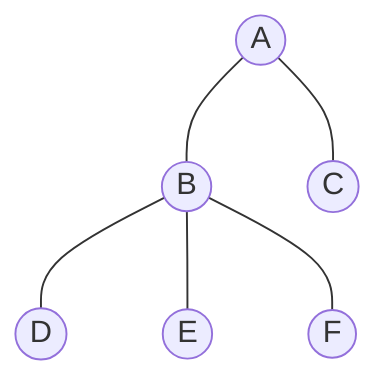

## Introducción

Todo el software ejecutable se organiza en **procesos secuenciales** o simplemente procesos. Un proceso es una abstracción de un programa en ejecución, mientras que un **programa** está almacenado en disco y no hace nada. Si un programa estuviera corriendo dos o más veces, podríamos optimizarlo teniendo el código una única vez en memoria y que los procesos accedan a él.

Conceptualmente, un proceso tiene su propio CPU, es decir que ejecuta como si fuera suyo y no hubiera otros procesos usando el mismo. Posee sus propios registros y variables. Lo mismo pasa con la memoria: no piensa si otro proceso está guardando justo en una posición de memoria otra cosa. El scheduler es el que se encarga de ir dándole el CPU a cada proceso. Aunque tengamos un único CPU, es tan rápido que provee un **pseudo paralelismo** (no es paralelismo estrictamente hablando, porque deberíamos tener múltiples CPUs compartiendo memoria física). Se podría decir que nos da la sensación de que hay varios procesos ejecutándose.

A la hora de programar, facilita pensar en una colección de procesos corriendo pseudo paralelamente en lugar de pensar en los switches. Si ejecutamos un hello_world, no nos importa si corre ahora o 5 minutos después de que el scheduler le asigne prioridad al archivo `.out`. Cambia tan frecuente y aleatoriamente de tarea que no tiene sentido pensarlo así, sino que parece que sucede a la vez. Los switches nunca son iguales: en una ejecución puede ejecutar cierta cantidad de operaciones y en la siguiente otra. Por eso decimos que no es uniforme ni reproducible.

---
## Modelo de Procesos

Hay 3 maneras de interpretar la idea de "múltiples procesos corriendo en un sistema". La primera es que hay un único instruction pointer que va ejecutando un poco de cada proceso (a). Esto se denomina **multiprogramación de cuatro programas**. Otra manera, más conceptual, es que hay varios instruction pointers que van avanzando (b). Como cada proceso se ejecuta creyéndose dueño del CPU, tiene sentido pensarlo conceptualmente de esta manera. Es un modelo conceptual de cuatro procesos independientes y secuenciales. La última manera es un gráfico más similar a la idea del primero, porque para cada fracción de tiempo se ejecuta un único proceso (c).
![[Pasted image 20261123201215.png|center|630]]

---
## Creación de Procesos

La creación de procesos es un servicio del kernel, pero hay sistemas donde puede no ser necesaria, como es el caso de un microondas. En sistemas de propósito general sí la van a requerir, como el caso de nuestra computadora. Los procesos no siempre se crean por la interacción con el usuario. Hay distintos casos donde se los requiere:
- Al prender la máquina hay un montón de procesos creados y ninguno fue creado por nosotros.
- Un proceso solicita la creación de otro proceso: formular el problema en términos de problemas relacionados. Por ejemplo, un script de bash y comandos UNIX.
- Un usuario solicita crear un nuevo proceso a través, por ejemplo, de la terminal o una interfaz gráfica (GUI). Es otro caso de proceso creando otro proceso, pero vale la pena hacer la distinción del origen y de quién lo genera.
- Inicio de un trabajo por lotes: se toma un trabajo, se realiza un proceso y se pasa al siguiente. Aplicable a mainframes: cuando hay recursos disponibles, se toma el siguiente trabajo.

En UNIX, podemos crear procesos utilizando el `fork` que ya vimos y un `execve` para el hijo. Que la creación esté en estas dos etapas facilita mucho la comunicación, dado que le permite al hijo manipular los file descriptors antes del `exec`. Entonces, luego de hacer `fork` se puede hacer, por ejemplo, que en lugar de escribir en salida estándar se haga en un archivo, modificando los file descriptors antes de llamar al `execve`:
```c
if(fork() == 0 ){

// hacer que el fd 1 deje de ser tty y
// pasa a ser output.txt


  execve(/bin/ls)
}else{

}
```

En Win32 (estándar de Windows) se crea un proceso mediante la función `CreateProcess()`, que recibe 10 parámetros:
- El programa a ejecutar
- Parámetros
- Argumentos
- Atributos de seguridad y control
- Prioridad
- Ventana a asociar con el proceso

Además, Windows provee más de 100 syscalls extras para administrar y sincronizar procesos. En ambos casos (UNIX y Win32), los procesos creados tienen su propio espacio de direcciones, diferente al del padre.

---
## Terminación de Procesos

Un proceso puede terminarse en varios casos. Generalmente, la terminación se hace con una syscall (`exit`), pero varía el contexto en el que se utiliza:
- **Salida normal (voluntaria)**: cuando nosotros invocamos `RET`, en realidad siempre se termina volviendo a la función `_start()` donde se encuentra el `exit`, a pesar de que nosotros no lo hagamos. Se termina con `exit(0)` o `return 0`.
- **Salida por error (voluntaria)**: cuando un proceso no termina con cero, es porque se considera que hubo algún error. Se termina con `exit(!= 0)` o `return != 0`.
- **Error fatal (involuntario)**: algunos casos son instrucciones inválidas, división por 0, memoria inexistente, etc. Se le envía una señal al proceso, que tiene un handler. Es decir, si llega tal señal, se ejecuta el código correspondiente. Hay algunas señales en las cuales no podemos modificar el handler.
- **Muerto por otro proceso (involuntario)**: otro proceso puede enviar una señal kill y terminar el proceso. Debe tener los permisos para poder hacer kill en el proceso.

Es importante que siempre se termine un proceso con `exit` porque, caso contrario, el `RET` sigue ejecutando código.

---
## Jerarquía de Procesos

La jerarquía de procesos es básicamente un grafo dirigido bajo la relación padre_de, como se ve en la figura. El proceso A creó dos procesos hijos, B y C. A su vez, el proceso B creó tres procesos hijos, D, E y F.


El proceso init adopta **procesos huérfanos**, que son los que, por ejemplo, tenían un padre al que le llegó una señal de kill. En el caso de la figura, si se "mata" a B, D, E y F pasan a ser hijos de A (supongamos que es el init). Es importante que esto suceda porque `waitpid()` tiene como parámetro `&status`, donde va a guardar el parámetro de `exit` de dicho proceso. Si el padre muere, nadie les podría hacer `wait` a los hijos y no se podría borrar la información que mencionamos antes, y por eso se encarga init de adoptarlos. Hay procesos denominados **zombies**, que están muertos porque el proceso ya terminó, pero el padre todavía no les hizo `wait`.

Un padre y sus descendientes forman un **grupo de procesos** que pueden recibir una señal, y será la misma para cada uno de sus integrantes. La atención de la señal es independiente en cada uno.

En el caso de Windows, no existe una jerarquía de procesos. El padre recibe un handle para manejar el proceso, y el mismo se puede transferir, a su vez, a otro proceso.

---
## Estado de Procesos

Un proceso pasa por distintos estados durante su ejecución:
- **Running**: se encuentra usando el CPU en ese instante.
- **Ready**: está ejecutable, pero detenido temporalmente para dejar que se ejecute otro proceso. Está a la espera de que lo tome el scheduler nuevamente.
- **Blocked**: no se puede ejecutar hasta que ocurra algún evento externo. Por ejemplo, se bloquea mediante `wait`, pues está a la espera de que finalice el proceso correspondiente.

Las transiciones entre estos estados son las siguientes:
```tikz
\begin{document}
\begin{tikzpicture}[>=stealth, thick]
  % Estados
  \draw (0,0) ellipse (1.1 and 0.45);
  \node at (0,0) {Running};
  \draw (-2.3,-1.8) ellipse (1.1 and 0.45);
  \node at (-2.3,-1.8) {Blocked};
  \draw (2.3,-1.8) ellipse (1.1 and 0.45);
  \node at (2.3,-1.8) {Ready};
  % Transiciones
  \draw[->] (-0.75,-0.33) to[out=210, in=80] (-2.5,-1.34);
  \draw[->] (0.75,-0.33) to[out=-30, in=100] (2.5,-1.34);
  \draw[->] (1.55,-1.47) to[out=150, in=-80] (0.3,-0.44);
  \draw[->] (-1.65,-2.17) to[out=-15, in=195] (1.3,-1.98);
  % Etiquetas
  \node at (-1.75,-0.55) {1};
  \node at (1.75,-0.55) {2};
  \node at (0.15,-0.85) {3};
  \node at (-0.1,-1.85) {4};
\end{tikzpicture}
\end{document}
```
1. Process blocks for input
2. Scheduler picks another process
3. Scheduler picks this process
4. Input becomes available

No existe un paso de ready a blocked porque en ese momento no se está ejecutando, entonces no tiene manera de hacer algo que lo bloquee. No hay uno de blocked a running porque primero se tiene que cambiar el estado para ser "levantado" por el scheduler.

---
## Implementación de Procesos

Para esto, vamos a necesitar una estructura de datos. Se utiliza una **tabla de procesos** donde cada entrada se denomina **Process Control Block (PCB)**. Esta tabla tiene información para determinar el estado de los procesos que vimos antes. Otra información que se puede guardar en la tabla es la siguiente:

| **Process management**    | **Memory management**            | **File management** |
| ------------------------- | -------------------------------- | ------------------- |
| Registers                 | Pointer to text segment info     | Root directory      |
| Program counter           | Pointer to data segment info     | Working directory   |
| Program status word       | Pointer to stack segment info    | File descriptors    |
| Stack pointer             |                                  | User ID             |
| Process state             |                                  | Group ID            |
| Priority                  |                                  |                     |
| Scheduling parameters     |                                  |                     |
| Process ID                |                                  |                     |
| Parent process            |                                  |                     |
| Process group             |                                  |                     |
| Signals                   |                                  |                     |
| Time when process started |                                  |                     |
| CPU time used             |                                  |                     |
| Children's CPU time       |                                  |                     |
| Time of next alarm        |                                  |                     |

Los registros se guardan en la tabla para poder tenerlos cuando el proceso no está corriendo en el núcleo. Cuando el scheduler le vuelve a dar el procesador, recupera los valores que tenía. El program counter y el program status word son otros registros que la tabla guarda por la misma razón. El estado del proceso ya lo vimos: es más una variable, pero NO un registro. Lo mismo con la prioridad y los parámetros de scheduling, que van muy de la mano. El process ID también se guarda como una variable, porque no modifica al proceso. Se guardan también el proceso padre y el grupo de procesos si corresponde, las señales y una serie de estadísticas.

En cuanto al manejo de memoria, se guardan tres punteros que el proceso necesita: uno al text segment, otro al data segment y otro al stack segment. Luego, para el manejo de archivos se guarda el directorio de trabajo, porque recordemos que según el directorio vamos a tener distintas salidas para `ls`. También se guardan los file descriptors. El User ID y el Group ID están relacionados con los permisos de los archivos.

Para ver lo que sucede cuando se genera una interrupción, podemos tomar la siguiente serie de "pasos" o eventos:
1. Hardware stacks program counter, etc.
2. Hardware loads new program counter from interrupt vector.
3. Assembly-language procedure saves registers.
4. Assembly-language procedure sets up new stack. Este "segundo stack" es privado para el kernel. Como no usamos el del proceso, no se nos puede filtrar información sensible.
5. C interrupt service runs (typically reads and buffers input).
6. Scheduler decides which process is to run next.
7. C procedure returns to the assembly code.
8. Assembly-language procedure starts up new current process.

Esto ocurre infinitas veces y en muy poco tiempo, por lo que todo este mecanismo debe ser muy eficiente.

---
## Modelando Multiprogramación

Se denomina **multiprogramación** a una técnica por la que dos o más procesos pueden alojarse en la memoria principal y ser ejecutados concurrentemente por el procesador o CPU. Con la multiprogramación, la ejecución de los procesos (o hilos) se va solapando en el tiempo a tal velocidad que causa la impresión de realizarse en paralelo (simultáneamente). Se trata de un paralelismo simulado, dado que la CPU solo puede trabajar con un proceso cada vez (el proceso activo).

Tener el CPU al $100\%$ significa que en cualquier instante de tiempo, si hacemos un snapshot, hay un proceso corriendo. No hay momento en el que "no corra nada", como en el siguiente caso.
![[Pasted image 20261123201758.png|center|343]]

Si un proceso usa el CPU el $20\%$ del tiempo, sería lógico pensar que entonces 5 procesos de estas características mantendrían el CPU al $100\%$. Esto no es correcto, porque los procesos en general se bloquean, como por ejemplo esperando un dato, haciendo un sleep, etc. Por esto, no se bloquean "justo" cuando se pasa al siguiente proceso y nos queda algo de la siguiente forma.
![[Pasted image 20261123201839.png|center|293]]

Si los primeros 4 están bloqueados y el quinto terminó, entonces en el resto del tiempo no va a estar corriendo ninguno en el CPU. Entonces no es realista el caso planteado inicialmente.

Este análisis fue bastante simple, pero se complejiza si lo pensamos probabilísticamente. Un proceso pasa una proporción $p$ del tiempo esperando por I/O (bloqueado). Con $n$ procesos en memoria al mismo tiempo, la probabilidad de que los $n$ estén esperando (CPU libre) es $p^n$. Entonces, podemos decir que la utilización del CPU se puede expresar como:
$$\text{Utilización del CPU} = 1 - p^n$$
Lo podemos ver graficado:
```tikz
\begin{document}
\begin{tikzpicture}[xscale=0.7, yscale=0.045]
  % Ejes
  \draw[->] (0,0) -- (10.6,0);
  \draw[->] (0,0) -- (0,110);
  \node[rotate=90] at (-1.6,55) {\small CPU utilization (in percent)};
  % Marcas del eje x
  \foreach \x in {0,1,...,10} {
    \draw (\x,0) -- (\x,-2);
    \node[below] at (\x,-2) {\small \x};
  }
  % Marcas del eje y
  \foreach \y in {20,40,60,80,100} {
    \draw (0,\y) -- (-0.15,\y);
    \node[left] at (-0.15,\y) {\small \y};
  }
  % Curvas 1 - p^n
  \draw[thick, domain=0:10, samples=60] plot (\x, {100*(1-0.2^\x)});
  \draw[thick, domain=0:10, samples=60] plot (\x, {100*(1-0.5^\x)});
  \draw[thick, domain=0:10, samples=60] plot (\x, {100*(1-0.8^\x)});
  % Etiquetas de las curvas
  \node at (3.6,106) {\small 20\% I/O wait};
  \node at (4.6,90) {\small 50\% I/O wait};
  \node at (5.6,63) {\small 80\% I/O wait};
\end{tikzpicture}
\end{document}
```

Notemos que con 3 procesos y un $20\%$ de proporción de espera, tenemos un uso de casi el $100\%$ del CPU. A medida que aumentamos la proporción del tiempo que los procesos están bloqueados, el uso del CPU baja. Vemos que para el $80\%$ (3 procesos) es alrededor del $50\%$ de uso de CPU. Este modelo es mucho mejor que el anterior, pero no es perfecto.
