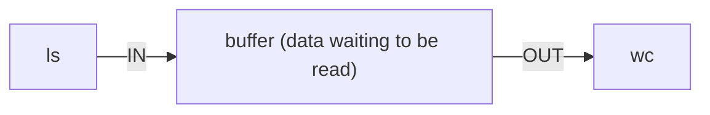
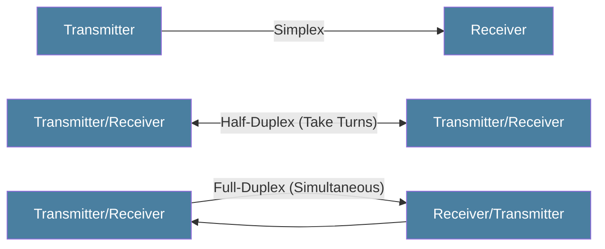

## Introducción

Vamos a ver lo que son los protocolos de comunicación entre procesos (**IPC**). La idea que tenemos de modularización a la hora de programar la podemos llevar y aplicar a los procesos. Necesitamos IPC para poder compartir información, acelerar la computación, modularidad y por conveniencia.

---
## Modelos

Existen dos modelos fundamentales para comunicar procesos: la lectura de **memoria compartida** (b) y el **pasaje de mensajes** (a). En el primer caso, tenemos una ventaja, que es que no interviene el kernel, por lo que se acelera la comunicación.
![[Pasted image 20261123201915.png|center|409]]

En el pasaje de mensajes sí hay una intervención del kernel, que provee un servicio para facilitarla. Tiene una ventaja, que es que ya está desarrollado, mientras que en el otro caso se encargan los procesos de manejar la memoria.

Para configurar la memoria compartida, sí debe intervenir el kernel. Entonces, los procesos, cuando acuerdan compartir memoria, deben "hablar" con el kernel para que se las configure. Pero a la hora de acceder a la información no se van a utilizar syscalls. La organización de la información y la sincronización son determinadas por los procesos, que tienen un puntero a dicha zona de memoria. La sincronización se refiere a que ambos procesos pueden acceder a la memoria compartida al mismo tiempo o uno luego del otro. Si A va a escribir y B a leer, hay que sincronizarlos para que B no lea hasta que A no haya escrito.

Cuando tenemos pequeñas cantidades de información, nos va a convenir el pasaje de mensajes, donde va a haber una intervención del kernel. El tamaño del mensaje puede ser fijo o variable. Las operaciones son `send(message)` y `receive(message)`, y en este caso es necesario un canal de comunicación (memoria, bus, red).

En el pasaje de mensajes también se requiere de una sincronización. Las instrucciones `send` y `receive` pueden ser bloqueantes o no bloqueantes:
- **`send` bloqueante**: hasta que llega a la casilla o proceso.
- **`send` no bloqueante**: resume inmediatamente.
- **`receive` bloqueante**: hasta que hay un mensaje disponible.
- **`receive` no bloqueante**: recibe un mensaje o null.

Por defecto, es recomendable usarlos bloqueantes.

El **buffering** se refiere al almacenamiento temporal de datos que se transfieren entre dos procesos. Esto significa que los mensajes residen en un buffer. La capacidad del mismo puede ser:
- **Capacidad 0**: no hay buffering, por lo que `send` debe bloquear.
- **Capacidad acotada**: `send` debe bloquear si se agota el espacio.
- **Capacidad no acotada**: `send` no bloquea.

Un ejemplo de memoria compartida es el siguiente:
```bash
vim main.c
gcc -Wall main.c
```

En este caso se comparte a partir del `main.c`, ya que con vim se editó y luego gcc lo compiló. Primero accedió uno y luego el otro, pero hubo una comunicación.

---
## Pipes

El **pipe** es el mecanismo de comunicación entre procesos más básico que hay. Conecta la salida de un proceso con la entrada de otro. Linux crea un buffer para cada pipe, pero el buffering es acotado. Si la información se escribe en el buffer más rápido de lo que se lee, entonces se llena. Si esto sucede, la escritura se va a bloquear (wait) hasta que se lea lo que se debe leer. Si el target process muere, como por ejemplo `wc` en el gráfico, el pipe se cierra y a `ls` se le manda SIGPIPE, que por default termina el proceso. 


Para crear un pipe, se utiliza `ls | wc -l`, donde `ls` y `wc` son los procesos que se quieren comunicar:


La comunicación a través de los pipes puede ser unidireccional o bidireccional. Si es bidireccional, debemos ver si es **half-duplex**, es decir que "toman turnos" para comunicarse, o **full-duplex**, donde ambos pueden leer y escribir a la vez:


Para realizar esta comunicación, se requiere de una relación padre-hijo, donde el hijo hereda el pipe que se creó en el proceso padre. Los procesos pueden no estar en una misma computadora (no es nuestro caso), como en el caso de los sockets, que permiten comunicar procesos de dos computadoras.

Existen dos tipos de pipes. Los **nombrados** pueden ser accedidos por cualquier proceso arbitrario (hijo, hermano o cualquiera) utilizando ese nombre. El nombre es la ruta en el file system y, por lo tanto, está sujeto a los permisos de los archivos. El **pipe anónimo** es el que se crea utilizando `|` en la terminal. Para estos últimos necesitamos la relación padre-hijo, porque si no, no se lo puede heredar. No se pueden acceder desde afuera del proceso que lo creó (esto es medio entre comillas, porque igualmente puedo ingresar encontrándolo y manipulando file descriptors).

Los file descriptors se pueden duplicar usando `dup`. Con la variante `dup2` podemos duplicar un descriptor de archivo en un descriptor de archivo específico. A diferencia de `dup`, permite especificar el número del descriptor de archivo duplicado. Primero creamos el pipe, que devuelve dos file descriptors, uno de lectura y otro de escritura. Luego, duplicamos el standard output al file descriptor de escritura del pipe con `dup2` y así logramos que todo lo que iba a salir por la pantalla vaya al pipe. Entonces todo lo que escribamos va a pasar directo al pipe. Si se hace un `fork`, todos los procesos hijos heredan el pipe.

Tomemos el siguiente caso, donde se crea un pipe y luego dos `fork` que generan dos hijos:
![[Pasted image 20261123202102.png|center|646]]

| **fd** | **shell** | **child1** | **child2** |
| :----: | :-------: | :--------: | :--------: |
|   0    | /dev/tty  |  /dev/tty  |  /dev/tty  |
|   1    | /dev/tty  |  /dev/tty  |  /dev/tty  |
|   2    | /dev/tty  |  /dev/tty  |  /dev/tty  |
|   3    |   r-end   |   r-end    |   r-end    |
|   4    |   w-end   |   w-end    |   w-end    |

Lo primero que debemos hacer es `close(3)` y `close(4)` en el proceso padre, porque vamos a hacer que el hijo1 se conecte con el hijo2 a través del pipe, por lo que no nos interesa que estén abiertos:
![[Pasted image 20261123202138.png|center|364]]

| **fd** | **shell** | **child1** | **child2** |
| :----: | :-------: | :--------: | :--------: |
|   0    | /dev/tty  |  /dev/tty  |  /dev/tty  |
|   1    | /dev/tty  |  /dev/tty  |  /dev/tty  |
|   2    | /dev/tty  |  /dev/tty  |  /dev/tty  |
|   3    |     -     |   r-end    |   r-end    |
|   4    |     -     |   w-end    |   w-end    |

Ahora, se debe hacer `close(3)` en el hijo1 y `close(4)` en el hijo2, para así eliminar la comunicación que no nos interesa, porque recordemos que solamente el hijo1 escribe en el pipe, de donde luego lee el hijo2. No nos importa que el hijo1 pueda leer del pipe:
![[Pasted image 20261123202204.png|center|390]]

| **fd** | **shell** | **child1** | **child2** |
| :----: | :-------: | :--------: | :--------: |
|   0    | /dev/tty  |  /dev/tty  |  /dev/tty  |
|   1    | /dev/tty  |  /dev/tty  |  /dev/tty  |
|   2    | /dev/tty  |  /dev/tty  |  /dev/tty  |
|   3    |     -     |     -      |   r-end    |
|   4    |     -     |   w-end    |     -      |

En este momento entra en juego el `dup` que vimos antes. Lo que queremos hacer es modificar las tablas para que, en vez de la salida o entrada estándar, cada proceso lea o escriba (según corresponda) en el pipe. Entonces, en el hijo1 hacemos `close(1)` para que no escriba en salida estándar y en el hijo2 hacemos `close(0)` para que no lea de entrada estándar:

| **fd** | **shell** | **child1** | **child2** |
| :----: | :-------: | :--------: | :--------: |
|   0    | /dev/tty  |  /dev/tty  |     -      |
|   1    | /dev/tty  |     -      |  /dev/tty  |
|   2    | /dev/tty  |  /dev/tty  |  /dev/tty  |
|   3    |     -     |     -      |   r-end    |
|   4    |     -     |   w-end    |     -      |

Notemos que debemos duplicar los fd en cada proceso hijo con los enteros correspondientes para que efectivamente el hijo1 escriba en el pipe y el hijo2 lea de allí. Entonces, en el hijo1 hacemos `dup(4)` y en el hijo2 hacemos `dup(3)`:
![[Pasted image 20261123202240.png|center|304]]

| **fd** | **shell** | **child1** | **child2** |
| :----: | :-------: | :--------: | :--------: |
|   0    | /dev/tty  |  /dev/tty  | **r-end**  |
|   1    | /dev/tty  | **w-end**  |  /dev/tty  |
|   2    | /dev/tty  |  /dev/tty  |  /dev/tty  |
|   3    |     -     |     -      |   r-end    |
|   4    |     -     |   w-end    |     -      |

Por último, ya podemos cerrar los fd que no se utilizarán. Por lo tanto, hacemos `close(4)` en el hijo1 y `close(3)` en el hijo2:

![[Pasted image 20261123202318.png|center|313]]

| **fd** | **shell** | **child1** | **child2** |
| :----: | :-------: | :--------: | :--------: |
|   0    | /dev/tty  |  /dev/tty  |   r-end    |
|   1    | /dev/tty  |   w-end    |  /dev/tty  |
|   2    | /dev/tty  |  /dev/tty  |  /dev/tty  |

Una alternativa a utilizar pipes es utilizar archivos temporales, como en el siguiente caso:
```bash
ls > files.txt
grep "*.c" files.txt > sources.txt
sort sources.txt
rm files.txt sources.txt
```

```bash
ls | grep "*.c" | sort
```

Ambos generan la misma salida y no dejan archivos temporales creados. Igualmente, el pipe presenta una serie de ventajas. Primero, se eliminan automáticamente (anónimos), a diferencia de los archivos, que se deben eliminar mediante `rm`. En `files.txt` vamos a poder guardar tanta información como espacio tengamos en disco, mientras que en un pipe `ls` no va a dar error si el pipe está lleno, sino que espera, por lo que la información que se puede transferir es "infinita". Por otro lado, en el caso de los archivos, hasta que `ls` no termine no se puede seguir con el próximo proceso, mientras que el pipe permite una ejecución paralela. Con esto, la sincronización queda implícita y no hay que preocuparse por ella, mientras que en los archivos sí.

---
## Memoria Compartida

Consiste en que procesos arbitrarios compartan memoria. Sabemos que un proceso no puede acceder a la memoria de otro: se lo impide la MMU manejada por el SO. Si queremos permitir que dos procesos utilicen memoria en común, vamos a tener que hablar con el SO. Una característica importante es que no provee sincronización, sino que queda determinada por los procesos y, por lo tanto, por los programadores que escriben los procesos.

En el siguiente gráfico, lo que está en el medio es la memoria física, mientras que los dos bloques que están a los costados representan la memoria virtual de cada proceso. Vemos que las distintas direcciones virtuales de cada proceso están mapeadas a la misma zona de memoria física compartida. Una vez que ya está la memoria mapeada, no se va a necesitar una syscall para acceder a dicha memoria (R/W).
![[Pasted image 20261123202355.png|center|327]]

Hay tres formas de reservar 1024 bytes de memoria, como vemos a continuación:
```c
// ...
char buf[1024];
char *buf = (char *) malloc(1024);
char *buf = createSHM(..., 1024, ...);

sprintf(p, "Hola mundo\n");
// ...
```

La tercera es la que crea el segmento de memoria compartida (hay un error, `p` = `buf`). El resultado final de los 3 es exactamente el mismo, pero los primeros dos solo pueden ser utilizados por el proceso. En UNIX, las syscalls son `shm_open(3)`, `ftruncate(2)` y `mmap(2)`. Esta última devuelve un puntero al comienzo de los 1024 bytes. Los números entre paréntesis son para el manual (2 = syscalls, etc.).

Ahora, debemos ver cómo se estructura la información dentro de la shared memory. Supongamos que queremos almacenar una lista simplemente encadenada. Tenemos un problema: desde el proceso 1 (suponiendo que su memoria compartida arranca en la dirección virtual `0x1000`) se va a guardar un puntero al primer elemento, supongamos también que en `0x1000`. Bajo esta lógica, el campo `next` debería tener guardada la dirección `0x1001`, pero si el proceso 2 comienza en la `0x2000`, se va a encontrar con la dirección `0x1001` a la hora de desreferenciar el `next` del primer elemento, y en su mapa virtual iría a otro lado (fuera de la shared memory para este proceso). Por lo tanto, en la shared memory **NO** vamos a poder guardar punteros. Estos solo van a ser importantes para el proceso que los genera.

Como no podemos utilizar punteros en la shared memory, vamos a usar offsets, dado que el bloque de memoria tiene el mismo tamaño para ambos procesos.
![[Pasted image 20261123202428.png|center|518]]

Los **sockets** son también un mecanismo de comunicación entre procesos, que permite comunicar procesos a través de la red. No lo vimos en detalle.

---
## Señales

Desde un proceso se pueden enviar distintos tipos de **señales** a otro proceso, y hay comportamientos por defecto a la hora de recibir cada una de ellas. Cuando se hace un kill, por ejemplo, lo que pasa es que se envía una señal. Algunas señales pueden ser ignoradas y otras no (como es el caso de kill). Se suelen utilizar señales:
- Cuando termina un hijo
- Cuando un pipe está cerrado
- Cuando expira un timer
- Ante una instrucción ilegal
- Ante un segmentation fault

Notemos que algunas de estas señales son enviadas por hardware a través del kernel. Es el SO el que se encarga de enviar las señales a los procesos, y hay algunas que no se pueden ignorar ni se les puede modificar el comportamiento (SIGSTOP y SIGKILL). Distinto es el caso, por ejemplo, de que termine un hijo, que se ignora por defecto. En estos casos se puede hacer un override y modificar el comportamiento.

La programación en un entorno donde llegan señales puede ser complicada porque la ocurrencia es asincrónica, es decir que no sabemos en qué momento nos va a llegar. Funcionan análogamente a las interrupciones. Se usan para notificar eventos anormales que ocurren de manera asincrónica. Se generan principalmente por 3 motivos:
- Intencionalmente por el usuario.
- Por eventos de la terminal.
- Por errores en el programa.

Algunas de las más importantes son:
- **SIGHUP**: se utiliza para notificar cambios en la configuración.
- **SIGINT**: `CTRL + C`, finaliza todo el foreground group.
- **SIGQUIT**: parecido al anterior, fuerza a que terminen, pero además a que hagan un volcado de memoria.
- **SIGABRT**: se genera cuando el proceso termina anormalmente.
- **SIGFPE**: errores de tipo numérico (división por cero, por ejemplo).
- **SIGKILL**: ya la conocemos, mata el proceso. Es un último recurso.
- **SIGBUS**: se recibe si la dirección desreferenciada no está correctamente alineada. Se usaba más antes.
- **SIGSEGV**: se hace una referencia a memoria no válida, o fallo de segmentación.
- **SIGPIPE**: se escribe en un pipe que no tiene lector.
- **SIGALRM**: se genera cuando expira un timer.
- **SIGTERM**: es la que usamos para matar un proceso, menos "grave" que la anterior SIGKILL.
- **SIGCHLD**: aparece cuando algún proceso hijo termina. El kernel la manda en nombre del proceso hijo.

Cuando se recibe una señal, el proceso puede:
- Ignorarla
- Atenderla
- Ejecutar una acción por defecto

Para esto, se tiene la siguiente función, que utiliza una syscall, con el prototipo:
```c
#include <signal.h>

void (*signal(int sig, void (*func)(int)))(int);
```

Para simplificarlo:
```c
typedef void (*sighandler_t)(int);

sighandler_t signal(int signum, sighandler_t handler);
```

Donde `sighandler_t` es un puntero a función que toma un único argumento y no devuelve nada. Para manejar distintos casos, podemos aprovechar los siguientes valores no válidos como punteros para enviarle por parámetro a `signal`:
```c
#define SIG_ERR (void (*)())-1
#define SIG_DFL (void (*)())0
#define SIG_IGN (void (*)())1
```

Para enviar señales, podemos por ejemplo usar `kill(pid, sig)` como ya vimos, o también un proceso puede enviarse a sí mismo una señal mediante `raise(sig)`.

Históricamente, las señales presentaban una serie de problemas, principalmente que no eran confiables, pues se podían perder. Además, ofrecen poco control sobre las acciones que se pueden tomar, y la acción se vuelve al valor por defecto.

Una syscall se puede interrumpir dependiendo de cuánto tarda en ejecutarse, por lo que se dividieron en rápidas y lentas. Las lentas son las que se pueden bloquear indefinidamente. 4.2BSD introdujo el auto restart de las syscalls interrumpidas.

Si una señal interrumpe una función y el handler ejecuta esa misma función, el valor que tenga a la hora de retornar va a ser incorrecto: se genera una especie de race condition. Si esa función usa estructuras de datos estáticas, no es **reentrante**, lo que es un problema. El estándar establece una lista de funciones que son reentrantes para que esto no suceda. Si la función usa variables globales sucede algo similar a las race conditions, tal como vimos en los casos anteriores.

Sabemos que la señal se genera cuando ocurre el evento que causa esa señal y se entrega (deliver) cuando se ejecuta la acción definida para la misma. Un proceso puede bloquear la entrega de la señal y tiene una **máscara de señales** que indica cuáles están bloqueadas. Además, mantiene un **signal set** de las señales con las que opera. Este set se manipula a través de las siguientes funciones:
```c
#include <signal.h>

int
sigaddset(sigset_t *set, int signo);

int
sigdelset(sigset_t *set, int signo);

int
sigemptyset(sigset_t *set);

int
sigfillset(sigset_t *set);

int
sigismember(const sigset_t *set, int signo);
```

---
## Race Condition

Supongamos que tenemos un homebanking y se quiere debitar toda la plata al mismo tiempo. La situación ideal sería la siguiente.
![[Pasted image 20261123202528.png|center]]

Sin embargo, podemos plantear la siguiente situación patológica.
![[Pasted image 20261123202542.png|center]]

Los dos procesos "corren una carrera". Podemos definir entonces **race condition** como una situación en la que dos o más procesos están leyendo o escribiendo datos compartidos y el resultado final depende de quién corre en cada momento. Esto es muy difícil de detectar a la hora de hacer debugging.

Para resolver el problema de una race condition hay que forzar de alguna manera el resultado de la carrera. Debemos impedir los órdenes de ejecución que generan problemas. Una manera de hacer esto es que los procesos sean en serie, es decir que hasta que no termine uno, no se ejecuta el segundo. Esto se denomina **exclusión mutua**.
![[Pasted image 20261123202602.png|center]]

En nuestra línea temporal, como el primero que pide acceso exclusivo es el home banking 1, se le otorga. Cuando el segundo quiere pedirlo, no se le da porque ya lo tiene el otro proceso. Una vez que el primero lo libera, ahí se le va a otorgar al segundo. El bloqueo es similar a cuando un padre hace `wait` a que los hijos terminen o cuando se hace un sleep de tantos segundos y todavía no pasó el tiempo.

La **región crítica** es la parte del programa que accede a memoria compartida. En el caso de la función `debitar`, se corresponde con la sección que accede al saldo. Una vez que definimos la región crítica, realizar el bloqueo es bastante más sencillo:
```c
//...
int saldo_en_cuenta;

void debitar(int *saldo, int debito){
    if (*saldo >= debito)      // Región crítica
        *saldo -= debito;      // Región crítica
}
//...
```

En el siguiente diagrama podemos ver el proceso de dos home banking intentando debitar de una misma cuenta. Cuando el proceso A entra en la región crítica y B intenta hacer lo mismo, se detiene su ejecución (línea punteada) y espera a que A termine.
![[Pasted image 20261123202627.png|center|542]]

---
## Semáforos

Son un mecanismo de sincronización que permite realizar estos procesos de bloqueo que vimos anteriormente, además de otras cosas. Un **semáforo** se representa con un número entero entre 0 y n, que generaliza la idea del wakeup waiting bit, y se opera con dos funciones:
- **`down` (sleep)**: atómicamente decrementa el semáforo o bloquea al caller si ya es 0.
- **`up` (wakeup)**: atómicamente incrementa el semáforo y desbloquea a algún bloqueado si existe.

Tomemos esta solución para el caso del homebanking:
```c
//...
int saldo_en_cuenta;
semaphore mutex = 1;

void debitar(int *saldo, int debito){
    down(mutex);
    if (*saldo >= debito)
        *saldo -= debito;
    up(mutex);
}
//...
```

Cuando el primer proceso que llega ejecuta `down`, va a encontrar un 1, por lo que lo va a cambiar a cero y se le da el acceso exclusivo. Si otro proceso intenta hacer el `down()` antes de que el primer proceso llegue al `up()`, no se le va a dar el acceso porque está bloqueado: hay un 0. Si el semáforo estuviera inicializado en 2 o más, sería lo mismo que no haber usado un semáforo, porque no excluimos nada.

En el siguiente caso, si bien solucionamos la race condition, en el segundo caso vamos a tardar mucho más en ejecutar el proceso, porque se bloquea todo en vez de solo lo que accede a memoria compartida:
```c
int main(){
    // code
    // code
    // code
    // code
    // code
    down(mutex);
    // code that access shared data
    // code that access shared data
    up(mutex);
    // code
    // code
    // code
    // code
}
```

```c
int main(){
    down(mutex);
    // code
    // code
    // code
    // code
    // code
    // code that access shared data
    // code that access shared data
    // code
    // code
    // code
    // code
    up(mutex);
}
```

Es fundamental definir la región crítica tan chica como sea posible para evitar este problema.

---
## Deadlock

¿Qué pasa si se genera una espera circular? Esto sucede si un proceso espera a otro que espera, a su vez, al primero. Notemos que se genera una espera continua en la que no pasa nada. Este estado se denomina **deadlock**. Un conjunto de procesos está bloqueado (en estado de deadlock) si cada proceso del conjunto está esperando un evento que solo puede causar otro proceso del conjunto. Visualmente, lo podemos pensar de la siguiente manera.
![[Pasted image 20261123202707.png|center|420]]

Este estado es irrecuperable. Veamos casos concretos donde se produce un deadlock:
```c
//...
semaphore mutex = 1;

void foo(){
    down(mutex);
    down(mutex);
}
//...
```

```c
//...
semaphore mutexA = 1;
semaphore mutexB = 1;

void P1(){
    down(mutexA);
    down(mutexB);
}
//...
```

```c
//...
semaphore mutexA = 1;
semaphore mutexB = 1;

void P2(){
    down(mutexB);
    down(mutexA);
}
//...
```
