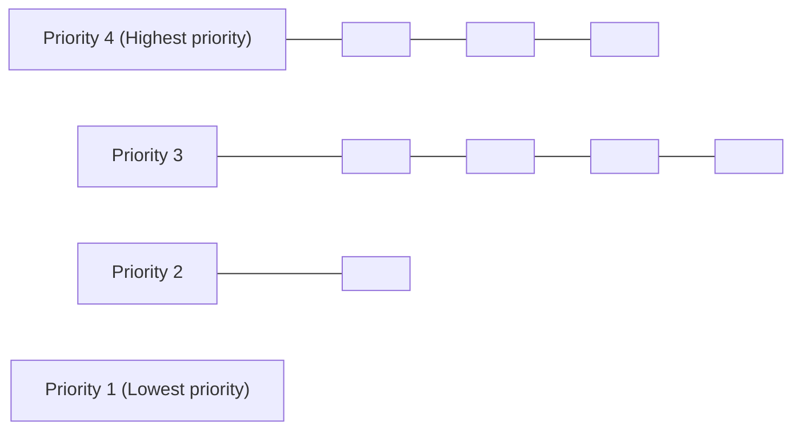

## Introducción

El problema que pretendemos resolver con el **scheduling** es qué programa, de dos en estado ready, ponemos a correr si tenemos únicamente un CPU disponible. El scheduling NO es un proceso, sino una parte del sistema operativo que toma la decisión. No existe un proceso en ejecución que se encargue de gestionar la memoria o de decidir quién es el siguiente proceso a ejecutar: es una responsabilidad del kernel. Esto no significa que no sea código en ejecución, sino que simplemente no es un proceso.

---
## El Algoritmo

Antiguamente, se podía ejecutar de a un proceso a la vez (en el TP2 será así). Con la idea de la multiprogramación, podemos tener múltiples procesos ejecutándose "por turnos", haciendo un switch que es costoso.

Usualmente los procesos alternan entre el uso de CPU e I/O, siendo este último cuando el proceso se bloquea esperando por un evento (semáforo, `wait`, etc.). Con esto, podemos clasificar los procesos en:
- **CPU-bound**: es aquel proceso que tiene ráfagas de uso de CPU largas. Sería el caso (a) de la imagen.
- **I/O-bound**: es aquel proceso cuyas ráfagas son cortas. Sería el caso (b).

![[Pasted image 20261123202752.png|center|599]]

Notemos que en la definición de ambos no se habló de la cantidad de tiempo que permanecen bloqueados. Si tuviéramos un proceso, supongamos el caso (c), donde las ráfagas de uso son muy largas, pero con tiempos grandes de bloqueo, sería igualmente CPU-bound.

La comparación solo tiene sentido cuando se comparan procesos, porque que una ráfaga de uso sea larga depende completamente del proceso con el que se esté comparando. Con procesadores más rápidos, los procesos se vuelven más I/O-bound. Esto sucede porque se acortan los tiempos de ráfaga y se mantienen iguales los tiempos de espera.

Si un proceso es más I/O-bound, es menos probable que el timer lo interrumpa y, en su lugar, se bloquee solo. Notemos que es más eficiente dejar ejecutar un proceso que sabemos que es I/O-bound, porque no le va a "faltar mucho" para terminar.

---
## Cuándo

Cuando hacemos un `fork`, cabe preguntarse quién es el que sigue corriendo, si el padre o el hijo. Hay que tomar una decisión sobre quién ejecuta, al igual que cuando se ejecuta un `exit`. En este último caso, si se hace un `exit` y no quedan más procesos, se ejecuta un proceso que ejecuta la función `halt` y pone el procesador en modo de bajo consumo.

Otra decisión que se debe tomar es, cuando termina un proceso o se realiza el switch, cuál de todos los listos se continúa ejecutando. Cuando un proceso se bloquea, es importante tener en cuenta por qué lo hizo. Si tenemos un proceso P1 que se bloquea porque no tiene un semáforo, se le da una alta prioridad a P2, que libera dicho semáforo.

Dependiendo de qué se haga con las interrupciones del timer, se tienen los siguientes tipos de algoritmos:
- **Preemptive**: elige un proceso y corre hasta que se vence un plazo establecido (la interrupción del timer), incluso si está en estado ready.
- **Non-Preemptive**: elige un proceso y corre hasta que se bloquea o hasta que libera el CPU voluntariamente. Esto lo hace con una syscall que libera el CPU, pero sin bloquearlo, llamada `yield`.

---
## Categorías

Las decisiones de scheduling para diferentes tipos de sistemas operativos pueden variar significativamente:
- **Batch**: no hay interacción con el usuario, por lo que puede ser non-preemptive o preemptive con un **quantum** (cuota de tiempo que se le da a un proceso) largo. Esto se hace porque los context switch no son baratos y se perdería mucho tiempo, y no necesitamos que sea "responsive".
- **Interactivo**: el usuario interactúa con el sistema. Es preemptive porque es de uso general, es decir que incluye programas arbitrarios y, por lo tanto, no tenemos ninguna garantía de que colaboren entre sí. Si en este caso tenemos un quantum muy largo, como de un segundo, puede pasar que toquemos una tecla y pase todo ese tiempo hasta que se interrumpa el proceso que se está ejecutando, lo que es una eternidad.
- **Real time**: se ejecutan tareas que tienen plazos que se tienen que cumplir. Por ejemplo, una tarea se tiene que ejecutar antes de los próximos 5 ms. Sorpresivamente, a veces no es necesario un scheduler preemptive.

---
## Objetivos

Cuando se administra un recurso, una de las primeras cosas en las que se piensa es en la **fairness**, es decir que se quiere ser lo más equitativo posible a la hora de asignar recursos. Otro aspecto importante es la **policy enforcement**, que consiste en vigilar que las políticas preestablecidas se respeten.

El **balance** es también muy importante, porque el SO administra múltiples dispositivos y busca ser eficiente, por lo que los mantiene a todos ocupados. Supongamos que tenemos un proceso CPU-bound y otro I/O-bound y ambos quieren ponerse a correr. Nosotros, como scheduler, deberíamos poner primero al I/O-bound, pues como tiene ráfagas de uso cortas es más probable que se bloquee solo, y mientras espera a que suceda un acontecimiento (como encontrar un dato en el disco), se le puede asignar el CPU al otro proceso, haciendo que trabajen el disco y el CPU al mismo tiempo y logrando el balance. Todos estos objetivos de un scheduling aplican cuando hablamos de **todos los tipos de sistemas**.

En los **batch systems** tenemos métricas como el **throughput**, que es la cantidad de tareas que terminan por hora, y el **turnaround time**, que consiste en el promedio del tiempo entre la sumisión y la terminación de una serie de tareas. La tercera métrica es la **utilización del CPU**, que está muy relacionada con el balance, ya que se busca mantenerlo siempre ocupado. Vale preguntarnos si maximizar el throughput minimiza el turnaround time. Maximizar el throughput se refiere a resolver la mayor cantidad de tareas en una unidad de tiempo. Si algunas son muy cortas y otras no, deberíamos priorizar las que tardan poco para maximizar el throughput. Haciendo esto, el turnaround time no necesariamente disminuye, porque las operaciones más largas van a estar esperando más tiempo y, por el contrario, aumenta el turnaround time (habría que ver los números para ver si realmente es así).

En los **interactive systems** se toma como métrica el **tiempo de respuesta**, que consiste en el tiempo que se tarda en responder los pedidos. También se tiene en cuenta la **proporcionalidad**, que consiste en cumplir con las expectativas de los usuarios.

En los **real-time systems** se busca principalmente evitar perder información y la **predictibilidad**, que consiste en evitar la degradación en la calidad de contenido multimedia.

---
## Algoritmos

El **First-Come First-Served** es un algoritmo de scheduling de los batch systems muy similar a una cola tradicional. Es non-preemptive, y los procesos bloqueados van al final. Es simple y fácil de programar. Tomemos el siguiente caso: tenemos un proceso CPU-bound que corre por 1 s y se bloquea en disco y varios procesos I/O-bound que realizan 1000 accesos a disco cada uno.

En este sistema, si tenemos este algoritmo estamos obligados a atender casi siempre al CPU-bound, porque los otros van a estar casi siempre bloqueados. Entonces nos perdemos la posibilidad de atender a los I/O-bound, que no van a consumir tanto. La alternativa es usar preemption para atender rápido los I/O-bound y luego volver al CPU-bound.

El algoritmo **Shortest Job First**, dentro de los batch systems, siempre pone a correr primero el proceso más corto. Como es un sistema por lotes y las tareas no son interactivas pero sí repetitivas, se puede obtener información registrada de cuánto demoran. Se puede hacer un cálculo del turnaround time usando el algoritmo:
![[Pasted image 20261123203028.png|center|483]]
$$\begin{gathered}
(a):\ \frac{A + (A+B) + (A+B+C) + (A+B+C+D)}{4} = \frac{4A + 3B + 2C + D}{4} = 14\text{ s} \\[2ex]
(b):\ \frac{B + (B+C) + (B+C+D) + (B+C+D+A)}{4} = \frac{4B + 3C + 2D + A}{4} = 11\text{ s}
\end{gathered}$$

Son un promedio del tiempo de retorno de cada proceso, por lo que se divide por 4. Vemos que en el caso (b) obtenemos un turnaround menor, por lo que el algoritmo lo va a elegir. Es óptimo si todos los procesos están disponibles simultáneamente.

Hay una versión preemptive de este algoritmo llamada **Shortest Remaining Time Next**, que consiste en elegir el proceso al que menos tiempo de ejecución le queda. Al llegar un nuevo trabajo, se compara su tiempo restante (total) con el restante del trabajo actual. En este caso nos podemos dar el lujo, tomando el caso anterior, de que si comenzamos a ejecutar el A y llega el B (no se cumple el caso óptimo planteado antes), se pueda pasar a ejecutar ese. Este algoritmo además beneficia al throughput, porque lo que menos tarda se saca de encima más rápido.

En los interactive systems existe un algoritmo preemptive llamado **Round-Robin**. Se tiene una cola circular de procesos y se va atendiendo de a uno. Si un proceso termina o se le vence el quantum, se pasa al siguiente. Si al finalizar el quantum sigue ready, se le quita el CPU de todos modos. Es un algoritmo fácil de implementar, y no es mala idea hacer este algoritmo para ir probando. Con él funcionaría todo el TP2 menos los tests de prioridad. El tamaño del quantum es importante por la sensación de fluidez, que se pierde si es muy grande, aunque se gana aprovechamiento del CPU. Si es más chico se hace más responsive, pero se desperdicia demasiado CPU (y pasa a dejar de ser fluido).

Si el context switch es de 1 ms y los quantum son de 4 ms, el costo es del $20\%$ de desperdicio. En cambio, si el quantum es de 100 ms, el costo es del $1\%$ de desperdicio y un aprovechamiento del $99\%$. Con esto podemos concluir que un quantum razonable es de entre 20 y 50 ms. Supongamos que tenemos el dato de la ráfaga media de CPU, es decir, cuánto tiempo usa un proceso el CPU sin importar si se interrumpe. Si el quantum es mayor, el proceso se va a bloquear solo porque le va a "sobrar" tiempo, y vamos a estar ahorrando context switches. Si el quantum es menor, lo vamos a estar interrumpiendo constantemente antes de que pueda terminar.

Round-Robin asume que todos los procesos son igualmente importantes. El algoritmo **Priority Scheduling** asigna prioridades a los procesos, y aquellos que tienen la mayor son elegidos primero. Es preemptive. La prioridad debe ser ajustada periódicamente para evitar la **inanición** (el proceso se muere de hambre). Esto se puede hacer estáticamente o dinámicamente, dependiendo del usuario o dependiendo del comportamiento del proceso. Para un proceso I/O-bound puede ser $1/f$, donde $f$ es la proporción del último quantum usado. Por ejemplo, si un proceso usa el $50\%$ del quantum, tendrá una prioridad de $1/0{,}5 = 2$. Si usó un $25\%$, tiene una prioridad de $1/0{,}25 = 4$. Notemos que cuanto menos quantum use, más prioridad tiene. Esto es así para sacarse de encima los procesos cortos rápidamente y mantener el balance.

Es conveniente agrupar los procesos por clases usando:
- Priority scheduling entre clases
- Round-Robin dentro de cada clase

Con cierta frecuencia se le asigna un quantum grande a los procesos CPU-bound. Cuando un proceso usa todo su quantum, vimos que se le baja la prioridad. Pasa a vivir en la cola de abajo en la figura:


Los de prioridad 3 no van a correr mientras haya procesos de prioridad 4, pero notemos que estos van a ser todos I/O-bound, ya que ocupan muy poco del quantum.

Por ejemplo, tomemos un proceso CPU-bound que necesita 100 quantums (q) para terminar. Inicialmente se le asigna 1q, luego 2q, 4q, …, 64q (usa 37 de los 64). En lugar de tener los 100 context switches que tendría con Round-Robin, hace solo 7.

>[!INFO] Recomendación TP2
>Hacerlo más simple que esto, no se pide. Solamente se pide gestión de prioridades. Lo más sencillo es volver al Round-Robin y agregar los procesos varias veces, porque se multiplican sus chances de ser elegidos:
>```mermaid
>flowchart LR
>    CP["Current process"] -.-> F1[F]
>    F1 --- D[D] --- G1[G] --- A[A] --- B[B] --- G2[G] --- F2[F]
>
>    classDef verde fill:#7fbf7f
>    classDef amarillo fill:#ffff80
>    class F1,F2 verde
>    class G1,G2 amarillo
>```

Hay una versión de Shortest Job First para sistemas interactivos que se conoce como **Shortest Process Next**. Dijimos que es difícil saber cuándo un proceso va a ser corto. Podemos estimarlo en base a su comportamiento previo. La estimación es $T_0$ y su próxima ejecución es $T_1$. Se puede actualizar la estimación con la siguiente fórmula, donde $a$ va entre 0 y 1:
$$aT_0 + (1-a)T_1$$

La elección de $a$ puede olvidar ejecuciones previas rápidamente ($a$ pequeño) o recordarlas en el tiempo ($a$ grande). Si $a$ es $1/2$, las estimaciones sucesivas son:
$$T_0, \quad T_0/2 + T_1/2, \quad T_0/4 + T_1/4 + T_2/2, \quad T_0/8 + T_1/8 + T_2/4 + T_3/2$$
Esta técnica se conoce como **envejecimiento (aging)**.

Tomemos el ejercicio 3. La técnica de envejecimiento (aging) con $a = 1/2$ es usada para estimar los tiempos de ejecución de un proceso. Las últimas 4 ejecuciones registraron los siguientes tiempos (de más antiguo a más reciente): 40, 20, 40 y 15 ms. ¿Cuál es la estimación para la siguiente ejecución? Entonces:
1. $T_0 = 40$
2. $T_0/2 + T_1/2 = 20 + 10 = 30$
3. $T_0/4 + T_1/4 + T_2/2 = 35$
4. Etc.

Notemos que si $a$ es grande, los denominadores son más pequeños y los tiempos viejos tienen un mayor peso.

El algoritmo **Guaranteed Scheduling** (sistemas interactivos) trata de dar a cada usuario del sistema una n-ésima parte ($1/n$) del tiempo del CPU. Si se tiene 1 usuario con $n$ procesos, cada proceso recibirá la n-ésima parte del tiempo del CPU. La idea es elegir aquel proceso que haya utilizado la menor proporción de CPU, registrando el tiempo de uso de cada usuario o proceso en términos de la proporción usada. Va de la mano con la idea de darle mayor prioridad a los I/O-bound.

En los sistemas interactivos también tenemos el **Lottery Scheduling**, donde se sortea el acceso al CPU. Cada proceso tiene tickets de "lotería" para diferentes recursos. Si un proceso tiene más tickets, tiene más chances de ganar. Poseer una fracción $f$ de los tickets implica obtener una fracción $f$ del recurso, que no necesariamente es el CPU. Los procesos que cooperan entre sí pueden compartir tickets.

Por último, en los sistemas interactivos se tiene el algoritmo **Fair-Share Scheduling**, donde se tienen dos usuarios, uno ejecuta una cantidad de procesos y el otro usuario otra cantidad, y se le asigna una fracción del tiempo a cada uno. Si tenemos:
- Usuario 1, procesos A, B, C y D
- Usuario 2, proceso E

Si le asignamos el $50\%$ del CPU a cada usuario, tenemos:
A**E**B**E**C**E**D**E**A**E**B**E**C**E**D**E** ...

Si le asignamos el doble de CPU al usuario 1 que al usuario 2:
AB**E**CD**E**AB**E**CD**E** ...
