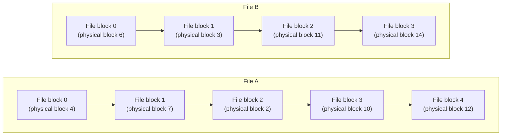
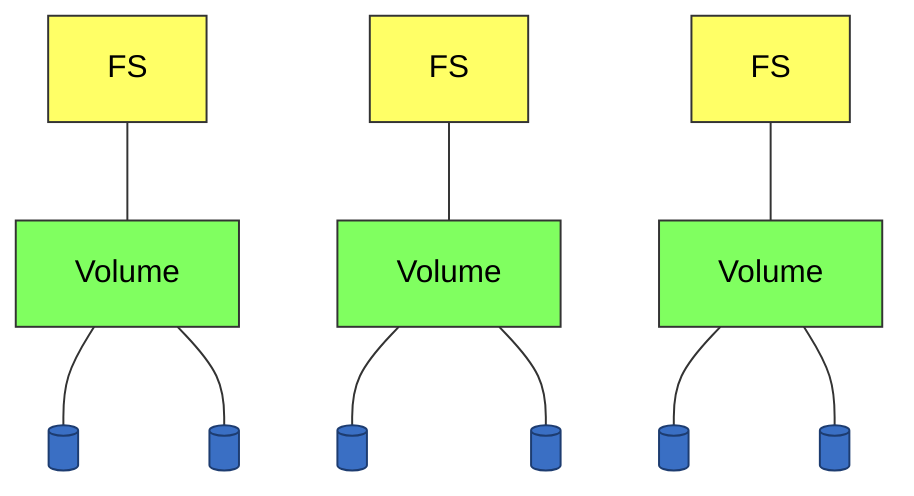
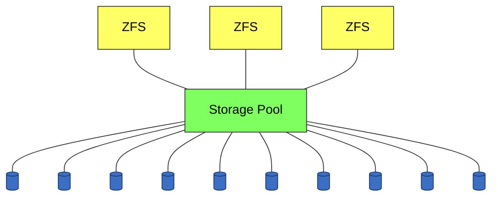

## Introducción

Los **file systems** nos permiten solucionar:
- Almacenar mucha información, que quizás no entra en el EDV.
- Persistencia luego de la muerte del proceso.
- Múltiples procesos accediendo a la misma información, como por ejemplo las librerías.

Al disco lo podemos ver como una secuencia lineal de bloques de tamaño fijo que soporta dos operaciones:
- Leer el bloque K
- Escribir el bloque K

Con este acercamiento no resolvemos todos los problemas de almacenamiento que surgen, como por ejemplo buscar información, proteger la información de un usuario para que no sea accedida por otros usuarios o saber qué bloque está libre.

Una falla en el file system puede afectar a una gran cantidad de componentes del funcionamiento de la computadora, principalmente por el alcance que tiene.

---
## Abstracciones

Ya vimos que los procesos son una abstracción del CPU, y que cada uno se ejecuta creyendo que es dueño del procesador. En este caso, los **archivos** son una abstracción del disco y cada proceso puede ejecutarse creyéndose dueño de él. Incluso los archivos se pueden ver como un espacio de direcciones.

Los archivos son administrados por el file system del sistema operativo, que se encarga de definir cómo serán:
- Estructurados
- Nombrados
- Accedidos
- Usados
- Protegidos (permisos de lectura y escritura)
- Implementados
- Administrados

---
## Asignación

Sabemos que tenemos archivos almacenados en disco. Una manera sencilla de almacenar los archivos con el file system es **asignar bloques contiguos**. Por ejemplo:
- Con bloques de 1 KB y un archivo de 50 KB, usamos 50 bloques.
- Con bloques de 2 KB y el mismo archivo, usamos 25 bloques y tenemos una pequeña fragmentación interna.

![[Pasted image 20261123210653.png|center|597]]

Este sistema tiene dos ventajas, que son la facilidad de implementarlo (solo inicio y longitud) y un excelente rendimiento de disco (secuencial y random), pues es sencillo acceder a la información calculando con los datos guardados de inicio y longitud. Las desventajas son la fragmentación externa (pues cuando se liberan los bloques pueden no quedar contiguos, como se ve en el caso b de la imagen) y que se debería conocer el tamaño a priori, pero los archivos no mantienen un tamaño constante. Sin embargo, este sistema se sigue utilizando hoy en día en sistemas donde el tamaño del archivo se conoce a priori y se requiere eficiencia para leer, como en un disco de pasta (una canción luego de la otra y tamaño de los archivos constante).

Otra forma de asignación es la utilización de **listas enlazadas**, donde se guarda un pedacito de cada bloque para apuntar al siguiente. Para encontrar un archivo, se necesita únicamente un puntero al primer bloque. En este caso, la fragmentación interna va a estar en el último bloque de la lista, lo que es similar al caso anterior. En cuanto a la fragmentación externa, logramos quitarnos este problema de encima gracias a los punteros. El acceso secuencial de esta forma es parecido al anterior, porque de un bloque paso al siguiente siguiendo el puntero (no estamos teniendo en cuenta la eficiencia). Notemos que esta es la única forma de acceder a la información, es decir que si queremos acceder al bloque 3 de la imagen, debemos pasar por todos los anteriores:


Cuando un buen programador programa, es consciente de tener datos de tamaño potencia de 2 para estar en sintonía con el hardware, el cual almacena en dicha potencia. Como el file system quita un pedazo de memoria para guardar el puntero al siguiente bloque, se rompe esta consideración del programador.

Toda esta idea que vimos está basada en el disco. Si la llevamos a memoria, tendría la siguiente forma:
![[Pasted image 20261123210730.png|center|386]]

Vemos que el concepto es el mismo: tenemos la lista enlazada, pero los punteros se almacenan en la memoria, permitiendo que no rompamos con la lógica de potencia de dos del programador. Este esquema se conoce como **File Allocation Table (FAT)**. Existe un problema, que es que toda la tabla tiene que estar en memoria. Si tenemos un disco de 1 TB y los bloques son de 1 KB, necesitaríamos $2^{30}$ entradas de 32 bits (4 bytes) cada una, lo que se iría a alrededor de 4 GB. Esta tabla es global, no es una por proceso, pues el disco es uno solo, pero es considerable el espacio que ocuparía.

Otra metodología de almacenamiento son los **i-nodes**, donde cada archivo del sistema tiene su i-node, que contiene los atributos y la lista de bloques. Los i-nodes solo tienen que estar en memoria si el archivo es abierto por algún proceso. En la imagen, vemos que tenemos lugar para guardar punteros a 8 bloques y luego un último puntero a otro bloque en disco que contiene direcciones extra, en caso de ser necesarias. Si el bloque tiene 1 KB y cada dirección es de $2^2$ bytes, con este bloque podemos almacenar $2^8$ bloques más. Vemos que ocupa significativamente menos espacio que la tabla anterior.
![[Pasted image 20261123210750.png|center|425]]

---
## Estructura

Tradicionalmente, un file system tenía la estructura de la siguiente tabla. En primer lugar se tenía el **bloque de booteo**, con toda la información para el booteo del sistema operativo. Luego el **superblock**, los **bloques de inodos** y, por último, los **bloques de datos**:

| **Boot block** | **Superblock** | **Inode blocks** | **Data blocks** |
| :------------: | :------------: | :--------------: | :-------------: |

El superblock es la estructura de datos más crítica del file system, pues es el encargado de definir su estado. Si se corrompe, muere el file system y no se puede recuperar. Contiene:
- **Umount status**: se monta el file system y se chequea mediante este flag si se montó y desmontó correctamente.
- **Corrupción presente**: el file system se da cuenta solo de que tiene un problema y se marca con este flag.
- **Estado del montaje**: indica si se encuentra montado o no, o si se lo hizo solo como lectura.
- Free inodes
- Espacio total
- Espacio libre
- Free block list

En cuanto a los bloques, siempre es mejor tener una menor cantidad de bloques de mayor tamaño que una gran cantidad de bloques pequeños. Todo esto lo podemos ver:
```bash
fer@fer-desktop:~$ sudo dumpe2fs -h /dev/sda2
Last mounted on:          /
Filesystem magic number:  0xEF53
Filesystem features:      has_journal ext_attr resize_inode dir_index filetype needs_recovery extent 64bit …
Filesystem state:         clean
Inode count:              7299072
Block count:              29173760
Reserved block count:     1458688
Free blocks:              2536753
Free inodes:              6881264
First block:              0
Block size:               4096
```

Notemos que tiene un **magic number**, que es el que permite identificar el file system actual. Sirve para recuperar elementos borrados en una partición de un programa.

Los inodos tienen el siguiente formato. El modo son principalmente los permisos para el usuario, el grupo, etc. Son varios bits que representan flags. El uid es el id del usuario dueño del archivo y el gid es lo mismo, pero para el grupo:

|  **Mode**   |
| :---------: |
|   **uid**   |
|   **gid**   |
| Link count  |
|    atime    |
|    ctime    |
|    mtime    |
|    size     |
| block count |
| data blocks |

El link count indica cuántas referencias tiene ese nodo. Luego hay tres timestamps, que son el tiempo del último acceso (atime), el del último cambio del inodo (ctime) y el de la última modificación del contenido (mtime). El primero se suele deshabilitar, porque si no, cada vez que se lee el archivo se modifica el atime y se debe modificar la metadata. Por último, se contiene el tamaño, la cantidad de bloques y los bloques. Esto no pasa cuando el file system es distinto, dado que el inodo 3 de un sistema no es el mismo que el de otro.
![[Pasted image 20261123210835.png|center|532]]
Vemos que el nombre del archivo no se guarda en el mismo, dado que no es una propiedad de él, sino del directorio, que es el encargado de mapear los nombres. Es una lista de la siguiente forma:

| **i-node** | **Nombre**   |
| ---------: | ------------ |
|  142028495 | .            |
|    1142588 | ..           |
|  142518204 | bar          |
|  142518205 | baz          |
|  142518203 | foo          |
|  142029290 | getlogins.sh |
|  142050113 | logins.csv   |

Notemos que nada impide que un mismo archivo tenga dos nombres distintos. Si movemos un archivo dentro del file system, la acción es instantánea, pues lo único que sucede es crear un link nuevo. No se crean bloques nuevos, únicamente cambian los punteros. Algo similar sucede con la eliminación, que se puede hacer aunque no tengamos permisos de escritura sobre el archivo, porque simplemente estamos modificando el directorio, no el archivo en sí.

---
## Manejo de Consistencia

Sabemos que los discos son lentos, por lo que los sistemas operativos tienen una caché de disco (o buffer caché/caché unificada) donde se realiza la escritura al invocar un `write`. Luego, el SO baja esa información al disco. Si se corta la luz en el proceso de escritura en la caché, la información se pierde y se deja el file system inconsistente, pues se pueden corromper otros archivos. Por lo tanto, luego de una caída se debe correr un FS check (`fsck`), que tarda mucho en un disco muy grande.

Tomemos el ejemplo del borrado de un archivo. Se deben seguir los siguientes pasos:
- Lock directory i-node, pues estamos entrando en una región crítica.
- Eliminar la entrada del directorio.
- Unlock directory.
- Lock file inode.
- Decrementar el link count; si link == 0, liberar recursos.
- Unlock inode.

Para mitigar el problema del FS check se pueden tomar ciertas medidas, como sincronizar la escritura de data y metadata, de forma que hasta que una no termina no se pasa a la siguiente. Otra medida es escribir sincrónicamente la metadata. También se pueden hacer **soft updates** (se ordenan las actualizaciones de metadata) y **journaling**, que consiste en tener un pedazo de disco (journal) que es como el log de transacciones de una base de datos. Se escribe todo lo que se debe transferir. Esta opción es la utilizada por Linux. Mejora mucho el tiempo de recuperación.

En la implementación clásica hay una serie de problemas. El primero es que hay una sola copia del superblock, que dijimos que es una parte crítica del file system. Si se corrompe, tenemos un problema. Otro es que la tabla de inodos está al principio, y se debe buscar allí la información para luego volver a buscar el dato. Por otro lado, no hay una política de asignación de inodos.

La primera mejora propuesta fue **BSD FFS**, que divide el disco en zonas lógicas llamadas **grupos de cilindros** para minimizar el seek, que es caro en tiempo. Trata de alocar los inodos de los archivos de un mismo directorio en el mismo grupo de cilindros. Además, aumenta el block size.
![[Pasted image 20261123210913.png|center|546]]

Cada uno de los anillos del esquema es un track de los platos de los antiguos discos magnéticos, y los tracks que están a la misma distancia del centro en todas las superficies forman un cilindro.

---
## ext4

Luego se implementó el **fourth extended file system (ext4)**, que agrega optimizaciones para adecuarlo al hardware moderno. Tiene 64 ZB de tamaño de FS, 16 TB de tamaño de archivo y una cantidad ilimitada de subdirectorios. Otra característica es que reemplaza los bloques por **extents** (grupos lógicos de bloques contiguos) y agrega nuevos modos de journaling. Propone **delayed allocation**, que retrasa la asignación de bloques hasta que los datos se bajan a disco, en lugar de asignarlos en cada escritura.

Entonces, algunos de los problemas de los file systems tradicionales son que son susceptibles a silent data corruption, requieren chequeo si se apagaron anormalmente, tienen asignación de espacio estática y requieren operaciones R-M-W.

---
## ZFS

La abstracción tradicional del file system es el **virtual disk**, que contiene una partición o volumen por cada FS. Si se necesita más espacio, se debe ampliar el volumen y luego ampliar el FS (expansión manual). Además, tiene un ancho de banda (BW) limitado y el almacenamiento está fragmentado:


Otra abstracción (**ZFS**) que surgió se basó en el manejo de memoria, que se reserva, usa y libera (`malloc`/`free`). Entonces, se tiene un **storage pool**, como se puede ver en la imagen, y todos los discos se pueden utilizar. Cada FS tiene todo el ancho de banda y puede repartir la carga. Además, el almacenamiento es compartido:


Esta abstracción presenta los siguientes beneficios:
- **Todo es COW (copy on write)**: no se sobreescriben datos y el estado en disco es siempre válido (no hace falta `fsck`).
- **Todo es transaccional**: los cambios relacionados ocurren o fallan como un todo, por lo que no hace falta journal.
- **Todo tiene checksum**: esto genera que no haya silent data corruption.
