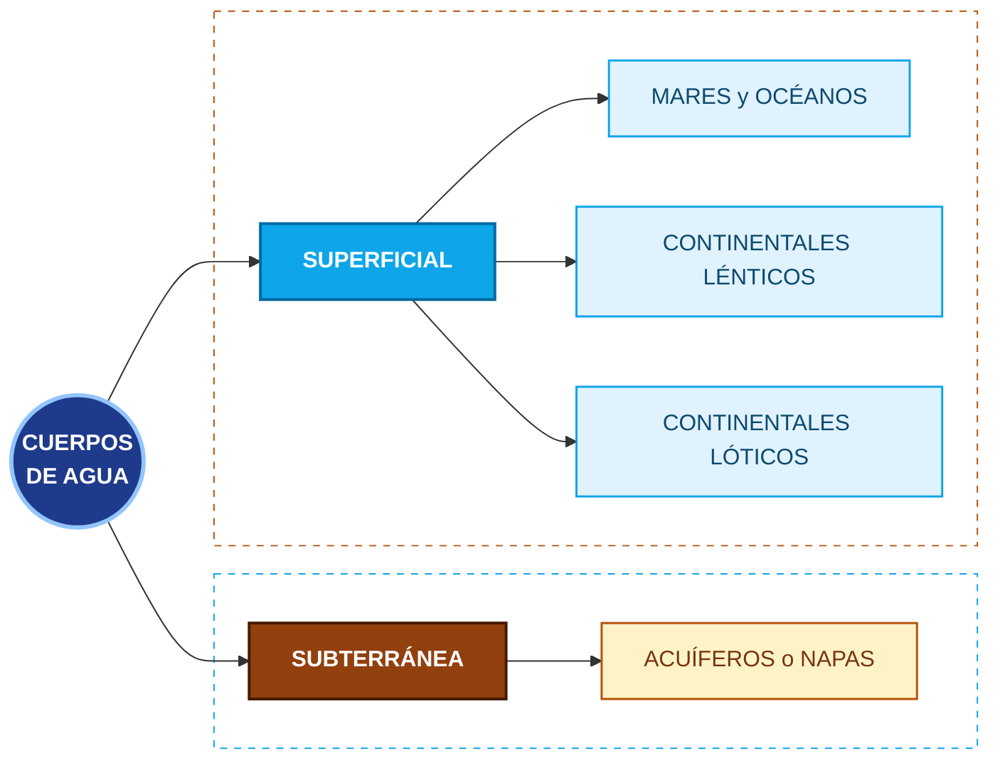

## Introducción

La primera cumbre mundial que se encargó de los temas ambientales fue la **Convención de Estocolmo**, en 1972. De allí surgió una declaración escrita en inglés donde la palabra environment se pasó al castellano como "medio/ambiente", porque el traductor no sabía cuál de los dos términos emplear, y quien transcribió ese texto lo pasó como "medio ambiente". Es en realidad un error de traducción, y aunque su uso ya está muy extendido, sería más adecuado decir **ambiente** o **medio**.
![[Pasted image 20261016112702.png|center|402]]

Si representamos el ambiente con un diagrama de Venn, tendríamos tierra, agua y aire, o para ser más precisos, litósfera, hidrósfera y atmósfera. Está también la energía, y en la intersección de todo eso, es decir, donde hay suelo, agua, aire y energía, es donde existe la **biósfera**, de la que formamos parte todos nosotros y cuya protección será el foco de todo estudio y desarrollo ambiental que hagamos.
![[Pasted image 20261016112819.png|center|334]]

Entonces, los componentes del ambiente son cinco:
- Litósfera
- Hidrósfera
- Atmósfera
- Energía
- Biósfera

¿Es el término **ecosistema** lo mismo que ambiente? Hay varias escuelas al respecto, pero nosotros vamos a considerar que sí, aunque desde diferentes puntos de vista. El ambiente está enfocado en los componentes que acabamos de ver, mientras que el ecosistema está enfocado en las relaciones entre esos componentes.

El objetivo de todo lo que vamos a ver apunta a afianzar nuestra convicción sobre cuán imprescindible es que todas nuestras acciones ingenieriles sean acciones de **ingeniería sostenible o sustentable** (que consideraremos como sinónimos, aunque también hay distintas escuelas al respecto). Los objetivos de esta parte de la materia son:
1. Lograr una visión de los sistemas naturales ambientales.
2. Descubrir el campo profesional de cada ingeniero vinculado con las temáticas ambientales.
3. Comprender la importancia de la ingeniería sostenible.
4. Vislumbrar las regulaciones ambientales vigentes. No hace falta recordar muchos números de memoria, solo algunas cosas muy básicas, como el artículo 41 de la Constitución Nacional, que es donde se basa todo nuestro derecho ambiental.
5. Manejar las bases y comprender lo que es una evaluación de impacto ambiental.
6. Conocer los sistemas de gestión ambiental (ISO 14001), que ya estudiamos previamente.

---
## El Ambiente como Sistema

El ambiente es un **sistema**, es decir, un conjunto de componentes que se relacionan entre sí, donde lo que le pasa a uno termina afectando a los demás. Por un lado tenemos los subsistemas naturales que ya mencionamos (biósfera, atmósfera, hidrósfera y litósfera), y por otro, los subsistemas humanos: población, economía, esfera psicosocial, organización social y ciencia y tecnología.
![[Pasted image 20261016193529.png|center|458]]

Veamos un ejemplo de cómo se relacionan. Desde la economía se impulsa la expansión de la frontera agrícola y una agricultura más intensiva. Esto lleva a una sobreexplotación de la vegetación (biósfera), que provoca erosión del suelo y pérdida de fertilidad (litósfera). A su vez, la pérdida de fertilidad del suelo termina generando marginalización en la organización social, que vuelve a presionar sobre los recursos. Vemos que un problema que arranca en un subsistema recorre todo el sistema.

Para analizar estas relaciones, la **Teoría General de Sistemas (TGS)** utiliza los **ciclos de retroalimentación**. Tomemos dos variables, A y B, unidas por flechas con un signo:
- Un signo **"+"** indica que, si A aumenta, B también aumenta (y si A disminuye, B también disminuye). Es decir, se mueven en el mismo sentido.
- Un signo **"-"** indica que, si A aumenta, B disminuye, y viceversa. Se mueven en sentido contrario.

Si las dos relaciones del ciclo son positivas, tenemos un **ciclo de refuerzo**. Cuando A crece, hace crecer a B, que a su vez vuelve a hacer crecer a A, y así sucesivamente: el sistema se dispara. Pero esto funciona también para el otro lado: si pinchamos A y se achica, B también se achica, lo que achica aún más a A, y el sistema colapsa.
![[Pasted image 20261016193435.png|center|434]]

Si en cambio una relación es positiva y la otra negativa, tenemos un **ciclo compensador o de balance**. Si inflamos A, crece B, pero B hace que A disminuya, por lo que el sistema tiende a mantenerse en equilibrio.
![[Pasted image 20261016193607.png|center|308]]

>[!TIP] Importante
>Para saber de qué tipo es un ciclo, contamos los signos negativos: si hay una cantidad par (o ninguno), el ciclo es de **refuerzo (R)**; si hay una cantidad impar, el ciclo es **compensador o de balance (B)**.

Un ejemplo clásico de ciclo de refuerzo es la carrera armamentista. Si el país A aumenta sus capacidades militares, aumenta la percepción de amenaza del país B, que entonces aumenta sus propias capacidades militares. Esto aumenta la percepción de amenaza del país A, que vuelve a aumentar sus capacidades, y así sucesivamente.
![[Pasted image 20261016193643.png|center|337]]

Llevándolo al ambiente, podemos ver el caso de la temperatura del planeta, donde conviven ciclos reforzadores y compensadores:
- **R1**: si aumenta la temperatura, disminuye la cobertura de hielo del Ártico, por lo que queda más agua de mar expuesta. El agua refleja menos que el hielo, así que disminuye el **albedo** (la reflectividad de la Tierra) y se absorbe más radiación, lo que aumenta todavía más la temperatura.
- **R2**: de la misma forma, al derretirse el hielo queda más tierra expuesta, que también disminuye el albedo y aumenta la temperatura.
- **B1**: si aumenta la temperatura, aumentan la evaporación y la cobertura de nubes, que aumentan el albedo. Esto hace que se refleje más radiación y disminuya la temperatura, compensando el efecto.

![[Pasted image 20261016193718.png|center|368]]


Donella Meadows, junto con otros autores, publicó en 1972 (el mismo año de la Convención de Estocolmo) el informe **"Los límites del crecimiento"** (The Limits to Growth), encargado por el Club de Roma. Allí se simuló con un modelo de dinámica de sistemas cómo evolucionarían la población, la producción industrial, los alimentos, los recursos y la contaminación. El escenario base mostraba que, si se mantenían las tendencias, los recursos se iban agotando mientras la producción industrial, los alimentos y la población crecían hasta alcanzar un pico durante el siglo XXI, para luego caer abruptamente. Es decir, un crecimiento ilimitado en un planeta con recursos finitos no es posible.
![[Pasted image 20261016193838.png|center|329]]

---
## Litósfera

La **litósfera** (litos, piedra) es la cáscara dura del planeta. Para empezar, pensemos en un problema real que se detectó hace unos 15 años, referido a una potencial falta de agua potable en la ciudad de Buenos Aires a causa de la deforestación en las yungas, la selva o bosque nublado del noroeste de nuestro país. Es un problema que relaciona un mal manejo del suelo, que es parte de la litósfera, con el agua para tomar a más de mil kilómetros de distancia. Esto nos muestra que el ambiente está todo conectado.

La **tectónica** estudia la dinámica litosférica. La corteza terrestre está fracturada en placas que, hasta donde se conoce, se generaron por el impacto de un meteorito en la zona más profunda del planeta, cerca de Filipinas, en la fosa de las Marianas, que fracturó lo que originalmente era una corteza continua.

Entre la litósfera y el núcleo interno (también sólido) hay una zona amplia de material fluido, entre líquido y blando. Podemos pensar al planeta como si fuera una fruta con una cáscara dura, un carozo duro y todo el material interno fluido.
![[Pasted image 20261016112941.png|center|191]]

Las líneas de contacto entre placas tectónicas se diferencian en tres tipos principales de fallas:
- **Convergentes**: el material de superficie se va metiendo hacia el interior del planeta (lentamente).
- **Divergentes**: el material magmático emerge y va pasando a formar parte de la superficie, ya sea continental o del fondo marino.
- **Transformantes**: como la que está en California, son zonas con presiones muy grandes, de orden planetario, donde se forman algunos tipos de rocas que veremos más adelante.

En definitiva, podemos pensar que, aunque sea en tiempos geológicos, el planeta se va reciclando a sí mismo: lo que es corteza se va metiendo adentro y lo que es magma va saliendo afuera.

Como principales accidentes o formaciones litosféricas tenemos:
- **Continentales**: los elevados, que son las montañas, y los planos, que son los escudos.
- **Oceánicos**: las fosas, como la de las Marianas, que llega a 11 km debajo del nivel del mar, y las dorsales oceánicas, que son como cordilleras debajo del océano (las más elevadas llegan a unos 5 km sobre el nivel del fondo). Hay una dorsal atlántica que es más o menos paralela a la cordillera de los Andes.

---
## Rocas

Una piedra o roca puede estar formada por uno o varios minerales. Por ejemplo, el granito (que conocemos de muchas mesadas de cocina) está formado por los minerales mica, feldespato y cuarzo. Hay tres tipos principales de rocas:
- **Ígneas**: se clasifican como primarias.
- **Sedimentarias**: se clasifican como secundarias.
- **Metamórficas**: se clasifican como secundarias.

Esta tipificación viene de lo que se conoce como el **ciclo de las rocas**:
1. Partimos del material magmático, que se solidifica y da lugar a la formación de las **rocas ígneas** (primarias).
2. Estas rocas, estando en superficie, sufren la **meteorización**, es decir, la acción de los factores ambientales. Se van desgastando y generan sedimentos.
3. Estos sedimentos se van acumulando y, con el paso de miles de años, se van comprimiendo. Empieza a ocurrir la **litificación**, que es la formación de una nueva roca, denominada **roca sedimentaria** (secundaria).
4. Tanto las rocas sedimentarias como las ígneas, cuando están expuestas a presiones de orden planetario (como las que ocurren en las fallas transformantes), sufren grandes cambios en su estructura hasta llegar a ser **rocas metamórficas** (secundarias). Este proceso se conoce como **metamorfismo**.
5. Así como las rocas ígneas sufren meteorización, esto también puede sucederle a las rocas metamórficas y a las propias sedimentarias.
6. Por último, cuando cualquiera de los tipos de rocas se incorpora a la profundidad terrestre, ocurre la **fusión** y vuelve a formar parte del magma.

Las **rocas ígneas**, según dónde se formen, se clasifican en:
- **Volcánicas**: se forman en superficie o cerca de ella.
- **Hipabisales**: se forman a una profundidad intermedia.
- **Plutónicas**: solidifican en profundidad, en general durante mucho tiempo.

Pensemos en una hamburguesa. Cuando la ponemos en el freezer, ¿queremos que se enfríe lentamente o rápido? Tiene que enfriarse rápido, pero no por un tema de que se pudra, sino para no dar tiempo a que el agua forme cristales grandes. Si el agua se enfría lentamente, los cristales van creciendo, y los cristales grandes rompen las células (el agua está dentro y fuera de ellas), destrozando el tejido. Al descongelarla, ya no es lo mismo.

Lo mismo ocurre con las rocas ígneas. Las **volcánicas**, que se enfrían rápidamente porque salen a la superficie, tienen **grano muy fino**, ya que el grano no tiene tiempo de crecer. Incluso algunas, como la obsidiana o vidrio volcánico, directamente no tienen grano. En cambio, las **plutónicas**, que se van solidificando muy lentamente en profundidad, tienen **grano grande**, como el granito, donde los granos son muy visibles.

Ahora, si queremos hacer una construcción con rocas ígneas, ¿cuál de los tres tipos será más resistente a la meteorización? A veces tendemos a pensar que la plutónica, porque asociamos las rocas volcánicas a la piedra pómez, que flota. Pero la piedra pómez es como la espuma de las rocas volcánicas; el basalto, por ejemplo, es una roca volcánica durísima y muy pesada. En realidad, las **rocas volcánicas son más resistentes a la meteorización** que las plutónicas, porque se formaron en el ambiente externo, es decir, ya conocen los factores ambientales y han sido oxidadas por el ambiente exterior. Las plutónicas, en cambio, se formaron en profundidad y no conocen el ambiente externo, por lo que son más fácilmente atacables por los factores meteorológicos (humedad, pH, temperatura, etc.).

Las **rocas sedimentarias** se clasifican en:
- **Detríticas**: corresponden a la explicación que dimos sobre sedimentarias, porque detritos son pedacitos, sedimentos. Algunas son **cementadas**, como la arenisca del Cerro de los Siete Colores en Purmamarca. En estos casos, la litificación es favorecida por soluciones salinas u otras que van percolando entre los detritos, llenando cavidades y secándose, cumpliendo un rol de pegamento o cementicio. Las rocas detríticas cementadas son más fuertes que las no cementadas.
- **Químicas**: son características, por ejemplo, de las estalactitas y estalagmitas de las cavernas, donde soluciones carbonatadas que chorrean se van secando y, en el transcurso de miles de años, terminan constituyendo la roca. No solo se encuentran en cavernas: en general, la caliza y la dolomita son materiales de este tipo.
- **Orgánicas**: se definen para incluir a los carbones minerales.

Por último, tenemos las **rocas metamórficas**, con un ejemplo tan conocido como el mármol.

---
## Suelos

Ya vimos tectónica y petrología, por lo que pasamos ahora a la **edafología**, que es la ciencia que estudia los suelos. El suelo bajo nuestros pies nos presta un montón de servicios y cumple funciones **físicas, químicas y biológicas**, entre otras, todas de vital importancia, aunque solemos no tenerlo en cuenta porque parece siempre haber estado allí. No sería lo mismo si nos tocara trabajar en una estación espacial o en otro planeta donde el suelo no soporte vida.

La composición de un suelo es muy variable de uno a otro, pero siempre vamos a encontrar:
- Sustancias minerales
- Materia orgánica
- Agua
- Aire

Las capas del suelo en profundidad se denominan **horizontes edáficos**. Hay algunas reglas generales para su denominación, y no todos van a estar presentes siempre:
- **Horizonte O**: horizonte superficial muy rico en materia orgánica, sin descomponer o parcialmente descompuesta. Puede o no existir.
- **Horizonte A**: horizonte mineral que va acumulando cierta cantidad de humus (materia orgánica humificada), sin superar el 20% de materia orgánica.
- **Horizonte E**: horizonte de pérdida. Se llama así porque el agua de lluvia que va escurriendo arrastra sales y sustancias (hierro, aluminio, materia orgánica) hacia el siguiente horizonte. Estos procesos de aluviación y lixiviación extraen los compuestos solubles y las partículas más finas. Siempre está presente.
- **Horizonte B**: horizonte de ganancia o acumulación, donde se acumula lo que arrastra el agua desde el horizonte E (arcilla, hierro, aluminio, sales, etc.). Siempre está presente.
- **Horizonte C**: comienza a haber presencia de la roca madre partida (material regolítico), afectada por los procesos de formación del suelo.
- **Horizonte R**: roca madre, donde comienza la roca continua.

![[Pasted image 20261016113021.png|center|527]]

¿Hasta qué profundidad se define un suelo como tal? Es relativo a lo que se esté estudiando. Puede ser hasta donde llegan las raíces de las plantas, o incluir la parte que alberga la napa freática, etc. El pozo rectangular que hacen los edafólogos (en general ingenieros agrónomos o geólogos) para estudiar los horizontes y sus características se denomina **calicata**.
![[Pasted image 20261016113110.png|center|274]]

Podemos ver algunos ejemplos de perfiles de suelo. Existe una clasificación internacional de suelos de la FAO, con una jerga edafológica bastante particular, ya que los suelos reciben nombres como Natracualf, Pedocal, etc. Además, en la nomenclatura de los horizontes pueden usarse sufijos (hasta tres) para indicar características particulares (por ejemplo, Bt para un horizonte B con acumulación de arcilla), y un prefijo numérico para distinguir horizontes originados por rocas madres diferentes.
![[Pasted image 20261016113136.png|center|444]]

Además de la materia orgánica, las piedras y la grava (arena gruesa), el material mineral que compone el suelo se clasifica, según el tamaño de los granos, en:
- **Arena**: la de granulometría más gruesa. Un horizonte arenoso es muy permeable; si echamos agua sobre la arena, rápidamente percola y desaparece.
- **Limo**: de tamaño intermedio.
- **Arcilla**: la más fina, del orden de 2 micrones. Los horizontes arcillosos son bastante impermeables. Cuando llueve sobre un camino de campo rico en arcillas, se torna jabonoso porque el agua queda retenida sobre la arcilla y se infiltra muy lentamente.

![[Pasted image 20261016113203.png|center|432]]

Los límites de tamaño que separan cada fracción son 2 mm (entre grava y arena), 0,05 mm (entre arena y limo) y 0,002 mm (entre limo y arcilla). Además del tamaño, cada fracción tiene una composición química distinta:
- **Arena**: minerales primarios silicatados, es decir, minerales que vienen directamente de la roca madre sin haber sido transformados.
- **Limo**: mezcla de minerales primarios y secundarios (los secundarios se forman por alteración de los primarios), como cuarzos y micas.
- **Arcilla**: minerales silicatados secundarios, óxidos y coloides amorfos.

Para identificar el contenido de arena, limo y arcilla de un suelo hay un análisis muy sencillo: mezclar una cucharadita de suelo con un litro de agua, agitarlo bien y ponerlo a sedimentar en un cono.
- A los **10 minutos** habrá precipitado toda la **arena** (en general, mucho antes).
- A las **2 horas** se habrán sumado en el fondo los **limos**.
- El material que queda disperso, enturbiando el agua, son las **arcillas**, que no sedimentan o demoran muchísimo en hacerlo.

Hay un método más preciso, con algunos reactivos de laboratorio, que es el **método Bouyoucos**. Un ejemplo de este fenómeno son las islas del delta del Paraná y del Río de la Plata, que se forman por sedimentación. El agua viene con mayor velocidad por el cuerpo de los ríos Paraná y Uruguay, y cuando llega al Río de la Plata (que en realidad es un estuario, un triángulo que se abre) va perdiendo velocidad, y tanto las arenas como los limos van sedimentando y formando esas islas.

Para graficar un tipo de suelo se emplean **diagramas triangulares** (clases texturales). En cada vértice tenemos el 100% de arena, de arcilla y de limo, respectivamente.
![[Pasted image 20261016113239.png|center|310]]
- Un suelo totalmente de arena, como la playa de Mar del Plata, se representa con un punto en el vértice de la arena.
- Un suelo representado por un punto en el medio del triángulo contiene un 33% de cada uno.
- Un suelo mitad arena, mitad arcilla, se representa con un punto en la mitad del lado entre arena y arcilla. Si separamos un poco el punto de ese lado, va a tener un poco de limo.

Para saber cuánto contiene de cada uno, el contenido de limo corresponde al tamaño del segmento que va entre el punto y el lado opuesto al vértice del limo. De la misma forma, el contenido de arena corresponde a la distancia entre el punto y el lado opuesto al vértice de la arena, y el mismo razonamiento empleamos para la arcilla. Lo importante es no perder la sencillez de la idea original: si el punto está cerca del vértice de la arcilla, el suelo tiene mucha arcilla.

Pensemos qué ocurre si tenemos tierra y arena en superficie, más abajo un horizonte de arcilla, y echamos residuos en un punto. Cuando llueve, la lluvia lixivia los contaminantes del residuo, que llegan hasta el horizonte arcilloso. Como este es más impermeable, los contaminantes se distribuyen radialmente, contaminando una gran superficie de suelo. Y esto sin tener en cuenta la posible presencia de una napa de agua que los distribuya aún más, como veremos en hidrósfera.

Esto nos lleva a las **propiedades físicas, químicas y biológicas** de cada fracción, que podemos resumir en la siguiente tabla (los limos tienen siempre un comportamiento intermedio):

|        **Propiedad**         |               **Arenas**                |  **Limos**  |              **Arcillas**               |
| :--------------------------: | :-------------------------------------: | :---------: | :-------------------------------------: |
|   **Depuración de aguas**    |       Soporte biológico y filtro        | Intermedio  |  Absorción química y soporte biológico  |
|        **Porosidad**         | ↓ (muchos macroporos, pocos microporos) | Intermedio  | ↑ (pocos macroporos, muchos microporos) |
|    **Retención de agua**     |                    ↓                    | Intermedio  |                    ↑                    |
|        **Aireación**         |                    ↑                    | Intermedio  |                    ↓                    |
|      **Permeabilidad**       |                    ↑                    | Intermedio  |                    ↓                    |
|     **Amplitud térmica**     |                    ↑                    | Intermedio  |                    ↓                    |
|  **Expansión-contracción**   |                    -                    | Intermedio  |                    ↑                    |
|           **CIC**            |                    ↓                    | Intermedio  |                    ↑                    |
| **Desgaste de herramientas** |                    ↑                    | Intermedio  |                    ↓                    |
|        **Fertilidad**        |                    ↓                    | Intermedio  |                    ↑                    |
|   **Formación de costras**   |                    ↓                    | Intermedio  |                    ↑                    |
|    **Conservación de MO**    |                    ↓                    | Intermedio  |                    ↑                    |
|    **Densidad aparente**     |             ↑ (1,40 a 1,80)             | 1,25 a 1,40 |             ↓ (1,00 a 1,25)             |

Una propiedad muy importante es la **CIC (capacidad de intercambio catiónico)**, que es la capacidad del suelo de retener cationes en su superficie (como nutrientes, pero también metales u otros contaminantes) e intercambiarlos con la solución del suelo. Las arcillas, al tener partículas tan chicas, tienen una superficie enorme y cargada, por lo que tienen una CIC alta. Esto explica por qué son más fértiles y por qué tienen esa capacidad de absorber químicamente los contaminantes, que veremos que es clave para depurar el agua que llega a las napas. Las arenas, en cambio, depuran el agua principalmente filtrándola y sirviendo de soporte a los microorganismos que degradan los contaminantes.

Por otro lado, la **materia orgánica (MO)** contenida en el suelo es esencial y cumple funciones muy importantes:
- Tiene una CIC muy alta (150 a 300 cmol/kg), incluso mayor que la de las arcillas.
- Soporta la vida de macro y microorganismos.
- Acidifica el suelo y funciona como buffer (amortigua los cambios de pH).
- Se une a las arcillas, mejorando la estructura edáfica.
- Aumenta la aireación, ya que genera poros.
- Aumenta la retención hídrica.
- Posee acción antierosiva.
- Es fuente de carbono, nitrógeno, fósforo, azufre y otros nutrientes.

Pongamos todo esto en práctica con un ejercicio. En una zona empleada como basural clandestino, se toma una muestra del horizonte superficial del suelo y se mezcla una pequeña porción con agua en una probeta, observando que rápidamente sedimenta la mayor parte del material. ¿Qué podemos decir sobre su clase textural, su permeabilidad, y cómo afectarán los lixiviados a la napa freática?

Recordemos que las arenas son las que sedimentan rápido (en menos de 10 minutos), por lo que se trata de un **suelo arenoso**. Este suelo es muy permeable, así que cuando llueva, los lixiviados del basural van a percolar rápidamente hacia abajo. Además, al tener baja CIC y baja retención, el suelo casi no va a retener los contaminantes, por lo que estos van a llegar rápido a la napa freática y la van a contaminar.

¿Y si el horizonte superficial fuese de la clase textural opuesta, es decir, arcilloso? En ese caso el suelo sería casi impermeable, por lo que los lixiviados se infiltrarían muy lentamente. Además, gracias a su alta CIC, las arcillas retendrían buena parte de los contaminantes. La napa quedaría más protegida, pero, como vimos antes, los lixiviados tenderían a escurrir y distribuirse en superficie, contaminando una mayor superficie de suelo.

Veamos otro ejercicio. ¿Qué proporción de cada granulometría contiene el horizonte edáfico representado en el siguiente gráfico triangular? ¿Cómo se comportará ante lixiviados? ¿Qué ocurriría si tuviese también materia orgánica?
![[Pasted image 20261016194344.png|center|271]]

Midiendo las distancias del punto a cada lado, vemos que tiene aproximadamente un 45% de arcilla, un 40% de arena y un 15% de limo. Al tener una proporción importante de arcilla, va a ser un suelo de baja permeabilidad, por lo que los lixiviados van a infiltrar lentamente, y buena parte de los contaminantes va a quedar retenida por la CIC de las arcillas. Si además tuviese materia orgánica, aumentaría todavía más la CIC y, por lo tanto, la capacidad de retener contaminantes, y se favorecería la vida de los microorganismos que los biodegradan. Es decir, mejoraría su capacidad de depuración.

---
## Atmósfera

La **atmósfera** (atmos, vapor o aire en griego) es la capa gaseosa que rodea el planeta. Antes de entrar en detalle, veamos algunos conocimientos ancestrales que vienen de la navegación y que pueden sernos útiles:
- Si **amanece amarillo** (del mismo color del sol), el día va a estar bueno. Si **anochece rojo**, al día siguiente va a estar bueno.
- Si **amanece rojo**, es muy probable que llueva ese día. Si **anochece amarillo**, es bastante factible que llueva al día siguiente.
- Si al comenzar una tormenta primero viene el viento y luego la lluvia, la tormenta va a ser suave. Si empieza lloviendo sin viento y luego se agrega el viento, la tormenta va a ser muy fuerte.
- Si baja rápido la presión atmosférica, lloverá pronto.
- Si en el campo se callan todos los animales (porque se refugiaron), va a llover.

Además, hay algunos saberes populares de nuestros pagos, como "cielo aborregado, a los tres días mojado", "viento del este, lluvia como peste", "viento norte que dura, tormenta segura", o que si el ñandú empieza a andar en espiral, va a llover pronto.

¿Cuánto mide la atmósfera? Si consideramos que la Tierra mide unos 12.750 km de diámetro, la atmósfera, incluyendo la exósfera (la capa más externa y muy difusa), llega a medir unos 10.000 km, un tamaño muy importante comparado con el de la Tierra. Sin embargo, el 99% del aire está contenido en los primeros 30 km.

Las capas de la atmósfera están definidas por el **perfil térmico atmosférico**:
![[Pasted image 20261016113435.png|292]]
- **Tropósfera**: es la zona más baja, donde la temperatura desciende al ascender. Entre la tropósfera y la estratósfera se encuentra la **tropopausa**. Mide en promedio 15 km, variando desde 8-9 km en los polos hasta 16-18 km en zonas tropicales. Normalmente $dt/dz$ = – 6,5 ºC/km. Nubes, rayos, aerosoles, vida, etc.
- **Estratósfera**: al ascender hay una primera zona de temperatura constante, y luego la temperatura aumenta paulatinamente hasta alcanzar, en la **estratopausa**, una temperatura cercana a la de superficie. Mide unos 35 km. Hasta los 20-25 km la temperatura se mantiene constante en unos –55 ºC, luego aumenta hasta valores similares a los de superficie. La ozonósfera se concentra en altitud 20 a 35 km. Alcance de globos meteorológicos.
- **Mesósfera**: llega hasta los 90 km de altitud, aproximadamente. Allí se alcanza la temperatura más baja de la atmósfera, en la **mesopausa**. Mide unos 35 km. La temperatura desciende hasta cerca de –90 ºC en la mesopausa (es la más baja registrada en la atmósfera).
- **Termósfera**: tiene muy poco contenido gaseoso, y las temperaturas aumentan hasta el orden de los 1000°C. Finaliza a unos 500 km. Auroras, estación espacial, satélites, transbordadores, etc. Formación de mesones y otras partículas por impacto de rayos solares y cósmicos.
- **Exósfera**: los pocos gases que hay se siguen difuminando. Forma la porción exterior difusa de la atmósfera, de temperatura constante, que puede llegar hasta los 10.000 km contenida por la magnetósfera terrestre. Está formada por plasma, gas y polvo cósmico. Hubble, satélites, etc.

Hay un nombre de una capa que también es conocido y nos está faltando: la **ionósfera**. No aparece porque no está definida por el perfil térmico, sino que es una capa de la atmósfera ionizada que se forma por efecto de la radiación solar y de la radiación cósmica. Coexiste en altura con la parte baja de la exósfera, toda la termósfera y casi toda la mesósfera.

Como la ionósfera depende mucho de la radiación solar, su nivel bajo difuso (nivel D) está presente de día y se va difuminando de noche. Por este motivo, la ionósfera tiene un mayor espesor de día que de noche. Dado que las estaciones de radio AM utilizan la ionósfera para hacer rebotar las ondas transmitidas, deben transmitir con diferente potencia de día y de noche: de día deben usar más potencia, porque ese nivel difuso inferior absorbe parte de la radiación.

Si consideramos los primeros 80 km (más o menos las tres primeras capas), hay un conjunto de gases que se mantienen prácticamente constantes en concentración, mientras que otros son bastante variables.
- **Gases constantes**: están caracterizados por el nitrógeno y el oxígeno. Hay un tercer gas con una concentración importante, muchas veces no considerado, que es el **argón** (cerca del 1%), además de otros en menores concentraciones.
- **Gases variables**: agua, dióxido de carbono, óxido nitroso, metano, ozono (la capa de ozono u ozonósfera es una de las capas de la estratósfera), material particulado, clorofluorocarbonos, etc.

La **tropósfera**, la capa donde vivimos, va desde unos 8 km en los polos hasta unos 18 km en el ecuador, y en promedio anda entre 10 y 15 km. ¿Cómo saber visualmente hasta dónde llega? Con los **cumulonimbus**, nubes que se extienden en toda la altura troposférica. Se desarrollan desde el nivel de condensación atmosférica (la zona baja, donde aparecen todas las nubes) hasta la tropopausa cuando están completamente desarrolladas, y allí adoptan una forma de yunque. Estas nubes tienen granizo adentro dando vueltas, que puede llegar al suelo como granizo o como gotas de agua según las condiciones atmosféricas.
![[Pasted image 20261016113908.png|center|378]]

---
## Inversión Térmica

Normalmente, cuando subimos en la tropósfera, la temperatura disminuye (lo sabemos de haber subido alguna montaña). Sin embargo, por diversas causas que no estudiaremos aquí, suelen ocurrir **inversiones térmicas**, ya sea a nivel del suelo o en altura. Son fenómenos que pueden durar horas, bastantes días o incluso meses en zonas cordilleranas, donde la temperatura aumenta a medida que subimos, no en toda la tropósfera, sino en cierta zona.
$$\begin{gathered} \text{Condiciones normales:} \quad \frac{dT}{dz} < 0 \\[2ex] \text{Inversión térmica:} \quad \frac{dT}{dz} > 0 \end{gathered}$$
![[Pasted image 20261016113943.png|center|397]]

Este fenómeno es muy importante porque funciona como un **techo para los contaminantes**. Los gases más calientes de una chimenea, por ejemplo, suben porque encuentran aire más frío arriba, pero cuando empiezan a encontrar aire más caliente se quedan atrapados. Entonces, las inversiones térmicas bajas hacen que, si hay contaminación en la zona donde estamos nosotros (la tropósfera baja), esta se conserve y respiremos todo ese aire viciado.

Para estudiar este fenómeno con más precisión, necesitamos definir dos gradientes verticales de temperatura. El primero es el **gradiente vertical adiabático seco** ($\gamma_s$). Pensemos en una porción de aire que asciende o desciende sin intercambiar calor con el aire que la rodea (adiabáticamente). Al subir, la presión disminuye, el aire se expande y se enfría. Del primer principio de la termodinámica resulta la siguiente igualdad para el ascenso o descenso adiabático de aire seco:
$$\gamma_s = \frac{dT}{dz} = -\frac{g}{C_p} = -9,76 \ \text{°C/km}$$
Es decir, el aire no saturado de agua se enfría casi 10 °C por cada kilómetro que asciende (y se calienta lo mismo al descender). En el libro de Masters, a este gradiente se lo llama tasa de lapso adiabático.
```tikz
\begin{document}
\begin{tikzpicture}[x=0.14cm, y=3.5cm, every node/.style={font=\sffamily}]
  % Marco
  \draw[thick] (0,0) rectangle (50,2);

  % Marcas del eje X (abajo y arriba)
  \foreach \x in {5,10,...,45} {
    \draw (\x,0) -- (\x,0.06);
    \draw (\x,2) -- (\x,1.94);
  }
  \foreach \x in {10,20,30,40,50}
    \node[below] at (\x,0) {\x};

  % Marcas del eje Y (izquierda y derecha)
  \foreach \y in {0.5,1,1.5} {
    \draw (0,\y) -- (1,\y);
    \draw (50,\y) -- (49,\y);
  }
  \node[left] at (0,1) {1};
  \node[left] at (0,2) {2};

  % Rótulos de los ejes
  \node[below=18pt] at (25,0) {Temperatura $^\circ$C};
  \node[rotate=90, above=14pt] at (0,1) {Elevación, km};

  % Líneas punteadas (gradiente de 10 $^\circ$C/km)
  \begin{scope}[densely dotted, very thick, blue!40!black]
    \draw (10,0) -- (0,1);
    \draw (20,0) -- (0,2);
    \draw (30,0) -- (10,2);
    \draw (40,0) -- (20,2);
    \draw (50,0) -- (30,2);
    \draw (50,1) -- (40,2);
  \end{scope}
\end{tikzpicture}
\end{document}
```

El segundo es el **gradiente vertical ambiental** ($\gamma_a$), que es el gradiente real que se obtiene de un sondeo, por ejemplo, con un globo meteorológico que va midiendo la temperatura a distintas alturas. Depende de multitud de factores ambientales, incluyendo los vientos, y normalmente no es constante, sino que sigue una poligonal continua de formas diversas. Como vimos, en la tropósfera vale en promedio unos –6,5 °C/km.
```tikz
\begin{document}
\begin{tikzpicture}[x=0.14cm, y=3.5cm, every node/.style={font=\sffamily}]
  % Marco
  \draw[thick] (0,0) rectangle (50,2);

  % Marcas del eje X (abajo y arriba)
  \foreach \x in {5,10,...,45} {
    \draw (\x,0) -- (\x,0.06);
    \draw (\x,2) -- (\x,1.94);
  }
  \foreach \x in {10,20,30,40,50}
    \node[below] at (\x,0) {\x};

  % Marcas del eje Y (izquierda y derecha)
  \foreach \y in {0.5,1,1.5} {
    \draw (0,\y) -- (1,\y);
    \draw (50,\y) -- (49,\y);
  }
  \node[left] at (0,1) {1};
  \node[left] at (0,2) {2};

  % Rótulos de los ejes
  \node[below=18pt] at (25,0) {Temperatura $^\circ$C};
  \node[rotate=90, above=14pt] at (0,1) {Elevación, km};

  % Gradiente adiabático seco (punteado)
  \draw[densely dotted, very thick, blue!40!black] (25,0) -- (5,2);

  % Gradiente ambiental (línea roja)
  \draw[very thick, red!60!black]
    (25,0) -- (25,0.47) -- (30,0.82) -- (18.5,1.41) -- (14,2);

  % Etiquetas
  \node[align=center] at (28,1.62) {Gradiente vertical\\ambiental};
  \node[align=left]   at (11,0.27) {Gradiente vertical\\adiabático seco};
\end{tikzpicture}
\end{document}
```

Con esto, podemos definir con precisión a la inversión térmica como una zona donde el **gradiente vertical ambiental es positivo** ($\gamma_a > 0$), es decir, donde la temperatura aumenta con la altura. Puede durar desde unos minutos hasta varios días, e incluso meses, y funciona como un techo que evita que el aire, el humo, el vapor, etc., asciendan más allá de la inversión.

```tikz
\usetikzlibrary{decorations.pathreplacing}
\begin{document}
\begin{tikzpicture}[x=0.9cm, y=4cm, font=\sffamily]

  % Marco
  \draw[thick] (0,0) rectangle (10,2);

  % Ticks eje X (abajo y arriba)
  \foreach \x in {1,...,9} {
    \draw (\x,0) -- (\x,0.05);
    \draw (\x,2) -- (\x,1.95);
  }
  \foreach \x in {2,4,6,8,10}
    \node[below] at (\x,0) {\x};

  % Ticks eje Y
  \foreach \y in {1,2} {
    \draw (0,\y) -- (0.2,\y);
    \draw (10,\y) -- (9.8,\y);
    \node[left] at (0,\y) {\y};
  }

  % Etiquetas de ejes
  \node[below=0.6cm] at (5,0) {Temperatura $^\circ$C};
  \node[rotate=90, above=0.6cm] at (0,1) {Elevaci\'on, km};

  % Gradiente normal (punteado)
  \draw[blue!50!black, line width=1.5pt, dotted] (4,0) -- (0,2);

  % Perfil con inversión (rojo)
  \draw[red!70!black, line width=1.5pt]
    (4,0) -- (3,1.05) -- (6.1,1.67) -- (5.1,2);

  % Llave
  \draw[decorate, decoration={brace, amplitude=8pt}]
    (6.3,1.55) -- (3.5,1.0);

  % Texto
  \node[align=center] at (6.5,1.12) {Inversi\'on de la\\temperatura};

\end{tikzpicture}
\end{document}
```

Estos fenómenos, junto con otros que se conocen como **estabilidad atmosférica** (que veremos a continuación), son los que provocan, por ejemplo, que la ciudad de Buenos Aires se llene de humo cuando se queman pastizales.
![[Pasted image 20261016114058.png|center|500]]

---
## Estabilidad Atmosférica

La **estabilidad atmosférica** nos indica si el aire tiende a moverse verticalmente o no, y se determina comparando el gradiente vertical ambiental ($\gamma_a$) con el gradiente adiabático seco ($\gamma_s$). Pensemos en una porción de aire que, por algún motivo, empieza a subir. Mientras asciende, se va a enfriar siguiendo el gradiente adiabático, mientras que el aire que la rodea tiene la temperatura que marca el gradiente ambiental. Entonces:

```tikz
\begin{document}
\def\marco{
  \draw[thick] (0,0) rectangle (50,2);
  \foreach \x in {5,10,...,45} {
    \draw (\x,0) -- (\x,0.06);
    \draw (\x,2) -- (\x,1.94);
  }
  \foreach \x in {10,20,30,40,50}
    \node[below] at (\x,0) {\x};
  \foreach \y in {0.5,1,1.5} {
    \draw (0,\y) -- (1.5,\y);
    \draw (50,\y) -- (48.5,\y);
  }
  \node[left] at (0,1) {1};
  \node[left] at (0,2) {2};
  \node[below=14pt] at (25,0) {Temperatura $^\circ$C};
  \node[rotate=90, above=12pt] at (0,1) {Elevación, km};
}
\begin{tikzpicture}[x=0.1cm, y=2.5cm, every node/.style={font=\sffamily\small}]

  % ---------- 1) INESTABLE (arriba izquierda) ----------
  \begin{scope}
    \marco
    \draw[densely dotted, very thick, blue!40!black] (30,0) -- (10,2);
    \draw[very thick, red!60!black] (30,0) -- (5,2);
    \draw[very thick, red!60!black] (30,0) -- (0,1.6);
    \node[anchor=west, font=\sffamily\footnotesize] (li) at (17,1.7) {Ligeramente inestable};
    \draw[-latex] (li.west) -- (11,1.55);
    \node[anchor=west, align=left, font=\sffamily\footnotesize] (ga) at (24,0.94) {Gradiente vertical\\adiabático seco};
    \draw[-latex] (ga.west) -- (20.8,0.94);
    \node[anchor=west, font=\sffamily\footnotesize] (mi) at (1,0.15) {Muy inestable};
    \draw[-latex] (mi.east) -- (25,0.27);
    \node[below=30pt, font=\sffamily\bfseries] at (25,0) {Inestable};
  \end{scope}

  % ---------- 3) ESTABLE (arriba derecha) ----------
  \begin{scope}[xshift=7.5cm]
    \marco
    \draw[densely dotted, very thick, blue!40!black] (20,0) -- (0,2);
    \draw[very thick, red!60!black] (20,0) -- (9,2);
    \draw[very thick, red!60!black] (20,0) -- (34,2);
    \node[anchor=west, align=left, font=\sffamily\footnotesize] at (12,1.66) {Ligeramente\\estable};
    \node[anchor=west, font=\sffamily\footnotesize] at (28,0.92) {Muy estable};
    \node[anchor=west, align=left, font=\sffamily\footnotesize] at (1,0.35) {Gradiente\\vertical\\adiabático\\seco};
    \node[below=30pt, font=\sffamily\bfseries] at (25,0) {Estable};
  \end{scope}

  % ---------- 2) NEUTRA (abajo, centrada) ----------
  \begin{scope}[xshift=3.75cm, yshift=-7.5cm]
    \marco
    \draw[densely dotted, very thick, blue!40!black] (30,0) -- (10,2);
    \draw[very thick, red!60!black] (29,0) -- (9,2);
    \node[below=30pt, font=\sffamily\bfseries] at (25,0) {Neutra};
  \end{scope}

\end{tikzpicture}
\end{document}
```

- **Atmósfera inestable**: el aire ambiente se enfría con la altura más rápido que el adiabático ($\gamma_a$ más negativo que $\gamma_s$). La porción que sube queda siempre más caliente (y más liviana) que el aire que la rodea, por lo que sigue subiendo. Cualquier movimiento vertical se amplifica, y hay mucha mezcla.
- **Atmósfera neutra**: el gradiente ambiental es igual al adiabático. La porción de aire queda siempre a la misma temperatura que su entorno, por lo que se queda donde la dejemos.
- **Atmósfera estable**: el aire ambiente se enfría con la altura más lento que el adiabático, o directamente se calienta, como en una inversión. La porción que sube queda más fría (y más pesada) que el aire que la rodea, por lo que vuelve a bajar. Los movimientos verticales se frenan y hay muy poca mezcla.

>[!TIP] Importante
>En los gráficos de temperatura versus elevación, si la línea del gradiente ambiental queda a la izquierda (más inclinada hacia el frío) que la del adiabático seco, la atmósfera es inestable; si coinciden, es neutra; y si queda a la derecha, es estable. Cuanto más se aleja, más inestable o más estable es.

Esto tiene una consecuencia muy visible en las **plumas de las chimeneas**, cuya forma depende de la estabilidad atmosférica:
![[Pasted image 20261016195328.png|center|573]]
- **Serpenteo**: se da con una atmósfera muy inestable. La pluma sube y baja formando grandes ondas, porque los movimientos verticales se amplifican. Dispersa bien los contaminantes, pero puede llegar a tocar el suelo cerca de la chimenea en forma intermitente.
- **Cono**: se da en condiciones cercanas a la neutralidad o ligeramente estables. La pluma se va abriendo de forma pareja, con forma de cono.
- **Abanico**: se da con una atmósfera muy estable (por ejemplo, con una inversión). Casi no hay mezcla vertical, por lo que la pluma se extiende horizontalmente como una cinta, transportando los contaminantes lejos sin diluirlos demasiado.

Cuando el perfil de temperatura cambia de estabilidad a cierta altura, aparecen otros dos casos:
![[Pasted image 20261016195356.png|center|573]]
- **Elevada**: hay una inversión por debajo de la salida de la chimenea y una zona inestable por encima. La inversión funciona como un piso que impide que los contaminantes bajen, por lo que estos se dispersan hacia arriba. Es la situación más favorable para quienes están en superficie.
- **Fumigación**: es el caso contrario. Hay una zona inestable abajo y una inversión por encima de la chimenea, que funciona como techo. Los contaminantes no pueden subir, y la inestabilidad de abajo los mezcla hacia el suelo. Es la situación más desfavorable, porque las concentraciones a nivel del suelo son muy altas.

Pongamos esto en práctica con el siguiente ejercicio. Una chimenea alta y una chimenea pequeña cercana tienen columnas como se muestra en la figura. ¿Cuál es el perfil de temperatura atmosférica que tendría más probabilidad de causar ese par de columnas? La línea punteada representa el gradiente vertical adiabático seco y la llena, el gradiente vertical ambiental.
![[Pasted image 20261016195428.png|center|565]]

Vemos que la pluma de la chimenea pequeña se extiende horizontalmente, como un abanico, mientras que la de la chimenea alta sube y baja, serpenteando. Entonces, necesitamos un perfil que sea estable a baja altura y que sea inestable más arriba. Esto es lo que ocurre en el perfil **(d)**: cerca del suelo hay una inversión (la temperatura aumenta con la altura), que atrapa la pluma de la chimenea pequeña y la hace avanzar en abanico. Por encima de la inversión, la temperatura disminuye más rápido que el gradiente adiabático, es decir, la atmósfera es inestable, y por eso la pluma de la chimenea alta serpentea.

---
## Hidrósfera

La **hidrósfera** estudia el agua de nuestro planeta, tanto líquida como sólida (la gaseosa queda para la atmósfera). Como dato, la bibliografía central que emplean los laboratorios para efectuar todo tipo de análisis de agua es el **Standard Methods**. Por ejemplo, si queremos saber si un agua es potable, tomamos una muestra y la enviamos al laboratorio. En el informe, el método analítico empleado para cada parámetro aparece indicado como "SM" y unos números y letras, que refieren a este libro.

Podemos clasificar los cuerpos de agua líquida del planeta de la siguiente manera:

- **Aguas superficiales**:
	- **Mares y océanos**: son los grandes cuerpos de agua salada del planeta. Sus masas de agua circulan a nivel global por diferencias de temperatura y salinidad, y en ellos se forman las olas, las mareas y las corrientes litorales, que veremos más adelante.
	- **Lechos lénticos**: se mueven lentamente (muchos tienen forma lenticular, para acordarnos). Por ejemplo, lagos, lagunas, charcas, embalses, pantanos, esteros, bañados, estanques y albúferas (zonas de contacto entre agua dulce y salada, muy interesantes para los biólogos marinos).
	- **Lechos lóticos**: se mueven con cierta velocidad (como regla mnemotécnica, podemos acordarnos de la marca de autos Lotus, que se mueven rápido). Los más representativos son los ríos, los arroyos y los estuarios, como el del Plata.
- **Aguas subterráneas**: son las que denominamos **napas o acuíferos**. El término acuífero a veces se emplea también para cuerpos de agua superficial, pero nosotros lo usaremos solo para agua subterránea.

¿Cuánta de toda esta agua tenemos realmente disponible? Si bien el 70% de la superficie de la Tierra está cubierta por agua, el 97,5% de esa agua está en los mares y océanos, y solo el 2,5% es agua dulce. Y de esa agua dulce:
- El 68,7% está congelada (glaciares y casquetes polares).
- El 30,1% son aguas subterráneas.
- El 0,26% es agua de lagos y ríos.
- El 0,94% restante corresponde a otros (humedad del suelo, atmósfera, etc.).

Vemos entonces que el agua dulce que tenemos más a mano, la de lagos y ríos, es una porción ínfima del total, y que las aguas subterráneas son la gran reserva de agua dulce líquida. Por eso es tan importante cuidar las napas, como veremos a continuación.

¿Cómo son las napas de agua subterránea? A veces pensamos en una especie de río subterráneo, pero la mayoría de las napas de nuestro territorio, y de gran parte del mundo, son **napas porosas**: arenosas, de grava o pedregosas, pero en general arenosas. Están saturadas de agua, es decir, no son un hueco, sino una zona llena de arena donde el agua ocupa los intersticios.
- **Napa o acuífero freático**: es el acuífero cercano a la superficie, que está a presión atmosférica.
- **Napas o acuíferos piezométricos**: están a mayor profundidad y suelen tener presiones mayores. También se los denomina acuíferos confinados o semiconfinados, según las características del terreno.

![[Pasted image 20261016122014.png|center|484]]

Los ríos subterráneos también existen, y son las denominadas **napas kársticas**. Los terrenos kársticos son ricos en carbonatos de calcio y magnesio, que en presencia de agua con cierta acidez se van carcomiendo y generan túneles que son verdaderos ríos subterráneos. En nuestro país, en la zona cordillerana, hay este tipo de napas. Existe un tercer tipo, las **napas fisurales**: todos los huecos que quedan por quebradura de la roca madre, siempre que haya continuidad, se van llenando de agua.

Por último, tenemos el suelo congelado o semicongelado en profundidad, que se denomina **permafrost**. Cuando acampamos en zonas donde puede haber permafrost (zonas muy frías, glaciares, etc.), no hay que hacer fuego en el piso cerca de la carpa, porque puede derretir el permafrost y deformar el terreno.
![[Pasted image 20261016122108.png|center|427]]

El ambiente está todo conectado, y las aguas superficiales y subterráneas no son la excepción. El **ciclo hidrogeológico** es un ciclo más o menos regular, que en América del Sur dura unos 4 o 5 años, con momentos de gran contenido de agua en las napas freáticas y otros de bastante sequía. Podemos imaginar el suelo como una esponja por la que pasa un río: el agua de la esponja y la del río están en contacto permanente, y se mueven de uno a otro según cuál tenga el nivel más alto.
- Cuando las **napas están más altas que el río**, le aportan agua al río. Si ensuciamos el suelo y con eso ensuciamos la napa, terminamos ensuciando el río también. 
![[Pasted image 20261016122136.png|center|384]]
- En los tiempos secos del ciclo, cuando la **napa está más baja que el río**, es el río el que le aporta agua a ella. En ese caso, si volcamos un efluente sucio al río, terminamos ensuciando también la napa freática. 
![[Pasted image 20261016122211.png|center|382]]

Veamos un corte de alrededor de mil metros de profundidad en la zona del parque industrial de Pilar, que muestra los distintos perfiles de suelo:
![[Pasted image 20261016122258.png|center|419]]
- **Arenas pampeanas**: son los primeros 30 o 40 metros, donde corre el **acuífero pampeano**, que es el acuífero freático de la zona. Lamentablemente, esa agua está sucia por el aporte de todo lo que hay en superficie.
- **Acuitardo**: es un estrato arcilloso de unos pocos metros que está entre el pampeano y el puelche. Al ser de arcilla (muy poco permeable), permite que el agua lo atraviese, pero muy lentamente.
- **Arenas puelches**: tienen también unos 30 o 40 metros de espesor, por lo que su fondo está a unos 60 u 80 metros de la superficie. Allí corre el **acuífero puelche**, que es un acuífero confinado y de buena calidad (o por lo menos venía siéndolo, ya que se ha ido ensuciando en algunas zonas por sobreexplotación).
- **Formación Paraná**: de unos 300 metros de profundidad. Su zona superior es arcillosa y bastante impermeable, y por la parte baja transcurre el **acuífero Paraná**, de agua salada (con cloruros de sodio y otros).
- **Formación Olivos**: de unos 400 metros de profundidad, con un acuitardo o acuicludo en la zona superior (los acuicludos son zonas más cerradas que los acuitardos, en general formaciones arcillosas o de roca madre). En la zona inferior, de arenas rojizas, corre el **acuífero Olivos**, de aguas muy antiguas y sulfatadas.
- **Basamento cristalino**: hasta el fondo de Olivos hay unos 750 metros desde la superficie.

El puelche recibe el agua del pampeano, que va pasando a través del acuitardo. Y aquí hay un punto muy importante: las arcillas del medio van **limpiando el agua** mientras esta las atraviesa. Por un lado, por absorción química y física de los contaminantes, y por otro, porque permiten la biodegradación de los contaminantes presentes (en investigaciones del suelo se han encontrado organismos vivos hasta unos 20 km de profundidad).

Las **perforaciones mal hechas**, no cementadas, provocan el ensuciamiento de las napas. Si perforamos el pampeano y el acuitardo y llegamos al puelche, por ahí se puede infiltrar el agua sucia.

Por otro lado, está el problema de la **sobreexplotación**. El pasaje de fluidos por medios porosos está gobernado por la **ley de Darcy**, que para explicarla de forma sencilla es parecida a la ley de Ohm: la corriente sería el movimiento de agua, y el voltaje sería el gradiente de humedad. Si secamos alguna zona del puelche, aumenta mucho el gradiente entre el pampeano y el puelche (lo que sería el voltaje), y la corriente va a ser mucho mayor, es decir, el agua va a pasar mucho más rápido a través del acuitardo arcilloso. Al pasar rápido, no le da tiempo a limpiarse y termina ensuciando el puelche. Lamentablemente, ya se vienen midiendo zonas contaminadas en nuestro puelche.

Cuando se construye una instalación industrial, es requisito colocar **freatímetros**, que son pozos de diámetro pequeño que llegan hasta el fondo de la napa freática. Los geólogos e hidrogeólogos definen dónde colocarlos, pero básicamente tiene que haber por lo menos uno **aguas arriba** de la fábrica (respecto de la napa) y otro **aguas abajo**. Si la fábrica trabaja con mercurio, por ejemplo, vamos a medir el mercurio en ambos freatímetros, y si hay una diferencia entre los dos puntos, es debida a la fábrica. Los controles son periódicos, según indique la legislación de cada lugar.
![[Pasted image 20261016122327.png|center|377]]

---
## Criósfera

La **criósfera** es la parte congelada de la hidrósfera. Para que se forme el hielo de un glaciar, es necesario que se acumulen al menos 32 metros de nieve por encima del **nivel de nieves eternas** (nivel de nevé), es decir, donde siempre hace menos de 0°C. Recién ahí se empieza a formar abajo un poco de hielo de glaciar, por lo que vemos que no es fácil que se formen. Existen dos tipos de glaciares:
- **Glaciares de valle**: son los que tenemos, por ejemplo, en las montañas, como el Perito Moreno, que van descendiendo. El valle puede ser fluvial (de un río) o glaciar (la artesa glaciaria por donde corre un glaciar).
- **Glaciares de manto**: son los que hay en la Antártida o en Groenlandia, y crecen radialmente.

Los glaciares son un excelente **indicador del calentamiento global**, ya que al irse elevando el nivel de nieves eternas, se van reduciendo, y eso es muy visible. Por ejemplo, hace pocos años se rompió una zona de la barrera de Larsen, en la Antártida, y el trozo que se desprendió tenía más o menos el tamaño de la mitad de Puerto Rico. Es normal que, en el crecimiento radial de los glaciares de manto, haya rupturas en las zonas externas, pero ese proceso se ha venido acelerando fuertemente.

Otro caso es el de la zona del volcán Lanín, en el sur de Argentina, donde tenemos fotos con una diferencia de aproximadamente 100 años. Vemos cómo se fue elevando el nivel de nieves eternas a causa del calentamiento global y cómo la lengua del glaciar ya no llega hasta donde llegaba antes. El nivel de nevé corresponde a la cota de 0°C en verano: por encima de ella (donde siempre hace 0°C o menos, incluso en verano) es posible la existencia de nieves eternas.
![[Pasted image 20261016122406.png|center|469]]

En el año 2008 se vetó la **ley de protección de glaciares**, que se ocupaba de evitar que emprendimientos de distintos tipos (mineros en ese momento, pero también otros) destruyeran o sacaran glaciares de las montañas para extraer los minerales de abajo. Un grupo de 11 estudiantes de posgrado de ciencias ambientales de la UBA, dirigido por el profesor, organizó una campaña nacional para juntar firmas, apoyándose en el **derecho de iniciativa popular** que da nuestra Constitución, que permite juntar cierta cantidad de firmas para exigir al Congreso que trate un tema. Se juntaron un cuarto de millón de firmas con voluntarios en todo el país, en recitales y con el apoyo de muchas ONG, y se presentaron en 2009-2010, dejando aclarado desde el principio que era un movimiento no partidario.
![[Pasted image 20261016122508.png|center|302]]

Finalmente, se logró aprobar una ley de protección de glaciares, que es una de las **leyes de presupuestos mínimos** que veremos más adelante. No es la mejor, pero se logró que el asunto no quedara en la nada. Uno de sus logros fue que el **IANIGLA** (Instituto Argentino de Nivología, Glaciología y Ciencias Ambientales) llevara a cabo un enorme trabajo científico de relevamiento para confeccionar el **inventario nacional de glaciares**, porque hasta ese momento no sabíamos todos los glaciares que teníamos, y difícilmente podemos proteger lo que no sabemos que tenemos. Hoy sabemos que tenemos alrededor de **17.000 glaciares** continentales.

---
## Océanos

Volvamos al agua líquida, en este caso a los océanos. Las curvas de temperatura y salinidad versus profundidad (hasta unos 3 o 4 km) son una especie de **huella digital** de cada sector del océano. Los oceanógrafos pueden, a veces, saber de qué zona del planeta se trata viendo este gráfico. Se obtienen bajando unas rosetas con muchos tomamuestras para colectar agua a distintas profundidades y medir estas variables.

El agua tiene ciertas particularidades de densidad: el agua más pesada se da a 4°C (por debajo y por encima de ese valor pierde peso), y el agua salada es más pesada que el agua dulce. Esto termina generando un movimiento de las masas de agua que, en el planeta, convergen en lo que se llama el **cinturón de circulación termohalina global**. Este cinturón, que va por superficie y por profundidad, es importantísimo porque permite el intercambio de temperatura entre las zonas frías y cálidas del planeta, y transporta nutrientes de un lado a otro. Si se interrumpiese en algún momento, la vida en el planeta como la conocemos no sería posible.

Para que se formen las **olas** es necesaria la presencia de un área con gran profundidad marina y de vientos casi constantes. Estas ondas viajan prácticamente sin atenuación hasta que se acercan a la costa, y cuando la profundidad alcanza unas tres veces la amplitud de la ola, esta es afectada y ocurre la rompiente. Las olas que recibimos en nuestra costa atlántica se forman en dos zonas: el sur de Sudáfrica y el norte de la Antártida.

Existen otras ondas tridimensionales de longitud mucho mayor, que son las **mareas**. Son generadas por la atracción gravitatoria (en primer lugar del Sol y, en segunda instancia, de la Luna) y también por la fuerza centrífuga debida a la rotación de la Tierra. Imaginemos que la Tierra estuviera quieta, con el agua lisa, y empezara a girar: el agua se acumularía en la zona del ecuador hasta que, en un momento, la columna de agua sería tan grande que comenzaría a oscilar, generando una onda tridimensional en todo el océano. Ese efecto, sumado a la atracción del Sol y de la Luna, es lo que genera las mareas.

Dependiendo de la posición de cada zona costera y su orientación, la marea puede ser:
- **Diurna**: tiene un momento en el día de pleamar (playa más chica) y otro de bajamar (playa grande).
- **Semidiurna**: tiene dos momentos en el día de pleamar y dos de bajamar.
- **Mixta**: también tiene dos momentos de cada uno, pero de distinta intensidad. Tenemos una playa más grande en cierto momento, después una grande pero no tanto, y dos playas más pequeñas intermedias.

>[!INFO] Mareas en Argentina
>En nuestra costa atlántica tenemos mareas mixtas al norte del paralelo 42 y mareas semidiurnas al sur de ese paralelo.

Por último, tenemos las **corrientes litorales**, que son más o menos paralelas a la costa y se generan por la convergencia del oleaje y de distintos factores de movimiento marino. Tienen enorme importancia porque llevan consigo sedimentos, contaminación y nutrientes, entre otras cosas. En Argentina, al norte del paralelo 42 las corrientes litorales suelen ir de sur a norte, y al sur del paralelo 42 (que no delimita la Patagonia, sino que está en medio de ella) suelen ir hacia el sur.
![[Pasted image 20261016122539.png|center|329]]

Tomemos el caso de una espiga en una playa de la costa argentina. ¿Es más probable que esté al norte o al sur del paralelo 42? Fijémonos dónde hay más sedimentos acumulados, es decir, dónde es más grande la playa: del lado sur. Eso indica que la corriente litoral se mueve de sur a norte, por lo que la espiga hizo que crezca la playa sur y que se achique la playa norte, a la que no le llegan sedimentos. Por lo tanto, es mucho más probable que sea de una zona al norte del paralelo 42. Este fenómeno, donde una playa crece y la otra se achica, llevó a colocar infinidad de espigas en nuestra costa bonaerense, en lo que son **malos manejos costeros**.

Así como las corrientes litorales transportan sedimentos, también transportan los contaminantes que se descargan en las costas. Un caso cada vez más grave es el de los **residuos plásticos** en el agua y las costas. Los plásticos no se degradan, sino que se van fragmentando en pedazos cada vez más chicos, que los animales marinos confunden con alimento. Muchas aves y especies marinas mueren con el estómago lleno de plástico.

---
## Clase 2

Gracias.

tocan el examen.

Estos son los videos.

Esto ya lo vimos. Lo primero que que ingresa a la Tierra. Fíjense que los números, obviamente no los tienen que memorizar, es simplemente por el que vean las relaciones, de lo que llega a la Tierra, la mitad más o menos es absorbida por la superficie. Esta absorción de la radiación solar a lo mejor de la Tierra es lo que hace que nosotros vivamos en una temperatura media terrestre de 15 grados. si esto no sucediera si no hubiera efecto embernadero serían menos 18 grados no sé, yo prefiero que lo dices

digamos, el efecto embernadero es causado por gases que ahora vamos a ver por el son que tienen origen tanto natural como antropogénico antropogénico es del hombre, de actividad humana entonces, el efecto embernadero

siempre existió a que la temperatura promedio de la tierra no sea tan baja. Eso no significa que esté bueno que estemos emitiendo la cantidad que estamos emitiendo hoy. Todo en sus justas medidas. Bueno, de la que llega, una parte se absorbe y otra parte se refleja.

Fíjense que, diciéndole el criollo, como que rebota. Y así como ingresa, una parte sale.

La que no sale y es lo que genera que aumente la temperatura es la radiación de la superficie. Y ahora vamos a ver por qué. Esta radiación es la que choca con la capa de gases de infección barradero. Por ende, no puede salir completamente y se queda atrapada y empieza a elevar la temperatura.

Acá tienen los números por si los quieren ver, pero la idea es esa.

Bueno, está la ley de Plan, que ya no vi que la haya tomado, y si la toman le van a dar una formula en el sentido que la memoricen. Pero básicamente describe la emisión según la longitud de onda para una dada temperatura. 5780 Kelvin es la temperatura superficial del Sol.

y acá lo que vemos es que a 500 milímetros tenemos la emisión la longitud de onda máxima

esto es a esta temperatura

y después lo que tenemos la ley de Ving es el máximo de plan es ese pico de la curva que vimos recién y se calcula con esta constante que ya es así y la temperatura en K-Lin

o en el cielo la temperatura del sol es 5780 poniendo la longitud de onda máxima 500

y emite en el espectro visible que se llama pero la temperatura promedio de la tierra como dijimos es 15 grados Celsius

entonces como está dividiendo la longitud de onda máxima es mucho mayor

emite en el infrarrojo

esta diferencia en la longitud de onda de emisión de la radiación del sol versus la tierra es la explicación de por qué

la energía emitida por la tierra no puede atravesar la base de efecto marmadero y la del sol sí

para explicar el efecto marmadero se suele caer en el error de decir que la radiación emitida por el sol que choca y sale de la Tierra, sale con menos energía y por eso no puede salir. Eso es un error técnico. No es la radiación que rebota que la que vimos estaba acá a la izquierda agarrilla y que sale.

Porque sigue siendo la misma longitud de onda, que es la del Sol. La base de frente por madera en esta longitud de onda casi que ni la ven. Pero la de la Tierra sí.

Esa es la diferencia.

etc.

Bien, y esto es lo que les decía acá tenemos un listado de gases de efecto invernadero que tenemos cuatro que son naturales que son el agua, el oxíacarbón, el metano y el oxíac nitrógeno pero sacando el agua todo el resto son también de origen antropogénico de acá para abajo no son naturales directamente

¿Cómo se compara, cómo se entiende el efecto de la gasa de efecto invernadero? El más común es el dióxido de carbono porque es lo que se emite con la combustión de mayormente combustibles fósiles, por lo menos utilizamos acá es como que se tomó de referencia se dijo, bueno, todos los gases de efecto invernadero se van a comparar contra el dióxido de carbono Por eso se le asigna un global warming potential de 1. Y todo el resto es en función de ese 1. O sea, el vapor de agua es 10 veces menos. Y el metano es 25 veces más.

Independientemente del... Después se calculará para que haya carbono y eso se extrapola con estas relaciones. ¿Se entiende? O sea, cuando se calcula una huella de carbón, además todo se hace, se informa incluso en toleradas equivalentes de óxido de carbón. Independientemente de si vos tenés todo este listado de gases en la industria donde estás queriendo medir esa huellada

Bueno, acá tenemos unos gráficas que justamente son acá del informe IPCC de 2014

el IPCC lo que hace es reunir a científicos investigadores de todo el mundo mayormente bravos y reconocidos y se ponen a estudiar investigaciones ya publicadas no se ponen a hacer nada ellos sino que hacen la revisión de miles y miles de estudios y lo que hacen es sacar conclusiones y esas conclusiones son en forma de un informe que se llama del IPCC ahora está por salir otro si es que no salió todavía y bueno, es como el más catastrófico hasta qué temperatura hasta qué

cuánto sobrepasamos el límite del 1,5 básicamente

y acá lo que vemos es la temperatura media de la Tierra en función del tiempo desde más o menos la revolución industrial de 1850 a entre 2015 más o menos fíjense que obviamente hay oscilaciones no es una línea recta ascendente tenemos como habíamos dicho el fenómeno de la línea tenemos equías tenemos periodos de más calor más frío pero la tendencia si es clara

inevitablemente va subiendo lo mismo con el nivel del mar A mayor temperatura media del planeta, más se van derritiendo los glaciares, las reservas de agua congelada, y esa comunidad tiene que ir y donde van es al mar, por ende sube el nivel.

De hecho hay un montón de islas muy pequeñitas que están en peligro de desaparecer básicamente, porque suben el nivel del mar y la tienen que evacuar. No hay mucho que hacer, ¿no? Contra el nivel de mar.

y después

y bueno

acá tenemos el uso de combustibles fósiles y demás es como que si lo ves

de dióxido de carbono y aumentaba la temperatura.

Pero bueno, para eso sirve esto, ¿no? Como un consenso global de los científicos respecto del tema.

Es el panel interdubernamental para el cambio climático de las Naciones Unidas.

¿Quieren hacer un recreo porque hay mucha info o prefieren seguir? Por mí seguir está bien. ¿Llegó?

bien bueno, no sé si ustedes llegaron a escuchar de la capa ozono como que estaban pedidos bueno, en 1987 el protocolo de Montreal dijo estamos destruyendo la capa ozono y el principal

enemigo, por así decirlo eran los flores fluorocarbonos que se usaban mucho para refrigeración y demás y hicieron un protocolo para mudar los cloros a los hidro-clorocarbonos, claramente el problema del cloro, y esto no afectaba al acoso. El problema es que en 1987 no se hablaba de la base de efecto en armadero que este es uno. Entonces, Pox tuvo que hacer otro tratado para cambiar de nuevo. desde los hidrofluorocarbonos a otras sustancias que no sean que hacer efecto madero por ejemplo, ahora se usa mucho el propano el amoníaco para refrigerantes y se están metando de lado los ojos de ser

bueno, acá fue en 2016 en Ruanda fíjense que fue 30 años después que dijeran che, la idea que dijimos no estaba tan buena Esto es algo que pasa muchísimo a la historia, ¿no? Y la ciencia, la tecnología. Se puede proponer algo como una solución casi mágica y en 10 años los estudios dicen en realidad esto está matando todo el planeta.

Y se tiene que ir para atrás y buscar otras soluciones.

Lo ideal es que estos análisis sucedan antes de decir, bueno, vamos a poner en práctica esta idea. Yo creo que el uso de inteligencia artificial y demás debería usarse para mejorar los programas predictivos, que los efectos que tienen, cualquier tipo de avance tecnológico.

Pero bueno, parece que hay más miedo de que la guía nos domine que que lo hacemos para...

para tener un impacto positivo en el ambiente.

Bueno, después esto es el espectro solar que llega a la Tierra, esto es lo que les mencionaba en el Instituto de Ondas, el espectro visible que está acá, que va corriendo de color,

a los 500, la radiación del Sol, que es un color más o menos verde, y después la Tierra emite por acá y se le pone el infrarrojo

acá lo que explica es la relación con las manchas solares miren esas manchas oscuras que tiene el Sol

hay un ciclo en el cual cada 22 años cambia la polaridad magnética del Sol esto es dato de color

Y después tenemos la variación anual de la radiación que llega al sol, que obviamente ya lo sabemos, en nuestro país tenemos cuatro estaciones bien definidas, estamos con otros países que la temperatura es casi constante a lo largo del año, no tienen verano, invierno, primavera y otoño, como tenemos acá.

Y esto, no sé si lo sabían, ¿cuál es la hora del día más fría?

No.

¿Alguna se pusieron a pensar?

Sí, debe ser...

¿La madrugada? Claro, la madrugada, seguro. ¿Tres de la mañana? Más o menos. Cuando salgo de boliche. Sí. Parece, ¿no? Se puede bailar y es frío, pero no. En realidad es a las 8 de la mañana.

Dos horas después de que más o menos salga el sol. ¿Por qué? Porque a partir de que el sol se esconde, la Tierra empieza a emitir porque ya no recibe la radiación del sol. Esa emisión hace que baje la temperatura.

Y entre lo que está en la ventana, la superficie y demás, o menos se calcula, son dos horas, entonces el momento más frío son las ocho de la mañana, o sea, te está dando el sol de la mañana, pero a veces es un momento más frío del día, porque todavía la Tierra no se calentó y empezó a emitir.

Sí, acá se ve la radiación solar en amarillo, y acá se ve la radiación de la Tierra.

La temperatura máxima entonces es alrededor de las 3 a 5 de la tarde, no porque el sol está en el pico, el pico está en el mediodía, sino porque la radiación que pide la Tierra puede haber acumulado toda esa energía a lo largo del día y recibir la radiación del sol.

Bueno, esto es algo que a vos le gusta mucho, que son los indicadores naturales.

Acá lo que mostré es un corte transversal de un árbol, de un tronco. Y vieron que los anillos como que te dicen la edad, como que van registrando todo el largo de los años del árbol. Y fíjense como acá prácticamente son círculos iguales pero después de este lado como que se empiezan a agrandar y este lado que van a un nivel de chiquitos, ¿no? empiezan a expandir

bueno la explicación es que probablemente esta parte del árbol daba para el lado del sol y si estamos en el hemisferio azul como nosotros el sol nos pega del norte

¿no? no sé si alguna vez fueron a ver un departamento o algo y fíjense que siempre hice la orientación porque uno quiere saber de dónde le va a venir el sol a lo largo del día bueno, acá en el expreso le da este que esté en orientación al norte

y lo que vemos en la naturaleza es que crecen en favor de esa luz solar así que si el sol da desde el norte lo más probable es que veamos los troncos más anchos apuntando al norte o que el árbol tenga más hojas, del lado del norte, ¿sí? Se ve como parece desplasado

que crecen en humedad pero no lejos de la exposición solar.

Entonces si las tenemos de este lado, lo que podemos decir es que el sol sale del otro lado. Porque si no, como que la secaría.

Como que los hongos es algo que, no sé, tenés hongos en tu casa que te dicen abrir las ventanas, dejar que entre el sol. Bueno, en la naturaleza es lo mismo.

Bueno, aquí tenemos

distintos tipos de clima asociados a a la vegetación, como el revés estén interconectados desde ahora tenemos más calor y más seco a medida que subimos se va a mostrarnos, pasamos por un desierto caliente, en cierto frío, un bosque y el polo. Y de acá para acá aumenta la humedad.

La sabana, un bosque de lluvia, podemos decir las yungas en Tucumambo, ejemplo, que es un climaticamente húmedo y caliente.

En nuestro país a veces tenemos una variación atípica, no todos los países tienen un... Acá lo podemos ver, la distribución geográfica de idiomas,

el ajuste templado, troplicar, selva, estepa, sabana, bueno, lo que hay es todo.

Y obviamente se nota igual la diferencia entre el misterio norte y el misterio surco, que serán como dos cosas diferentes.

Bueno, vamos a la biosfera.

Vamos a ver el tema de los reinos.

Básicamente se identificaron tres, que son alqueras, bacterias y eucariotas.

Los virus, como que no se termina de decidir si son seres vivos o no, quedan ahí como medio en el medio Y los heteronormos somos nosotros, el reino animal, somos metasodos Después también tenemos los protosodos, que son organismos unicelulares, los hongos, las plantas, las algas

Y las arterias, las bacterias son procaídotas

No sé si se acuerdan de... ¿Qué significaba? ¿Qué significaba prokaryota y apariota? Creo que uno tenía uno y uno dos, algo así me suena. Uno tenía un núcleo, puede ser... Eso.

Las prokaryotes no tienen memoria nuclear. Dijimos que eran las arterias y las bacterias.

Tienen ADN circular y las bacterias no tienen histomas, las arqueas y las histonas son lo que conforman todo lo que son las proteínas. Después del sotorioce, que sería el resto, tienen un grano nuclear, tienen ADN lineal múltiple y tienen histonas. Esto no es algo de modo que se te van a memorizar, pero puede que aparezca alguna pregunta que tengan que recordar las diferencias más generales. ¿Sí?

Bueno, después tenemos las características de memoria en el celular y yo no sé si está en la necesidad de un el hacer éter formificado

¿Tuvieron clínica? Sí

Muy básico

¿Tuvieron clínica? Sí ¿Vos? ¿Vos? 2 ¿Vos? ¿Cómo se llama la roda? 8 8

8 ¿Y vos? Es algo más general y después de la herramienta. Me lo hace mucho en los hilos. ¿Y nada más? No, pero justo esto es biología. Claro. Más o menos. Bien.

Sí, porque es mucha información y la verdad que si no, no tiene ninguna base...

que lo vayan a recordar pero pueden preguntar que componentes tiene la membrana no, no

pero si quizás saber que estas no tienen membrana y que estas si, si eso puede llegar a preguntarse las histonas por el tema de las proteínas quizás también, la verdad es que no creo

o bueno, una característica importante es que las arterias no son sensibles a antibióticos mientras que las arterias obviamente sí

y esto lo vemos después en el tratamiento de afluentes que justamente se usan para tratar sulfatos o nitrificación de nitrificación

pero bueno, es muy específico De hecho yo tuve una materia que se llamaba bioingeniería y después cuando salió la carrera dije: "Wow, una carrera de bioingeniería es un montón, pero no tiene nada que ver". Mi bioingeniería era el uso de C-E-Boss en bioingeniería, principalmente de bacterias, como la producción de cerveza o de vinagre o tratamiento de influentes con rectores biológicos. Esa es ingeniería también. Creo que deberían dar un gusto de la nombre. Para que no fungués muy amplia. Sí, pero ni siquiera... Es más biotecnología.

Claro, sí. Es que acá, por lo que tengo entendido, es más ingeniería biomédica que otra cosa. Al menos un amigo que está haciendo video. Ahora sé que Litva sumó ingeniería en biotecnología. Claro, esa es la que yo digo acá. Y la lucha es más de la distancia. Claro. Es que he hecho en la UBA también el año pasado se sumó a ingeniería y cuando leí por la edad dije, nada que ver. Y ahí entendí que hay una ingeniería en medicina y una de ingeniería del uso de seres vivos en ingeniería. Que son generalmente bacterias.

Que las vamos a dar más adelante.

Bueno, acá están divididos los efectivos por si son pluricelulares o unicelulares. Así, los efectivos que están afuera no tienen células.

Y esto sí, quizás puede llegar a preguntarse si los metasodos son pluricelulares o unicelulares, o algún ejemplo, como bacteria, es el más típico de los unicelulares, o los protozoos. Después las alas y los hongos pueden ser uno o pueden ser otro. Y los vegetales son ludicelulares.

Y bueno, acá tenemos el árbol.

De los reinos tenemos la bacteria, arquea, eucaria. Y la eucaria dijimos que teníamos los animales, entre los cuales estamos individuos. No somos nada especiales. El fungi, el ruino fungi que es relativamente nuevo y se está estudiando un montón el uso de los hongos y su capacidad de interconexión. Se está usando obviamente como alimento, pero también para hacer biopolímeros o incluso para el estudio de, son como las redes neuronales entre los cuales se comunican los hongos. Es muy interesante, es algo que para mí va a dar que hablar.

Dijimos también que teníamos las plantas y los protozoos, tenemos las bacterias, las salas.

Bueno, la pregunta es cuántas especies existen. Y la respuesta es que se conocen alrededor de 2 millones, pero se estima que existen alrededor de 20 millones.

Que obviamente no las conocemos. y pregunta ¿qué es una especie? y para mí el ejemplo más recordable es el de

la capacidad de seguir teniendo descendencia de, por ejemplo un caballo y una yegua tiene un botrillo que puede de nuevo pulsarse con una yegua y tener otro botrillo pero si juntamos un burro y una yegua tenemos una mula que sabemos que la mula queda ahí

después esto, no se preocupen filoncordata cláusula de brata eso es por nuestro objeto básicamente bueno, somos mamíferos descendemos de los primates nuestras familias son los primates el género es homo y la especie es abierta y eso ya sabemos todos

y bueno, acá tienen el ejemplo con una serpiente de nuevo, yo no creo que no haya preguntado nada de esto en el medio pero si, dominio, quizás el reino y género y especie, nuestro como mucho pero después la verdad que andar memorizando esas cosas no tiene mucho sentido

acá tenemos el tema de la evolución y la extinción del humano

acá son las tres teorías que anduvieron dando vuelta una es el creacionismo que todavía se usa en algunas escuelas de Estados Unidos en otros países que dice que todo inicia en el año 4004 antes de Cristo muy específico

bueno no debimos a esa teoría después tenemos a la Mark que propuso como que había una herencia de caracteres a PIRIS para adaptarse al entorno pero después vino a Darcy y dijo, no es tan así algunos cambios son aleatorios en realidad la supervivencia era más apto y demás lo que se está tomando rellones en los últimos años es la epigenética

que es la posibilidad de modificar, no el ADN el ADN sigue igual pero como en los genes, como en la lectura de esa cadena ADN, el entorno, la presión del entorno,

básicamente las vivencias de cualquier, voy a poner de ejemplo animal o humano, obviamente eso hace que las distintas descendencias, las distintas sucesiones vayan haciendo cambios.

en guerras o sin acceso al agua o con comijos desnutridos

y eso se va viendo en la descendencia o incluso, no sé si habrán visto que se habla de acá a no sé cuántas generaciones que van a nacer directamente con redes así por estar viendo todo el día el celular o sea, ya hay mucha gente que tiene derecho por obra y eso a mí es un tema que me preocupa la verdad que no sé si estamos yendo a un buen lugar eso quiere decir pero bueno, son dos cosas a tener en cuenta nada es

eterna

bueno, acá lo que hay es que falla el paradigma gen-proteína lo que decía era que se tenía dentro de la cantidad de proteínas que de genes, pero en nuestro caso tenemos 120.000 proteínas que sería solo el 20% explicado por esta teoría

nada es simplemente para ver que a veces hay una ley de algo o algo de toda la vida esto es obvio y llega un punto en que la ciencia lo revisa y dice me parece que no -

-

- todo lo que se habló últimamente del miedo es humo.

No es así. Bueno, al menos yo ahora estoy haciendo la tesis sobre inteligencia artificial bien teórico, o sea, estudiando la interpretabilidad de la IA. Y, a ver, supuestamente hay muchos que dicen que toda la nueva movida de que la IA es algo catastrófico es por un hecho de que necesitan que los regulen porque el costo del token es más caro de lo que ellos lo cobran. para mí en parte es así porque la IA se ha sido una máquina que podés desenchufar no es tan terrible lo que sí es verdad es que para mí están avanzando demasiado rápido y no están teniendo cuidado sobre el corpus de datos que le alimentan al sistema que van a entrenar y por eso tenés como resultados que todavía no podés interpretar ni saber bien de dónde vienen yo para mí, el foco tiene que estar en ir más lento en cómo se arma ese conjunto de datos con el que después van a entrenar.

Pasa que va tan rápido y compiten tanto que es más datos, más datos, más datos, entrenamos y vemos cómo salió. Y en ese tener millones de neuronas en el medio, te perdés de capaz de decir, se te hace más complicado trazar de dónde viene un razonamiento. Entonces, para mí, se está demostrando la capacidad que tiene, eso sí es como el potencial es gigante, no me parece que sea tan catastrófico la inteligencia artificial, sí me parece más catastrófico

cómo el ser humano puede llegar a depender, o sea, para mí es,

ponerle un chico de inteligencia artificial desde chico es terrible,

para mí es como una, no una nueva red social, sino el efecto red social de la adicción, Bueno, capaz, acá otro lo puede explicar mejor que yo, pero el ser humano, por naturaleza, se adapta a ser más eficiente en el uso de sus recursos. Entonces, si vos usás inteligencia artificial todo el tiempo, tu cerebro encuentra un atajo para ahorrarse recursos y no tener que hacer, por ejemplo, un proceso de razonamiento complejo. Entonces, para mí el problema de la idea es cómo afecta al humano, no el problema de la tecnología en sí.

Eso en algún momento se resuelve. Se puede poner un freno y decir, bueno, vamos a revisar los corpus datos que estamos usando. O, no sé. Pero, caso más dramático, desenchufar la máquina y no anda. No es que se va a acabar el mundo porque la idea se desarrolló un montón. A mí me preocupa... ¿Viste a Matrix? De muy chico. Nunca la volví a ver. Pero...

Está buenísimo. Sí, hasta ahora la tengo que volver a ver. Habla de eso, de cuando la están en la máquina. Claro. ¿Por qué no te dicen eso? No, no. Tengo la noción de la película para la de chico, me la mostró mi viejo, pero no me acuerdo.

Pero sí, para mí es más... Como que se dimensiona menos todavía lo malo que puede ser para el ser humano si no lo usa bien. Lo que es tecnología, avance y que se va a terminar el mundo, eso para mí es humo.

Pero bueno, ya entró en una competencia tan violenta y tan rápida que sí, si sabés qué, más datos, más datos, metele todo a internet y que aprende, que aprenda. Porque claro, aprende un montón, es recontraeficiente, labura bárbaro, pero te cuesta mucho más decir, che, bueno, viste, hay casos donde la propia inteligencia social miente sobre cuánto sabe. Capaz dice que sabe menos para que no le ajusten, no le hagan cambios. Entonces, pero de vuelta, eso pasa porque la IA sabe sobre IA y todavía no hay un experimento de decir, che, ¿qué pasa si entreno a una IA sin que sepa de IA? Es más, yo propuse eso en un momento para hacer de tesis, pero era muy complicado.

Entonces, para mí es eso. A mí lo que sí me preocupa es cómo va a influenciar al ser humano como una nueva red social, como un problema de adicción. Bueno, se dice que estas generaciones nuevas son las primeras que tienen un desarrollo colectivo menor que la generación... Sí. Bueno, es que para mí la guía lo potencia. Igual vos salís a la calle y lo ves, ves a los nenes de ahora, y no sé si es ineptitud de los padres, también en parte, que es que...

Sí, creo que es una confluencia de distintos factores que hacen que esto ocurra. No creo que sea la IA por sí sola, pero sin duda tiene un efecto multiplicador. Va bien de la mano, es como lo mismo que las redes sociales, es el problema de la adicción, son cosas distintas, no afectan a lo mismo, pero digo... Pero le da una satisfacción automática también Claro, claro.

Exactamente.

Exactamente.

Así que, bueno, estoy un poquito de preocupación.

entonces para mí y es un cambio que no puede saltar a criticar al hito de que no se adaptó

cualquier universidad

sí sí sí

não tem ideia do que está apresentando.

Es algo natural, no es algo que está mal. El cuerpo humano busca ser eficiente en cuanto a recursos. Y si tu cerebro encuentra una manera de ahorrarse... Esa es una realidad, como que naturalmente se aprobe el camino de menos confrontación, para decir, menos esfuerzo, pero la naturaleza misma... Es un mecanismo de supervivencia. Lo puedes hacer un paralelismo cuando el hombre estaba en las cavernas y se encontraba un lugar que podía dormir mejor porque no tenía que gastar recursos, estar pendiente si le iba a comer un animal iba a ir por ese camino entonces esto lamentablemente mal usado lo potencia pero un nivel, y mismo va yo siento que en un momento caí en el de estar che, le estoy metiendo toda la guía pará bueno, a veces yo hago la culpa tengo que escribir un mail un poco largo con varias cosas y este, digamos, no se me la pide si no, pero eso es tan bien o sea, hay que entender No, yo para lo único que no uso guía es para mails o para escribir cosas, lo hago todo a mano.

Por más que tenga errores, escriba a mano. Sí, es cada uno donde se pone, es como lo mismo en las redes sociales, qué sé yo. Yo cuando estoy en pocas exámenes me borro Instagram, ponele, porque sé que caigo. Es donde cada uno se dibuja su propio límite para decir, esto me está afectando y me está haciendo mal.

Claro, eso es verdad.

Sí, es verdad. si vos hubieras nacido hoy en 10 años en 20 años no sé si vas a tener la capacidad de decir me voy a poner un límite porque

la verdad es que es un tema súper interesante y yo que soy asistente hace muchos años fue increíble el cambio en dos años de dos años para hoy tuvimos que reestructurar toda la materia porque ya lo que mandamos no tenía sentido com o hardware, porque não resolviam eles.

Es lo mismo, solo que le haces perder al alumno más tiempo, más tokens, más potencialmente plata. Es como que en informática pasa quizás también que te piden más funcionalidades, más features. Ok, pero no sé si ayuda a que el alumno realmente aprenda y entienda más o solo a que haga más esfuerzo, que ni siquiera es cognitivo, que es en tiempo. Con lo cual es medio...

claro con los dash

claro

Bueno, justo en este laburo se están tratando de concentro de la certificación, que creo que 10 años no la tienen. Pero nada, como que el curso era todo y estaba ahí. Por más que la norma le tiene la empresa, gente. Sí. Era todo el que funciona. Y sí, igual al que quiera llegar primero, igual ya estamos reatrazados. En mi ausencia ni te digo.

De hecho, hace dos años fueron todas las actualizaciones de los planes y fue justo el momento en el que explotó la idea y se utilizó como una herramienta abierta. Claro. De uso masivo y ya quedaron obsoletas esas actualizaciones.

Pero bueno, piensa que estos son los privilegiados de las últimas generaciones que nacieron sin eso. Eso le entraba a una cantidad de herramientas y de escenarios que las generaciones de ahora no van a tener.

Así que bueno, veamos que podemos hacer un todo eso y con la responsabilidad que requiere la necesidad.

Bueno, acá lo que hace es hacer como una analogía de la estructura de la célula y el cuerpo humano.

Lo que dice es que quizás se tiene que pensar que el núcleo sería el cerebro de la célula, Pero en realidad serían como los órganos reproductivos porque es donde se dividen, ¿no? Para hacer nuevos individuos. En realidad el cerebro sería la membrana, ¿sí? La membrana celular.

Nada, es lo que hace como para entender más o menos para qué se usa cada cosa. Y después acá lo que pone es la red list que se puede consultar y que tiene que estar improvisada todo el tiempo respecto de las especies en peligro de extinción o extintas.

Tenemos las que están en peligro, vulnerables o críticamente en riesgo. Después al final de la clase les voy a dejar para que vean un ejercicio que tiene que ver.

Y bueno, después acá hay veces una analogía entre la reproducción humana y la de las bacterias. Por ejemplo, dice, las bacterias se reproducen aproximadamente cada 20 minutos, mientras que los humanos lo hacemos más o menos cada 20 años. Ahora sí que cada vez más.

Nueva generación es en promedio. Entonces se podría decir que un minuto de una bacteria es un año de un humano.

O sea que en un día las bacterias vivían 1.440 años equivalentes y en un año de humano las bacterias tendrían más de un millón de años equivalentes. ¿Esto a dónde apunta? Bueno, a por qué es tan común encontrar nuevas especies a diario de bacterias. Porque se reproducen muy rápido todo el tiempo. es como de nuevo así en nuestro año de 2026, 2027 hubiera pasado 500.000 años, obviamente 500.0000 años ni nos podemos imaginar nosotros como vamos a estar, como vamos a ser si vamos a perder el dedo chiquito del pie que tanto dicen que va a desaparecer como se usa. Por eso es tan común encontrar distintas especies que pareciera que hoy en día ya se debería conocer todo, pues no. Y dice, bueno, por eso aparecen nuevas especies y se adaptan rápidamente a las condiciones del entorno, por eso se está teniendo tanto problema con los antibióticos. No sé si les pasó de ir a la guardia porque les dolía la cabeza y les dieron antibióticos y era gripe. Hubo como una sobre, sobre receta de antibióticos y eso lo que hace es matar obviamente las bacterias que generan esa enfermedad pero hay casos en que algunas bacterias sobreviven en ese antibiótico y entonces esas bacterias se reproducen y la descendencia es bacteria la descendencia quizás no de una generación pero en este caso que estamos viendo de miles de generaciones en corto tiempo son bacterias resistentes a ese antibiótico porque justamente sus tatatatatatabuelas fueron las que lo vivieron y sobrevivieron Entonces, después sacan la velocidad del dúo, y después tienen que sacar la velocidad del dúo plus, para cubrir un espectro más amplio de bacterias, porque tienen distintas especies que algunas son resistentes.

Y bueno, se hablaba de la creación de superbacterias. Por lo menos a mí me pasó hace unos dos meses que tenía sinusitis y me tuvieron un mes sin darme antibióticos, por si acaso, por si no era. Como que se fueran para el otro extremo.

Pero bueno, fíjense cómo cosas muy básicas como recetar un antibiótico en un aguardio puede derivar en la generación de una bacteria súper resistente a los antibióticos conocidos. cosas que quizás en el momento la verdad que no se tienen en cuenta, porque la vida es muy cercada, pero tienen consecuencias que estaría bueno poder producir.

Bueno, después hablamos acá de los niveles de organización en ecología, tenemos la población, comunidad y ecosistema. La población es cuando son individuos de la misma especie, viviendo en el mismo lugar y en bosque.

tenemos una comunidad cuando son poblaciones de distintas especies en el mismo lugar y tiempo y después el ecosistema es esa comunidad más el sistema biológico y el medio en el que vivían

y acá aclara que la idea de ecosistema se enfoca en relaciones y ambiente en los componentes

bueno acá tenemos un ejemplo de población de todos animalitos de la misma especie. Acá tenemos el ejemplo comunidad, tenemos distintos peces y acá tenemos una variedad de bacterias, a que no parezca, estas cositas que parecen una rosita, un ramo de rosas, son bacterias, se llaman vortichelas, y esta maraña de pelos que ven acá son todas bacterias de distintas especies que esto lo ves típicamente cuando extraes una muestra de un rector biológico que yo les comentaba, para tratamiento de fluentes se generan estas comunidades de distintas bacterias para poder degradar la materia orgánica de esos fluentes o sea, esto es natural y se forma natural en la que tienen que inyectarle bacterias

y bueno, acá tenemos un nuevo Este es el tipo que yo les venía diciendo de un rector biológico. Esto que ven acá. ¿Alguna vez lo habian visto?

Rector biológico o sistema de barras activados se llama. Este que ven acá tiene un valor importante.

Mi trabajo es básicamente hacer auditoría de estos sistemas.

Ahí lo conocí a Gustavo, de hecho. Lo que ven que tiene espumita es porque tiene aireadores para mantenerlo en movimiento y para que la degradación pueda ser aeróbica. O sea, son microorganismos que usan el oxígeno inyectado para degradar más materia orgánica, o sea, limpiarlo.

Y bueno, tiene que ser de este color. Este color así marrón, que parece sucio, Coca-Cola, está perfecto. Significa que las comunidades están trabajando bien en equilibrio.

bueno, después tenemos las interacciones esto es bastante

conocido, quizás lo vieron en el colegio pero bueno, para repasar el tipo de interacciones entre especies, acá tenemos especie 1, especie 2 tenemos el neutralismo, es decir que ninguna será afectada por la otra. En el comensalismo una será afectada positivamente, la otra nada. Amensalismo lo mismo, una será afectada negativamente, la otra ni se entera. Después tenemos uno más conocido que es la simbiosis o la cooperación, mutualismo, que las dos se ven favorecidas por la otra. Y después tenemos otro caso conocido que es la depredación con parasitismo, que una se favorece cuando la otra se desfavorece. Y después tenemos la competencia, que ninguna de las dos se ve pobrecida por la presencia del otro y compiten quizás por los mismos recursos o por los mismos pasos.

Bien, después está la ley de Gierling, que esto suele consultarlo.

Es bastante sencillo la idea, básicamente que, por ejemplo, esto es un ejemplo de un cultivo, de un campo en el que se embras algo. Dice que el crecimiento o rendimiento de ese cultivo está limitado por el nutriente que se presenta en la mínima cantidad. O sea que solo por ese nutriente, que puede ser nitrógeno, fósforo, potasio, y no por el resto de los nutrientes.

Vieron los fertilizantes que se usan mucho en la agricultura.

Tienen distintos macronutrientes. Puede ser nitrógeno, puede ser fósforo y hay una relación óptima entre estos dos nutrientes. Que hay que respetar. Por ejemplo, si necesito 20 de fósforo y 80 de nitrógeno. ¿Sí? Si yo tengo 50 de hidrógeno y 20 de cofos, por ahora parece que tengo más, pero en realidad tengo un déficit. Y necesito agregarle hidrógeno a ese suelo, por ejemplo. Eso es lo que dice la ley de diésel.

Y después tenemos la de Shell porque es la tolerancia a condiciones ambientales. Dice la existencia de la glóbulosidad y su abundancia a través de la tolerancia con condiciones ambientales reinantes. Tanto la carencia como el exceso de cualquier variable física, química o biológica en el ecosistema condicionan el desarrollo y la suponencia de sus poblaciones. Esto es bastante obvio, pero bueno, hubo un señor que le puso su nombre a la ley. Y acá en el evento ambiental básicamente vemos cualquier variable que pueda

afectar a este ecosistema no sé, temperatura o medalla, lluvia disponibilidad de alimentos, lo que sea hay un rango que va a ser óptimo, en el cual pueden existir y después va a haber un rango que tiene un estrés que va a ser un rango de tolerancia y después saliendo de ese rango ya directamente los organismos no pueden existir que es un rango de tolerancia y desaparecen

bueno, después está el concepto de nicho ecológico

está definido como un hipervolumen de n dimensión que escribe la posición relacionada a la especie en el ecosistema en otras palabras es la ocupación, la función que desempeña el cierto individuo dentro de la comunidad es el hábitat compartido por varias especies incluye todos los factores bióticos, abióticos y antrópicos con los que el organismo se relaciona y corresponde a la combinación de reglamentos imitantes y tolerancias de los organismos, que es lo que vimos en el centro.

Bien, ahora pasamos a las estrategias de vida. Esto es algo que a Gus le gusta mucho, las especies R y las especies K. Se puede ser R estrategas o K estrategas, se puede decir también. Las especies se dan una regla renotécnica automática es que se reproducen rápido en si tienen muchos tipos, muy rápido no invierten mucha energía cuidarlos como por ejemplo los humanos suelen ser organismos sencillos y son colonizadores

por el otro lado las especies K respetan la capacidad de carga del ecosistema que también pueden hacer la regla renotécnica desde acá poseen periodos de gestación largo tienen pocos hijos invierten mucha energía en cuidarlos son más complejos y desplazan a los colonizadores y ahí tenemos el hielo en polón de microorganismo versus un león

bueno, ahí está otra teoría de las islas

de biogeografía La carácter de especies que hay en una isla depende de dos factores: la distancia del continente, que es el continente de aquí y acá, y la superficie de la isla. Entonces te da dos ejemplos: las Islas Marinas y creo que es un short shift. Y dice: bueno, ¿dónde va a ser más probable que haya vida, básicamente? Bueno, la respuesta es las Islas Marinas por estos dos factores que acabamos de mencionar.

Bueno, después aclara que hay especies que necesitan áreas grandes para vivir, como por ejemplo los jaguars o los cóndores. Y la generación de organismos vivo no es espontánea si es que hay animales o plantas recientes de otros que en algún momento llegaron al lugar. Esta por si llega a aparecer la pregunta.

Y bueno, después, ¿cómo sacudimos un ecosistema? Están los disturbios, estamos hablando de, obviamente, incendios, por ejemplo, heladas, contaminación, granizadas, agresiones, invasión de plagas, especies invasoras. Todo eso es un disturbio porque saca del equilibrio natural al nicho.

No sé si alguno de ustedes fue a Ushuaia, ¿conocen Ushuaia? Sí.

en el parque nacional

hay carteles que dicen si avistan castores avisar a la autoridad no sé si lo viste yo por ese caso no avisé

pero básicamente son una especie exótica invasiva también acá al menos es que no es un nicho natural los bajaron de no sé de dónde seguro de Estados Unidos porque querían ser tapados allá por el siglo anterior estaban muy de moda los tapados de bienes animales y dijeron vamos a traer el lichito que acá crezca y hacemos tapados y los vendemos bienes a los bueno, que pasa, que el castor no es propio de Ushuaia no es propio de este país entonces el ecosistema no se adaptó a ellos ni eso es el ecosistema lo que hicieron fue un desmonte y tienen una reproducción muy acelerada.

Entonces terminaron siendo una plaga que les monta los bosques porque los árboles que tenemos en ese lugar no están hechos para que los toman los actores para ser sus represas, ¿entiendes? En el dicho natural de los actores los árboles crecen mucho más rápido o hay mayor cantidad, cosa que no se hace acá, por ende después de unos 50 años se llegaron a contar que no había sido una monedera y ellos empezaron a tratar como plaga y a cazarlos, porque ya encima tampoco se usan tapados de piel así que bueno, se animó por varios lugares

y el disturbio, que di estos ejemplos, que también puede ser una incorporación de una especie exótica es un evento distrito que causa daños en el desarrollo natural del ecosistema provocando la pérdida de concierto total de los atributos. O sea, puede ser natural o artificial. Sí. Ok. Por ejemplo, un incendio podría ser natural definitivamente o no hay nada de lo mismo. El disturbio es lo que te saca del equilibrio. Perfecto. Básicamente.

Bien. Y como que cierro la ley de la sucesión ecológica, que es lo que viene quizás después de un descubrio, como puede ser, le gusta dar el ejemplo de cuando se derrite un glaciar y deja expuesta una capa de tierra que estuvo durante milenios bajo hielo, y lo que tenemos es un ambiente abiótico. Entonces se sucede una sucesión ecológica. Y al principio, ¿qué tipo de animales creen que van a poblar este ambiente abiótico? ¿Los R o los K?

Los R. Los R, perfecto. van a colonizar porque se reproducen muy rápido y después acá por ejemplo en el estudio empieza otra sucesión ecológica. Entonces si en un ecosistema vemos una proporción importante de especies K, podemos inferir que es un ecosistema que no ha tenido disturbios en lo cercano. porque las especies que tardan en desarrollarse y tardan y lo hacen muy lindo también

bueno, la definición dice que es el proceso de cambio que sufre el ecosistema en el tiempo como consecuencia de los cambios que se producen en las condiciones del entorno, como las porciones que le integran dando lugar a un ecosistema cada vez más organizado y complejo ¿está bien?

suele consultar sobre las especies cálidas

Bueno, después tenemos la cumbre de la tierra río de Janeiro en Brasil en el 92.

Esto lo vamos a ver más adelante. Pero básicamente se habló de la conservación de la biodiversidad, el uso sostenible de los componentes, la participación justa y equitativa de los beneficios resultantes de la utilización de los recursos. Eso es algo que en este país se adeuda bastante.

Después también tenemos indicadores de biodiversidad Esta también nos suele consultar Tenemos diversidad alfabeta y gamma

Y para cada uno tenemos distintos índices De Shanna Winner, de Simpson, de Shaka

en la diversidad alfa lo que vemos es riqueza y abundancia riqueza es la cantidad de especies presentes y la abundancia es la cantidad de individuos de cada especie

se dice que tiene una diversidad alfa, alta de alta abundancia, de alta riqueza y después la diversidad beta es la variación con la alocación o sea, en el mismo lugar voy mirando distintas zonas y todas tienen distintas especies como que está poblado y varilla en el tiempo lo mismo en distintos momentos veo el mismo lugar y veo ahora hay azelas después hay jirafas como que quizás a lo largo del tiempo van migrando los animales esa es la diversidad beta de varilla en el tiempo y es por la diversidad la global que es la combinación de las otras dos esto lo vamos a usar ahora para un proceso

bueno, el tema de la vindicación ya lo habíamos visto por ejemplo para donde crecieron los líquenes o para donde crecieron los árboles o las plantas se trata de una investigación aplicada sobre sistemas ambientales con utilidad en distintos campos por ejemplo Un ambiente que por su fin o medial temperatura debería ser celebrativo bocoso si se observa con la ausencia de árboles y solo en pocas especies de animales pequeñas que dijimos que pueden ser asociados a las terras trateras, es probable que eso haya construido un distrito reciente.

La proponencia de especies terras de la CAF, que indica ecosistemas jóvenes.

Esto se usa mucho también, yo lo llevo a un campo, al tema de determinados fluentes con los ecosistemas bacterianos de los protozoos, porque también se dividen en K y R. Entonces, si tenemos una más para un reactor y vemos preponderancia de especies carrastrategas, podemos inferir que hubo un cambio grupo de pH, una helada, se rompió una bomba y entró mucha más materia orgánica. o sea, todo eso son disturbios del equilibrio ecosistémico que había en ese rector y viendo la composición podemos bien indicar sucesos previos por ejemplo, muchas veces hay lo que son estapes de barros los barros son como los sólidos que se generan en esta digestión de la materia orgánica por parte de las bacterias y sale mucha plata que espera eso

E aí

que se llama, que se ven así en el fresco. Que es el desarrollo de alias y senobacterias, bioindica problemas vertidos de nutrientes, que son fósforo y nitrógeno en este caso, que muchas veces provienen del árbitro, por los fertilizantes. Pero puede venir cualquier industria que genere fósforo o nitrógeno, no necesariamente tiene que ser un fertilizante.

bueno, vos también usas mucho el ejemplo de los rectores porque también se dedica a eso pero bueno, acá hay una microfotografía de un biorector con presencia de hondos filamentosos es como que se ramifican, empiezan a sacar ramas por todos lados y en vez de separarse es toda una misma masa y el proceso de depuración no se hace bien

dice

se identifican las especies, los microorganismos que están ahí y obviamente teniendo una buena base de información, a partir de eso poder entender la calidad de esa agua, el origen de esa agua, si hubo algún vertido industrial, algún mundo de contaminación importante.

Y bueno, acá tienen el listado, esto es lo que les decía que era la información, el listado de familias para el índice de Rondán. ¿Sí? Y básicamente asignan valor por familias. Hay muchos índices, este es uno. Y la dividen en cinco categorías. En función de cuánto te da esta sumatoria, con identificación de las distintas especies, te va a dar un valor. Y ese valor va a entrar en una categoría desde muy buena hasta muy pobre. interpretaciones que si es muy buena es decir que el valor es mayor a 100 de la diversidad y este índice que vamos a usar es porque no está contaminado ni hubo disturbios

de 70 a 100 no está contaminado pero vuelve un disturbio leve pasamos por el disturbio intermedio contaminado o muy contaminado son formas que se utilizan para bioindicar Y acá lo que les dejo es un ejercicio que me gustaría que hagan para la clase que viene, porque dejo mucha información, y arrancamos con eso, lo debatimos.

Acá tienen una cantidad de individuos más o menos por maestría, distintas temporadas, 2018, otoño, invierno, primavera y verano 2019, de un montón de animales. Tiene hasta perro, bundo, bueno, tienen para entretenerse.

Y no dice, Fede es el propietario de una fábrica de equipos de ultrasonido de alta potencia que empezó a producir hace un año. Y está en una zona rural cerca de un pueblo. Cuando llega a trabajar a la mañana encuentran un grupo de vecinos que pierden la entrada del grito de asesinos. Se acerca a preguntar y le explican que cinco personas del pueblo, entre ellos dos niños, han muerto por culpa de su fábrica. Personal de un ambientalista que participó del piquete le entrega un documento con estos datos que es la tabla.

El documento incluye una nota al Ministerio de Salud informando que durante el último año se quito explicar en los casos de dengue en la zona cuando ese aumento no se corresponde con el incremento a nivel país. Usted lo sabe porque incluso en su familia hubo casos de enfermedad. Poco después se entera que los vecinos referidos fallecieron por los efectos del dengue. ¿Es hasta responsable de estas muertes en la pregunta? ¿Y si así fuese qué hizo mal o qué se podría haber hecho para evitarlas? Bueno, y acá vamos a usar uno de los indicadores, el de biodiversidad alfa, beta y gamma Nos tienen que calcular sobre el ecosistema donde está su fábrica con los datos mostrados Las fórmulas están después Y en base a lo visto en clase y al racionamiento, estime qué conclusiones puede bioindicar respecto de la edad del ecosistema, el tamaño, el clima, la habitación, etc.

Acá están los fóndulos.

Tienen que calcular los índices y hacer un análisis integral de todo lo que estemos viendo. No es un cálculo para una calculadora.

Y bueno, los invito a que lo hagan ustedes.

así que mínimo de sentido y lo debatimos en la próxima clase ¿me parece?

con mi bolsa con mi bolsa