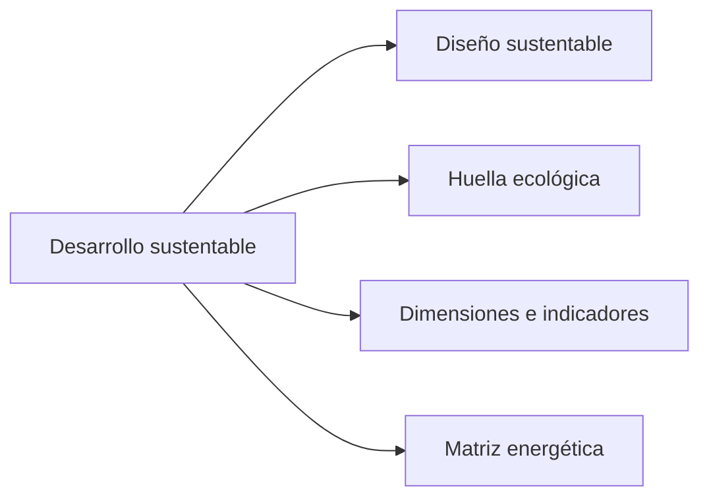
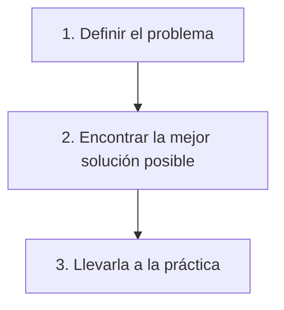
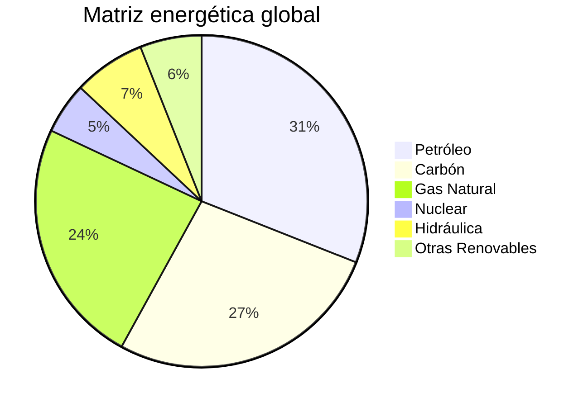

## Introducción

Ahora vamos a trabajar sobre el **desarrollo sustentable**, recorriendo cuatro grandes temas:

El objetivo es comprender que todo desarrollo debe ser sustentable, y que cada una de nuestras acciones ingenieriles debe ser "ingeniería sustentable".

Antes de empezar, aclaremos el vocabulario. En esta materia usamos **sustentable** y **sostenible** prácticamente como sinónimos. Si queremos ser precisos, sustentable se refiere más bien a contar con los recursos necesarios para llevar a cabo lo que se quiere hacer, mientras que sostenible apunta a que podamos seguir haciéndolo de la misma manera a lo largo del tiempo, sin perjudicar al ambiente. A los fines prácticos, ambos términos expresan la misma idea.

---
## Proceso de Diseño

Pensemos en un ejemplo sencillo. Queremos instalar un dispenser de agua y tenemos que decidir entre uno con bidón o uno sin bidón, conectado a la red con un filtro. ¿Cuál es más sustentable?
![[Pasted image 20261107092728.png|center|255]]

A primera vista, el dispenser conectado a la red parece la mejor opción, ya que evita el transporte semanal de bidones en camión y las emisiones asociadas. Sin embargo, si miramos con más detalle aparecen otras variables. Si el equipo conectado a la red tiene una pérdida, puede desperdiciar agua potable de forma continua, mientras que el bidón, en el peor de los casos, se vacía y ahí termina la pérdida. Además, habría que analizar de qué materiales está hecho el filtro y cada cuánto hay que reemplazarlo.

Esto nos lleva a mirar el **proceso de diseño**, que tiene tres etapas principales:

Si miramos un poco más adentro de cada etapa, para que el diseño sea sustentable:
- **Definir el problema**: identificar las variables involucradas, definir los criterios de selección y fijar las restricciones.
	- Por ejemplo, quizás no podemos pagar el recambio de filtros cada tres meses como corresponde y lo hacemos una vez por año. En ese caso, algo que parecía más ecológico termina derivando en contaminación del agua.
- **Encontrar la mejor solución posible**: buscar información útil, generar soluciones diversas y escoger la mejor solución posible.
- **Llevarla a la práctica**: especificar los detalles técnicos y logísticos (por ejemplo, si vamos a tener un camión todas las semanas trayendo bidones o un técnico que cambia el filtro cada tanto), gestionar los recursos necesarios para la implementación y prever qué controlar, el mantenimiento y la mejora continua.

En ingeniería, salvo en las materias básicas, nunca hay una única solución ni una única respuesta correcta. La mejor solución depende de las variables y criterios que definimos al inicio, es decir, de lo que consideramos más crítico. Por eso el ingeniero aporta **criterio**: toma decisiones considerando mucha información previa, ya procesada, y eso es algo difícil de reemplazar.

>[!WARNING] Cuidado
>La última etapa (control, mantenimiento y mejora continua) no puede faltar. Si no está, el diseño deriva en problemáticas que ni siquiera podemos anticipar.

---
## Diseño Sustentable

A partir de la rueda de estrategias LiDS (The LiDS Wheel, Van Hemel 1995), podemos enumerar las estrategias del **diseño sustentable**:
- **Materiales de bajo impacto**: limpios, renovables, reciclados, reciclables y con baja huella ecológica. Notemos que reciclado y reciclable no son lo mismo. Un material reciclado proviene de materiales ya utilizados en otro producto, mientras que uno reciclable puede reutilizarse en otro producto una vez finalizada su vida útil.
- **Reducción en el contenido de materiales**: productos más livianos y más chicos. Un producto más liviano es más fácil de transportar, es decir, requiere menos recursos para moverlo. No es lo mismo un camión cargado de plumas que uno cargado de plomo.
- **Optimización de la producción**: procesos alternativos, menos pasos, menos energía y más limpia, menos insumos y con menor huella ecológica.
- **Optimización de la distribución**: menos packaging, más chico y reusable, transporte con baja huella ecológica y logística eficiente.
- **Reducción del impacto durante el uso**: menor consumo de energía, fuente más limpia, menos consumibles y más limpios, sin desperdicio de energía o directamente sin consumibles.
- **Mejora de la vida útil**: confiabilidad, durabilidad, fácil mantenimiento y reparación, estructura modular, diseño clásico y fuerte relación usuario-producto. Cada vez hay menos productos fáciles de reparar. Si a una procesadora se le rompe una pieza pequeña y no conseguimos el repuesto, terminamos comprando otra entera.
- **Optimización del sistema de fin de vida útil**: reúso, recauchutado, reciclado de materiales, desarmabilidad e incineración segura. Se trata de saber qué hacer con el producto cuando ya no funciona o ya no lo necesitamos, porque muchas veces terminamos de usar algo sin tener idea de qué hacer con él.
- **Desarrollo de un nuevo concepto**: desmaterialización, uso compartido, integración de funciones y optimización del producto y sus componentes. Por ejemplo, si necesitamos una máquina por un tiempo acotado, en lugar de comprarla podemos alquilarla, o alquilarla entre varias personas. Lo mismo ocurre con el alquiler de ropa de fiesta, algo muy relevante si consideramos que la industria textil es una de las más contaminantes.

---
## Huella Ecológica

Un **indicador** es algo que nos ayuda a llevar registro y seguimiento de lo que nos interesa medir. La **huella ecológica** es un indicador ambiental que mide el impacto que ejerce sobre su entorno una persona o comunidad humana determinada, o más precisamente, las actividades que esa persona o comunidad genera.

Se expresa como el área (tierra y agua) biológicamente productiva necesaria para generar los recursos naturales que consume y absorber los desechos que genera esa persona o comunidad humana. Se mide en **hectáreas globales (hag)**, que consideran hectáreas con una productividad biológica media mundial. Es decir, 1 hag es la capacidad productiva de 1 hectárea de tierra de producción media mundial.

A escala global, tenemos que definir dos conceptos más:
- **Capacidad biológica o biocapacidad**: los recursos naturales disponibles.
- **Sobrecarga o déficit ecológico**: ocurre cuando la huella ecológica es mayor a la capacidad de carga.

Relacionado con esto está el **Día del Sobregiro de la Tierra**, la fecha del año en la que la humanidad ya consumió todos los recursos que el planeta puede regenerar en ese año. No significa que se agotaron todos los recursos existentes, sino que, a partir de esa fecha, estamos consumiendo a cuenta del futuro.

En 2023 el déficit fue del $75\%$, es decir, usamos un $75\%$ más de lo que podemos usar en un año, de modo que a la Tierra le toma un año y tres cuartos regenerarlo. Esto va directamente en contra de la definición de sustentabilidad, que era algo que se puede mantener en el tiempo sin consecuencias.
![[Pasted image 20261107094005.png|center|552]]

Los datos provienen de la [Global Footprint Network](https://footprintnetwork.org/faq/).

Además de la huella ecológica existen otras huellas. Cuando hablamos de huellas nos referimos siempre a indicadores. Las principales son la **huella de carbono** y la **huella hídrica**, que a su vez se divide en verde, azul y gris, y luego hay otras huellas más específicas.

---
## Eficiencia Energética

La producción de energía por medios convencionales suele tener tantas huellas como un ciempiés. Un indicador que seguramente vimos en cualquier electrodoméstico es la etiqueta de **eficiencia energética**, que clasifica el consumo del equipo en relación con la media:

| **Clase** | **Consumo** |
|:---:|:---:|
| A | $< 55\%$ de la media |
| B | Entre $55\%$ y $75\%$ |
| C | Entre $75\%$ y $90\%$ |
| D | Entre $90\%$ y $100\%$ |
| E | Entre $100\%$ y $110\%$ |
| F | Entre $110\%$ y $125\%$ |
| G | $> 125\%$ de la media |

La normativa avanza a paso lento pero firme. Por ejemplo, hoy en ciertas instalaciones nuevas ya no se permite colocar equipos con una etiqueta menor a A. Existe una presión externa cada vez más exigente respecto de la eficiencia energética.

---
## Normas ISO

Algunas normas relacionadas con estos temas son:
- **ISO 14064-1**: gases de efecto invernadero. Especificación con orientación, a nivel de las organizaciones, para la cuantificación y el informe de las emisiones y remociones de gases de efecto invernadero.
- **ISO 50001**: sistemas de gestión de la energía. Requisitos con orientación para su uso.

Las normas ISO no son de adecuación obligatoria, son voluntarias. Sin embargo, cada vez más empresas buscan certificarlas, en parte por una cuestión de marketing y de marca, pero también porque para hacer negocios entre empresas o para exportar muchas veces se exigen ciertos certificados.

La más típica es la **ISO 9001**, de calidad, que fue la primera que se empezó a certificar masivamente. Hoy también se certifica bastante la **ISO 14001** (gestión ambiental), y se suma la ISO 50001 de gestión de la energía. Son normas que se espera que tenga cualquier empresa seria.

---
## Huella de Carbono

La **huella de carbono** mide los **gases de efecto invernadero (GEI)**, cuantificados como emisiones de $CO_2$ equivalente en toneladas, que son liberados a la atmósfera como resultado de la actividad humana.

¿Por qué equivalente? Porque los gases de efecto invernadero son varios. El dióxido de carbono es uno, pero también están el metano, el óxido nitroso e incluso el vapor de agua, entre otros. Para medir el efecto de todos estos gases en un único indicador, se los normaliza a emisiones de dióxido de carbono equivalente.

La huella de carbono asociada a un producto tiene en cuenta las emisiones de GEI durante todo el ciclo de vida del producto, lo que se conoce como "de la cuna a la tumba", es decir, desde la adquisición de la materia prima hasta su gestión como residuo. De esto se encarga la norma **ISO 14067**.

Para calcularla existen calculadoras de huella de carbono para organizaciones.
![[Pasted image 20261107094048.png|center|422]]

En el cálculo hay que buscar el factor de conversión de cada gas de efecto invernadero a dióxido de carbono equivalente, que va a depender del equipo, de la fuente de energía que utiliza ese equipo, del combustible que genera esa energía, etc. Por ejemplo, el gobierno del Reino Unido publica planillas con estos factores de conversión.

Según la norma ISO 14064-1:2018, el cálculo se organiza en tres alcances operacionales, definidos según el **GHG Protocol**:
- **Alcance 1**: emisiones directas de GEI. Provienen de fuentes que son propiedad de la empresa o están controladas por ella. Fue el primer alcance que se tomó, el más obvio.
- **Alcance 2**: emisiones indirectas de GEI asociadas a la electricidad. Provienen de la generación de la electricidad adquirida y consumida por la empresa. Es decir, no es necesariamente el humo de una combustión propia, sino lo que se emitió para generar la energía que usan nuestros equipos.
- **Alcance 3**: otras emisiones indirectas. Son consecuencia de la actividad de la empresa, pero ocurren en fuentes que no son propiedad ni están controladas por ella. Se agregó al darse cuenta de que todo lo demás quedaba afuera.

>[!INFO] Nota
>El alcance 3 figura como una categoría opcional, pero en la práctica es cada vez menos opcional.

Veamos un ejemplo de cuadro resumen de la huella de carbono anual de una empresa de bebidas alcohólicas, con las categorías según la ISO 14064-1:2018. Para cada actividad se multiplica el dato por su factor, se suman las actividades de cada alcance y luego se suman los tres alcances:

| **Nº** | **Actividad** | **Dato** | **Factor** | **Huella** |
|:---:|:---|:---:|:---:|:---:|
| | **Alcance 1** | | | |
| 1 | Distribución productos | 3.460.000 km | $0{,}00054$ t/km | 1.868 t($CO_2$) |
| 2 | Emisión $CO_2$ directa x depuración eflu. | 503 t | 1 t/t | 503 t($CO_2$) |
| A1 | Emisiones directas | | | 2.371 t($CO_2$) |
| | **Alcance 2** | | | |
| 3 | Electricidad para calentar | 4.878 MW·h | $0{,}3$ t/(MW·h) | 1.463 t($CO_2$) |
| 4 | Electricidad para máquinas y oficinas | 423 MW·h | $0{,}3$ t/(MW·h) | 127 t($CO_2$) |
| 5 | Electricidad EDAR | 824 MW·h | $0{,}3$ t/(MW·h) | 247 t($CO_2$) |
| A2 | Emisiones indirectas por electricidad | | | 1.837 t($CO_2$) |
| | **Alcance 3** | | | |
| 6 | Fabricación bioetanol | 38.160 t($CO_2$) | 1 t/t | 38.160 t($CO_2$) |
| 7 | Viajes de negocios en automóvil | 900.000 km | $0{,}00018$ t/km | 162 t($CO_2$) |
| 8 | Viajes de negocios en avión | 550.000 p·km | $0{,}00015$ t/(p·km) | 82 t($CO_2$) |
| 9 | Publicidad | 3.100.000 u\$s | $0{,}000114$ t/u\$s | 353 t($CO_2$) |
| 10 | Producción de botellas | 25.000 MW·h | $0{,}3$ t/(MW·h) | 7.500 t($CO_2$) |
| 11 | Transporte en barco MP | 149.400.000 t·km | $0{,}000016$ t/(t·km) | 2.390 t($CO_2$) |
| 12 | Transporte en tren MP | 18.000.000 t·km | $0{,}000028$ t/(t·km) | 504 t($CO_2$) |
| 13 | Transporte en camión MP | 4.320.000 t·km | $0{,}000027$ t/(t·km) | 117 t($CO_2$) |
| A3 | Otras emisiones indirectas | | | 49.268 t($CO_2$) |
| **HC** | **Huella de carbono TOTAL** | | | **53.476 t($CO_2$)** |

En este caso la huella de carbono es de aproximadamente 53.000 toneladas de $CO_2$ equivalente. Notemos que el alcance 3 es, por lejos, el de mayor peso.

---
## Huella Hídrica

La **huella hídrica** tiene en cuenta el agua dulce necesaria para producir los bienes y servicios consumidos por un individuo o comunidad, y se mide en $m^3$/año. Se refiere al agua dulce porque es la que podemos consumir, y representa apenas alrededor del $2{,}5\%$ del agua total del planeta, por lo que hay que cuidarla.

Dentro de la huella hídrica distinguimos tres componentes:
- **Huella verde**: la precipitación efectiva utilizada o bien evaporada o formando parte del producto. Es relevante en los cultivos, ya que se trata del agua de lluvia que aprovechan.
- **Huella azul**: el agua superficial (arroyos, lagos, ríos) o subterránea (napas) utilizada. Es la más común en la industria.
- **Huella gris**: el volumen de agua necesario para asimilar la carga de contaminantes aportada.

La huella gris depende del cuerpo receptor. No es lo mismo volcar contaminantes en un arroyo pequeño que en un lago grande como el San Roque, en Córdoba, aunque incluso un cuerpo de agua grande puede llegar a saturarse.

La norma que corresponde a la huella hídrica es la **ISO 14046**.

---
## Rol del Ingeniero

Todas las carreras, y en particular las ingenierías, se ven atravesadas por la cuestión ambiental, aunque no trabajemos directamente en el área. Los ingenieros tenemos un conocimiento y unas herramientas que la mayoría de la población no tiene, y somos relativamente pocos en proporción a otras profesiones. Ese grado de conocimiento lleva asociado un grado de responsabilidad.

>[!TIP] Importante
>Los ingenieros debemos dejar el lugar en mejores condiciones de lo que lo encontramos. Siempre.

En esta línea, el **Código de ética profesional de la NSPE** (National Society of Professional Engineers) dice en su preámbulo:

"La ingeniería es una profesión importante y erudita. Como miembros de esta profesión se espera que los ingenieros muestren las normas más altas de honestidad e integridad. La ingeniería tiene un impacto directo y vital sobre la calidad de la vida de todas las personas. En consecuencia, los servicios que proporcionan los ingenieros requieren honestidad, imparcialidad, objetividad y equidad y deben dedicarse a la protección de la salud, la seguridad y el bienestar públicos. Los ingenieros deben desempeñarse de acuerdo con una norma de conducta profesional que requiere la adhesión a los principios más altos de la ética."

Lo importante es el porqué. No se espera esto porque los ingenieros seamos superiores, sino porque la ingeniería tiene un impacto directo y vital sobre la calidad de vida de todas las personas.

El código establece además los siguientes cánones fundamentales. En el cumplimiento de sus deberes profesionales, los ingenieros:
1. Pondrán por sobre todo la seguridad, la salud y el bienestar del público.
2. Desempeñarán servicios solamente en las áreas de su competencia.
3. Realizarán declaraciones públicas solo de manera objetiva y veraz.
4. Actuarán para cada empleador o cliente como agentes o fiduciarios de confianza.
5. Evitarán las acciones engañosas.
6. Se conducirán honorablemente, responsablemente, éticamente y legalmente, realzando a consecuencia el honor, la reputación y la utilidad de la profesión.

---
## Desarrollo Sustentable

El **desarrollo sustentable** es la satisfacción de las necesidades de la generación presente sin comprometer la capacidad de las generaciones futuras para satisfacer sus propias necesidades.

Para asegurarlo, hay que evaluar constantemente el **impacto antrópico** (es decir, de origen humano) sobre los bienes y servicios ecológicos y sobre el ambiente como un todo.

Los **bienes ecológicos** son los recursos naturales, por ejemplo:
- Agua
- Madera
- Animales
- Frutos vegetales

Los **servicios ecológicos** son un poco más difíciles de ver. Algunos ejemplos son:
- **Depuración atmosférica** por parte de vegetales y algas, que reducen el $CO_2$ y el $N_2O$ y aumentan el $O_2$.
- **Belleza de paisajes**, que habilita actividades como el turismo.
- **Biodegradación de contaminantes** por microorganismos naturales (DQO, $DBO_5$). Por ejemplo, la autodepuración del Río de la Plata, que recibe nuestros efluentes cloacales.
- **Protección del suelo** de la erosión pluvial por parte de árboles y otras plantas, como ocurre en las Yungas.

---
## Cumbres de la Tierra

A nivel internacional, en 1972 se reunieron por primera vez representantes de distintos países para reconocer que se estaban haciendo las cosas mal en materia ambiental. Desde entonces se realizaron las **Cumbres de la Tierra**, sobre ambiente y desarrollo, que revisan todo lo relacionado con el desarrollo sustentable:

| **Año** | **Cumbre** | **País** |
|:---:|:---:|:---:|
| 1972 | Primera cumbre | Suecia |
| 1992 | Río | Brasil |
| 1997 | Río +5 | Estados Unidos |
| 2002 | Río +10 | Sudáfrica |
| 2012 | Río +20 | Brasil |

Por otro lado están las **COP (Conferencias de las Partes)**, también denominadas Conferencias Internacionales sobre Cambio Climático, que se focalizan en un tema apremiante, el calentamiento global. Se realizan anualmente desde 1995, y en Argentina se hicieron la COP4 (1998) y la COP10 (2004). La COP29 fue en 2024 en Azerbaiyán y la COP30 en 2025 en Brasil.
![[Pasted image 20261107094220.png|center|429]]

En estas reuniones se juntan referentes de todo el mundo a debatir sobre ambiente y desarrollo, y también se discuten intereses económicos y comerciales. Para un país en desarrollo como Argentina, participar es importante porque permite acceder a financiamiento para proyectos ambientales y para mejoras de la normativa. Es un tema que tiene cada vez más relevancia y que va a tener un peso cada vez mayor.

---
## Dimensiones e Indicadores

El desarrollo sustentable tiene tres dimensiones. Tiene que ser **ecológicamente sustentable**, que es lo más obvio, pero también **socioeconómicamente sustentable** y **político-institucionalmente sustentable**. Si estas tres dimensiones no están en sintonía, el desarrollo sustentable no es posible.
![[Pasted image 20261107094252.png|center|272]]

La Comisión de Desarrollo Sustentable de las Naciones Unidas define 14 áreas de análisis para definir indicadores (en el documento de la ONU se las llama "themes"):
1. Pobreza
2. Gobernabilidad
3. Salud
4. Educación
5. Demografía
6. Riesgos naturales
7. Atmósfera
8. Suelo
9. Océanos, mares y costas
10. Agua potable
11. Biodiversidad
12. Desarrollo económico
13. Alianzas económicas globales
14. Patrones de consumo y producción

Dentro de estas áreas se revisan 44 aspectos ("sub-themes" en el documento de la ONU), referidos a cada área pero que impactan siempre sobre dos o más de ellas:

| **Área** | **Aspectos** |
|:---|:---|
| Pobreza | Ingresos, igualdad, cloacas, agua potable, energía, condiciones de vida |
| Gobernabilidad | Corrupción, crimen |
| Salud | Mortandad, atención sanitaria, nivel nutricional, nivel de salubridad y riesgos |
| Educación | Nivel educativo, alfabetización |
| Demografía | Población, turismo |
| Riesgos naturales | Vulnerabilidad ambiental, preparación y respuesta ante desastres |
| Atmósfera | Aporte al cambio climático, daño a la ozonósfera, calidad de aire |
| Suelo | Uso y calidad de suelos, desertificación, agricultura, bosques |
| Océanos, mares y costas | Uso de costas, pesca, estado del ambiente marino |
| Agua potable | Cantidad y calidad |
| Biodiversidad | Estado de ecosistemas, conservación de especies |
| Desarrollo económico | Performance microeconómica, finanzas públicas, empleo, TICs, I+D, turismo |
| Alianzas económicas globales | Comercio internacional, financiamiento externo |
| Patrones de consumo y producción | Materiales, energía, residuos, transporte |

Algunos comentarios sobre estas áreas:
- **Pobreza**: además de los ingresos, incluye el acceso a servicios como cloacas, agua potable y energía.
- **Gobernabilidad**: se refiere a la ausencia de corrupción y crimen, un desafío importante en los países de Latinoamérica.
- **Suelo**: la agricultura afecta mucho la calidad del suelo. Además, alrededor de un tercio de los alimentos producidos a nivel mundial se desperdicia. Parte de esto se debe a estándares estéticos: en las verdulerías vemos todos los tomates y bananas iguales porque los productos con alguna imperfección no se compran. En el Mercado Central, por ejemplo, las frutas y verduras "feas" se separan y se descartan, aunque siguen siendo aptas para el consumo.
- **Océanos, mares y costas**: la pesca indiscriminada genera desbalances ecosistémicos.
- **Alianzas económicas globales**: no es sustentable que cada país se arregle por su cuenta sin acuerdos con otros países.
- **Patrones de consumo y producción**: la cultura de consumo cada vez más descartable (comprar, usar pocas veces y tirar) va completamente en contra de la sustentabilidad.

Para todo esto se usan 50 indicadores básicos y 46 agregados, referidos a cada una de las áreas y aspectos. Veamos ejemplos para algunas áreas.

---
## Coeficiente de Gini

Un concepto importante es el **coeficiente de Gini**, que indica la **distribución de ingresos** de un país. Para entenderlo hay que interpretar el gráfico. En el eje X tenemos el porcentaje acumulado de la población, y en el eje Y el porcentaje acumulado de los ingresos.
![[Pasted image 20261107094320.png|center|542]]

El coeficiente se calcula como el área entre la recta de igualdad perfecta y la curva ($a$), dividida por el área total del triángulo bajo la recta ($a + b$):
$$G = \frac{a}{a+b}$$

La distribución perfectamente equitativa corresponde a $G = 0$. En ese caso no hay área entre la recta y la curva, y leyendo el gráfico, el $1\%$ de la población tiene el $1\%$ de los ingresos, el $2\%$ tiene el $2\%$, el $50\%$ tiene el $50\%$, y así. Obviamente esto no sucede en ningún país.

Cuanto mayor es el coeficiente de Gini, mayor es la desigualdad. En el caso extremo de inequidad total, $G = 1$: si un país tuviera 100 personas, 99 no tendrían nada y recién al sumar a la última persona aparecería la totalidad de los ingresos.

>[!TIP] Importante
>El coeficiente de Gini va de 0 a 1 (o de 0 a 100). Vale 0 cuando hay igualdad perfecta y 1 cuando hay desigualdad total.

Es un indicador internacional muy utilizado porque es muy visual y fácil de interpretar. Por ejemplo, el mapa del coeficiente de Gini por país en 2009 era el siguiente.
![[Pasted image 20261107094350.png|center|551]]

También podemos ver la evolución del coeficiente de Gini mundial a lo largo de 50 años, con y sin China. China, por su enorme población, tiene mucho peso en la estadística global. Incluyéndola, el coeficiente mundial baja desde mediados de los 80, mientras que sin China sube hasta el 2000 y recién después empieza a bajar.
![[Pasted image 20261107094407.png|center|362]]

Relacionada con esto está la **hipótesis de Kuznets**, que plantea que, a medida que una economía se desarrolla, la desigualdad primero aumenta, llega a un pico y luego empieza a bajar, describiendo una curva con forma de U invertida. Es una hipótesis y no está comprobada.

---
## Barrios Populares

Llevemos el análisis a la Ciudad de Buenos Aires. En la Capital Federal hay 38 villas y asentamientos fijos y transitorios (DGEyC GCBA 2015), también llamados barrios populares, donde habitan unas 200.000 personas (163.587 en 2010), lo que representa alrededor del $6{,}5\%$ del total de la ciudad. Viven en una situación de vulnerabilidad social, con ausencia del Estado, clientelismo político, etc.
![[Pasted image 20261107094508.png|center|553]]

Las más grandes son la Villa 21-24, en Barracas, y la Villa 31-31 bis, en Retiro. La mayoría se encuentra en el sur de la ciudad. Esto es relevante viniendo del coeficiente de Gini, porque la Capital Federal es de las zonas más pudientes del país y, aun así, en Retiro conviven uno de los barrios más caros con la Villa 31.

La vulnerabilidad no se limita a las viviendas, sino que se ve en los datos oficiales de acceso a servicios básicos (Ministerio de Economía):
![[Pasted image 20261107094541.png|center|593]]
- **Energía eléctrica**: el $56{,}75\%$ tiene una conexión irregular a la red.
- **Agua corriente**: el $56{,}63\%$ tiene una conexión irregular a la red de agua. Que sea irregular implica que nadie asegura que el agua no esté contaminada ni que el suministro sea continuo, por ejemplo cuando hace mucho calor.
- **Efluentes cloacales**: el $65{,}92\%$ desagua solo a pozo negro, ciego u hoyo. Si el barrio está cerca del Riachuelo, esos efluentes terminan en el Riachuelo.
- **Calefacción**: el $37{,}82\%$ usa leña o carbón, con las consecuencias de la quema de estos combustibles que vimos en clases anteriores.

---
## Otros Indicadores

Veamos otros indicadores que se tienen en cuenta. El **índice de transparencia** (Índice de Percepción de la Corrupción, de Transparency International) mide qué tan corrupto se percibe el sector público de cada país. América Latina presenta valores altos de corrupción percibida.
![[Pasted image 20261107094637.png|center|445]]

La **esperanza de vida al nacer** se muestra por separado para hombres y mujeres. En ambos mapas, cuanto más cálido el color, mayor la esperanza de vida.
![[Pasted image 20261107094704.png|center|522]]

Notemos que la esperanza de vida femenina es mayor, ya que los hombres suelen morir antes.
![[Pasted image 20261107094723.png|center|490]]

El **índice de alfabetización de adultos** (UNESCO 2015) no tiene datos para varios países, que no adhieren a este índice.
![[Pasted image 20261107094746.png|center|480]]

La **pirámide poblacional** cambia mucho de un país a otro. Comparemos Suecia, Argentina y Camerún.
![[Pasted image 20261107094806.png|center|550]]

En Suecia la población está distribuida casi por igual entre las edades, e incluso la base es más chica que el centro, por lo que es una población envejecida. En Argentina la distribución es bastante equilibrada. En cambio, en países menos desarrollados como Camerún la esperanza de vida es muy baja, por lo que las poblaciones de mayor edad son casi inexistentes.

La pirámide poblacional es importante, por ejemplo, para el sistema previsional. En la mayoría de los países, los jóvenes en etapa laboral sostienen a los jubilados. Como la tasa de natalidad baja en todo el mundo y la esperanza de vida aumenta por los avances de la medicina, esto genera una presión creciente sobre esos sistemas.

El **índice de riesgo por desastres naturales** muestra el nivel de riesgo de cada país.
![[Pasted image 20261107094824.png|center|507]]

La **emisión de $CO_2$ por habitante** muestra las toneladas de $CO_2$ por persona provenientes de la energía y el cemento (2013).
![[Pasted image 20261107094843.png|center|514]]

También se analizan los países con grandes cambios netos en el área de bosques entre 2000 y 2005, distinguiendo los que pierden y los que ganan más de $0{,}5\%$ anual.
![[Pasted image 20261107095002.png|center|469]]

El **índice de salud oceánica** (Ocean Health Index, OHI) indica el nivel de riesgo del ambiente marino de cada país. Cuanto más alto el índice, menor el riesgo.
![[Pasted image 20261107095020.png|center|484]]

En el **índice de acceso al agua potable**, Argentina está muy bien posicionada, al menos por ahora, pero hay que cuidarlo.
![[Pasted image 20261107095047.png|center|489]]

Por último, en el **porcentaje de áreas protegidas** Argentina está bastante baja (entre $5\%$ y $10\%$) considerando la cantidad de naturaleza que tiene, mientras que buena parte del resto de Latinoamérica supera ese valor.
![[Pasted image 20261107095122.png|center|456]]

---
## Herramientas para el Desarrollo

La herramienta principal para el desarrollo sustentable es la **investigación y desarrollo (I+D)**.

Ahora bien, ¿qué es desarrollo? El "desarrollo" depende del paradigma cultural que lo defina. Lo que es desarrollo para Canadá puede ser completamente distinto de lo que es para Rusia. Un ejemplo es la división en los "tres mundos" durante la Guerra Fría del siglo XX.
![[Pasted image 20261107095143.png|center|467]]

Esta división quizás ya quedó antigua, y hace falta otra visión sobre hacia dónde apunta cada país o región del mundo y qué necesita para eso.

La pregunta siguiente es más filosófica: desarrollo, ¿para qué? ¿A dónde queremos llegar? Un ejemplo es el concepto de **Felicidad Nacional Bruta (GNH)**, que se explica en este [video](https://www.youtube.com/watch?v=DaN60KaDyqE). El producto bruto interno es simplemente un indicador, como tantos otros, y no tiene en cuenta algo tan básico como la felicidad. Que un país tenga un PBI mayor que otro no significa que su población esté más satisfecha con sus condiciones de vida.

---
## Matriz Energética

La **matriz energética** es la proporción en la que se utiliza cada fuente de energía. Puede ser global, pero generalmente se analiza por país. La matriz energética global (IEA 2020, BP 2021) muestra una clara predominancia de los combustibles fósiles:

Entre petróleo, carbón y gas natural suman el $82\%$, y queda menos del $20\%$ para la hidráulica, la nuclear y las otras renovables.

Comparemos ahora la matriz energética de Argentina con la de otros países:
![[Pasted image 20261107095217.png|center]]
- **Argentina**: predomina el gas natural, con un $50\%$, seguido por el petróleo con un $32\%$ (antes era mucho mayor). La hidráulica es bastante importante ($10\%$), la nuclear aporta un $4\%$ con solo tres centrales (Atucha I y II, en Buenos Aires, y Embalse, en Córdoba) y las otras renovables un $4\%$, principalmente eólica en el sur y solar.
- **Francia**: el $70\%$ de la energía proviene de centrales nucleares, que tienen una emisión bajísima comparada con otras fuentes.
- **China**: el $57\%$ proviene del carbón, la fuente más contaminante.
- **Canadá y Brasil**: predomina la hidráulica, con $60\%$ y $65\%$ respectivamente.

Se suele hablar del **gas natural** como la energía de transición, porque su combustión tiene una huella de carbono menor que la del petróleo. Sin embargo, no deja de ser una energía no renovable.

Un caso extremo es Paraguay, donde la mayor parte de la matriz energética proviene de la central hidroeléctrica de Itaipú, que comparte con Brasil.

Ninguna fuente es perfectamente limpia ni tiene emisión cero. Todo tiene un impacto. La fabricación de paneles solares, por sus materiales, es muy contaminante. Para construir una represa hidroeléctrica muchas veces hay que inundar pueblos enteros, lo que provoca el desplazamiento de muchas personas, frecuentemente poblaciones vulnerables o indígenas. Siempre se trata de equilibrios, balances y compromisos entre intereses.

---
## Sustentabilidad Energética

Aquí se cruzan la sustentabilidad y la energía. El World Energy Council (WEC) plantea el **trilema energético**, que consiste en equilibrar tres objetivos:
![[Pasted image 20261107095258.png|center|255]]
- **Seguridad energética**
- **Igualdad energética**
- **Sostenibilidad medioambiental**

El reto consiste en lograr un sistema energético que cubra las necesidades actuales, pero que, al mismo tiempo, sea competitivo y pueda funcionar de forma continua (eje económico), sin exclusión (eje social) y que no conlleve una destrucción progresiva de la naturaleza (eje ambiental). Ese es el desafío de hoy.

El funcionamiento continuo es una dificultad para las energías que dependen de la naturaleza. Si se nubla, la energía solar rinde menos, y si no hay viento, la eólica deja de generar, por lo que se necesita una fuente de respaldo.

Queda planteada la pregunta: ¿qué ventajas y desventajas presentan las energías renovables (solar, hidroeléctrica, eólica, bioenergía, oceánica, geotérmica, etc.) frente a las no renovables?
