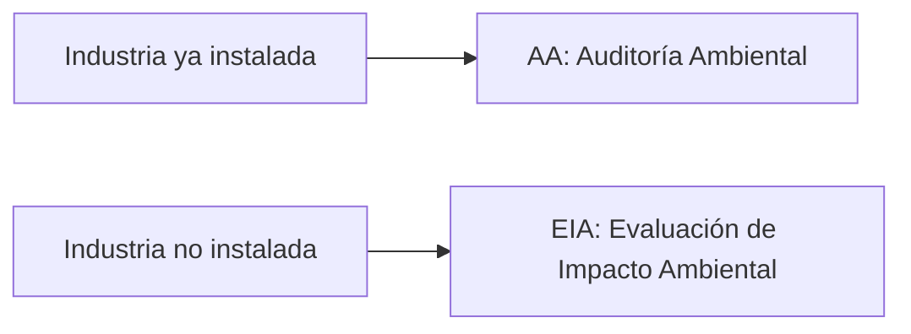
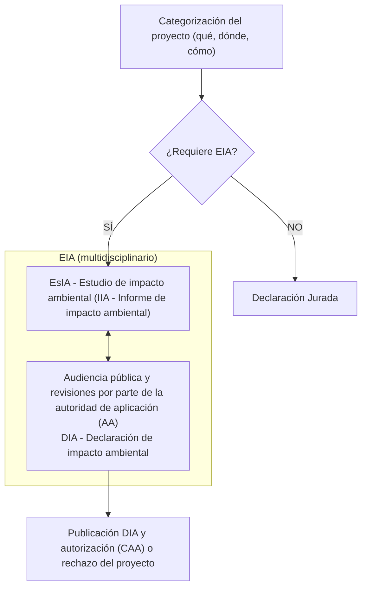
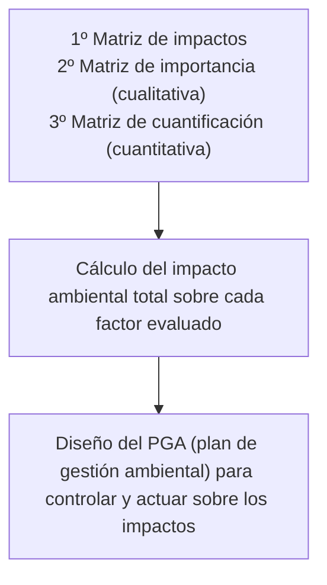

## Introducción

Vamos a trabajar sobre la **legislación ambiental**. El objetivo es hacernos una idea de la legislación ambiental vigente y entender de dónde sale, cómo se hace y para qué sirve una evaluación de impacto ambiental. Antes de entrar en el caso argentino, conviene saber que el nuestro no es el único paradigma legislativo. A modo de aproximación, en el mundo conviven distintos paradigmas.
![[Pasted image 20261107100856.png|center|416]]
- **Romano germánico**: se basa en el derecho escrito. Es el que rige en Argentina.
- **Anglosajón**: se basa en la jurisprudencia.
- **Islámico**: es religioso, ya que la religión rige todos los aspectos de la vida.
- **Asiático**: es familiar. Muchas veces la culpa se traslada a la familia, por ejemplo, responsabilizando a los padres por no haber criado bien a quien cometió una falta.
- **Africano**: es colectivo, con mucho peso del derecho de la comunidad y no tanto del derecho individual.

---
## Pirámide Jurídica

En Argentina las normas se ordenan según la **pirámide jurídica**. Lo que está arriba rige a lo que está abajo, y una norma inferior no puede contradecir a una superior.
![[Pasted image 20261107100917.png|center|427]]

De arriba hacia abajo encontramos:
1. **Constitución Nacional y tratados internacionales de derechos humanos**: son la norma suprema del país.
2. **Leyes nacionales y códigos**: por ejemplo, el Código Civil y Comercial, la Ley General del Ambiente y las leyes de presupuestos mínimos, que son las que nos interesan en esta unidad.
3. **Decretos y reglamentaciones**: corresponden al poder ejecutivo, que detalla cómo se aplican las leyes y códigos de arriba. Aplican, pero no modifican. Primero se sanciona una ley y después se reglamenta. Un ejemplo reciente es la ley de financiamiento universitario, que estuvo vigente más de un año sin poder ejecutarse porque su reglamentación no establecía de dónde salían los fondos.
4. **Normas provinciales y ordenanzas municipales**: son la regulación local.
5. **Reglamentos, disposiciones y resoluciones**: los dictan organismos específicos.

Un ejemplo de organismo específico es **ACUMAR** (Autoridad de Cuenca Matanza Riachuelo), una autoridad ambiental con normativa propia que estaría en la base de la pirámide. Sin embargo, dentro de su jurisdicción es la autoridad máxima en la materia. Si ACUMAR exige una DBO de 30 para los vuelcos y otra autoridad, como la Autoridad del Agua de la provincia, permite 50, dentro de la cuenca rige la de 30.

Por eso, en cualquier actividad que desarrollemos tenemos que averiguar muy bien en qué jurisdicción estamos trabajando y qué normativa nos corresponde cumplir, lo cual no es un reto menor. Muchas industrias se saltean este paso y luego alegan que no sabían que tenían que cumplir con algo, pero a la ley no le importa si lo sabíamos, sino si lo cumplimos o no.

---
## Artículo 41

El **artículo 41 de la Constitución Nacional** es la base legal de todo lo ambiental en Argentina, incorporado en la reforma de 1994. Dice lo siguiente:

"Todos los habitantes gozan del derecho a un ambiente sano, equilibrado, apto para el desarrollo humano y para que las actividades productivas satisfagan las necesidades presentes sin comprometer las de las generaciones futuras; y tienen el deber de preservarlo. El daño ambiental generará prioritariamente la obligación de recomponer, según lo establezca la ley.

Las autoridades proveerán a la protección de este derecho, a la utilización racional de los recursos naturales, a la preservación del patrimonio natural y cultural y de la diversidad biológica, y a la información y educación ambientales.

Corresponde a la Nación dictar las normas que contengan los presupuestos mínimos de protección, y a las provincias, las necesarias para complementarlas, sin que aquéllas alteren las jurisdicciones locales.

Se prohíbe el ingreso al territorio nacional de residuos actual o potencialmente peligrosos, y de los radiactivos."

La primera parte es un postulado muy importante, porque habla de lo que les dejamos a las generaciones que vienen después. Tenemos el deber de preservar el ambiente más allá de las actividades productivas que ejerzamos. Aunque el artículo tiene más de 30 años, todavía no se cumple como debería, ya que suele primar la búsqueda de resultados inmediatos por sobre las consecuencias futuras.

La última parte se relaciona con lo que vimos sobre residuos. Al prohibir el ingreso de residuos peligrosos y radiactivos, se evita que el país termine siendo el depósito de basura de los países desarrollados, algo que les sucede a muchos países de bajos recursos.

En síntesis, el artículo 41 es importante porque:
- Reafirma que el ambiente es un **derecho colectivo y fundamental**.
- Introduce la idea de **desarrollo sostenible** en la Constitución.
- Ordena la creación de leyes de **presupuestos mínimos**.
- Da marco a la **participación ciudadana** en la protección ambiental.

Además, Argentina suscribió una larga lista de **tratados internacionales sobre ambiente**, como el Tratado Antártico, el Convenio de Ramsar sobre humedales, el Convenio de Viena y el Protocolo de Montreal sobre la capa de ozono, el Convenio de Basilea sobre movimientos transfronterizos de desechos peligrosos, el Protocolo de Kyoto y el Convenio de Estocolmo sobre contaminantes orgánicos persistentes, entre muchos otros.

Dentro de la Constitución Nacional hay otros dos artículos relevantes:
- **Artículo 43**: establece las acciones de amparo para preservar derechos constitucionales.
- **Artículo 124**: establece que corresponde a las provincias el dominio de los recursos naturales. Sin embargo, por la pirámide jurídica, las normas provinciales no pueden estar por encima de la Constitución Nacional.

---
## Presupuestos Mínimos

Por debajo de la Constitución están las **leyes nacionales de presupuestos mínimos**. La más importante es la **Ley 25.675**, la Ley General del Ambiente, y luego hay otras:
- Ley 25.612: residuos industriales
- Ley 25.670: PCBs
- Ley 25.688: aguas
- Ley 25.831: libre acceso a la información ambiental
- Ley 25.916: residuos domiciliarios
- Ley 26.331: bosques nativos
- Ley 26.562: actividades de quema
- Ley 26.639: glaciares
- Ley 26.815: manejo del fuego

Una **ley de presupuestos mínimos** no tiene que ver literalmente con un presupuesto económico. Es una ley nacional que fija un piso, una base mínima de protección para todas las provincias. Por ejemplo, puede exigir como mínimo un órgano de control, inspectores que fiscalicen, recorran y multen, o una inversión en la recomposición de cierto ambiente. De ahí para arriba, cada provincia puede ser más exigente, pero nunca menos. De esta manera se respeta la autonomía de las provincias sin resignar una protección básica común.

Muchas de estas leyes requieren ser **reglamentadas** para ponerse en práctica. A nivel nacional se reglamentan mediante resoluciones y decretos, y a nivel provincial mediante leyes, decretos y resoluciones propias.

>[!TIP] Importante
>El único artículo que hay que memorizar es el 41, y a lo sumo el número de la Ley General del Ambiente (25.675). Del resto de las leyes importa el concepto, no el número. Por ejemplo, una provincia no puede flexibilizar un límite fijado por una ley de presupuestos mínimos aunque sea dueña de sus recursos naturales, por la pirámide jurídica.

---
## Recurso de Amparo

De la legislación nacional surgen algunas **herramientas de protección ambiental** que vamos a revisar:
- Recurso de amparo ambiental
- Iniciativa popular
- Ombudsman
- Seguro ambiental

Luego nos centraremos en la evaluación de impacto ambiental.

El **recurso de amparo ambiental** es una medida judicial rápida con las siguientes características:
- Aplica a una acción actual o inminente, es decir, algo que está sucediendo, y no a acciones pasadas.
- Se aplica para restablecer derechos vulnerados.
- Es válido ante acciones manifiestas, no cuando las medidas probatorias o los procedimientos son complejos y prolongados.
- Se funda en el artículo 43 de la Constitución Nacional.

Es importante entender que el derecho ambiental es un **derecho colectivo**, no individual. Si pensamos en los derechos humanos a partir del lema de la Revolución Francesa, la libertad corresponde a los derechos de primera generación, la igualdad a los de segunda y la fraternidad a los de tercera. El derecho ambiental, como derecho colectivo, es un derecho humano de **tercera generación**.
![[Pasted image 20261107101002.png|center|530]]
Lo que está en juego con el ambiente queda claro con el **Día del Sobregiro de la Tierra** que vimos la clase pasada. Si a nivel global ese día cae a fines de julio, a los siete meses del año ya consumimos lo que el planeta puede regenerar en el año, y los cinco meses restantes los tomamos de las generaciones futuras, que es justamente lo que el artículo 41 busca evitar. Los países mejor posicionados en este indicador son los menos industrializados, como Ecuador o Nicaragua, ya que consumen menos recursos.

---
## Causa Mendoza

El ejemplo más conocido de este tipo de acción es la **causa Mendoza**, que lleva el apellido de una de las vecinas que la presentó. Un grupo de vecinos, muchos de ellos de Villa Inflamable (Avellaneda), demandó al Estado y a las empresas por la contaminación de la **cuenca Matanza-Riachuelo**. En 2008 la Corte Suprema, apoyándose en el artículo 41 y en la Ley General del Ambiente, ordenó su saneamiento integral.

La cuenca abarca un área enorme, que va desde la Capital Federal y la desembocadura en el Río de la Plata hasta General Las Heras y Cañuelas, pasando por Marcos Paz y Ezeiza. Está formada por el cuerpo de agua principal, el Riachuelo, y los arroyos que lo alimentan.

Villa Inflamable está pegada al **polo de Dock Sud**, que antes era un polo petroquímico completamente industrializado y hoy funciona principalmente como almacenamiento de hidrocarburos. Al tomar muestras de suelo en todo su perímetro, sale negro de hidrocarburos. Es muy común que junto a las industrias se emplacen barrios irregulares, sin acceso a servicios y conviviendo a diario con la contaminación.

El fallo ordenó:
- El saneamiento integral de la cuenca.
- La recomposición ambiental y social del área.
- Que ACUMAR fuera responsable de coordinar y controlar las acciones de saneamiento.
- La relocalización de las familias que vivían en condiciones de riesgo sanitario sobre la ribera. Esto implica mover a miles de personas de sus casas, cualesquiera fueran sus condiciones.
- Programas de reconversión industrial con controles ambientales más estrictos.

Antes del saneamiento, acercarse al Riachuelo era insoportable por el olor. Las industrias más contaminantes, como las curtiembres y las que usaban azufre y cromo, se concentraban cerca del Riachuelo y del puerto, desde donde distribuían su producción. Hoy el olor ya no está, pero eso implicó la quiebra y el cierre de muchas industrias, principalmente las pequeñas, porque las inversiones necesarias para producir sin contaminar no les daban los números. Algunas grandes absorbieron a las chicas e invirtieron en plantas de tratamiento. Hacer cumplir la ley no es sencillo, porque hay muchos factores en juego que no se ven.

En la ribera se acumulaban residuos, en su mayoría domiciliarios, provenientes de asentamientos sin servicio de recolección que usaban el Riachuelo como basural. Hoy hay cooperativas de vecinos que limpian la ribera todos los días, y lanchas del organismo que recogen los residuos del agua. Todo esto nació de una vecina de un barrio humilde que presentó una acción judicial, lo que muestra el poder que tiene cualquier ciudadano gracias a estas herramientas.

---
## Iniciativa Popular

La **iniciativa popular** está establecida en el artículo 39 de la Constitución Nacional: "Los ciudadanos tienen el derecho de iniciativa para presentar proyectos de ley en la Cámara de Diputados. El Congreso deberá darles expreso tratamiento dentro del término de doce meses".

La Ley 24.747 la reglamenta y establece que:
- La cantidad de firmas debe ser mayor o igual al $1{,}5\%$ del padrón electoral.
- Si la iniciativa es nacional, las firmas deben provenir de al menos 6 distritos electorales.
- El Defensor del Pueblo debe verificar el contenido de la iniciativa en un plazo no superior a 10 días, antes de la circulación y recolección de firmas.
- Las firmas se presentan en la mesa de entradas de la Cámara de Diputados.

Una recolección de firmas como las de [change.org](https://www.change.org) puede terminar en una iniciativa popular. El Congreso no está obligado a aprobar el proyecto, pero sí a tratarlo. Es una herramienta muy importante, porque permite que se trate un proyecto de ley presentado por ciudadanos y no necesariamente por un diputado o senador, que muchas veces tiene sus propios intereses.

---
## Defensor del Pueblo

El **Defensor del Pueblo de la Nación** es un **órgano independiente** instituido en el ámbito del Congreso de la Nación, que actúa con plena autonomía funcional y sin recibir instrucciones de ninguna autoridad. La figura del **Ombudsman** proviene del derecho escandinavo y se integró al orden normativo argentino con la reforma constitucional de 1994, al igual que el artículo 41 y las leyes de presupuestos mínimos.

Según el artículo 86 de la Constitución Nacional, tiene **legitimación procesal**, es decir, está facultado para presentarse en sede judicial. Es designado y removido por el Congreso con el voto de dos tercios de los miembros presentes de cada Cámara, y dura 5 años en su cargo, con posibilidad de ser designado nuevamente una sola vez. Además, es la única institución nacional de derechos humanos reconocida por Naciones Unidas, con status clase A.

Hace varios años que el cargo está vacante, porque debe proponerlo el Congreso y no hay consenso. Actualmente la Defensoría está a cargo del subsecretario general.

En la Defensoría puede denunciarse todo acto u omisión, de autoridades públicas o particulares, que lesione, restrinja, altere o amenace derechos y garantías reconocidos por la Constitución Nacional y las leyes. Esto incluye discriminación, problemas con servicios públicos, violaciones a los derechos humanos, maltrato en hospitales públicos, aumentos de impuestos y tarifas, corrupción y **contaminación ambiental**, entre otros temas. Dentro del área ambiental se tratan, por ejemplo:
- Cuenca Matanza-Riachuelo
- Medio ambiente y ecología
- Parques nacionales, monumentos naturales y reservas nacionales
- Recursos naturales, renovables y no renovables
- Residuos peligrosos
- Urbanismo y vivienda, ordenamiento ambiental del territorio y asentamientos

Respecto del ordenamiento territorial, en los últimos años muchas personas que ya no necesitaban ir a la oficina se mudaron de la Capital Federal al conurbano, a zonas como Pilar, Ezeiza o Canning, y hubo una gran expansión de los barrios cerrados (conjuntos inmobiliarios). Esa expansión se hizo sin un ordenamiento territorial adecuado, para responder rápido a la demanda, y hoy genera problemas de contaminación por efluentes cloacales, movimientos de suelo y desvío de cursos de agua naturales. En la Capital, de hecho, hay varios arroyos soterrados bajo las avenidas, y existen iniciativas para descubrirlos, como hacen muchas ciudades del mundo que conviven con sus cursos de agua.

---
## Seguro Ambiental

El **seguro ambiental** fue instituido en 2002 por la Ley General del Ambiente 25.675. El seguro que se exige contratar se denomina **seguro de caución por daño ambiental de incidencia colectiva**. Como su nombre lo indica, es un seguro colectivo, más allá de los perjuicios individuales que puedan suscitarse.

Tomemos el ejemplo de una **curtiembre**, que procesa los cueros de las vacas que salen del frigorífico. El cuero llega crudo, con grasa y sangre, y hay que inactivar químicamente su fase orgánica para que no se pudra y pueda durar. Esa inactivación se hace con compuestos de cromo, un contaminante importante por sus efectos sobre la salud, tanto en exposición crónica como aguda. Además, el cromo III puede pasar a cromo VI, que es cancerígeno en concentraciones mínimas.

Si a la curtiembre se le pincha el tanque de cromo y termina en la canaleta del barrio, la autoridad (por ejemplo ACUMAR, si está en su jurisdicción) ejecuta el seguro ambiental para remediar el daño. Funciona como cualquier seguro: la empresa paga una prima y, si ocurre algo, la aseguradora cubre la recomposición. Lo que no cubre es la indemnización a un vecino que inicie un juicio porque le contaminaron la casa, ya que el seguro es de incidencia colectiva. Además, los controles respecto del vencimiento del seguro son muy estrictos.

Otras características del seguro ambiental son:
- Es obligatorio para quienes realicen actividades riesgosas para el ambiente. En la provincia de Buenos Aires, cuando el **nivel de complejidad ambiental (NCA)** es igual o mayor a $14{,}5$ puntos. Si el NCA de una actividad es 10, no está obligada por ley a contratarlo. En CABA, cuando la actividad es "con relevante efecto".
- El NCA se calcula a partir de muchas variables, como el tipo de actividad, la superficie que ocupa, la cantidad de personas, la distancia a otros puntos y si está en una zona industrial o urbana.
- Debe garantizar la recomposición del daño ambiental que pudiera generarse.
- Intervienen tres partes: el tomador de la póliza (la empresa), el Estado y la compañía aseguradora.
- Hay una docena de aseguradoras habilitadas, agrupadas en CAARA.
- Aunque rige para todo el país, actualmente se exige solo en algunas jurisdicciones: CABA, provincia de Buenos Aires, la zona de la cuenca Matanza-Riachuelo y las provincias de Santa Fe, Córdoba, Catamarca, La Rioja, Chaco, Chubut, Neuquén, Santa Cruz y Tierra del Fuego.

---
## Legislación de la EIA

Entramos ahora en la **evaluación de impacto ambiental (EIA)**, que también se desprende de la legislación. Las principales normas son:
- **Ley General del Ambiente 25.675**: establece la obligatoriedad y los contenidos mínimos de una EIA (declaración jurada, estudio de impacto ambiental, descripción detallada, consecuencias ambientales y acciones para mitigar los efectos negativos) e indica que debe asegurarse la participación ciudadana. El **estudio de impacto ambiental (EsIA)** forma parte de la evaluación, pero son dos cosas distintas.
- **Constitución de la provincia de Buenos Aires, artículo 28**: control del impacto ambiental, recuperación de ambientes dañados y derecho a la información.
- **Ley de radicación industrial 11.459 (provincia de Buenos Aires)**: define el nivel de complejidad ambiental, que es el cálculo que determina si el seguro ambiental es obligatorio, y la obligatoriedad de obtener el **certificado de aptitud ambiental (CAA)**, que se expide en función del resultado de la evaluación.
- **Ley integral de medio ambiente y recursos naturales 11.723 (provincia de Buenos Aires)**: define qué proyectos deben hacer una EIA ante la autoridad provincial o municipal.
- **Resolución SPA 538/99 (provincia de Buenos Aires)**: establece el procedimiento para llevar a cabo una EIA. La SPA luego pasó a ser el OPDS, que hoy es el Ministerio de Ambiente de la provincia.
- **Constitución de CABA, artículo 30**: los proyectos "con relevante efecto" deben hacer una EIA.
- **Leyes 123 y 452 y Decreto 1.352/02 (CABA)**: categorizan los proyectos con y sin relevante efecto.

>[!WARNING] Corrección
>En clase se dijo que la Ley 123 categoriza los proyectos en primera, segunda y tercera categoría según su impacto potencial. En realidad, la Ley 123 de CABA los categoriza como con o sin relevante efecto. La clasificación en primera, segunda y tercera categoría según el NCA corresponde a la Ley 11.459 de la provincia de Buenos Aires.

Otras provincias tienen su propia legislación, como Córdoba, Mendoza, Corrientes, Neuquén, Río Negro y Tierra del Fuego. Como vemos, todas estas normas giran alrededor de las mismas ideas.

---
## Evaluación de Impacto Ambiental

Para hablar de evaluación de impacto ambiental, repasemos primero qué es el impacto ambiental. Según Gómez Orea, el **impacto ambiental** es la alteración que la ejecución de un proyecto introduce en el medio, expresada por la evolución de este "sin" y "con" proyecto. Es decir, el efecto es la diferencia entre el antes y el después.

Según Conesa Fernández-Vítora (2010), hay impacto ambiental cuando una acción, consecuencia de un proyecto o actividad, produce una alteración, favorable o desfavorable, en el medio o en alguno de sus componentes. Notemos que puede ser positiva, aunque los casos favorables son pocos. La acción puede ser un proyecto de ingeniería, un programa, un plan, una ley o una disposición administrativa con implicancias ambientales. Nosotros nos vamos a centrar en proyectos de ingeniería.

Según el PNUMA (Naciones Unidas), la **evaluación de impacto ambiental** es la investigación, análisis y evaluación de actividades planeadas, buscando asegurar un desarrollo sustentable y ambientalmente sano. Conesa Fernández-Vítora la define de forma más precisa:

"La EIA es un procedimiento jurídico-administrativo que tiene por objetivo la identificación, predicción e interpretación de los impactos ambientales que un proyecto o actividad produciría en caso de ser ejecutado, así como la prevención, corrección y valoración de los mismos, todo ello con el fin de ser aceptado, modificado o rechazado por parte de las distintas administraciones públicas competentes."

>[!TIP] Importante
>La EIA es un procedimiento jurídico-administrativo, y trata de ser lo más objetiva posible.

Pensemos en una fábrica de galletitas que se quiere instalar en San Antonio de Areco. Hay que hacer una evaluación de impacto ambiental y presentarla ante las autoridades, que pueden aceptarla tal como está planteada, pedir que se modifique o rechazarla directamente, es decir, decidir que la fábrica no puede instalarse en ese lugar de ninguna manera.

---
## Origen de la EIA

El concepto de evaluación de impacto ambiental apareció en 1969 en la legislación de Estados Unidos, con la **NEPA** (National Environmental Policy Act). La Unión Europea la introdujo en su legislación en 1985 (Directiva 85/337/CEE), y a Sudamérica llegó recién en la década de los 90.

En 1992, en la Declaración de Río (segunda Cumbre de la Tierra), el principio 17 estableció que deberá emprenderse una evaluación del impacto ambiental, en calidad de instrumento nacional, respecto de cualquier actividad propuesta que probablemente haya de producir un impacto negativo considerable en el medio ambiente y que esté sujeta a la decisión de una autoridad nacional competente.

Luego, el **Manual de Operaciones del Banco Mundial** (OP 4.01, 1999) exige que todos los proyectos propuestos para obtener financiamiento se sometan a una evaluación ambiental, con el fin de garantizar su solidez y sostenibilidad ambiental y mejorar así el proceso de toma de decisiones. Estas políticas se aplican a todos los proyectos presentados a partir del 1 de marzo de 1999. Por ejemplo, el nuevo campus del ITBA obtuvo un préstamo del Banco Mundial, por lo que debió presentar su evaluación de impacto ambiental. No hace falta que la actividad sea muy contaminante, basta con que tenga un impacto, como lo tiene cualquier proyecto de este estilo.

La EIA se aplica a una industria que todavía no está instalada. Para una industria ya instalada corresponde una **auditoría ambiental (AA)**, que analiza los efectos que ya están sucediendo. En ese caso solo queda corregir lo que se pueda o, si no hay manera de que continúe, clausurar la industria.

---
## Procedimiento de la EIA

El procedimiento de evaluación de impacto ambiental es el siguiente:

Primero se categoriza el proyecto y se evalúa si requiere una EIA. Son pocos los casos en que no, pero existen, y en ese caso se pide una **declaración jurada**. Si la requiere, se realiza el estudio de impacto ambiental y se hace una **audiencia pública**, además de las revisiones de la autoridad de aplicación que corresponda.

Una audiencia pública es una reunión sobre cierto tema, por ejemplo la instalación de la fábrica de galletitas, abierta a toda la comunidad: vecinos, intendentes, el dueño de la fábrica, el dueño del terreno y cualquier persona que sienta que el proyecto la afecta. Quienes quieran pueden anotarse como oradores y exponer, con un tiempo asignado, los motivos por los que están de acuerdo o en desacuerdo. Según la magnitud del proyecto puede durar varios días, y todo lo que se dice queda registrado e incluido en la evaluación.

Lo ideal sería que siempre se hiciera, aunque muchas veces las decisiones se toman a puertas cerradas en una mesa de negociación. Sin embargo, en una audiencia pública surgen detalles y observaciones que solo puede aportar quien vive en el lugar.

Si la evaluación resulta positiva, se publica la **declaración de impacto ambiental (DIA)** y se otorga el **certificado de aptitud ambiental (CAA)**, con lo que el proyecto puede llevarse a cabo. Si no, se detallan las modificaciones que hay que hacer o directamente se rechaza el proyecto en ese lugar.

La bibliografía de referencia es la "Guía Metodológica para la Evaluación del Impacto Ambiental", de Vicente Conesa Fernández-Vítora, de donde salen los métodos que vamos a ver. Son métodos orientativos, ya que no existe una fórmula mágica que diga si un proyecto es viable o no.
![[Pasted image 20261107101055.png|center|114]]

---
## Estudio de Impacto Ambiental

El **estudio de impacto ambiental (EsIA)** es el corazón de la evaluación de impacto ambiental. A diferencia de la evaluación, que es un procedimiento administrativo, el estudio es técnico. Es el estudio técnico, de carácter interdisciplinario, que incorporado en el procedimiento de la EIA está destinado a predecir, identificar, valorar y corregir los efectos ambientales que determinadas acciones pueden causar sobre la calidad de vida del hombre y su entorno.

Los contenidos mínimos de un EsIA son:
1. Aspectos relevantes del proyecto: localización, dimensiones, magnitud, demandas, productos y desechos, etc.
2. Caracterización del sistema ambiental potencialmente afectado, con la selección de **factores ambientales** y de **indicadores**.
3. Evaluación de alternativas. Muchas veces el proyecto se presenta en distintas versiones (A, B, C) que se comparan y evalúan.
4. Identificación y evaluación de **impactos**, con su magnitud y significación, a través de métodos cualitativos y cuantitativos. Estos métodos son herramientas, no cálculos matemáticos exactos.
5. **Plan de gestión ambiental**, que tiene que estar sí o sí.

Existen muchísimos métodos para la evaluación de impactos ambientales:
- **Matrices causa-efecto**: Leopold, Clark, CNYRPAB, Moore, Bereano, guías metodológicas MOPU, Banco Mundial, BASA, Canter, ESCAP, Lohani y Halim, Espinoza y Richars, etc.
- **Listas de chequeo**: simples, descriptivas, de escala simple y de escala ponderada.
- **Sistemas de interacciones o redes**: Sorensen y redes ampliadas.
- **Sistemas cartográficos**: superposición de transparencias, McHarg, Tricart y Falque.
- **Análisis de sistemas**.
- **Métodos basados en indicadores, índices e integración de la evaluación**: Holmes, Universidad de Georgia, Hill-Schechter, Fischer-Davies e índice global.
- **Métodos cuantitativos**: Batelle-Columbus.
- **Métodos de simulación**.
- **Métodos ad hoc**: Estevan Bolea, Gómez Orea y Conesa Fernández-Vítora.

A continuación vamos a ver el procedimiento propuesto por Conesa Fernández-Vítora en su guía metodológica.

---
## Método de Conesa

El **método de Conesa Fernández-Vítora** se organiza en los siguientes pasos:

Un punto clave es que la evaluación de impacto ambiental considera las tres etapas de un proyecto: la **construcción**, el **funcionamiento** y el **fin de la vida útil**. Las dos primeras son obvias, pero la última no tanto. En Vaca Muerta se pueden perforar muchísimos pozos para extraer todo el gas y el petróleo posible, pero en algún momento no va a quedar nada por extraer y las instalaciones van a quedar obsoletas. La EIA tiene que incluir ese momento: ¿qué se va a hacer con las instalaciones? ¿Se van a desmantelar? ¿Se va a remediar el lugar? Lo que se haya hecho sobre ese lugar hay que corregirlo al irse. No se pueden abandonar las instalaciones sin más, aunque en la práctica sucede, porque es muy difícil exigirle la remediación a una empresa que ya se dio de baja.

En la **matriz de impactos** se identifican primero los factores ambientales, agrupados por medio:
- **Medio físico**: aire (calidad del aire, nivel de polvo, nivel de olores, silencio), agua (calidad del agua potable, cursos de agua superficial, agua subterránea) y suelo (fertilidad, cobertura vegetal).
- **Medio natural**: flora (biodiversidad, libre de químicos) y fauna (conservación).
- **Medio antrópico**: laboral (nivel de empleo, oferta de mano de obra), económico (nivel de consumo, ingresos) y servicios (transporte, salud, educación).
- **Medio perceptual**: paisaje (belleza natural, infraestructura) y valor histórico (conservación edilicia).

Por otro lado, en cada etapa del proyecto se definen las acciones. En la construcción pueden ser el movimiento de suelos, la modificación de cursos de agua naturales o la construcción de caminos. En el funcionamiento, la combustión de la caldera o el esparcimiento de material particulado. En el fin de la vida útil, la contaminación que haya quedado remanente.

Luego se cruza cada factor con cada acción y, donde corresponde, se asigna una valoración que en esta matriz es simplemente positiva o negativa.
![[Pasted image 20261107101127.png|center|435]]

La elección de los factores depende del profesional que hace la evaluación, que además les asigna una importancia según su propia formación. Por eso la evaluación de impacto ambiental es bastante subjetiva.

---
## Matriz de Importancia

Una vez determinado si cada impacto es positivo o negativo, la **matriz de importancia** le asigna un valor a cada cruce entre factor y acción. Además, cada factor tiene un peso de importancia relativa (UIP), de modo que unos factores pesan más que otros. Los valores se ponderan por esos pesos, se suman por factor y luego se suma toda la columna de importancia relativa ponderada.
![[Pasted image 20261107101153.png|center|420]]

En el ejemplo, el resultado es $2{,}38$. Ese número por sí solo no dice si el proyecto se aprueba o se rechaza. Es un modo de análisis que sirve, por ejemplo, para comparar con otro proyecto similar.

El valor de cada celda se obtiene con el **cálculo de la importancia**, una fórmula matemática que busca ser más objetiva, aunque los valores que se asignan a cada variable siguen dependiendo del criterio del profesional:
$$I = \pm(3IN + 2EX + MO + PE + RV + SI + AC + EF + PR + MC)$$

| **Variable** | **Significado** | **Valores** |
|:---|:---|:---|
| Signo | Beneficioso o perjudicial | $+$ beneficioso, $-$ perjudicial |
| Intensidad (IN) | Grado de destrucción | 1 baja o mínima, 2 media, 4 alta, 8 muy alta, 12 total |
| Extensión (EX) | Área de influencia | 1 puntual, 2 parcial, 4 amplio o extenso, 8 total, $+4$ si es crítico |
| Momento (MO) | Plazo de manifestación | 1 largo plazo, 2 mediano plazo, 3 corto plazo, 8 inmediato, $+4$ si es crítico |
| Persistencia (PE) | Permanencia del efecto | 1 momentáneo, 2 temporal, 3 persistente, 4 permanente |
| Reversibilidad (RV) | Reconstrucción por medios naturales | 1 corto plazo, 2 mediano plazo, 3 largo plazo, 4 irreversible |
| Sinergia (SI) | | 1 simple o nula, 2 moderada, 4 muy sinérgico |
| Acumulación (AC) | | 1 simple, 4 acumulativo |
| Efecto (EF) | | 1 indirecto, 4 directo |
| Periodicidad (PR) | | 1 irregular, 2 periódico, 4 continuo |
| Recuperabilidad (MC) | Reconstrucción por medios humanos | 1 inmediato, 2 corto plazo, 3 mediano plazo, 4 largo plazo o parcial, 8 irrecuperable |

Según el resultado, el impacto se clasifica en:
- **Compatible**: $I < 25$
- **Moderado**: $25 \leq I \leq 50$
- **Severo**: $50 < I \leq 75$
- **Crítico**: $I > 75$

---
## Matriz de Cuantificación

La **matriz de cuantificación** agrega una medida cuantitativa. En cada celda se registra la importancia $I$ (en UIP) y la magnitud $M$ (en UCA, unidades de calidad ambiental), y el impacto ambiental resulta de su producto:
$$IA = I \times M$$
![[Pasted image 20261107101227.png|center|486]]

La **magnitud** se calcula con una **función de transformación**, que convierte el valor de un indicador en una calidad ambiental entre 0 y 1. Por ejemplo, para la concentración de mercurio, una concentración de 10 ppm corresponde a una calidad ambiental de $0{,}08$. Las distintas funciones de transformación están tabuladas en el libro de Conesa (Anexo VIII).
![[Pasted image 20261107101312.png|center|270]]

---
## Plan de Gestión Ambiental

Del análisis previo con las matrices, la identificación de los impactos y los riesgos surge el **plan de gestión ambiental (PGA)**, que incluye dos tipos de medidas. Las **medidas correctoras** son:
- **Mitigadoras**: tienden a evitar el impacto modificando algunos componentes del proyecto, como la localización, la tecnología, el cronograma o los materiales.
- **Correctoras**: reducen o modifican el impacto, por ejemplo con filtros o con la disposición de residuos.
- **Compensadoras**: se aplican ante impactos inevitables, por ejemplo mediante costos ambientales o relocalizaciones.
- **Plan de contingencias**: programa predictivo, preventivo y reactivo para actuar ante eventos fortuitos. Se tiene por si acaso, con la esperanza de no usarlo, pero hay que estar atentos.

El plan de gestión ambiental no puede independizarse del proceso productivo. Tiene que acompañar todas sus etapas para estar preparados si falla el envasado, la reacción química o cualquier otra cosa.

Las **medidas de vigilancia** son:
- **Monitoreo**: elección de un conjunto de indicadores que permita el seguimiento.
- **Información**: prever el acceso público a la información ambiental.

Por ejemplo, la DBO de vuelco puede ser un indicador, que debería estar entre 10 y 30 ppm. No es lo mismo que llegue a 40 que a 100, por lo que con el indicador se define de antemano cómo actuar. Si llega a 40, se analiza qué pasó, se ajusta el pH y se observa cómo evoluciona. Si llega a 100, se corta el vuelco y se almacenan los efluentes hasta corregir lo que hizo que se triplicara el valor permitido. Ese monitoreo, junto con la identificación y la corrección, retroalimenta el ciclo de mejora continua, que todo el tiempo agrega información para mejorar el plan. El plan de gestión ambiental no es algo estático.

El acceso a la información parece menor, pero no lo es. Cualquier ciudadano, ya sea para una tesis o por simple curiosidad, puede presentar una **solicitud de acceso a la información pública** ante cualquier organismo, por ejemplo para saber qué tan contaminante es la fábrica que tiene al lado de su casa. El organismo está obligado a responder.

>[!TIP] Síntesis
>La **EIA** es un procedimiento técnico, administrativo y jurídico. El **EsIA** es el documento técnico elaborado por el proponente. La autoridad competente decide mediante la **DIA**, aprobando, rechazando o poniendo condiciones al proyecto. Por eso un EsIA no alcanza para cerrar una EIA: hay que revisarlo y sumarle la participación ciudadana y el plan de gestión ambiental.

---
## Ejemplo de Aplicación

Veamos un caso: se quiere instalar una **planta de tratamiento de efluentes** para un parque industrial. Los parques industriales tienen la ventaja de concentrar las industrias en un lugar separado de los barrios, lo que facilita el control y hace que, si algo sale mal, el problema quede acotado ahí. Por ejemplo, cuando explotó una fábrica en un parque industrial y el incendio alcanzó a la de al lado, el hecho de que no hubiera un barrio pegado evitó consecuencias peores.

En este caso, el parque industrial tiene un barrio a 700 metros, un humedal natural y un arroyo a 350 metros. La idea es que la planta mejore la calidad de los efluentes del parque, pero al mismo tiempo queda al lado del humedal. Los pasos de la evaluación son identificar los efectos antes de ejecutar la planta, comparar alternativas (localización, diseño y tecnología propuesta), evitar los impactos y controlar los restantes. La calidad de la evaluación depende de que existan alternativas reales.

Recordemos el recorrido completo:
1. Determinar si se requiere una evaluación de impacto ambiental.
2. Definir el alcance, es decir, los límites de la evaluación.
3. En el estudio de impacto ambiental, analizar la evidencia y las alternativas.
4. En la revisión, verificar la calidad del estudio y sumar la participación ciudadana y la opinión pública.
5. Tomar una decisión.
6. Hacer el seguimiento. No hay proyecto que no tenga un plan de seguimiento.

A grandes rasgos, se evalúan el **medio natural** (agua superficial, suelo, aire, humedal y biodiversidad) y el **medio antrópico** (la población del barrio cercano y su salud, la movilidad, la economía, el uso del territorio, la cultura y las relaciones comunitarias, y la percepción del riesgo). La percepción del riesgo no es algo menor. Mucha gente no quiere tener una industria cerca, como ocurrió con el conflicto por las papeleras en Uruguay, y una cantidad enorme de proyectos se tuvo que rechazar por no tener en cuenta que la sociedad no los iba a aceptar. Se hicieron los diseños, se calcularon las ganancias, se consiguieron los inversores, y al momento de emplazarlos no hubo manera.

Entre las herramientas disponibles están las listas de chequeo, las redes de causas y los mapas y **sistemas de información geográfica (SIG)**. Estos últimos se usan cada vez más gracias a la mejora de las bases de datos satelitales. Por ejemplo, en una auditoría ambiental de las concesiones que YPF vende a la provincia de Santa Cruz hay unas 10.000 locaciones, imposibles de recorrer una por una. Con sistemas de información geográfica se definen similitudes para inspeccionar presencialmente solo el $10\%$ o el $20\%$.

---
## Matriz y PGA del Ejemplo

Para el ejemplo se usa una matriz de importancia simplificada, con las variables intensidad, extensión, duración, reversibilidad y probabilidad, cada una con una escala de 1 a 3. Los impactos analizados son:
- Turbidez en el arroyo durante la obra, por el movimiento de suelos.
- Olores de la planta de tratamiento durante la operación.
- Afectación del humedal, que también aporta naturalmente a la depuración de las aguas.

Por ejemplo, la afectación del humedal tiene una intensidad alta, porque la planta está pegada a él. La duración es permanente, porque la planta funciona todo el día durante toda la vida útil del parque. La reversibilidad es 3, porque el efecto es muy poco reversible, y la probabilidad es 2, porque no es seguro que ocurra todo lo que se estima. La asignación de estos valores es muy subjetiva y depende de la formación del profesional (ingeniero industrial, químico o agrónomo, biólogo, licenciado en ciencias ambientales, antropólogo, etc.). Por eso se insiste en que la evaluación sea interdisciplinaria.

Sumando las valoraciones se obtiene un total por impacto, que define su prioridad:
- **Baja** (5 a 7): no es crítico.
- **Media** (8 a 11): hay que prestarle atención y se pueden aplicar medidas de mitigación. Por ejemplo, para los olores en operación, cubrir las unidades críticas y controlar las condiciones anaeróbicas.
- **Alta** (12 a 15): hay que proponer alternativas. Es el caso del humedal, donde se puede desplazar la planta a la alternativa B o evitar caminos, acopios y drenajes dentro del área.

La turbidez en el arroyo tiene una reversibilidad baja, porque solo ocurre durante el movimiento de suelos, y se mitiga, por ejemplo, con barreras de retención de sedimentos.

De aquí se desprende el plan de gestión ambiental, que busca evitar, minimizar, restaurar y compensar. Para cada impacto se define la medida, el indicador, el responsable, la frecuencia y la respuesta:
- **Humedal**: rediseño y franja de protección. El indicador es la superficie afectada, que debe ser cero. El responsable es el jefe de obra y el control es semanal.
- **Turbidez**: drenajes y barreras de sedimentos. Se compara la turbidez aguas arriba y aguas abajo. El responsable es el responsable ambiental, que puede ser el técnico de seguridad e higiene, con especial cuidado en épocas de lluvia.
- **Olores**: encapsulado de unidades, tratamiento de aire y protocolo de quejas. Los indicadores son los eventos de olor, la concentración de sulfuro de hidrógeno y el tiempo de respuesta. El responsable es el jefe de operaciones y el control es continuo.

La conclusión es que la viabilidad requiere condiciones previas: evitar la afectación del humedal mediante el diseño o la relocalización (esto surge de la matriz), demostrar el control de olores y definir el protocolo de respuesta del PGA, y formalizar indicadores, responsables y medidas para asegurar el monitoreo. Lo decisivo es que, si se mantiene la alternativa A, no se puede evitar el impacto crítico sobre el humedal, por lo que la evaluación debe comparar seriamente la alternativa B. De lo contrario, hay riesgo de que rechacen el proyecto.

En definitiva, la evaluación de impacto ambiental busca evitar o disminuir problemas futuros. Todo lo que hacemos tiene impactos, incluso una planta cuyo objetivo es mejorar la calidad del arroyo, porque afecta al humedal o al barrio de al lado. Para eso están las evaluaciones, para elegir la alternativa menos perjudicial.
