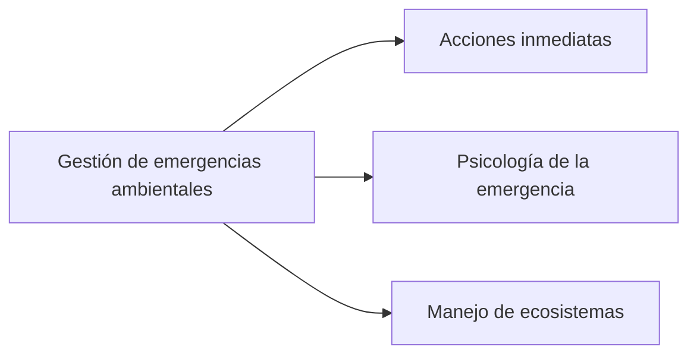

## Introducción

En ingeniería, cuando se habla de emergencias ambientales, muchas veces se piensa en derrames de combustible o de alguna sustancia corrosiva o peligrosa. No es algo extraño, ya que es bastante probable haber visto alguna noticia de un derrame, y lamentablemente sucede seguido porque estas sustancias se transportan en camiones cisterna que circulan por las rutas. En una planta también pueden ocurrir incendios, y es muy común tener que saber cómo responder ante ellos.

Además, como vimos con los sistemas de gestión ambiental, ante cada una de estas contingencias ya tiene que existir una respuesta planificada de antemano. La **gestión de emergencias ambientales** se organiza en tres temas:


El objetivo es orientarnos sobre cómo actuar ante emergencias ambientales, a corto y largo plazo, además de "priorizar la prevención".

---
## Acciones Inmediatas

Ante cualquier situación que detectemos fuera del funcionamiento normal (en una planta química, en un proceso o donde sea), el primer paso siempre es **avisar**, y cuanto antes, mejor. Es decir, comunicar el mensaje de alerta. Puede que finalmente no pase nada, pero siempre es preferible pecar de exagerado antes que perder cinco minutos que podrían haber sido críticos.

El principio que guía las **acciones inmediatas y de seguimiento** es siempre actuar buscando proteger y preservar la salud de las personas. A esto se suma una advertencia: no frenarse por "dudas" legales. Por ejemplo, si para frenar un derrame tenemos que cortar una válvula que no nos corresponde, la responsabilidad de esa decisión pasa a segundo plano: si el petróleo se prende fuego e incendia toda la planta, poco importa de quién era la válvula. Las responsabilidades se analizan después, incluso meses más tarde. En el momento, lo que importa es hacer todo lo necesario para que las consecuencias sean lo menos graves posible, con la menor cantidad de víctimas (o ninguna) y el menor efecto posible sobre la salud.

Lo mismo ocurre con las dudas administrativas. En una empresa suele haber contratistas y proveedores, y si alguno sufre un accidente pueden surgir preguntas sobre quién es responsable de su salud, si tiene ART o a dónde debería trasladarlo su ART. Primero hay que actuar para preservar la salud de esa persona, y luego, con tiempo, se resuelven las cuestiones burocráticas: a quién reportar y quién debe hacerse cargo.

Como regla mnemotécnica se usa la palabra **CALMA**:
- **C**alma
- **A**cciones inmediatas
- **L**ugar base
- **M**arcar plan
- **A**ccionar plan

Mantener la calma es lo primero, en la medida de lo posible. El **lugar base** es el típico punto de encuentro. En cualquier visita a una planta industrial, lo primero que se hace es mostrar un video con las normas de seguridad: por dónde caminar, no salirse de la línea peatonal, qué significa cada tipo de alarma y a qué punto de encuentro dirigirse. Marcar el plan significa que todos sepan lo que tienen que hacer sin ponerse a pensar demasiado, porque en una emergencia el cerebro entra en estado de alerta, no responde bien y los pensamientos se vuelven catastróficos. Por eso el plan tiene que estar detallado de antemano y ser accionable.

Si desmenuzamos un poco más las acciones inmediatas y de seguimiento, tenemos cinco pasos:
1. **Reconocimiento de la emergencia**: entender qué está pasando. ¿Explotó una caldera? ¿Se prendió fuego un tanque de almacenamiento? ¿Hubo un choque o un derrame?
2. **Respuesta inicial y evaluación**: por ejemplo, reunir a las personas, indicarles que bajen por determinada escalera sin correr y se dirijan al punto de encuentro, o que se agachen y se cubran la cara con un pañuelo mojado si hay humo. Luego se evalúa cómo continuar según el tipo de emergencia.
3. **Movilización de recursos**: llamar a los bomberos, a la policía o a una ambulancia, o activar una alarma de evacuación total.
4. **Implementación de acciones correctivas**: una vez identificada la emergencia, se activan los planes de contingencia previamente planificados. No hay tiempo para ponerse a pensar en ese momento qué hacer.
5. **Seguimiento posterior y aprendizaje**: para que no vuelva a suceder o, si sucede, que se resuelva de la mejor manera.

Todo deriva del primer paso, ya que según la emergencia que se reconozca se accionan los distintos planes. Los elementos típicos que intervienen son las alarmas, los puntos de reunión, la evacuación, las brigadas y los bomberos.

---
## Materiales Peligrosos

Los camiones que transportan sustancias químicas llevan un cartel naranja con dos números. El de arriba es el **número de riesgo**, que indica la clase de peligrosidad. El de abajo es el **número UN** (o número ONU), que identifica específicamente qué sustancia se transporta. El de arriba es el más fácil de memorizar, ya que nos dice, por ejemplo, si se trata de un gas inflamable o de un líquido.
![[Pasted image 20261118213453.png|center|497]]

Ante un derrame de material peligroso se utiliza la **Guía de Respuesta en Caso de Emergencia**, pensada para los primeros respondedores durante la fase inicial de un incidente en el transporte de materiales peligrosos. Tiene cinco secciones divididas por colores para que sea más fácil de usar:
- **Blanca**: indicaciones generales de uso de la guía.
- **Amarilla**: listado de productos químicos ordenado por número, es decir, por el número del cartel naranja.
- **Azul**: el mismo listado, pero ordenado alfabéticamente. Según el dato que tengamos (el número o el nombre de la sustancia), usamos una u otra.
- **Naranja**: detalla cómo actuar frente al derrame de cada sustancia.
- **Verde**: si en la guía amarilla o azul la sustancia aparece resaltada con color, se trata de una sustancia volátil, y en esta sección se indica cómo aislar el lugar.

![[Pasted image 20261118213543.png|center|442]]

Las **clases de peligrosidad** corresponden al primer dígito del número de riesgo:
1. Explosivos
2. Gases
3. Líquidos inflamables
4. Sólidos inflamables
5. Oxidantes y peróxidos orgánicos
6. Tóxicos e infecciosos
7. Radiactivos
8. Corrosivos
9. Diversos (todo lo que no entra en las ocho clases anteriores)

Ante el derrame de una sustancia volátil, la guía verde indica cuántos metros o kilómetros a la redonda hay que aislar según la volatilidad de la sustancia. Esa distancia depende del momento del día, y es mayor de noche. ¿Por qué? Recordemos lo que vimos sobre los bolsones de aire: para ascender tienen que estar calientes. De noche el suelo ya está frío y la atmósfera también, por lo que la nube de gases tóxicos queda atrapada cerca del suelo y no se dispersa. Como se concentra justo a la altura de las personas, hay que aislar una superficie mayor. Notemos que la volatilidad no depende de que la sustancia esté caliente: hay sustancias que se volatilizan a $-15$ °C por sus características propias.

>[!TIP] Importante
>Un derrame de una sustancia volátil exige aislar una distancia mayor de noche, porque el aire frío cerca del suelo impide que la nube de gases tóxicos ascienda y se disperse.

---
## Código de Riesgo

El número de arriba del cartel también se llama **CIR** (Código de Identificación de Riesgo) e indica el tipo de sustancia. Por ejemplo, 263 es un gas tóxico e inflamable: el 2 indica gas (riesgo principal), el 6 tóxico y el 3 inflamable (riesgos subsidiarios). Si trabajamos con este tipo de sustancias y recordamos estos números, con solo ver el cartel de un camión ya sabemos qué transporta, qué riesgos conlleva y cómo actuar en caso de derrame. En otro ejemplo, el cartel 268 sobre 1005 corresponde a un gas tóxico y corrosivo, y el número ONU 1005 es el amoníaco anhidro.

El ejercicio propuesto es el siguiente: escoger un caso e indicar cómo actuaríamos ante el accidente de un camión con vuelco de parte de su contenido, tomando uno de estos números ONU identificatorios:
![[Pasted image 20261118213657.png|center|513]]

Como la guía es digital, conviene buscar directamente el número en la sección amarilla o el nombre en la azul con la función de búsqueda, en lugar de recorrerla a mano. Por ejemplo, el 1001 es **acetileno disuelto**, y la guía indica consultar la guía 116. Como no está resaltado, no es volátil y no hace falta ir a la guía verde, sino directamente a la naranja. Allí se indica que es extremadamente inflamable, que se enciende fácilmente por calor, chispas o llamas, que forma mezclas explosivas con el aire y que puede explotar incluso en ausencia de aire.

Por eso es importante que, si en algún momento trabajamos con este tipo de sustancias, no veamos un 1001 y supongamos que es inofensivo por ser un número bajo. Tenemos que tener una mínima noción de lo que estamos tratando. La guía además indica la ropa de protección (térmica y química), las distancias de evacuación y qué hacer en caso de fuego, con indicaciones como no extinguir un incendio por fuga de gas a menos que la fuga pueda ser detenida, o eliminar todas las fuentes de ignición cercanas al área en caso de derrame o fuga. Es una biblia de sustancias peligrosas que conviene tener a mano y saber interpretar.

---
## Psicología de la Emergencia

La **psicología de la emergencia** distingue acciones antes, durante y después de la emergencia. Antes, lo ideal es la **prevención**: tomar las medidas necesarias para que la cantidad de emergencias, accidentes y contingencias sea mínima o cercana a cero. Como ese número puede no ser cero, también hay que estar preparados: armar **planes de actuación** antes de que algo suceda y **capacitar y entrenar** al personal en ellos. Esto se hace a través de **simulacros**, con y sin aviso de ocurrencia y de contenidos.

Un simulacro no funciona si todos saben de antemano que va a ocurrir. A lo sumo, en el momento en que suenan las alarmas se aclara que es un simulacro, para que nadie sufra un ataque de pánico, pero no mucho más. Por ejemplo, en un simulacro en una oficina en el piso 24 de una torre, todos tuvieron que bajar los 24 pisos por escalera, porque durante una emergencia está prohibido el uso del ascensor.

Otro ejemplo es el simulacro de un choque entre una camioneta y un camión cisterna de transporte de combustible en el Polo Petroquímico de Dock Sud. Los bomberos y la comisaría estaban al tanto, y la idea era medir cuánto tardaba en llegar la respuesta, cuánto se tardaba en apagar el fuego y en rescatar a las personas, que actuaban como lesionadas dentro de los vehículos. Los simulacros deben ser lo más cercanos posible a la realidad.

Durante una emergencia, las pupilas se dilatan y la visión se vuelve un túnel, de modo que todo lo demás deja de percibirse. Por eso la capacitación previa es tan importante: es la diferencia entre poder reaccionar bien o actuar sin rumbo y que termine siendo peor.
![[Pasted image 20261118213728.png|center|522]]

También hay que confiar en los sentidos. El olfato, aunque cada vez lo usamos menos, es un sentido bastante bueno y es el primero en alertarnos. Sin embargo, hay sustancias sin olor, como el monóxido de carbono, la conocida "muerte silenciosa": no se ve ni se siente, simplemente da sueño. En la medida de lo posible, usamos el olfato, la vista y el oído, que se agudizan en ese momento. Como la vista puede estar acotada, conviene ampliar el rango de visión y mirar bien hacia todos lados, además de seguir las indicaciones. Si logramos mantener la calma, podemos intentar transmitírsela a quien esté completamente en crisis.

---
## Simulacros

Los simulacros tienen acciones previas y posteriores. Antes del simulacro hay que:
- **Avisar previamente que es un simulacro**, aunque no con tanta anticipación como para que todos vengan preparados a participar.
- **Demarcar el sector y señalizar correctamente**, por ejemplo dónde está el incendio, por dónde es la salida o dónde está el punto de encuentro.
- **Disponer personal observador interno y externo al simulacro**. El interno es el que guía la evacuación o la reunión en el punto de encuentro. El externo mira todo desde afuera, sin intervenir, y toma nota: cuánto tardan, si alguien fue por una escalera que no correspondía, si corrieron o si alguien usó el ascensor.
- **Avisar a la comisaría** o a quien corresponda según la magnitud del simulacro. En el caso de Dock Sud había que avisar a todas las autoridades: la comisaría, los bomberos, ACUMAR y probablemente algún medio de comunicación, ya que un derrame en el Polo Petroquímico sale en todas las noticias y, al hacerse en la calle, se ve desde afuera.
- **Definir una válvula de control** para interrumpir total o parcialmente el simulacro, que también puede ser una palabra de seguridad. Si en medio del simulacro alguien sale apurado, se cae y se lastima, hay que cortarlo y atender a esa persona, porque deja de ser un simulacro y pasa a ser algo real. La palabra de seguridad sirve para distinguir lo actuado de lo real, por ejemplo si a uno de los actores le agarra ansiedad al ver salir el gas del tanque.

Después del simulacro se analiza:
- **Relajación (si lo requiere) y defusing (siempre)**: se reúne al grupo y se hace una charla posterior para salir de la mentalidad del simulacro, bajar un par de cambios y hablar de cómo resultó.
- **Psicología de la emergencia**: ¿cómo fue reaccionando cada uno? Lo registra el observador externo con sus anotaciones.
- **Herramientas técnicas**: ¿se usaron las adecuadas?
- **Toma de decisiones**: análisis y modelización. Los datos recogidos durante el simulacro forman parte de una base de datos que se analiza para mejorar los simulacros a futuro.
- **Procedimientos**: ¿se respetaron? Este punto es importantísimo.
- **Visualización global de la situación de emergencia**: cuál habría sido el resultado si hubiera ocurrido de verdad, es decir, si la evacuación funcionó bien o si cada uno hizo lo que quiso.

---
## Durante y Después

Durante la emergencia hay que **evitar vacíos de información**: que la gente sepa qué está sucediendo, por ejemplo que hubo un incendio en determinado laboratorio o que una sustancia volátil se está esparciendo por los conductos de ventilación. Si no, todos empiezan a preguntar qué pasó, quién fue, si es fuego, si es tóxico, y se ponen más nerviosos preguntando que haciendo lo que tienen que hacer.

También hay que **evitar la segunda agresión**, algo muy difícil en una emergencia. Supongamos que le pedimos a un compañero que deje sus cosas y nos siga porque hay que evacuar, y en lugar de eso empieza a guardar el celular y la computadora, o se queda paralizado. No hay que gritarle, zamarrearlo ni empujarlo: la persona ya está en shock, y sumarle una agresión solo empeora la situación. Por eso hay personas designadas para estas tareas, tanto en simulacros como en situaciones reales, ya que no cualquiera puede hacerlo en un momento de emergencia.

Para esto se usan **técnicas de resolución de conflictos**, que están detalladas en el documento "Herramientas para resolución de conflictos" del campus:
- Centrarse en la persona
- El otro tiene razón
- Acompasar
- Legitimar
- Encuadrar
- Escuchar en forma activa
- Parafrasear
- Preguntar
- Connotar positivamente
- Clarificar
- Temporalizar
- Normalizar
- Redefinir
- Redactar

Algunas de ellas son:
- **Centrarse en la persona**: separar a la persona del problema. Si hay un derrame, en ese momento no importa si fue culpa de alguien: está el derrame y está la persona, y son cosas distintas.
- **Acompasar**: usar el principio de comportamiento analógico similar al de la otra persona. Si alguien tiene una crisis nerviosa y no para de hablar, respondemos con calma, hablando menos y más bajo para que el otro nos siga, y no al revés, dejando que nos contagie su ritmo y su nerviosismo.
- **Legitimar** y **parafrasear**: reconocer lo que le pasa al otro y repetir lo que dice para que sienta que lo estamos escuchando. Por ejemplo, si alguien dice que se lastimó el pie, respondemos "te duele el pie, está bien", en lugar de desestimarlo.

>[!TIP] Importante
>Puede aparecer en el examen una pregunta sobre cuáles de estas son técnicas de resolución de conflictos (por ejemplo, si acompasar lo es). Son bastante obvias una vez que se leen, pero conviene tenerlas ordenadas.

Por último, durante la emergencia hay que **poner en práctica lo previsto para minimizar el daño ambiental**. Siempre hay una persona responsable designada previamente que, antes de evacuar, cierra la válvula o activa el sistema de corte y sellado, para que el daño, e incluso el peligro, no sea mayor. La persona que se encarga de evacuar es una y la que se encarga de cerrar todo es otra.

Después de la emergencia, en la parte ambiental hay que **reparar el daño ambiental**, si lo hubo. Con las personas se habla de **rehabilitar a las personas involucradas**, mediante:
- **Defusing**: extroversión compartida de lo que se acaba de vivir.
- **Debriefing**: separar hechos, pensamientos y sentimientos.
- **Herramientas PSI para "equilibrar"**: EMDR, abrazo mariposa, etc.
- **Otras técnicas** que puedan ofrecer en el lugar de trabajo.

---
## Manejo de Ecosistemas

El último tema es el **manejo de ecosistemas**: si después de una emergencia tenemos un ecosistema degradado, cómo lo reparamos. Según el resultado que se alcance, hablamos de:
- Rehabilitación
- Remediación
- Reemplazo
- Mitigación
- Compensación
- Restauración (el caso ideal)

Para entender la diferencia entre cada una, ubicamos el ecosistema en un gráfico según sus **componentes** y su **funcionamiento**, y partimos de un ecosistema degradado como consecuencia de una emergencia. La **restauración** consiste en volver desde el ecosistema degradado al ecosistema original, recuperando el $100\%$ de los componentes y del funcionamiento. Es la situación ideal:
```tikz
\begin{document}
\begin{tikzpicture}[scale=1, >=stealth, thick]

  % Ejes
  \draw[->] (0,0) -- (5,0) node[below right] {componentes};
  \draw[->] (0,0) -- (0,5) node[above] {funcionamiento};

  % Marcas OK
  \node[below] at (4,0) {OK};
  \node[left] at (0,4) {OK};
  \draw[dashed, thin] (0,4) -- (4,4) -- (4,0);
  \draw[dashed, thin] (0,0.5) -- (0.5,0.5) -- (0.5,0);

  % Ecosistemas
  \fill[gray] (0.5,0.5) circle (3pt);
  \node[right, gray] at (0.6,0.4) {ecosistema degradado};
  \fill[green!70!black] (4,4) circle (3pt);
  \node[right, green!50!black] at (4.1,4) {ecosistema original};

  % Flecha
  \draw[->, line width=3pt, green!50!black] (0.7,0.7) -- (3.85,3.85);
  \node[green!50!black] at (1.6,2.6) {RESTAURACI\'{O}N};

\end{tikzpicture}
\end{document}
```

En la **rehabilitación** se recupera el funcionamiento, pero no la totalidad de los componentes. No llegamos al ecosistema original, pero el resultado está mucho mejor que el ecosistema que quedó degradado después de la emergencia:
```tikz
\begin{document}
\begin{tikzpicture}[scale=1, >=stealth, thick]

  % Ejes
  \draw[->] (0,0) -- (5,0) node[below right] {componentes};
  \draw[->] (0,0) -- (0,5) node[above] {funcionamiento};

  % Marcas OK
  \node[below] at (4,0) {OK};
  \node[left] at (0,4) {OK};
  \draw[dashed, thin] (0,4) -- (4,4) -- (4,0);
  \draw[dashed, thin] (0,0.5) -- (0.5,0.5) -- (0.5,0);
  \draw[dashed, thin] (2,4) -- (2,0);

  % Ecosistemas
  \fill[gray] (0.5,0.5) circle (3pt);
  \node[right, gray] at (0.6,0.4) {ecosistema degradado};
  \fill[green!70!black] (4,4) circle (3pt);
  \node[right, green!50!black] at (4.1,4) {ecosistema original};
  \fill[green!50] (2,4) circle (3pt);

  % Flecha
  \draw[->, line width=3pt, green!50!black] (0.6,0.7) -- (1.95,3.85);
  \node[green!50!black] at (0.2,2.4) [right] {REHABILITACI\'{O}N};

\end{tikzpicture}
\end{document}
```

La **remediación** es el caso opuesto: recuperamos todos los componentes, pero no el pleno funcionamiento. De nuevo, no estamos en el ecosistema original, ya que tenemos la cantidad de componentes originales, pero no el funcionamiento entre ellos:
```tikz
\begin{document}
\begin{tikzpicture}[scale=1, >=stealth, thick]

  % Ejes
  \draw[->] (0,0) -- (5,0) node[below right] {componentes};
  \draw[->] (0,0) -- (0,5) node[above] {funcionamiento};

  % Marcas OK
  \node[below] at (4,0) {OK};
  \node[left] at (0,4) {OK};
  \draw[dashed, thin] (0,4) -- (4,4) -- (4,0);
  \draw[dashed, thin] (0,0.5) -- (0.5,0.5) -- (0.5,0);
  \draw[dashed, thin] (0,2.9) -- (4,2.9);

  % Ecosistemas
  \fill[gray] (0.5,0.5) circle (3pt);
  \node[right, gray] at (0.6,0.4) {ecosistema degradado};
  \fill[green!70!black] (4,4) circle (3pt);
  \node[right, green!50!black] at (4.1,4) {ecosistema original};
  \fill[green!50] (4,2.9) circle (3pt);

  % Flecha
  \draw[->, line width=3pt, green!50!black] (0.7,0.65) -- (3.85,2.8);
  \node[green!50!black] at (2.3,1.2) {REMEDIACI\'{O}N};

\end{tikzpicture}
\end{document}
```

El **reemplazo** agrega un tercer eje, el de la **diversidad beta**. Desde el ecosistema degradado pasamos a otro ecosistema que tiene el funcionamiento y los componentes, pero con otra diversidad. No es el original: es una buena opción, pero no es lo mismo.
![[Pasted image 20261118213817.png|center|344]]

En la **mitigación** mejoramos mucho los componentes y el funcionamiento, pero no llegamos al ecosistema original, ni siquiera al nivel del reemplazo. La recuperación es parcial tanto en componentes como en funcionamiento:
```tikz
\begin{document}
\begin{tikzpicture}[scale=1, >=stealth, thick]

  % Ejes
  \draw[->] (0,0) -- (5,0) node[below right] {componentes};
  \draw[->] (0,0) -- (0,5) node[above] {funcionamiento};

  % Marcas OK
  \node[below] at (4,0) {OK};
  \node[left] at (0,4) {OK};
  \draw[dashed, thin] (0,4) -- (4,4) -- (4,0);
  \draw[dashed, thin] (0,0.5) -- (0.5,0.5) -- (0.5,0);
  \draw[dashed, thin] (0,2.8) -- (2.7,2.8) -- (2.7,0);

  % Ecosistemas
  \fill[gray] (0.5,0.5) circle (3pt);
  \node[right, gray] at (0.6,0.4) {ecosistema degradado};
  \fill[green!70!black] (4,4) circle (3pt);
  \node[right, green!50!black] at (4.1,4) {ecosistema original};
  \fill[green!50] (2.7,2.8) circle (3pt);

  % Flecha
  \draw[->, line width=3pt, green!50!black] (0.7,0.7) -- (2.6,2.7);
  \node[green!50!black] at (0.7,1.9) [right] {MITIGACI\'{O}N};

\end{tikzpicture}
\end{document}
```

Por último, la **compensación** vuelve a usar el eje de la diversidad beta. Recuperamos los componentes originales, pero el funcionamiento no es el mismo y la diversidad tampoco. Es un ecosistema distinto, pero ni siquiera es un reemplazo, porque tampoco se alcanzó el funcionamiento original.
![[Pasted image 20261118213841.png|center|355]]

>[!TIP] Importante
>La restauración es la mejor opción, ya que devuelve el ecosistema a su estado original. Las demás son alternativas que, aunque no llegan a ese punto, siempre son mejores que no hacer nada.
