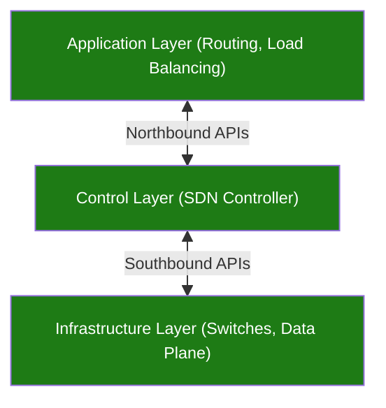

## Capa Física

La **capa física** es el soporte físico para entablar comunicaciones. El **medio de coaxil** tiene un core de cobre con un material aislante y otro conductor de malla trenzada que cubre ese material. Esto es contenido por una capa protectora de plástico. Tiene una característica importante que es la inmunidad al ruido.

El **Unshielded Twisted Pair (UTP)** consiste en dos hilos de un material de cobre que funcionan de manera diferencial. Es muy poco inmune al ruido, ya que no tiene la malla que veíamos antes. Para mejorar la supervivencia se lo trenza.

La **fibra óptica** consiste en un filamento de vidrio del grosor de un cabello o de un polímero con características similares al vidrio de la frecuencia a la que transmite. El transporte de información se realiza según dos modos:
- **Multimodo**: Se utiliza para cortas distancias (menores a 1Km), y se idetnfican mediante una cobertura exterior de color naranja.
- **Monomodo**: Se utiliza para distancias largas (mayores a 1Km), y se identifican mediante una cobertura exterior de color amarillo.

Los **cables submarinos** son la misma fibra monomodo que vimos recién pero con embañado mecánico que, según la zona a instalar, es más o menos gordo. 

Los **medios no guiados** transportan ondas electromagnéticas sin usar un conductor físico, propagando la señal a través del aire o del vacío a la velocidad de la luz. El espectro para medios no guiados se divide en tres rangos principales según el uso y comportamiento de la onda:
- **Microondas ($2\text{ GHz}$ a $40\text{ GHz}$):** Se utilizan para enlaces punto a punto terrestres (entre torres de telecomunicación) o enlaces satelitales, requiriendo alineación precisa y línea de vista despejada.
- **Ondas Radioeléctricas ($30\text{ MHz}$ a $1\text{ GHz}$):** Tienen un comportamiento omnidireccional, lo que significa que la señal se propaga en todas direcciones. Por esta razón, son ideales para esquemas de difusión masiva (broadcast), como la radio FM y la televisión abierta.
- **Infrarrojo ($3 \times 10^{11}\text{ Hz}$ a $2 \times 10^{14}\text{ Hz}$):** No pueden atravesar paredes ni objetos sólidos, por lo que su uso queda relegado a aplicaciones locales de corto alcance y dentro de entornos cerrados, como mandos a distancia.

Los **radioenlaces de microondas terrestres** son sistemas de comunicación inalámbrica punto a punto que utilizan ondas electromagnéticas de alta frecuencia para transmitir datos a través de la atmósfera.

En las **comunicaciones inalámbricas por satélite**, los sistemas se clasifican según la altitud de su órbita con respecto a la Tierra:
- **GEO (Geostationary Earth Orbit):** Aporx. $36.000\text{ km}$. El periodo orbital coincide con la velocidad de rotación terrestre y por ende permanece en una posición fija. Facilita la comunicación sin necesidad de mover las antenas receptoras.
- **MEO (Medium Earth Orbit):** Entre $10.000\text{ km}$ y $20.000\text{ km}$. No giran a la misma velocidad angular que la Tierra y son menos comunes para telecomunicaciones convencionales.
- **LEO (Low Earth Orbit):** De $5.000\text{ km}$ o menos. Al estar tan cerca de la Tierra, se desplazan a gran velocidad y requieren antenas motorizadas con capacidad de seguimiento o la creación de constelaciones.

Las **VSAT (Very Small Aperture Terminals)** utilizan antenas parabólicas mucho más compactas, de entre $1\text{ m}$ y $2\text{ m}$ de diámetro (las otras eran muy caras). No cuentan con la potencia suficiente para comunicarse directamente entre sí, y por ende, el enlace siempre debe realizarse mediante el esquema: VSAT $\rightarrow$ Satélite $\rightarrow$ VSAT. Para superar la falta de potencia de las antenas pequeñas y permitir la comunicación entre diferentes terminales: VSAT origen $\rightarrow$ Satélite $\rightarrow$ Hub $\rightarrow$ Satélite $\rightarrow$ VSAT destino.

El **Belio (B)** es una unidad logarítmica que expresa la relación entre dos magnitudes del mismo tipo, como la presión o la potencia respecto a un valor de referencia:
$$\text{Belio} = \log_{10}\left(\frac{\text{Magnitud}}{\text{Referencia}}\right)$$
En sistemas de transmisión, la ganancia o pérdida lineal en veces se define como la razón entre la potencia de salida ($P_o$) y la potencia de entrada ($P_i$):
$$\text{Ganancia (veces)} = \frac{P_o}{P_i}$$

---
## Cableado Estructurado

El **cableado estructurado** es un tendido de cables que provee voz, datos, video, audio, seguridad, control y monitoreo, en cualquier puesto de trabajo. El objetivo es justamente evitar el cableado independiente o propietario por cada servicio (telefonía, datos, monitoreo, etc.) y por proveedor.

El tramo que va desde la toma de usuario en la pared hasta el rack o armario de telecomunicaciones de esa misma planta, es el **tendido horizontal** (con un límite estricto de $100\text{m}$ por canal). Para interconectar los diferentes pisos con la sala de comunicaciones principal (MDF o Data Center), se utiliza el **tendido vertical**, el cual requiere medios de mayor capacidad y ancho de banda.

Historicamente, la infraestructura de cableado en edificios pasó por dos etapas:
- **Instalaciones Heterogéneas:** Redes separadas para voz y datos. 
- **Instalaciones Homogéneas:** Red unificada bajo un mismo estándar.

El cable **Unshielded Twisted Pair (UTP)** que vimos previamente es el medio de cobre estándar utilizado en redes LAN y cableado horizontal. El **cable directo** se utiliza para interconectar dispositivos que operan en diferentes capas de red, como un servidor a un switch o un switch a un router. En cambio, el **cable cruzado** se emplea tradicionalmente para conectar dispositivos que operan en el mismo nivel o que comparten la misma configuración de pines de transmisión y recepción.

Los **conectores** de cobre más comunes son el **RJ-11**, utilizado históricamente en telefonía analógica con 4 o 6 posiciones, y el **RJ-45**, el estándar indiscutido para redes de datos (Ethernet).

El **rack** o gabinete de telecomunicaciones es la estructura metálica estandarizada diseñada para alojar y organizar los equipos de red, paneles de conexiones (patch panels), servidores y sistemas de energía (UPS). La altura útil y la capacidad de los racks se miden en **Unidades de Rack (U o RU)**. Todos los equipos para montaje en rack (como un switch estándar de $1\text{U}$ o un servidor de $2\text{U}$ a $4\text{U}$) respetan esta modularidad vertical y los orificios normalizados en los rieles.

La **patchera de cobre (Patch Panel)** es el elemento pasivo modular (típicamente de $1\text{U}$ o $2\text{U}$ con 24 o 48 puertos) que sirve como punto de terminación y ordenamiento de todo el cableado horizontal que llega al rack. En su vista posterior, los cables UTP rígidos que vienen desde los puestos de trabajo se conectan de forma directa y permanente sin ficha RJ-45. En su vista frontal, cada cable queda expuesto a través de una boca hembra RJ-45 numerada y rotulada.  La patchera se interconecta a los switches mediante cables de parcheo cortos y flexibles  llamados **patch cords**. 

La **roseta** es la caja plástica superficial ubicada en el área de trabajo donde finaliza el extremo de usuario del cableado horizontal. En su interior aloja uno o más conectores hembra, sirviendo como punto de interfaz físico y estandarizado para que el usuario conecte su computadora, teléfono IP o dispositivo de red.

El **piso técnico (Raised Floor)** es una estructura modular sobreelevada mediante pedestales metálicos sobre la losa original, creando una cámara de aire subterránea por donde pueden realizarse tendidos de cables. Las **bandejas de cableado aéreo (Overhead Cabling Trays)**, por el contrario, consisten en sistemas de rejillas o canalizaciones metálicas suspendidas del techo o ancladas por encima de la parte superior de los racks.

La **montante** es el conducto o pozo vertical de la infraestructura de un edificio destinado al paso y soporte ordenado de los cables de datos y telecomunicaciones entre los distintos pisos. Permite interconectar los armarios de distribución de cada planta con la sala principal de equipos de forma protegida.

En un cableado estructurado como el de la imagen, podemos distinguir las siguientes partes:
![[Pasted image 20260813182554.png|center|209]]
1. **Conexión al Dispositivo Final**: el dispositivo es lo que conocemos como estación de trabajo, y puede ser una desktop, una laptop, etc. Se conoce como Work Area (WA). Lo que nos importa es conocer qué cantidad de estaciones de trabajo vamos a necesitar. Contemplan espacios de entre $4\text{m}^2$ y $10\text{m}^2$.
2. **Cableado Horizontal**: son las conexiones rojas que van desde la estación de trabajo hacia el rack 3, que es la sala de telecomunicaciones de piso. Para estas conexiones, generalmente se utiliza cobre y son menores a $100\text{m}$. De ellos, se considera que $90\text{m}$ son de conexión permanente, para así dejar $5\text{m}$ extra de cada lado para futuras necesidades. 
3. **Sala de Telecomunicaciones (TR)**: es donde vamos a tener nuestros racks. Llega el cable proveniente de la roseta y se conecta a una patchera por la parte trasera. Por la parte delantera se utiliza un patch cord corto para conectarse a un switch. Contienen el tráfico acumulado de todas las estaciones de trabajo de ese piso.
4. **Cableado Vertical**: son las conexiones que permiten conectar las salas de telecomunicaciones entre distintos. Se utiliza fibra por las distancias y porque no tiene interferencia, además de ser más rápida. Se quiere conectar los switches de acceso a uno de distribución. Estas conexiones se conocen como uplinks.![[Pasted image 20260811202312.png|center|268]]
5. **Servidores**: se encuentran en el Equipment Room (ER), y es donde van a estar los racks grandes. Cada uno va a tener su propio switch (Switch ToR) que se va a conectar a todos los servidores que contiene dentro. Estos se pueden conectar directo a los switches core, aunque puede haber una capa intermedia si estos últimos no tienen puertos suficientes para todos los ToRs.![[Pasted image 20260813190859.png|center|227]]
6. **Routers y Switches**: es donde se encuentran los switches de las capas de distribución y los core, además de routers que permiten la conexión a internet. Suelen enocontrarce también en el ER.
7. **Conexión externa**: es la conexión entrante y saliente del edificio hacia los proveedores de servicios, como por ejemplo el ISP. El espacio se conoce como Entrance Facilities (EF).

---
## Redes

Un **hub** es un dispositivo de capa 2 que permite aumentar las conexiones de dispositivos terminales a un servicio de red. Replica las tramas que recibe por todas las otras interfaces que tiene, sin ningún tipo de criterio.

Un **puente (bridge)** es un dispositivo de red que se utiliza para interconectar dos segmentos LAN, dividiendo dominios de colisión y filtrando el tráfico al decidir qué tramas se reenvían entre interfaces en función de las direcciones MAC.

Un **switch** consiste en un puente de más de dos puertos. Es un conector similar al hub, pero que posee un poco de inteligencia. Puede construir una **MAC Address Table**, y maneja Unicast, Broadcast y Multicast.
- **Switch Layer 2 - Unmanaged**: Solo conmuta tramas por dirección MAC en un único dominio de difusión predeterminado.
- **Switch Layer 2 - Managed**: Permite configurar parámetros avanzados como VLANs, priorización de tráfico (QoS), seguridad de puertos (Port Security) y prevención de bucles mediante Spanning Tree (STP).
- **Switch Layer 3**: Switch multicapa que cuenta con funciones de enrutamiento IP por hardware (Capa 3), permitiendo rutear tráfico entre diferentes VLANs a velocidad de cable (wirespeed) sin depender de un router externo.

Para garantizar alta disponibilidad y evitar SPOFs, cada switch de la capa de acceso cuenta con un doble enlace ascendente (uplink) conectado en paralelo hacia ambos switches de distribución.

Todos estos componentes son necesarios porque se trabaja sobre un **medio compartido**. Se necesita gestionar este medio porque no se pueden tener enlaces individuales con los distintos dispositivos finales. Si no se gestiona, ocurren las colisiones de tráfico.

El **Stacking de Switches** es una tecnología que permite unir físicamente múltiples switches para que operen y se comporten como un único switch lógico dentro de la red. La interconexión física del stacking se realiza habitualmente en **topología en anillo**, cerrando el circuito con un cable entre el primer y el último switch para garantizar redundancia y tolerancia a fallos en caso de que un enlace o equipo caiga.

Una **VLAN (Virtual Local Area Network)** es una tecnología que permite segmentar una red física en múltiples redes lógicas independientes, definiendo dominios de broadcast acotados y garantizando la separación y seguridad del tráfico entre diferentes áreas o servicios. Al utilizar stacking, una misma VLAN puede extenderse a través de múltiples switches físicos dentro de la matriz.

En un puerto configurado como **VLAN Untagged** (puerto de acceso), los dispositivos finales no reconocen ni gestionan etiquetas de VLAN, simplemente transmiten y reciben tramas estándar de Ethernet. En una interfaz configurada como **VLAN Tagged** los extremos son conscientes de la pertenencia a múltiples redes y requieren que las tramas incluyan explícitamente el encabezado VLAN Tag. Un puerto en modo **VLAN Trunk** está diseñado para transportar el tráfico de múltiples VLANs a través de un único enlace físico mediante el etiquetado de tramas.

El  **Spanning Tree Protocol (STP)** es un protocolo que detecta caminos redundantes y bloquea lógicamente determinados puertos para mantener una topología libre de bucles, activándolos automáticamente solo en caso de que falle un enlace activo. El objetivo de STP es construir una topología lógica en forma de árbol deshabilitando los enlaces redundantes para evitar bucles. Para ello, todos los switches participan en la elección de un nodo central llamado **Root Bridge**, el cual se define a partir del Bridge ID de menor valor. Una vez establecido el nodo raíz, cada switch no-root selecciona un único **Root Port**, que corresponde a la interfaz física con el menor costo de enlace para alcanzar al Root Bridge. Finalmente, los enlaces sobrantes que podrían generar loops se colocan en estado bloqueado.

El **diseño tradicional de datacenters** utiliza una arquitectura jerárquica pensada para centralizar el flujo de datos hacia el exterior (tráfico Norte-Sur). Los servidores dentro de cada rack se conectan a los ToR en Capa 2, los cuales concentran su tráfico en switches de agregación intermedios, para finalmente confluir en los switches de núcleo (Core en Capa 3). 

La **arquitectura moderna Spine-Leaf** está diseñada para optimizar el tráfico Este-Oeste (East/West), es decir, la comunicación intensiva y horizontal directa entre servidores dentro del data center. En este esquema de dos niveles, los servidores se conectan a los switches de acceso (Leaf, L2/L3) y cada uno de estos se enlaza de forma directa con absolutamente todos los switches centrales (Spine, L3), sin conexiones entre spines ni entre leafs. 

**Power over Ethernet (PoE)** es una tecnología estandarizada bajo la norma IEEE 802.3af que permite suministrar energía eléctrica a través de los mismos pares de cobre del cable de red utilizados para la transmisión de datos.

Un **router** es un dispositivo de red de Capa 3 cuya función principal es conectar redes distintas y gestionar el reenvío de paquetes entre ellas en función de sus direcciones IP de destino. En la práctica, se utiliza típicamente como el equipo de borde que interconecta una LAN con una WAN.

Una **WAN (Wide Area Network)** es una red de telecomunicaciones que interconecta múltiples redes locales (LAN) a través de grandes distancias geográficas. Existen distintos tipos de WAN:
- **Línea dedicada**: Enlace punto a punto exclusivo y privado provisto por la operadora de telecomunicaciones.
- **Multiprotocol Label Switching (MPLS)**: Red privada virtual gestionada por el ISP que utiliza etiquetas para conmutar paquetes de forma rápida. 
- **Banda ancha (DSL/Cable/Fibra)**: Conexiones de acceso a Internet estándar y de bajo costo. Se utilizan habitualmente en oficinas remotas o sucursales pequeñas.
- **Wireless (4G/5G)**: Conectividad inalámbrica celular (a través de redes públicas de operadoras o redes 5G privadas). Se emplea principalmente como enlace de respaldo (backup) ante caídas de la línea principal o para brindar acceso en ubicaciones temporales y de difícil despliegue físico.

Los proveedores de telecomunicaciones comercializan diferentes modalidades de vínculos WAN según el nivel de control, el ancho de banda y la infraestructura requerida:
- **Punto a Punto**: Enlace directo y dedicado entre dos ubicaciones mediante la instalación de un router en cada extremo.
- **LAN to LAN**: Interconexión transparente de redes de área local ubicadas en sitios remotos a través del backbone del proveedor. 
- **Fibra oscura**: Arrendamiento de filamentos de fibra óptica ya tendidos e instalados físicamente por la empresa de telecomunicaciones que se encuentran sin iluminar (sin equipamiento óptico activo conectado). El cliente adquiere el derecho de uso exclusivo y aporta sus propios transmisores y switches para gestionar el protocolo, la velocidad y la capacidad total del enlace.

**Wi-Fi (Wireless Fidelity)** es la tecnología estándar de redes locales inalámbricas (WLAN) regida por la familia de normas IEEE 802.11x. En los **medios compartidos**, el emisor chequea y, si está libre el medio, transmite. Esto tiene dos problemas principales:
- **Problema Near-Far**: Ocurre cuando dos emisores transmiten hacia el receptor simultáneamente y , por las diferencia de distancias, la señal del nodo más cercano arriba con una potencia significativamente superior, saturando el receptor y enmascarando por completo la señal débil del nodo lejano.
- **Problema Hidden Node**: Sucede cuando dos estaciones están dentro del rango de cobertura del Access Point pero fuera del alcance mutuo. Al no poder escucharse entre sí, ambas asumen que el canal está libre e inician transmisiones en paralelo hacia el AP, provocando colisiones destructivas en el receptor. 

---
## Protocolos de Ruteo

Un **Sistema Autónomo (AS)** es un conjunto de redes administradas por el mismo ente. Rige una sola política de ruteo.  NO necesariamente es un ISP. 
![[Pasted image 20260819103846.png|center|380]]

El objetivo de un protocolo de ruteo es crear una **tabla de ruteo** con "costos" mínimos para llegar a destino. Cada protocolo define ese costo utilizando variables específicas. En un esquema de **enrutamiento distribuido**, no existe una entidad centralizada que calcule la topología completa, sino que cada router procesa de forma autónoma la información de la red.

Los **EGP (Exterior Gateway Protocol)** se suelen usar al cambiar de países, o empresas, por ejemplo. Debemos pensar que, para que entre en juego su utilización, debemos estar hablando de un cambio grande o significativo. 
- **Path Vector Routing**: Es un protocolo basado en tres pilares:
	- **Ruteo por Path:** Los anuncios incluyen el path que decidió el router y sirve para detectar loops. 
	- **Ruteo Jerárquico:** Se rutea dentro de los AS y fuera de los AS de manera independiente. 
	- **Direccionamiento Topológico:** Se asignan ruteo por bloques de direcciones. 

**BGP (Border Gateway Protocol)** es el protocolo estándar de vector de trayectoria diseñado para interconectar ASs a escala global. Sus sesiones de vecindad se configuran de manera puramente manual y corren sobre TCP por el puerto `179` para garantizar una transmisión confiable de los anuncios de enrutamiento. 

BGP debe su éxito y predominio en Internet a su capacidad para aplicar **políticas de tránsito** altamente configurables, en lugar de limitarse a criterios rígidos de rendimiento técnico. Estas políticas se definen por razones de seguridad, motivos políticos o conveniencia económica.

El mecanismo fundamental de BGP para evitar bucles (loops) de enrutamiento se basa en la inspección de `AS-PATH`:
- Descarte por coincidencia de ASN
- Invariabilidad de la ruta

Los **Interior Gate Protocol (IGP)** se utilizan dentro de un Sistema Autónomo, por lo que están diseñados para redes pequeñas, e incluye protocolos como RIP, OSPF, iBGP, EIGRP. Estos protocolos no se preocupan por enrutamiento hacia entidades externas al sistema autónomo. Se pueden clasificar en:
- **Link-State Routing**: Cada router construye una visión completa e idéntica de la topología de la red para luego calcular de forma independiente los caminos más cortos hacia cada destino.
	- OSPF
	- IS-IS
- **Protocolos de Vector Distancia**: Cada nodo conoce la red únicamente a través de los anuncios que intercambia de forma periódica o disparada por eventos exclusivamente con sus vecinos directos ("ruteo por rumor").
	- RIPv1
	- IGRP

Podemos comparar:

|                                         **Link State**                                          |                    **Distance Vector**                     |
| :---------------------------------------------------------------------------------------------: | :--------------------------------------------------------: |
|         Cada router comparte el mapa completo que tiene de la red con todos los routers         |   Cada router comparte su tabla de ruteo con sus vecinos   |
| Las decisiones de ruteo, se toman con todo el mapa completo de la red (mas reliable y accurate) | Las decisiones de ruteo, se basan en información limitada  |
|                                      Difícil de configurar                                      |                    Fácil de configurar                     |
|                                       Convergencia rápida                                       |                       Converge lento                       |
|          Su métrica esta dada por multiples factores: bandwith, delay en un link, etc           | Su métrica es la cantidad de saltos entre origen y destino |
|                                Preferible para networks grandes                                 |              Preferible para networks chicas               |

La **IANA (Internet Assigned Numbers Authority)** es el organismo responsable de la coordinación global del direccionamiento en Internet, encargado de asignar bloques de **[[06. Capa de Red|direcciones IP]]** (IPv4 e IPv6) y **números de sistemas autónomos (ASN)**.

En el ecosistema global de Internet, los Sistemas Autónomos se estructuran en tres tipos según su conectividad y políticas de tránsito:
- **Red Stub**: Posee una única conexión hacia la red BGP (un solo ISP). Al ser un extremo de la topología sin caminos alternativos, no transporta tráfico de terceros; solo origina y recibe paquetes propios.
- **Red Multiconexión**: Cuenta con múltiples conexiones hacia diferentes Sistemas Autónomos para redundancia y balanceo de carga. Sin embargo, no actúa como red de paso: rechaza el reenvío de paquetes cuyo origen y destino pertenezcan a ASs externos ajenos a su red.
- **Redes de Tránsito**: Infraestructuras diseñadas para transportar tráfico de terceros entre distintos Sistemas Autónomos. Aplican políticas y restricciones de enrutamiento y cobran comercialmente por el servicio de tránsito IP prestado.

El **mecanismo de BlackHole** en BGP es una técnica utilizada para mitigar ataques DDoS. Consiste en anunciar una ruta específica para la dirección IP de la víctima de modo que el tráfico entrante sea redirigido hacia una interfaz nula o destino de descarte (`Null0`). El mecanismo opera anunciando una ruta de host específica para la IP víctima bajo ataque:
1. Publicación de máscara específica
2. Soporte del Carrier/ISP
3. Descarte en el borde

La **Distancia Administrativa (AD)** es el criterio utilizado por un router para seleccionar la mejor ruta hacia un destino cuando este es aprendido simultáneamente a través de diferentes protocolos de enrutamiento o fuentes administrativas. Define el grado de confiabilidad de la fuente mediante un valor entero entre `0` y `255`.

**IGRP (Interior Gateway Routing Protocol)** es un protocolo de enrutamiento interior por vector de distancia desarrollado por Cisco. Su principal innovación fue la implementación de una métrica compuesta. Luego, Cisco desarrolló **EIGRP (Enhanced Interior Gateway Routing Protocol)**, un protocolo de enrutamiento por vector de distancia avanzado (o híbrido) sin clase. A diferencia de su antecesor, elimina por completo las actualizaciones periódicas por broadcast: los routers solo envían actualizaciones parciales y dirigidas en el momento exacto en que se produce una modificación en la topología.

---
## Wide Area Network (WAN)

Una **WAN (Wide Area Network)** es una red de telecomunicaciones diseñada para interconectar múltiples redes locales (LAN) dispersas en distintas ciudades, países o continentes. Puede ser pública (Internet) o privada. Esta última se puede clasificar en:
- **Dedicada:** Consiste en otorgar un porción de la red para uso exclusivo de un cliente. Tiene muy poco overhead pero es más caro.
- **Switched**: La infraestructura del proveedor es compartida con otros clientes que tenga de manera segura.
	- **Circuit-Switched**: Establece dinámicamente una conexión dedicada para voz o datos entre un emisor y un receptor. Se establece la conexión previamente a comenzar cualquier comunicación. 
	- **Packet-Switched**: Es un circuito virtual punto a punto establecido utilizando la red de un proveedor, que permite a múltiples clientes compartir sus recursos. 

Existen dos tipos de redes:
- **Redes Broadcast** (Generalmente LAN): Como por ejemplo el Wi-Fi, donde todos nos conectamos.
- **Redes Punto a Punto** (Generalmente WAN): Las puntas normalmente son routers o switches, no computadoras.

**Frame Relay** es una tecnología de conmutación de paquetes para redes WAN que opera en las capas física y de enlace de datos. Este protocolo prescinde de mecanismos pesados de corrección de errores en el nivel físico y delega esa tarea en las capas superiores, logrando una transmisión considerablemente más ágil y eficiente. Permite multiplexar múltiples circuitos virtuales sobre un único enlace, por lo que cada router requiere solo una interfaz física para conectarse a múltiples destinos remotos simultáneamente.
![[Pasted image 20260825190625.png|center|390]]

El **Protocolo PPP (Point-to-Point Protocol)** es un estándar de enlace multiprotocolo capaz de transportar tráfico de capa de red variado como IP, IPX o AppleTalk. Se encuentra dentro de los protocolos punto a punto en WAN. Destaca por ofrecer mecanismos robustos de autenticación (mediante PAP y CHAP), a diferencia de Frame Relay, y la capacidad de asignar direcciones IP de forma dinámica al extremo remoto durante el establecimiento de la sesión.

**Metro Ethernet (MAN)** es una tecnología de telecomunicaciones diseñada para redes de área metropolitana (MAN) que opera en la capa 2. Su funcionamiento se basa en crear una conexión EVC (Ethernet Virtual Connection), lo que permite extender el estándar Ethernet más allá de la red local tradicional sin necesidad de convertir o encapsular tramas en protocolos seriales complejos.

Para conectar usuarios residenciales a las redes WAN/Internet, las dos tecnologías de acceso más extendidas históricamente son:
- **ADSL (Asymmetric Digital Subscriber Line):** Utiliza el par de cobre telefónico tradicional y suele apoyarse en PPPoE (PPP over Ethernet).
- **Cablemodem:** Opera sobre la red física de televisión por cable (coaxial o híbrida HFC). Se rige bajo el protocolo DOCSIS (Data Over Cable Service Interface Specification).

---
## Calidad de Servicio

Cuidado. Mientras que QoS gestiona prioridades y colas ante cuellos de botella, la aceleración WAN busca optimizar el uso del ancho de banda (BW) entre sitios mediante dispositivos o aplicaciones que se ejecutan en ambos extremos (origen y destino).

La **buferización (buffering)** es una técnica que se aplica directamente en el extremo receptor para almacenar temporalmente los paquetes antes de procesarlos o reproducirlos. Reduce la variación en los tiempos de llegada de los paquetes (jitter), logrando una reproducción continua y estable en servicios multimedia.

Las **normas de encolamiento** entran en juego en las interfaces del router, donde cada puerto dispone de una cola de memoria para retener temporalmente los paquetes que esperan ser transmitidos.
- **Cola FIFO**: Se retienen los paquetes y los despacha estrictamente en el mismo orden cronológico en el que ingresaron.
- **Cola de Prioridad**: Clasifica el tráfico separándolo en cuatro colas jerárquicas. La interfaz sólo transmite paquetes de un nivel inferior cuando la cola de mayor prioridad se encuentra completamente vacía. Hay riesgo de inanición (starvation).
- **Cola Personalizada**: Aplica Round-Robin para alternar de forma cíclica entre distintas colas. El administrador puede definir qué tipo de tráfico se asocia a cada una y otras reglas.
- **Weighted Fair Queueing (WFQ)**: Crea dinámicamente una cola separada para cada flujo de tráfico individual. El algoritmo busca la equidad al balancear flujos de poco caudal frente a transferencias masivas.

La **clasificación de tráfico** permite identificar y categorizar los paquetes según criterios como listas de control de acceso (ACL por IP y puerto), el puerto físico del switch o el tipo de aplicación. Una vez clasificado el flujo, el router o switch procede al etiquetado insertando marcas en la cabecera del paquete en Capa 2 o Capa 3 para que los dispositivos subsiguientes reconozcan su prioridad sin reanalizarlo.
- **Capa 3**: Se implementa sobre la cabecera IPv4 redefiniendo el antiguo campo ToS (Type of Service) bajo el estándar DSCP (Differentiated Services Code Point).
- **Capa 2**: La priorización está orientada a entornos LAN y opera a nivel MAC mediante el estándar IEEE 802.1p, el cual se inserta dentro del encabezado de VLAN.

En la configuración de un **Firewall/Router**, las reglas de filtrado permiten controlar el flujo de tráfico entre diferentes zonas de la red definiendo una acción específica (Allow, Deny o Discard). Para cada regla se establecen la zona de origen y destino, el servicio o protocolo de aplicación involucrado, y los criterios de origen, destino y usuarios autorizados. 

**MPLS (Multiprotocol Label Switching)** es una tecnología de conmutación de alto rendimiento que asigna una etiqueta a los datagramas para acelerar su reenvío en los routers del núcleo de la red. Al recibir un paquete, los equipos intermedios únicamente leen la etiqueta y no la dirección IP de destino, definiendo una ruta o circuito virtual preestablecido a lo largo de toda la infraestructura. Esta tecnología se ubica entre las capas 2 y 3. Para establecer los caminos de conmutación, los routers intercambian información de etiquetas de forma coordinada.

---
## Internet

Existen 3 tipos de ISPs en Internet, y a medida que vamos subiendo de tier, encontramos un requerimiento de una mayor capacidad de procesamiento.
- **Tier-1**: Backbone global con cables submarinos; operan sin default gateway (DFZ).
- **Tier-2**: Proveedores regionales que compran tránsito a Tier-1, hacen peering en IXPs y revenden conectividad hacia abajo.
- **Tier-3**: ISPs de última milla (como Telecom o Claro) que pagan tránsito a niveles superiores y dan servicio al usuario final.
- **Usuario final**: Clientes residenciales o corporativos que contratan acceso a Internet (habitualmente a un Tier-3) para enviar y recibir tráfico.

El **peering** es un acuerdo de interconexión directa y voluntaria entre dos redes o proveedores de Internet para intercambiar tráfico de manera recíproca, típicamente libre de costos (settlement-free), permitiendo que los clientes de una red alcancen a los de la otra sin pagarle tránsito a un proveedor superior.
- **Peering Privado**: dos operadores establecen un enlace físico punto a punto exclusivo y dedicado entre sus infraestructuras.
- **Peering Público**: se implementa a través de un IXP, donde múltiples ISPs y proveedores de contenido se conectan a un switch central compartido para intercambiar tráfico entre sí mediante un único enlace físico.

Los **IXP (Internet Exchange Points)** son centros neurálgicos de interconexión que adoptan una topología en estrella con un switch central compartido donde diversas entidades se conectan mediante un único puerto físico. La incorporación de un IXP no elimina el peering privado ni las conexiones de tránsito tradicionales. El IXP es un sistema autónomo y no da acceso a Internet, sino que brinda conectividad con el resto de los proveedores locales.

**CABASE (Cámara Argentina de Internet)** es la entidad pionera en Argentina que nuclea a ISPs, empresas de telecomunicaciones y proveedores de contenido, responsable de crear y operar la red federal de IXPs del país.

Los **carriers** son los operadores de telecomunicaciones propietarios de las redes troncales de Internet, y son los responsables del transporte de datos. No nos podemos desentender de ellos, porque a la larga alguien debe brindar conectividad hacia donde el ISP no llega, como por ejemplo hasta Japón.

Un **PAT (Punto de Agregación de Tráfico)** es un punto de presencia intermedio provisto por un miembro de la red para extender el alcance físico del IXP Regional. Su objetivo es facilitar el acceso remoto de varios miembros distantes hacia el punto de intercambio central sin que cada uno deba tender un enlace directo y costoso hasta la sede principal de CABASE.

Los **Looking Glass Servers** son herramientas de diagnóstico públicas provistas por ISPs e IXPs con acceso de solo lectura, diseñadas para consultar el estado de la red y las tablas de enrutamiento desde la perspectiva externa de un router específico.

**Anycast** es una técnica de direccionamiento y enrutamiento en la que una misma dirección IP pública se asigna a múltiples servidores o nodos distribuidos geográficamente (relación 1-a-muchos). A diferencia de Unicast (donde una IP identifica a una única interfaz específica de forma 1-a-1), en Anycast los paquetes enviados a dicha IP son encaminados por los routers hacia el nodo de destino topológicamente más cercano según las métricas y la convergencia de BGP (menor longitud de AS-Path o menor costo).

En la práctica, Anycast "engaña" a la capa de red, ya que mientras que en la realidad física existen múltiples servidores independientes en distintas ubicaciones configurados con la misma IP, los routers del plano de control asumen que se trata de un único servidor físico alcanzable a través de dos caminos redundantes.

---
## ISPs

La arquitectura de un ISP se organiza en capas jerárquicas:
- **Access Network**: red de acceso que llega hasta la casa del usuario.
- **Aggregation Network**: también llamada red de distribución. Red de múltiples capas que va consolidando el tráfico de diferentes partes de la red de acceso.
- **Edge Network**: red de borde. Se usa tanto como borde de la red de interior (hacia los usuarios) como de la red exterior (hacia internet).
	- Red que termina el tráfico de los usuarios donde son autenticados y se controla el ancho de banda (esto también puede hacerse en la red de acceso)
	- Red donde se interconecta con otras redes (ISPs/IXP)
- **Core Network**: red de núcleo es la red que interconecta a todo el ISP internamente. En particular conecta los Edge entre sí.
![[Pasted image 20260908182228.png|center|399]]

**NAT (Network Address Translation)** es una técnica utilizada en redes IP que permite modificar las direcciones IP en los encabezados de los paquetes que atraviesan un router u otro dispositivo de red. Su uso principal es permitir que múltiples dispositivos de una red privada accedan a Internet utilizando una única dirección IP pública.

**Source NAT (SNAT)** se usa cuando un dispositivo de la red privada (A) inicia una conexión hacia uno de la red pública (B, típicamente un servidor). El NAT ve salir el paquete con la IP y puerto privados de A como origen, y los traduce reemplazándolos por su propia IP pública y un puerto asignado, dejando intacto el destino (B). **Destination NAT (DNAT)** es el caso inverso.

Dentro de SNAT tenemos:
- **NAT – Full Cone**: es el tipo menos restrictivo. Una vez que A abre una conexión saliente, cualquier host externo puede enviarle tráfico a esa IP y puerto públicos y el NAT lo va a reenviar hacia A.
- **NAT – IP Restricted**: el NAT sí impone una restricción, pero solo sobre la dirección IP de origen del tráfico entrante.
- **NAT – Port Restricted**: es un paso más estricto que el anterior. El tráfico tiene que venir exactamente del mismo puerto, además de la IP.
- **NAT – Symmetric** es el tipo más restrictivo. Se genera un puerto público distinto por cada combinación de destino (`IP:puerto`).

**Double NAT (SNAT & DNAT)** aparece cuando el cliente está en una red pública (o al menos distinta) y el servidor con el que quiere hablar está en una red privada, publicado detrás de un NAT. 

**Double NAT (SNAT & SNAT)** es el escenario típico de una conexión P2P real: A y B están cada uno detrás de su propio NAT, y ninguno de los dos tiene una regla de DNAT configurada de antemano (porque no es práctico configurar manualmente una regla por cada posible peer). Entonces ambos NATs solo aplican SNAT sobre el tráfico saliente de su respectivo host, pero como no hay ninguna regla que permita el tráfico entrante desde el otro lado, ninguno puede alcanzar directamente al otro sin recurrir a alguna de las técnicas de NAT Traversal.

**UDP Hole** resuelve el problema de conectar dos PCs detrás de NAT/firewall sin depender de un tercero en el momento de la conexión, pero exige una condición fuerte: que ambos lados ya conozcan de antemano el puerto UDP público que va a usar el otro extremo, y que el firewall no cambie ese puerto entre conexiones.

**UDP Hole Punching** es una técnica que requiere que ambas PCs mantengan una conexión TCP permanente hacia un servidor conocido; a través de esa conexión, cada NAT le revela al servidor cuál es su IP y puerto públicos reales (los que usó para esa conexión TCP), y el servidor queda en condiciones de conocer las "coordenadas" públicas de ambos extremos. Cuando A y B quieren conectarse entre sí, el servidor le pasa a cada uno la `IP:puerto público` del otro.

**Session Traversal Utilities for NAT (STUN)** es un protocolo que le permite a un cliente detrás de NAT averiguar con qué IP pública y puerto está saliendo realmente su tráfico. El cliente le manda una consulta a un servidor STUN, y este le responde indicándole la `IP:puerto público` que vio en el paquete que le llegó, dato que el cliente puede usar después para publicarlo en otro protocolo.

**TURN (Traversal Using Relay NAT)** se basa en un relay real que reenvía el tráfico de datos entre los dos extremos cuando el NAT hole punching no logra atravesar el firewall. **ICE (Interactive Connectivity Establishment)** no es una técnica nueva en sí misma, sino un framework que combina y coordina las anteriores.

---
## VPNs

Una **VPN (Virtual Private Network)** se usa para interconectar redes o equipos a través de otras redes, típicamente Internet. Encapsula la comunicación original dentro de otro protocolo, creando un canal lógico entre las dos puntas que atraviesa la red intermedia sin que esta pueda ver el contenido real. Las ventajas de implementar VPN se ven en costos, seguridad y escalabilidad.

En el modo **Cliente a Sitio**, un dispositivo individual se conecta remotamente a la red de un sitio central, como si estuviera físicamente dentro de esa red. En el modo **Sitio a Sitio**, en cambio, lo que se interconecta son dos redes completas entre sí a través de Internet, por ejemplo para unir sucursales de una misma empresa.

En el extremo emisor, el router agrega una cabecera VPN (y su propia IP de tránsito) por delante del paquete original completo, de forma que ese paquete queda **encapsulado** dentro de otro paquete IP nuevo. Ese paquete "exterior" es el que efectivamente viaja por Internet entre los dos routers. Al llegar al otro extremo, el router remoto **desencapsula**: le saca la cabecera IP+VPN externa y recupera el paquete original tal cual salió del host emisor, para entregarlo dentro de la LAN destino.

Es importante tener presente que un paquete que atraviesa una VPN, previamente pasa dos veces por la tabla de ruteo. El paquete original entra y se dirige a una interfaz virtual que le agrega los encabezados mencionados. Esa interfaz virtual reenvía el paquete con dichos headers, entrando por segunda vez a la tabla de ruteo, pero con la IP agregada por la interfaz virtual apuntando al servidor VPN.

Para **autenticar** la conexión entre cliente y servidor VPN se usan principalmente tres protocolos: EAP (Extensible Authentication Protocol), considerado el más seguro; CHAP (Challenge Handshake Protocol); y PAP (Password Authentication Protocol).

---
## DMZ

El **network edge** es el borde entre la red interna (hogareña o empresarial) y la red externa, típicamente Internet. Aunque muchas veces se piensa como "el router" nada más, en la práctica puede ser bastante más que eso: puede incluir firewalls, proxies u otros equipos que en conjunto cumplen la función de frontera.

La **DMZ (Demilitarized Zone)** es una zona de red intermedia entre la red interna y externa, pensada como una especie de tierra de nadie donde se ubican los servicios que necesitan ser accesibles desde Internet, pero sin exponer directamente la red interna. La idea es que si un servicio en la DMZ es comprometido, el atacante no obtiene automáticamente acceso a la red interna real.

Existen básicamente dos topologías para implementar esto. Con **un solo firewall**, el mismo equipo tiene una interfaz hacia Internet, una hacia la DMZ y una hacia la red interna, y es él quien aplica todas las reglas de filtrado entre las tres zonas:
![[Pasted image 20260908204843.png|center|231]]
Con **dos firewalls**, en cambio, la DMZ queda encerrada entre dos equipos distintos: uno mirando hacia Internet y otro mirando hacia la red interna, de forma que un atacante que comprometa el firewall externo todavía tiene que atravesar un segundo firewall independiente para llegar a la red interna:
![[Pasted image 20260908204922.png|center|230]]

Existe un problema de side channel attack, ya que los servidores pueden hablar entre sí. Para corregir este problema se introducen **jump servers** como único punto de entrada administrativo.

---
## Cloud

La nube de AWS está dividida en **regiones**, que son ubicaciones geográficas completamente aisladas e independientes entre sí y que agrupan una serie de datacenters. Dividir la nube en regiones tiene varias ventajas:
- Aislar fallas.
- Reducir la latencia.
- Cumplir con los requisitos legales de cada país.

Las **zonas de disponibilidad** constituyen particiones lógicas y físicas dentro de la infraestructura de los datacenters virtuales diseñadas para garantizar alta disponibilidad y tolerancia a fallos. Físicamente, una AZ puede estar compuesta por uno o más datacenters discretos que albergan millones de servidores a gran escala.  Los datacenters están conectados por redes de muy baja latencia, y las AZs de una región están separadas por un máximo de 100 km.

Las **Virtual Private Cloud (VPCs)** son construcciones de red definidas por software (SDN) y permiten la implementación de recursos de las IaaS. Son regionales o globales y contienen subredes. Una **Software Defined Networking (SDN)** organiza la conectividad en una arquitectura modular de tres capas superpuestas:

- **Capa de aplicación**: aloja los servicios y políticas de red superiores.
	- Interfaz Northbound APIs: comunica las aplicaciones y servicios con el controlador central.
- **Capa de control**: actúa como el cerebro que toma las decisiones de tráfico y traduce las políticas.
	- Interfaz Southbound APIs: transmite las instrucciones y reglas de reenvío desde el controlador hacia el hardware físico.
- **Capa de infraestructura**: conforma el plano de datos, integrado por conmutadores físicos encargados de mover el tráfico real según las directivas recibidas.

Existen 3 tipos de equipos a alto nivel.
- **Hardware de Networking Interno**: La arquitectura interna de la red del datacenter de una nube suele basarse en una topología "Spine-and-Leaf" que utiliza:
	- **Switches Leaf (Hoja)**: Conmutadores de acceso a los que se conectan directamente los servidores (hosts).
	- **Switches Spine (Columna Vertebral)**: Conmutadores de agregación que interconectan todos los switches Leaf entre sí. 
- **Networking Definido por Software**: En la nube, la mayor parte de lo que el usuario ve como "networking" es en realidad una capa de software que se ejecuta sobre el hardware físico. Abarca las VPCs, el Cloud Router, el Cloud Load Balancing, los firewalls y la seguridad de red.
- **Conectividad Externa (Borde)**: Equipos que conectan los datacenters de la nube con la Internet pública y con las redes privadas de los clientes. Por ejemplo, router de borde, Cloud Interconnect y Cloud VPN.

La segmentación interna y el aislamiento en AWS se resuelven asignando **subredes** dentro de cada zona de disponibilidad. 
- **Subredes públicas**: configuradas con salida y enrutamiento hacia Internet para servicios expuestos al tráfico externo.
- **Subredes privadas**: aisladas del acceso público directo, reservadas para componentes internos como bases de datos o lógica de negocio. 

Google Cloud maneja un comportamiento distinto donde las subredes son componentes regionales y no se atan rígidamente a una única zona física. 

En AWS, para comunicar nuestra VPC con otras redes usamos **gateways**. Los dos principales son:
- **Internet Gateway**: conecta la VPC a internet de forma bidireccional.
- **NAT Gateway**: permite una comunicación unidireccional. Se crea en una subnet, y esa subnet debe ser pública. NAT Gateway necesita salir a internet a través del Internet Gateway. Además, necesita una IP pública (Elastic IP).

El tamaño de los bloques de red asignables está delimitado por restricciones técnicas que fijan tanto una capacidad mínima como una máxima dentro de la infraestructura:
- Bloque mínimo con máscara `/28`, lo que equivale a un total de 16 direcciones IP.
- Bloque máximo con máscara `/16`, que permite abarcar un espacio de hasta 65536 direcciones IP.

Debemos tener en cuenta los aspectos básicos de las direcciones IP públicas y privadas en Google Cloud:
- **IP Privada**: Se asigna del rango de subred a las VM mediante DHCP, y el lease se renueva cada 24 horas. El nombre de la VM y la IP se registran con un DNS acotado a la red.
- **IP Pública**: Se puede asignar desde un grupo (efímera) o se puede reservar (estática). Se factura cuando no está vinculada a una VM en ejecución. La VM no conoce la IP externa; está mapeada (NAT 1 a 1) a la IP interna.

Las **rutas** en una red virtual definen el camino que debe seguir el tráfico emitido desde una máquina virtual hacia cualquier otro destino, vinculando un rango de direcciones IP de destino con un salto o recurso específico. En un esquema de enrutamiento basado en software como el de Google Cloud, las **tablas de enrutamiento** se aplican directamente a las interfaces de las máquinas virtuales, resolviendo los saltos de forma distribuida.

Las rutas dentro de una red virtual se clasifican en dos grandes categorías según su origen, abarcando cuatro tipos operativos específicos. 
- **Rutas Generadas por el Sistema**
	- **Ruta predeterminada**: canalizar el tráfico general no emparejado hacia el exterior.
	- **Ruta de subred**: permitir la comunicación directa entre las instancias de las subredes locales.
- **Rutas Personalizadas**
	- **Ruta estática**: personalizada e ingresada manualmente por el administrador.
	- **Ruta dinámica**: personalizada pero aprendida y actualizada automáticamente mediante protocolos de enrutamiento.

Al momento de reenviar un paquete, el motor de red aplica un orden estricto de evaluación secuencial para determinar qué entrada debe utilizarse:
1. Primero, se consideran las rutas de las subredes.
2. Luego, busca otra ruta con el destino más específico.
3. Si más de una ruta tiene el mismo destino más específico, se considera la prioridad de la ruta.
4. Si no se encuentra un destino aplicable, descarta el paquete.

Los **security groups** son la forma de controlar el tráfico de los recursos de AWS. Definen qué tráfico de entrada (inbound) y de salida (outbound) está permitido para los recursos asignados a ellos. Son stateful. Funcionan como un firewall alrededor de los recursos, con una gran diferencia: las reglas son solo de allow, no de block.

Para correr nuestra aplicación necesitamos instancias de cómputo, que en AWS son las instancias de **EC2**. Al crear una EC2 tenemos que elegir una **AMI (Amazon Machine Image)**, que es una imagen con cierto software y configuración ya instalados. Dentro de cada tipo de instancia EC2 hay **series**. Las más comunes son:
- **Serie M**: propósito general, pensadas para tráfico predecible donde priorizamos la estabilidad. Más caras.
- **Serie T**: ambientes no productivos o con menor tráfico.

Para conectarnos por SSH a instancias que están en subredes privadas, una opción clásica es un **bastión**, que es una instancia en una subred pública a la que nos conectamos para estar dentro de la red, y desde ella accedemos a los recursos internos.

Un WAF está diseñado específicamente para frenar ataques dirigidos a vulnerabilidades de las aplicaciones web, tales como:
- **SQL Injection (SQLi)**
- **Cross-Site Scripting (XSS)**
- **Ataques de denegación de servicio a nivel de aplicación (DDoS en capa 7)**
- **Inclusión de archivos o ataques de bots maliciosos**

El **firewall** de una VPC opera bajo una arquitectura distribuida, protegiendo a las instancias de máquinas virtuales contra accesos y conexiones no autorizadas. Aunque las reglas se definen y aplican globalmente a nivel de toda la red virtual, el filtrado efectivo ocurre en la interfaz de cada instancia, donde el tráfico se permite o rechaza de manera individual. 

Las **redes compartidas** permiten que varios proyectos independientes se conecten a una única red de VPC centralizada y común, facilitando que servicios desacoplados en proyectos distintos, como recomendación, personalización o analítica, interactúen de forma segura con un servidor central de aplicaciones web mientras mantienen sus respectivos almacenes de datos aislados.

Cuando las cargas de trabajo pertenecen a entidades administrativas completamente separadas, como ocurre en la relación entre un consumidor y un proveedor de software como servicio, se recurre al **intercambio de tráfico entre VPCs**.

**Cloud VPN** es un servicio gestionado que conecta de forma segura y cifrada una red local o centro de datos con una red de VPC en Google Cloud atravesando la Internet pública.
- Soporte para conexiones de tipo sitio a sitio entre las puertas de enlace corporativas y la nube.
- Compatibilidad con esquemas de enrutamiento tanto estático como dinámico mediante Cloud Router.
- Negociación y seguridad mediante protocolos criptográficos basados en IKEv1 e IKEv2.

En una **topología de VPN estática**, el túnel cifra la comunicación entre la IP externa regional asignada a la puerta de enlace de Cloud VPN en la nube y la IP externa del dispositivo de VPN local. El tráfico interno se distribuye mediante tablas de enrutamiento fijas configuradas manualmente hacia los distintos recursos en las regiones. la **topología de enrutamiento dinámico** introduce el componente Cloud Router para automatizar el aprendizaje e intercambio de topologías de red sin intervención estática.

**Cloud Interconnect** constituye una solución de conectividad empresarial diseñada para extender redes locales hacia una VPC de Google Cloud mediante enlaces directos de alta capacidad.
- **Interconexión Dedicada**: se establece una conexión física directa entre la red del cliente y la red de Google en una instalación de colocación o coubicación conjunta.
- **Interconexión de Socio**: se proporciona conectividad a la VPC a través de un proveedor de servicios externo compatible.

El **balanceo de cargas** permite distribuir las solicitudes de los usuarios entre conjuntos de instancias de cómputo para optimizar la disponibilidad y el rendimiento. 
![[Pasted image 20261005122141.png|center|591]]
El **balanceador global HTTP(S)** procesa las conexiones a través de un flujo estructurado por etapas lógicas. ![[Pasted image 20261005122237.png|center|618]]
El paquete ingresa desde Internet hacia una IP global externa gestionada por una regla de reenvío global, la cual analiza la dirección, el protocolo y el puerto de entrada. Esta regla delega la solicitud a un proxy de destino asistido por un mapa de URL, el cual inspecciona el contenido de la petición para asociarla a un servicio de backend específico. Dicho servicio evalúa la capacidad de entrega de cada zona, el estado operativo reportado por las verificaciones de estado continuas y las reglas de firewall vigentes antes de despachar el paquete al grupo de instancias administradas correspondiente.

Un **servicio de DNS** en la nube es un sistema de nombres de dominio (DNS) gestionado y distribuido globalmente por un proveedor cloud. Estos servicios incluyen algunas funcionalidades avanzadas como:
- DNS Geográfico (GeoDNS)
- DNS Privado
- Integración con otros servicios en la nube

Una **Hosted Zone** en los servicios cloud de DNS actúa fundamentalmente como un contenedor lógico para alojar y organizar conjuntos de registros DNS. Por convención y diseño, adopta exactamente la misma denominación que el nombre de dominio correspondiente que administra, como por ejemplo `itba.edu.ar`. 
- **Public Hosted Zones**: orientadas a la resolución de nombres de dominio accesibles públicamente desde cualquier cliente en Internet.
- **Private Hosted Zones**: configuradas exclusivamente para resolver nombres internos dentro del límite privado de una red de VPC.

El **almacenamiento** en la nube representa la capa de persistencia fundamental dentro de los centros de datos virtuales, desacoplando los datos del hardware físico local mediante infraestructura gestionada por software.
- **Almacenamiento de archivos**: sistema de ficheros jerárquico y compartido accesible de forma concurrente por múltiples instancias mediante protocolos de red. Ej.: Elastic File System (EFS).
- **Almacenamiento en bloques**: provee volúmenes de bajo nivel que actúan como discos duros montados directamente en el sistema operativo de las instancias. Ej.: Elastic Block Storage (EBS), EC2 Instance Store.
- **Almacenamiento de objetos**: gestiona datos no estructurados junto con metadatos asociados mediante un espacio plano, ideal para distribución web, escalabilidad masiva y preservación a largo plazo. Ej.: Amazon S3, Amazon Glacier.

La **facturación en la nube (cloud billing)** es el sistema que utilizan los proveedores tecnológicos para medir, calcular y cobrar de forma automatizada por los recursos informáticos consumidos.
- **Medición de uso (Metering)**
- **Procesamiento y tarifas**
- **Ciclos de cobro y pagos**
- **Control y visibilidad**
- **Optimización y descuentos**
- **Gestión de cuentas**

---
## Site Reliability Engineering

**Site Reliability Engineering** surge como una disciplina formal originada en Google ante la necesidad crítica de operar sistemas masivos a escala. Este enfoque traslada la mentalidad, las metodologías y las herramientas del desarrollo de software hacia los desafíos operativos de disponibilidad y mantenimiento de la infraestructura.

La relación y distinción entre DevOps y Site Reliability Engineering suele sintetizarse bajo la analogía programática de que SRE implementa DevOps. Mientras DevOps se define como un conjunto amplio de pautas culturales orientadas a derribar los silos entre desarrollo, operaciones y arquitectura de TI, SRE toma ese núcleo conceptual y lo materializa mediante principios, prácticas y métricas concretas que determinan qué hacer y cómo actuar para maximizar la confiabilidad y la satisfacción del usuario final.

La disciplina de Site Reliability Engineering organiza su marco de trabajo a través de tres componentes estructurales interconectados:
- **Procesos**: se contempla el alcance del equipo, la gestión de guardias y toil, la planificación de capacidad, la respuesta a incidentes y los post mortems. Una de las metas operativas primordiales es equilibrar el tiempo dedicado al toil frente al trabajo de ingeniería de proyecto. Se define: tope estricto de 50% puramente de proyecto, franja fija y un rango variable entre el 20% y el 50% para el toil en función de las prioridades del momento.
- **Tecnología**: la medición de la confiabilidad evoluciona desde enfoques basados en tiempo hacia métricas centradas en el usuario. Se contempla $\text{Disponibilidad} = \frac{\text{Tiempo Activo}}{\text{Tiempo Total}}$, que se puede pensar también como $\text{Disponibilidad} = \frac{\text{Interacciones Exitosas}}{\text{Interacciones Totales}}$.
	- **Service Level Indicator (SLI)**: representa la métrica cuantitativa y precisa que define si un evento fue suficientemente exitoso, evaluando si el valor medido se mantiene por debajo de un umbral específico.
	- **Service Level Objective (SLO)**: constituye el objetivo interno prioritario fijado como una meta de cumplimiento para el indicador, estructurado típicamente como el cociente de la suma de indicadores cumplidos sobre la ventana total.
	- **Service Level Agreement (SLA)**: formaliza el compromiso contractual externo, incorporando el objetivo interno más un margen de tolerancia y las consecuencias financieras o legales derivadas de su incumplimiento.
- **Gente y Cultura**: incluye la inculpabilidad, la seguridad psicológica, la aceptación del riesgo, la medición generalizada, la reducción de la ambigüedad, el cambio controlado y la sustentabilidad.

---
## Logs y Monitoreo

La ingestión y procesamiento de **registros** en Google Cloud se canaliza de forma automatizada mediante una arquitectura centralizada que recopila eventos de múltiples fuentes. El componente **Logs Router** actúa como el punto neurálgico de control y filtrado, evaluando el flujo de eventos entrantes para balancear costos y necesidades de retención. 
![[Pasted image 20261006000218.png|center|424]]
A través de **filtros de exclusión** es posible descartar eventos prescindibles para evitar gastos de procesamiento innecesarios, mientras que los **filtros de inclusión** o Log Sinks redirigen el tráfico de interés hacia diferentes destinos especializados.

---
## Sustentabilidad en Cloud

Para auditar y cuantificar el impacto ambiental de toda esta infraestructura, el inventario de emisiones de gases de efecto invernadero se estructura en tres alcances o scopes fundamentales:
- **Scope 1**: contempla las emisiones directas liberadas por fuentes propias o controladas por la empresa, tales como el consumo de combustibles en instalaciones o generadores y los procesos operativos internos.
- **Scope 2**: abarca las emisiones indirectas derivadas de la generación de electricidad comercial, vapor, calefacción y refrigeración compradas y consumidas para el funcionamiento de los centros de datos.
- **Scope 3**: incluye todas las demás emisiones indirectas a lo largo de la cadena de valor, destacando la construcción de los centros de datos, así como la fabricación, ensamble y transporte del hardware informático instalado.

La sustentabilidad en el sector tecnológico se articula a través de dos alcances estratégicos diferenciados y complementarios. 
- **Greening of IT**: se enfoca en optimizar la propia infraestructura tecnológica, reduciendo el impacto ambiental directo de las operaciones de IT y sus emisiones asociadas. 
- **Greening by IT**: busca reimaginar modelos de negocio y soluciones externas a gran escala, permitiendo que empresas, gobiernos y entidades alcancen una operación significativamente más sostenible.   

Para cuantificar con exactitud la huella, proveedores como Google Cloud aplican una metodología de atribución de carbono estructurada en etapas progresivas:
- **Reparto interno**: mide el consumo energético real incorporando el sobrecosto de eficiencia eléctrica, el uso de recursos dedicados y compartidos, y la intensidad de carbono por región y hora.
- **Reparto por plataforma**: cruza los datos con la facturación y los códigos de producto para calcular el carbono por día, región y servicio específico de nube.
- **Huella por cliente**: consolida el uso particular por proyecto y cliente, agregando los datos mensualmente para visualización en dashboards o exportación analítica en BigQuery.


## Ciberseguridad en la Nube

A la disciplina, herramientas y procesos encargados de descubrir, monitorear y reducir la exposición en la nube se les conoce como:
- **CAASM (Cloud Attack Surface Management)**: Consiste en la gestión de la superficie de ataque en la nube.
- **CNAAP (Cloud Native Application Protection Platform)**: Integra la gestión de la superficie y la postura de seguridad de toda la infraestructura nativa de la nube.

Para garantizar la seguridad en la nube, existen una serie de principios que deben respetarse para mitigar los ataques maliciosos:
- **Modelo de Responsabilidad Compartida**: El proveedor se encarga de la seguridad de la nube, mientras que la organización es responsable de la seguridad en la nube (configuración de servicios, gestión de datos, identidades y control de accesos).
- **Gestión de Identidades y Accesos (IAM)**:
	- **Principio de Mínimo Privilegio**: Otorgar a usuarios, aplicaciones y servicios únicamente los permisos estrictamente necesarios para cumplir su función.
	- **Autenticación Multifactor (MFA)**: Las credenciales comprometidas son el vector de ataque más común. 
- **Postura y Protección de Cargas**:
	- **Cloud Security Posture Management (CSPM)**: Soluciones automatizadas para detectar errores de configuración y verificar el cumplimiento normativo.
	- **Cloud Workload Protection Platform (CWPP)**: Herramientas enfocadas en proteger los recursos activos de la nube.
- **Arquitectura de Cero Confianza y Cifrado**:
	- **Zero Trust**: Filosofía que asume que ninguna entidad (interna o externa) debe ser confiada por defecto; se requiere autenticación y autorización continua para cada interacción. Este modelo se fundamenta en tres pilares:
		- **Verificar Explícitamente**: Siempre se debe autenticar y autorizar basándose en todos los puntos de datos disponibles.
		- **Usar el Principio de Mínimo Privilegio**
		- **Asumir una Brecha**: Segmentar la red y los accesos, y aplicar un monitoreo y cifrado continuo de extremo a extremo para detectar anomalías a tiempo.
	- **Cifrado de Datos**: Asegurar la información. tanto en tránsito (mediante protocolos como TLS) como en reposo (en bases de datos y almacenamiento de objetos) utilizando llaves de cifrado gestionadas.

---
## Docker

La **virtualización** surgió como la respuesta técnica para resolver los conflictos de dependencias compartidas y aislamiento, permitiendo particionar el hardware físico en múltiples máquinas virtuales independientes. El principal inconveniente radica en la duplicación redundante de componentes: ejecutar un sistema operativo completo y un kernel por cada máquina virtual genera un desperdicio significativo de recursos.

Los **contenedores** se consolidan como una nueva solución arquitectónica implementando virtualización a nivel de sistema operativo en lugar de emular hardware completo. Son un método para empaquetar un ejecutable de aplicación y sus dependencias (tiempo de ejecución, herramientas del sistema, bibliotecas del sistema, configuración) y ejecutar el paquete como un conjunto de procesos aislados de recursos. Los contenedores:
- Consumen menos recursos
- Consumen menos espacio en disco
- Son más rapidos, nuevos o cambios escenario.
- Son independientes del OS
- No requieren licencias por cada OS
- Son portables

La **Open Container Initiative (OCI)** surge como un proyecto de estandarización abierto para establecer especificaciones universales en la tecnología de contenedores. El ciclo de vida operativo de los contenedores se articula a través de un flujo de trabajo continuo y normalizado:
1. Creación y compilación de la imagen a partir del código y sus dependencias.
2. Publicación y descarga mediante repositorios a través de operaciones push y pull.
3. Instanciación y ejecución directa del contenedor en el entorno de destino.

La **especificación de imágenes** establece la forma estándar de construir el paquete del sistema de archivos:
- Manifiesto descriptivo con el detalle de todas las capas que integran la imagen.
- Conjunto de capas inmutables que componen el contenido del sistema de archivos.
- Información de configuración requerida por el motor de ejecución para inicializar el contenedor.

La **especificación de tiempo de ejecución** define cómo ejecutar la imagen desempaquetada mediante motores de bajo nivel estandarizados como runc.
- Configuración de procesos, parámetros de entrada, variables de entorno y puntos de montaje.
- Parámetros de aislamiento relativos a seguridad, entornos de pruebas y redes virtuales.
- Operaciones del ciclo de vida que el motor puede ejecutar, tales como create, start, state, kill y delete.

El **Overlay FileSystem** es un sistema de archivos de tipo union, que superpone varios directorios y los presenta como uno solo. Las capas de la imagen se montan como solo lectura (lowerdir) y encima se agrega una capa de escritura propia del contenedor (upperdir); el contenedor ve la vista combinada (merged). Cuando modifica un archivo que pertenece a una capa inferior, este se copia primero a la capa superior (copy-on-write).

Los **CGroups (control groups)** limitan y contabilizan cuántos recursos puede usar un grupo de procesos, como ser CPU, memoria, I/O de disco, cantidad de procesos, etc. Son los que evitan que un contenedor consuma todos los recursos del host y afecte al resto. Los **Namespaces** aíslan lo que el proceso puede ver. Cada namespace virtualiza un recurso global del kernel, de modo que el proceso tiene su propia vista de él:
- `PID`: árbol de procesos propio (el proceso principal se ve como PID 1).
- `NET`: interfaces, tabla de ruteo, reglas de firewall y puertos propios.
- `MNT`: puntos de montaje propios.

El contenedor vive en su propio network namespace, y para comunicarlo con el exterior se usa un **veth pair**: un par de interfaces virtuales. Un extremo queda dentro del contenedor (es su `eth0`) y el otro queda en el host, conectado al bridge `docker0`. Este es un bridge virtual que actúa como un switch de capa 2 al que se conectan todos los contenedores de esa red, permitiendo que se comuniquen entre sí.

Docker ofrece distintos drivers de red:
- bridge: Docker crea un puente de red virtual. Los contenedores conectados a la misma red bridge pueden comunicarse entre sí usando sus nombres (gracias al DNS de Docker). La mejor práctica es crear una red definida por el usuario en lugar de usar el puente por defecto (bridge).
- host: El contenedor comparte la pila de red del host directamente.
- none: El contenedor está aislado y no tiene interfaces de red.
- overlay: Permite que contenedores en diferentes máquinas host se comuniquen entre sí.
- macvlan: El contenedor recibe una dirección MAC propia sobre la interfaz física del host y aparece en la red como un dispositivo más, con IP de la misma subred.

El flujo de trabajo con contenedores se divide en tres roles.
1. En el **builder** se parte de un Dockerfile: imagen base, dependencias a instalar, archivos a copiar y comando a ejecutar al iniciar. Docker lo procesa con `docker build` y genera una imagen, que es un paquete inmutable compuesto por capas de solo lectura con todo lo necesario para correr la aplicación.
2. Esa imagen se sube con `docker push` a un **registry**, un repositorio centralizado de imágenes (Docker Hub, o uno privado).
3. En el **runner**, que puede ser otra máquina totalmente distinta (un servidor de producción, por ejemplo), se descarga la imagen con `docker pull` y se la ejecuta con `docker run`, lo que crea un contenedor.

Las **Image Layers** de Docker son la forma fundamental en que se construyen y almacenan las imágenes de Docker. Se pueden conceptualizar como un sistema de archivos apilado, donde cada capa es una plantilla de solo lectura que representa un conjunto de cambios realizados en el sistema de archivos de la imagen anterior. Cada instrucción en un Dockerfile crea una nueva capa, siempre que modifique el sistema de archivos (ej. `FROM`, `RUN`, `COPY`, `ADD`).

Todo lo que Docker almacena en el host (imágenes, contenedores, volúmenes, redes) está bajo `/var/lib/docker/`. Las capas de las imágenes se guardan en `/var/lib/docker/overlay2/<ID de layer>/`, con un directorio por capa. Dentro del directorio de cada capa hay tres subdirectorios:
- `diff`: contiene los datos propios de la capa, es decir, solo los archivos que esa capa agrega o modifica respecto de las inferiores.
- `work`: directorio vacío que el overlay FS necesita internamente para preparar las operaciones de escritura antes de aplicarlas. 
- `merged` es el punto de montaje donde se ve el resultado de apilar todas las capas, y es lo que el contenedor termina viendo como su raíz `/`.

Como cada capa ocupa espacio en el host, conviene reducir su cantidad. Muchos `RUN apt install` seguidos pueden generar varias capas y, si la imagen base ya pesa 1 GB, el total puede crecer muchísimo. Hay dos formas de reducirlas:
- Juntar los paquetes en un solo `apt install`.
- Cuando no se puede juntar (por ejemplo, comandos distintos), encadenar los comandos con `&&` dentro de un único `RUN`, que sigue generando una sola capa.

Un Dockerfile tiene un `ENTRYPOINT` y un `CMD` como máximo. Trabajan juntos:
- **`ENTRYPOINT`**: Qué comando se ejecuta al iniciar el contenedor. Se reemplaza con la flag `--entrypoint`, que cambia el comando entero.
- **`CMD`**: Los argumentos por defecto de ese comando. Todo lo que escribimos a la derecha del nombre de la imagen en el `docker run` reemplaza al `CMD`.

El `ENTRYPOINT` (y el `CMD`) se pueden escribir de dos formas:
- **Con corchetes (exec)**: Docker ejecuta directamente el programa, que pasa a ser el proceso raíz del contenedor. Cada elemento de la lista es un argumento separado. Si ponemos varios elementos, el primero es el comando y el resto son argumentos fijos que el `CMD` no pisa. Por ejemplo, `ENTRYPOINT ["run.sh", "--port", "8080"]`.
- **Sin corchetes (shell)**: Docker lo envuelve en una shell (como un `sh -c "curl"`), por lo que el proceso raíz es la shell y nuestro programa corre como hijo. Esto cambia cómo reacciona el contenedor al `docker stop`. Primero se crea (`RUN useradd appuser`) y después se lo selecciona con `USER`. Si no existe, el `USER` no sirve. No genera capa.

Hasta que aparece un `USER`, todas las instrucciones del Dockerfile corren como root. A partir de `USER appuser`, los `RUN` siguientes y el contenedor al ejecutarse corren con ese usuario.

`EXPOSE` en el Dockerfile es solo **declarativo**: indica que la aplicación escucha en ese puerto, pero no lo publica.

 Los **volúmenes** son un mecanismo de almacenamiento que brinda la capacidad de conservar datos más allá del ciclo de vida de un contenedor individual. Existen distintos tipos:
- **Named Volumes**: los maneja internamente docker. Arranca vacío. Se le pueden configurar parámetros, como un límite de tamaño.
- **Bind Mounts**: monta un directorio del host. El origen tiene que ser una ruta absoluta; no se pueden usar rutas relativas como `../carpeta`. La conexión es bidireccional.
- **tmpfs Mounts**: maneja data en memoria sin persistencia.
- **Volumen Anónimo**: se declara solo el destino, sin origen (`-v /mi-volumen`), o con `VOLUME /mi-volumen` en el Dockerfile.

**Docker Compose** es una herramienta que facilita la ejecución de varios contenedores a la vez. En ese archivo cada contenedor se describe como un servicio, junto con su configuración, como de dónde sale la imagen, qué puertos publica, qué variables de entorno recibe, qué volúmenes monta y a qué redes se conecta. Con el archivo definido, `docker compose up` levanta toda la aplicación y `docker compose down` la detiene y elimina.

Un Dockerfile puede tener más de un `FROM`; cada uno inicia una **stage**. La ventaja es que las herramientas de una stage no quedan en la imagen final. Con `AS` le damos nombre a una stage, y con `COPY --from=<stage>` copiamos archivos de una stage anterior.
```dockerfile
FROM gcc AS builder
WORKDIR /app
COPY hello_world.c .
RUN gcc hello_world.c -o hello_world

FROM debian
WORKDIR /app
COPY --from=builder /app/hello_world .
ENTRYPOINT ["./hello_world"]
```

---
## Kubernetes

**Kubernetes** (abreviado k8s) es un sistema de orquestación de clústeres de contenedores de código abierto. En la vista general tenemos un usuario que accede al clúster mediante una CLI, una API o una interfaz gráfica que ofrezca el proveedor. Todos estos pedidos llegan al **Master** (o **Control Plane**), que es el punto desde donde se maneja todo e instrumenta todas las funcionalidades. Este contiene:
- **apiserver**: Recibe todos los comandos y consulta a los otros componentes. El tráfico pasa por él.
- **etcd**: base de datos clave-valor que persiste tanto el estado actual (real) del clúster como el estado deseado, es decir, lo que pidió el cliente. Lo accede únicamente apiserver.
- **scheduler**: asigna a un nodo los pods que todavía no tienen uno asignado, teniendo en cuenta los recursos disponibles y las restricciones que definamos.
- **controller manager**: supervisa el estado del clúster y lo lleva hacia el estado deseado. Maneja casos específicos de pods como ReplicaSets (cantidad de réplicas), CronJobs, DaemonSets, etc.

Cada **nodo** es un servidor (físico o virtual) que contiene **pods**, que son grupos de uno o más contenedores. Para un correcto desacople, los distintos servicios de una aplicación se distribuyen entre los nodos, y en cada uno de ellos corren los siguientes componentes:
- **kubelet**: recibe los comandos del control plane y se encarga de crear y matar los pods dentro del nodo, además de configurar la red interna de los mismos. Reporta el estado del nodo al apiserver.
- **kube-proxy**: mantiene la configuración de networking externa del nodo (services, etc.) usando reglas de iptables.
- **Container runtime**: es el que efectivamente ejecuta los contenedores.
- **Monitoring/Logging**: servicios auxiliares como Supervisord o Fluentd.

Los nodos se agrupan en **node pools**, que son grupos de nodos con la misma configuración (mismo tipo de máquina) dentro de un clúster. Esto brinda escalabilidad, clústeres heterogéneos, uso de labels, updates, etc.

La idea clave de Kubernetes es que es **declarativo**, pues nosotros no le decimos qué comandos ejecutar, sino cómo queremos que quede el sistema. Se hace un loop de consulta permanente entre el estado deseado y el estado actual, y el clúster se ocupa automáticamente de converger a lo que pidió el usuario. Además, este modelo se apoya en la **teoría de la promesa**. Sus ideas principales son:
- **Agentes autónomos**: cada componente del sistema es un agente independiente, que decide por sí mismo cómo comportarse y solo puede garantizar su propio comportamiento.
- **Promesas en lugar de obligaciones**: un agente no puede imponerle un comportamiento a otro, porque nada asegura que la orden se cumpla, solamente puede prometer.
- **Convergencia**: una promesa no se cumple una sola vez, sino que el agente verifica periódicamente el estado real y lo corrige hasta que coincida con lo prometido.

Kubernetes nos brinda dos niveles de autoescalado. 
- **Autoscaling del Clúster**: trabaja sobre las máquinas. Se agregan máquinas cuando se necesitan. Se quitan máquinas cuando no se precisan, por ejemplo ante un bajo uso de CPU.
- **Autoscaling Horizontal del Pod (HPA)**: trabaja sobre los pods. Agrega o elimina pods automáticamente según sea necesario. Se basa en la utilización de la CPU y otras métricas.

Un **pod** es la unidad mínima que maneja Kubernetes: no se despliegan contenedores sueltos, sino pods que contienen uno o más contenedores. Hay que tener en cuenta que los pods son **efímeros**: pueden morir y ser recreados en cualquier momento (y en otro nodo, con otra IP), por lo que nunca debemos depender de un pod en particular. Los contenedores de un mismo pod comparten algunos namespaces: 
- Comparten: `NET`, `IPC` y `UTS` (hostname). El `PID` puede compartirse opcionalmente.
- No comparten: `MNT`, `USER` y `CGroup`, es decir, cada contenedor tiene su propio filesystem y sus propios límites de recursos.

Lo primero que tenemos que decidir es cuántos clústers necesitamos. Tenemos dos enfoques:
- **Por aplicación**: un clúster por cada aplicación, tanto en desarrollo como en producción. Esto da mucho aislamiento, pero termina en una gran cantidad de clústers para administrar.
- **Multi-Tenant**: pocos clústers grandes compartidos por varias aplicaciones, típicamente uno de producción y otro de no-producción. Es más simple de administrar, pero el aislamiento se tiene que lograr dentro del clúster (con namespaces, como veremos más adelante).

El master y los nodos pueden distribuirse entre las zonas de disponibilidad de distintas maneras:
- **Zonal**: el master y todos los nodos están en una misma zona.
- **Multi-zonal**: hay un único master en una zona (la zona B) y los nodos se distribuyen en varias zonas. Si se cae la zona B, los nodos siguen funcionando y pueden recibir tráfico, pero no se los va a poder configurar ni escalar. 
- **Regional**: se tienen réplicas del master y nodos en cada zona. Es la opción más cara, pero brinda la mayor protección, ya que se tolera la caída de cualquier zona.

Los objetos en Kubernetes se definen en archivos **Manifest**, que tienen formato YAML. Todo manifest debe tener los siguientes parámetros:
- `apiVersion`: versión de la API de Kubernetes para el objeto.
- `kind`: tipo de objeto (Pod, Service, Deployment, etc).
- `metadata`: Datos que ayudan a identificar de forma única al objeto. Incluye `name`, `namespace`, `labels` y `annotations`.
- `spec`: toda la configuración, es decir, el estado deseado.

Un **ReplicaSet** mantiene una cantidad de réplicas de un pod.  Es fundamental que el template tenga el label del selector (`app: backend`); si no, los pods que crea no los administra. Un **Deployment** es una abstracción sobre los ReplicaSets: así como el ReplicaSet administra pods, el Deployment administra ReplicaSets. 
- `replicas`: Número de pods idénticos que se desean mantener corriendo simultáneamente.
- `selector`: Define cómo el Deployment encuentra los Pods que debe administrar (usualmente vinculado a los matchLabels).
- `template`: Es la plantilla interna que define cómo se construirán los Pods.
	- `containers`: Una lista con los contenedores que correrán dentro del Pod:
		- `name`: Nombre del contenedor.
		- `image`: La imagen de Docker/OCI (ej. nginx:latest).
		- `ports`: Puertos que expone el contenedor (containerPort).
		- `resources`: Límites y peticiones de CPU y memoria (requests y limits), fundamentales para la estabilidad y seguridad del clúster.
		- `env` o `envFrom`: Variables de entorno o inyección de secretos/configuraciones (ConfigMaps/Secrets).
		- `securityContext`: Permisos del contenedor (ej. runAsNonRoot: true, allowPrivilegeEscalation: false). Si este parámetro no está, puede ser que el contenedor corra como root, algo que no queremos.

Además de las réplicas, el Deployment se fija en el template del pod. Si cambia (por ejemplo, la versión de la imagen), hace un **rollout**: crea un ReplicaSet nuevo y va reemplazando los pods de a uno. 

Para un Service (Redes):
- `selector`: Conecta el Service con los Pods que tengan esas etiquetas específicas para redirigirles el tráfico.
- `type`: El tipo de exposición de red:
	- `ClusterIP` (por defecto, solo accesible dentro del clúster).
	- `NodePort` (expone el servicio en un puerto estático en cada nodo).
	- `LoadBalancer` (integra un balanceador de carga externo del proveedor cloud).
- `ports`: Mapeo de puertos:
	- `port`: Puerto en el que escucha el servicio virtual.
	- `targetPort`: Puerto al que redirige el tráfico dentro del Pod.

Para un ConfigMap o Secret (Configuración):
- `data` (o `stringData` en Secrets): Pares de clave-valor donde almacenas las configuraciones o datos sensibles (los Secrets van codificados en Base64).

Un **ConfigMap** guarda información no sensible en `data`, como pares clave-valor. Se puede usar como variables de entorno o montar como archivos. Un **Secret** es lo mismo, pero para información sensible (contraseñas, claves privadas). Se usa igual, con `secretRef` en lugar de `configMapRef`. Por defecto los Secrets no son seguros: solo se codifican en base64, así que cualquiera con acceso al clúster puede leerlos y decodificarlos.

Los **labels** son pares clave-valor que identifican, describen y agrupan un conjunto de objetos. No definen unicidad, sino que la idea es justamente que apliquen a muchos objetos a la vez. Los **selectors** usan esos labels para especificar a qué objetos aplican los comandos u otros objetos.

Tenemos tres opciones para derivar workloads (pods) a determinados nodos:
- **nodeSelector**: requiere que los pods y los nodos tengan etiquetas en común para que un pod determinado se ubique en un nodo determinado.
- **Affinity**: el sucesor de nodeSelector. Es una coincidencia basada en etiquetas que tiene más operadores y puede crear asociaciones positivas o negativas con nodos, o incluso con otros pods.
- **Taints**: son el medio por el cual un nodo puede repeler pods, algo así como una lista negra. Solo se ubican en ese nodo los pods que explícitamente toleren la taint.

Los **namespaces** de Kubernetes (que no hay que confundir con los namespaces de Linux) nos permiten, en clústeres multi-tenant, segmentar los pods por aplicación o grupo de trabajo. Cada namespace funciona como un clúster virtual dentro del clúster físico, sobre el cual podemos aplicar permisos y cuotas de recursos por separado.

Podemos elegir qué **canal de release** va a usar el clúster, es decir, con qué ritmo se actualiza la versión de Kubernetes que corre:
-  **Rapid** recibe la última versión que salió.
- **Regular** recibe versiones que ya fueron probadas, y es el canal por defecto.
- **Stable** recibe versiones que vienen funcionando bien hace mucho tiempo y no tienen ningún problema conocido.

Los **service mesh** sirven para gestionar aplicaciones con muchos Services. La idea es que dentro de cada pod, junto al contenedor principal, corre otra aplicación, un **proxy sidecar**, que se encarga de recibir comandos, loguear todo lo que sucede y ejecutar acciones. Como un Pod tiene una única dirección IP y se maneja por puertos, todo lo que hace el contenedor principal pasa por el sidecar y queda logueado. Usamos una service mesh para:
- **Gestión del tráfico**: con enrutamiento dinámico, reintentos automáticos, balanceo de carga y circuit breaking.
- **Seguridad**: ya que aplica la autenticación y autorización y encripta el tráfico automáticamente.
- **Observabilidad**: porque recopila métricas detalladas, logs y trazas sobre todo el tráfico.

Kubernetes usa **probes** (health checks, como en los target groups de AWS) para conocer el estado de los contenedores. Pueden ser comandos o requests HTTP. No hay probes por defecto: sin ellas, Kubernetes solo verifica que el contenedor esté levantado.
- **Readiness**: determina únicamente si el pod está listo para recibir tráfico. La usan los objetos que distribuyen tráfico (los services) para decidir si le mandan tráfico a ese pod.
- **Liveness**: determina si el contenedor tiene que reiniciarse. Si falla, Kubernetes lo reinicia automáticamente.

---
## Estrategias de Deployment

Cuando tenemos que actualizar una aplicación en producción, hay distintas estrategias según cuánto riesgo, complejidad y costo estemos dispuestos a asumir:
- **Rolling Deployment**: actualiza las instancias de forma gradual (en lotes o de una en una) hasta cubrir todo el sistema. Conviven versiones distintas temporalmente. Es la estrategia por defecto de Kubernetes.
- **Canary Deployment**: despliega la nueva versión para un porcentaje pequeño de usuarios (por ejemplo, 1% o 5%) para validar su estabilidad antes de pasarla al 100%. Minimiza riesgos en producción.
- **Feature Flags**: el código se despliega con la nueva función oculta tras un interruptor lógico que se enciende o apaga de forma remota.
- **Shadow Deployment**: duplica el tráfico real de producción y lo envía en paralelo a la nueva versión de forma invisible, descartando su respuesta. Es ideal para medir rendimiento sin riesgo para el usuario.
- **A/B Testing**: ejecuta dos versiones en paralelo para segmentos de usuarios distintos, con el fin de medir cuál ofrece mejores resultados de negocio o experiencia.

En el **Blue-Green Deployment** tenemos dos deployments activos en paralelo, que pueden ser la versión actual y la nueva, o variantes que estamos probando. Definimos los dos deployments con labels distintos (`env: blue` y `env: green`) y un service que apunta a uno u otro mediante su selector.

---
## Modelo de Red de Kubernetes

Kubernetes sigue un modelo de red muy estricto y fundamental para su diseño:
- Cada pod tiene su propia dirección IP única.
- Los pods en diferentes nodos pueden comunicarse sin NAT. Es decir, si un pod en el nodo A contacta a un pod en el nodo B, el pod de destino ve la dirección IP del pod de origen, y no la del nodo A.
- Los agentes del nodo (como el kubelet) pueden comunicarse con todos los pods.

Para exponer los pods tenemos 4 mecanismos principales, llamados Services:
- **ClusterIP**: Es una dirección única a la cual enviar tráfico, y luego se reparte entre los pods que la atienden (los endpoints), seleccionados por labels. Es un servicio interno del clúster.
- **NodePort**: Expone el service hacia afuera del clúster abriendo un puerto en la IP de cada nodo. El rango disponible de puertos es `30000`-`32767`. 
- **Load Balancer**: Es un balanceador sobre los node ports. Interactúa con el cloud provider para crear un load balancer externo, que mapea una IP externa con el ClusterIP del service.
- **Ingress**: Despacha pedidos HTTP a distintos services, permitiéndonos balancear según la URL. Trabaja en capa 7, por lo que funciona solo para HTTP/S. Es una colección de reglas de enrutamiento que controlan cómo el tráfico externo llega a los services del clúster, y requiere un **Ingress Controller** (como NGINX) para funcionar. Este controlador corre en los nodos y actúa como el router de edge que aplica las reglas definidas en el recurso Ingress. El Ingress maneja la terminación de HTTPS (certificados), liberando a los pods de esa tarea.

Las **Network Policies** son el mecanismo de firewall de Kubernetes. Definen cómo los pods pueden comunicarse entre sí y con otros endpoints de red. Por defecto, Kubernetes no restringe la comunicación entre pods, y una network policy nos permite aislarlos.

Tenemos los siguientes rangos de redes:
- Red de Nodos (Hosts): `10.100.0.0/24`. No se puede acceder desde fuera (por defecto).
- Red de Pods (CNI): `10.244.0.0/16`. Sí se puede acceder desde fuera del clúster, dependiendo de la infraestructura.
- Red de Services (ClusterIP): `10.96.0.0/16` (el rango default es `/12`, pero se superpone con la red de nodos).

---
## Seguridad

Para proteger un clúster usamos el paradigma de **defensa en profundidad**, que divide la seguridad en 4 capas conocidas como las 4C.
1. **Cloud**: la capa externa, que es el datacenter o la nube que sustenta toda la arquitectura. Ya sea la VPC de cualquiera de las nubes o una nube privada, tiene que estar cerrada, y todo lo que está dentro tiene que estar protegido. Las medidas son las siguientes. Se usan las reglas IAM del proveedor, y se aplica hardening de VMs y nodos.
2. **Cluster**: es la protección del plano de control. El API server es el punto central de administración, y se gestiona mediante RBAC (Role-Based Access Control), con Roles y RoleBindings explícitos. El **etcd** también se tiene que proteger, ya que es la base de datos de estado del clúster y acceder a él equivale a tener privilegios de root absolutos. La API tiene una feature de **Admission Control**. Un **Role** define qué acciones se pueden hacer sobre qué recursos. Un **RoleBinding** asigna ese rol a un sujeto.
3. **Container**: protege el entorno de ejecución y los privilegios del contenedor, con configuraciones en el manifest (ejecución como no-root user, read-only root filesystem, bloqueo de escalada de privilegios). Además, como los contenedores en definitiva se basan en funcionalidades de Linux, podemos aislarlos a nivel kernel y de recursos (como los límites de CPU y memoria, o el filtrado de syscalls).
4. **Code**: la capa interna, con la lógica de la aplicación, sus dependencias y sus secretos. Puede implementarse mediante escaneo de dependencias, firma criptográfica de imágenes y validación en el clúster. También se puede utilizar una arquitectura de bóvedas externas, donde se accede a secretos a través de una aplicación, para evitar teneros hardcodeados.

---
## Chaos Engineering

**Chaos Engineering** es una metodología que sirve en este paradigma de contenedores y sistemas distribuidos para entender lo que está pasando y poder probar los sistemas. Es un método científico que consiste en especificar y evaluar hipótesis de resiliencia en la siguiente serie de pasos:
1. Seleccionar una hipótesis.
2. Definir el alcance.
3. Identificar las métricas a monitorear.
4. Notificar a la organización.
5. Ejecutar el experimento, documentando todo.
6. Analizar los resultados.
7. Automatizar, por ejemplo con un control automático de la cantidad de pods por clúster.

Los experimentos que podemos hacer son los siguientes.
- Falla de infraestructura.
- Latencia de red.
- Agotamiento de recursos.
- Fallas en dependencias externas.
- Expiración o corrupción de datos

---
## Servicios Multimedia

Cuando hablamos de **streaming** nos referimos a la distribución de video en forma digital. Tiene tres características principales:
- **One-way**: es una transmisión unidireccional, desde la fuente hacia el receptor, sin requerir una interacción bidireccional constante.
- **Prioridad en calidad**: el objetivo es que el usuario final reciba siempre la mejor calidad de reproducción posible, y para eso se utilizan el almacenamiento en búfer y tasas de bits adaptativas.
- **Ocupación de red**: el contenido de video y audio es el que tiene la mayor ocupación y volumen de tráfico en las redes públicas.

Como el video necesita mucho ancho de banda, lo primero que hay que hacer es **comprimirlo**. Los algoritmos de compresión estándar actuales pueden comprimir un video a prácticamente cualquier tasa de bits deseada. Estos aplican dos pasos:
1. **Compresión de imagen**: es la compresión común de cualquier imagen. Se puede aplicar a cada cuadro del video por separado.
2. **Compresión entre cuadros (interframe)**: hasta que no haya un cambio grande de escena, no tiene sentido guardar cuadros completos si se pueden guardar solo los cambios entre uno y otro.

La arquitectura de **streaming de video** tiene cuatro etapas:
1. **Input Devices**: es el contenido de entrada, por ejemplo, un programa que se está filmando en vivo o archivos de video pregrabados.
2. **Media Processing**: el contenido se ingesta en un servidor que lo codifica y transcodifica, para que tenga un formato adecuado para ser transmitido.
3. **Media Server**: el contenido procesado se copia en un servidor de medios (media server o video server), que lo almacena y empaqueta.
4. **Cliente final**: desde el servidor de medios se hace el streaming que llega al cliente.

En un principio se utilizó la **transmisión por HTTP**. En este esquema, el video simplemente se almacena en un servidor HTTP como un archivo ordinario con una URL específica. Del lado del cliente, los bytes se van recogiendo en un búfer de la aplicación. Una vez que la cantidad de bytes del búfer supera un umbral predeterminado, la aplicación comienza la reproducción. Esto tiene un problema: todos los clientes reciben la misma codificación del video, a pesar de las grandes variaciones en el ancho de banda disponible.

Para resolver esto se desarrolló un nuevo tipo de transmisión basada en HTTP, llamado **transmisión adaptativa dinámica sobre HTTP (DASH)**. el video se codifica en varias versiones diferentes, cada una con una tasa de bits distinta y, en consecuencia, un nivel de calidad distinto. El cliente solicita dinámicamente fragmentos de segmentos de video de unos pocos segundos de duración. 

Cuando el ancho de banda disponible es alto, la aplicación del cliente selecciona fragmentos de una versión de alta tasa, y cuando es bajo, selecciona fragmentos de una versión de tasa más baja. Por eso decimos que es un protocolo **adaptativo**, que se ajusta al ancho de banda y al dispositivo del usuario final. El **encoder** recibe el video de entrada con un bitrate alto y lo codifica en las distintas versiones de bitrate. Estas versiones van al servidor web, que crea un **archivo manifiesto**.

DASH es uno de muchos protocolos de streaming. De acuerdo con las características que necesitemos, vamos a elegir un protocolo específico. Lo que no cambia es el funcionamiento general, que tiene que permitir que todo el mundo reciba los contenidos en distintas calidades sin depender tanto del ancho de banda ni del dispositivo.

Si tenemos un noticiero o un servicio como Netflix, ¿alcanza con un único servidor que tenga todos los manifiestos y todos los contenidos? No. Cuando aumenta la escala, un centro de datos único y centralizado tiene varias limitaciones, como por ejemplo cuellos de botella. La solución es tener una **Content Delivery Network (CDN)** quwe ubican servidores en el borde (edge servers), en los puntos de presencia, y los clientes acceden al que tienen más cerca, mientras que el servidor original mantiene el contenido de origen.
- El **contenido estático** son archivos que rara vez cambian y que se almacenan en la memoria caché de los edge servers, cerca de los usuarios. 
- El  **contenido dinámico** son datos que cambian en tiempo real según el usuario, su ubicación o sus acciones. Sirve para proporcionar respuestas personalizadas, realizar streaming en vivo y permitir llamadas a APIs aceleradas.

En cuanto a la **distribución geográfica**, el contenido se replica en múltiples clústeres distribuidos, que pueden ser **privados** (distribuye el contenido en sus propios data centers) o **de terceros** (empresas que ofrecen sus data centers gigantescos). Además, hay dos filosofías de despliegue de servidores:
- **Enter Deep (inserción profunda)**: miles de clústeres pequeños dentro de las redes de acceso de los ISP.
- **Bring Home (traer a casa)**: menos clústeres, pero de gran capacidad, ubicados en los Puntos de Intercambio de Internet o IXP.

Las tres estrategias de enrutamiento y redirección más usadas son las siguientes:
1. **Enrutamiento a nivel de red (capa 3) con IP Anycast**: múltiples servidores en distintas ubicaciones globales anuncian exactamente la misma dirección IP mediante el protocolo BGP (Border Gateway Protocol).
2. **Redirección y resolución a nivel de aplicación (capa 7)**: se usa cuando queremos un control más granular sobre a dónde distribuimos. Se aplica mediante DNS geolocalizado, redirección HTTP (códigos 301 y 302) y enrutamiento basado en CNAME.
3. **Balanceo de carga y selección del edge server**: funciona como cualquier load balancer con monitoreo en tiempo real y políticas de enrutamiento avanzadas.

En la redirección por DNS (segunda estrategia previa) el servidor DNS autoritativo transfiere la consulta al CDN, por lo que en lugar de devolver una dirección IP devuelve al Local DNS un nombre de host en el dominio del CDN. A partir de este momento, la consulta DNS entra en la infraestructura de DNS privada del CDN.

Los servidores que entregan el contenido lo tienen en una **caché**, que es una memoria distribuida que necesitamos que sea persistente para sacar provecho y tener mejor performance. 
- **Estrategia Push**: los servidores centrales predicen la demanda regional y distribuyen el contenido a las cachés antes de que los usuarios lo soliciten.
- **Estrategia Pull**: la caché local entrega el video directamente al usuario si se produce un acierto. Sino, el nodo solicita el archivo al servidor central, guarda una copia local y transmite en paralelo al usuario tras recibir los primeros fragmentos, minimizando la latencia.
- **Enfoque Híbrido**: combina la inserción programada con la extracción bajo demanda según el perfil del cliente o del contenido.

**Transcodificar** significa cambiar el formato del video o su compresión. Para hacerlo simple, se convierten todos los formatos entrantes en un archivo maestro, llamado **mezzanine**, y a partir de él se generan las copias en los distintos formatos que utilizan los usuarios.

---
## Telefonía

En un principio, la comunicación entre dos personas eran señales eléctricas, y todo el equipamiento dependía de la continuidad de esa señal. Hoy en día, tenemos dos tipos de redes de telefonía:
- **Red de conmutación de circuitos**: hay centrales de conmutación entre el originador y el receptor, y la continuidad de la llamada depende de la continuidad eléctrica del circuito.
- **Red de conmutación de paquetes (VoIP)**: usa una red IP (internet o una LAN) para transferir la voz desde el originador hasta el receptor, con protocolos como SIP. No necesita continuidad eléctrica ni pasar por centrales de conmutación, sino que envía paquetes por la red.

Las redes de telefonía se pueden clasificar de la siguiente manera:
- **Públicas (PSTN/PLMN)**: son las de las telcos, la telefonía que teníamos en nuestras casas o en los teléfonos públicos de la calle.
	- Circuit switched: es la tecnología legacy (TDM, 2G y 3G), que está en desuso porque se pasó al modelo de voz sobre IP.
	- Packet switched / VoIP: IMS, 4G/VoLTE e IP.
- **Privadas (PBX)**: son las centrales telefónicas internas de las empresas.
	- Circuit switched / analógica: legacy.
	- Packet switched / VoIP.

Cuando trabajamos con conmutación de paquetes, los requisitos dependen del servicio:
- **Voz y videoconferencia**: tiene que ser en tiempo real, con menos de 100 ms de round-trip, y full duplex (two way).
- **Live streaming y on-demand streaming**: es tolerante a la demora (delay tolerant), con baja latencia o casi tiempo real, simplex (one way) y con feedback.

En voz sobre IP tenemos dos planos, y para cada uno hay protocolos que nos ayudan:
- **Plano de señalización (control)**: envía mensajes para comunicar eventos y controlar los aspectos de cada llamada. Maneja la señalización de comienzo y fin de llamada, quién llama a quién, las negociaciones y los parámetros específicos de la llamada.
- **Plano de media (datos)**: es el audio o video que se intercambia en cada llamada, una vez que esta se estableció.

Una **PBX (Private Branch Exchange)** es la central telefónica privada de una empresa, de uso corporativo, que se usa para armar los internos. Una PBX IP es una central telefónica digital que utiliza los protocolos de voz sobre IP.

Los **internos** son equipos especiales con interfaz IP, que se conectan a los switches de la red de la empresa. También puede haber un **softphone**, que es un software instalado en la computadora que permite tener un interno de la empresa sin necesidad de un dispositivo físico. Los **contact centers** también hacen uso de estos servicios. Utilizar servicios IP permite procesar las llamadas, grabarlas y tener un tratamiento de los datos mucho más dinámico que con una central analógica.

 La red de telefonía de una empresa con una PBX IP es de la siguiente forma:
![[Pasted image 20261030170121.png|center|581]]
- **IP-PBX**: es la central telefónica interna, conectada a un switch de la empresa.
- **Internos**: al switch se conectan los internos IP físicos y los softphones.
- **Gateway (GW) hacia la PSTN**: es el punto de unión entre la red pública de telefonía y la central de voz sobre IP interna. Es un equipo que traduce las comunicaciones de la red pública (conmutación de circuitos) a voz sobre IP (conmutación de paquetes), y por el que entran y salen las llamadas de la PBX hacia la red pública.
- **Conexión IP**: la PBX también puede conectarse directamente por IP a un proveedor de telefonía IP (IPTSP).

En lugar de tener la PBX en un servidor propio, se puede usar una **PBX virtual o hosted**, es decir, una PBX como servicio alojada en internet. En este esquema, la empresa tiene un router, un switch, los internos IP físicos, los softphones y el interno analógico con su gateway, y del otro lado de internet está la PBX hosteada por la telco, conectada a la PSTN:
![[Pasted image 20261030170315.png|center|519]]

