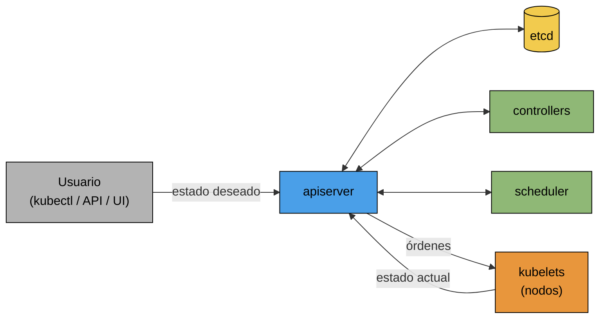
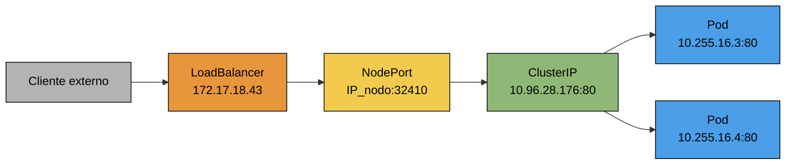
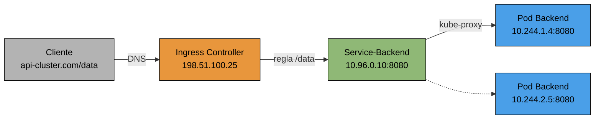

## Introducción

En la unidad anterior vimos que con Docker (y Docker Compose) podemos levantar varios contenedores en un solo host. El problema aparece cuando la aplicación crece y necesitamos distribuir esos contenedores entre muchas máquinas, reemplazarlos cuando fallan y escalarlos según la demanda. Ahí entra en juego la orquestación.

**Kubernetes** (abreviado **k8s**) es un sistema de orquestación de clústeres de contenedores de código abierto. Automatiza la implementación, el escalado y las operaciones de los clústeres de contenedores, de una manera que es sencilla para el usuario final. Está basado en la experiencia de Google durante más de 15 años y fue creado para un mundo de múltiples nubes:
- Pública
- Privada
- Híbrida

Una infraestructura centrada en contenedores tiene que resolver las siguientes cuestiones, y Kubernetes se encarga de todas ellas:
- **Programación (scheduling)**: decidir dónde deben ejecutarse los contenedores.
- **Escalado**: hacer conjuntos de contenedores más grandes o más pequeños.
- **Load balancers**: distribuir el tráfico en un conjunto de contenedores.
- **Volúmenes de almacenamiento**: proporcionar la capa de datos a los contenedores.
- **Registro y supervisión**: logging y monitoreo de lo que ocurre en el clúster.
- **Identidad y autorización**: controlar quién puede hacer cosas con los contenedores.

---
## Arquitectura

En la vista general tenemos un usuario que accede al clúster mediante una CLI (consola, con `kubectl`), una API (por ejemplo, desde Terraform) o una interfaz gráfica que ofrezca el proveedor. Todos estos pedidos llegan al **Master** (o **Control Plane**), que es el punto desde donde se maneja todo e instrumenta todas las funcionalidades. En las plataformas cloud el control plane es completamente abstracto para el usuario y se incluye en los planes de cobro. Del otro lado están los **nodos** (workers), que son las máquinas donde efectivamente corren los contenedores.
![[Pasted image 20261016211019.png|center|514]]

Empecemos por el control plane. Todo se ejecuta o se chequea a través de la **Kube API**, y todos los procesos del control plane son stateless: el estado se encuentra únicamente en el etcd.
- **apiserver**: recibe todos los comandos (de `kubectl`, de la API o de la UI) y consulta a los otros componentes. Su interfaz principal es el etcd, donde lee y escribe.
- **etcd**: base de datos clave-valor que persiste tanto el estado actual (real) del clúster como el estado deseado, es decir, lo que pidió el cliente.
- **scheduler**: asigna a un nodo los pods que todavía no tienen uno asignado, teniendo en cuenta los recursos disponibles y las restricciones que definamos.
- **controller manager**: supervisa el estado del clúster y lo lleva hacia el estado deseado. Maneja casos específicos de pods como ReplicaSets (cantidad de réplicas), CronJobs, DaemonSets, etc.

La idea clave de Kubernetes es que es **declarativo**: nosotros no le decimos qué comandos ejecutar, sino cómo queremos que quede el sistema (por ejemplo, "quiero 3 réplicas de este contenedor"). Se hace un loop de consulta permanente entre el estado deseado y el estado actual, y el clúster se ocupa automáticamente de converger a lo que pidió el usuario. Si se muere un pod, el controller detecta que hay una réplica menos de las deseadas y se crea una nueva, sin que tengamos que intervenir.


Este modelo se apoya en la **teoría de la promesa** (Promise Theory), formulada por Mark Burgess. La teoría propone una forma distinta de pensar cómo se coordinan los componentes de un sistema distribuido, y es la base conceptual de la forma en que se diseña y se usa Kubernetes. Sus ideas principales son:
- **Agentes autónomos**: cada componente del sistema es un agente independiente, que decide por sí mismo cómo comportarse y solo puede garantizar su propio comportamiento.
- **Promesas en lugar de obligaciones**: un agente no puede imponerle un comportamiento a otro, porque nada asegura que la orden se cumpla (el otro puede estar caído, saturado o inalcanzable). Lo que sí puede hacer cada agente es **prometer** qué va a hacer él, y los demás confían en esa promesa.
- **Convergencia**: como el entorno cambia y las cosas fallan, una promesa no se cumple una sola vez, sino que el agente verifica periódicamente el estado real y lo corrige hasta que coincida con lo prometido.

Contrastemos esto con el enfoque imperativo tradicional, donde un orquestador central envía una secuencia de comandos ("levantá este contenedor en el nodo 3") y asume que se ejecutaron. Si un comando se pierde o un nodo falla a mitad de camino, el sistema queda en un estado inconsistente que alguien tiene que detectar y reparar manualmente. Con las promesas, en cambio, el sistema se auto-repara.

| Teoría de la promesa | En Kubernetes |
| :--: | :--: |
| Agente autónomo | Cada controller, el scheduler y cada kubelet son procesos independientes que no se llaman entre sí, sino que solo hablan con el apiserver |
| Promesa | El estado deseado en el `spec` del manifest ("habrá 3 réplicas de este pod") y el compromiso del controller de hacerlo realidad |
| Verificación y convergencia | El loop de reconciliación: cada controller compara el estado actual con el deseado y corrige la diferencia |
| Reporte de cumplimiento | El `status` que cada kubelet reporta al apiserver, que se guarda en el etcd |

Veamos cómo se aplica cuando le pedimos a Kubernetes 3 réplicas de un pod:
1. Nosotros no mandamos "creá 3 pods": declaramos en el `spec` que queremos 3 réplicas, y eso queda guardado en el etcd.
2. El controller de ReplicaSets es el agente que promete mantener ese número. En su loop observa cuántos pods existen y, si faltan, crea los que hagan falta.
3. El scheduler es otro agente, que promete asignarle un nodo a cada pod que todavía no tenga uno.
4. El kubelet de cada nodo promete que los pods que le fueron asignados estén corriendo, y reporta su estado real.
5. Si un nodo se cae, nadie "cancela" nada ni da órdenes de emergencia: el controller simplemente ve que hay menos pods que los prometidos y vuelve a crearlos, y el scheduler los ubica en otro nodo.

Notemos que ningún componente le ordena nada a otro, sino que todos observan el estado compartido a través del apiserver y cada uno cumple su parte. Por eso los procesos del control plane pueden ser stateless y reiniciarse sin problema: al volver, leen el estado deseado del etcd y retoman la convergencia donde corresponda. Esto también es lo que hace que Kubernetes escale bien, ya que los agentes no dependen de un coordinador central que tenga que conocer los detalles de cada tarea.

>[!WARNING] Cuidado
>Una promesa no es una garantía absoluta. Kubernetes no asegura que el estado deseado se cumpla siempre, sino que va a hacer lo posible para llegar a él. Si pedimos 10 réplicas y no hay recursos en el clúster, los pods quedan en estado `Pending` hasta que haya lugar, y el sistema sigue intentándolo.

Todo este comportamiento depende de las restricciones que establecemos en los archivos de configuración en YAML, que vamos a ver más adelante.

Pasemos ahora a los nodos. Cada **nodo** es un servidor (físico o virtual) que contiene **pods**, que son grupos de uno o más contenedores. Para un correcto desacople, los distintos servicios de una aplicación se distribuyen entre los nodos, y en cada uno de ellos corren los siguientes componentes:
- **kubelet**: recibe los comandos del control plane y se encarga de crear y matar los pods dentro del nodo, además de configurar la red interna de los mismos. Además reporta el estado del nodo al apiserver.
- **kube-proxy**: mantiene la configuración de networking externa del nodo (services, etc.) usando reglas de iptables.
- **Container runtime**: es el que efectivamente ejecuta los contenedores (por ejemplo containerd o CRI-O, como vimos en la unidad anterior).
- **Monitoring/Logging**: servicios auxiliares como Supervisord o Fluentd.

>[!INFO] kubectl
>Los clientes utilizan la CLI de Kube Control (`kubectl`) para interactuar con el clúster. Por detrás, `kubectl` no hace más que enviar pedidos HTTP a la Kube API.

Podemos ver un diagrama más completo, con todos los componentes juntos, a continuación. Notemos que además aparece el **cloud-controller-manager**, que es el componente que interactúa con la API del proveedor cloud (por ejemplo, para crear load balancers o discos).
![[Pasted image 20261016211150.png|center|583]]

Cada pod tiene una dirección IP propia, y el kube-proxy se encarga de que el tráfico dirigido a los servicios llegue a los pods correctos, estén en el nodo que estén.

---
## Clústers

Lo primero que tenemos que decidir es cuántos clústers necesitamos. Tenemos dos enfoques:
![[Pasted image 20261016211548.png|center|573]]
- **Por aplicación**: un clúster por cada aplicación, tanto en desarrollo como en producción. Esto da mucho aislamiento, pero termina en una gran cantidad de clústers para administrar.
- **Multi-Tenant**: pocos clústers grandes compartidos por varias aplicaciones, típicamente uno de producción y otro de no-producción. Es más simple de administrar, pero el aislamiento se tiene que lograr dentro del clúster (con namespaces, como veremos más adelante).

Para crear clústers de producción tenemos las siguientes dos alternativas. En ambos casos el control plane se encuentra embebido en el entorno de producción y lo accedemos de las maneras que vimos antes.
![[Pasted image 20261016211614.png|center|602]]
1. Crear varios entornos de producción separados por proyectos.
2. Crear múltiples entornos de producción segregados por región.

El master y los nodos pueden distribuirse entre las zonas de disponibilidad de distintas maneras:
![[Pasted image 20261016211643.png|center]]
- **Zonal**: el master y todos los nodos están en una misma zona. Si se cae esa zona (en el ejemplo, la zona B), se pierde el funcionamiento de toda la aplicación.
- **Multi-zonal**: hay un único master en una zona (la zona B) y los nodos se distribuyen en varias zonas. Si se cae la zona B, los nodos siguen funcionando y pueden recibir tráfico, pero no se los va a poder configurar ni escalar. Si se cae la zona A o la C, simplemente habrá una reducción en la capacidad del servicio. En la imagen, los hexágonos chicos de las zonas a y c que aparecen en la fila del master son en realidad nodos: en multi-zonal hay un solo master.
- **Regional**: se tienen réplicas del master y nodos en cada zona. Es la opción más cara, pero brinda la mayor protección, ya que se tolera la caída de cualquier zona.

Incluso con un clúster regional, seguimos dependiendo de una única región. Para tener alta disponibilidad a nivel geográfico, podemos agregar un **Global Load Balancer** que balancee el tráfico entre clústers ubicados en distintas regiones. Si se cae una región entera, el tráfico se redirige a la otra.
![[Pasted image 20261016211729.png|center|268]]

Podemos llevar esta idea un paso más allá con el **clústering multiplataforma** (multinube): tener clústers en distintos proveedores cloud (por ejemplo, uno en GCP y otro en AWS) y poner delante una CDN o un load balancer externo que distribuya el tráfico entre ellos. Como Kubernetes es el mismo en cualquier nube, los mismos manifiestos sirven en ambos lados, lo que además evita depender de un único proveedor.
![[Pasted image 20261016211756.png|center|317]]

---
## Nodos

Para dimensionar los **nodos**, es importante contemplar la carga de trabajo que tendrá la aplicación o cada servicio específico de ella:
- Usar varios grupos de nodos de diferentes tamaños si diferentes cargas de trabajo requieren más CPU o memoria que otras.
- Usar los nodos más pequeños que admitan esas cargas de trabajo.
- Usar el autoescalado del clúster para asegurarnos de que se agreguen nuevos nodos a los grupos a medida que sean necesarios.
- Usar el escalado horizontal de pods para que las cargas de trabajo puedan soportar la demanda y se distribuyan uniformemente entre los nodos.

Los nodos se agrupan en **node pools**, que son grupos de nodos con la misma configuración (mismo tipo de máquina) dentro de un clúster. Usar varios node pools brinda los siguientes beneficios:
- **Escalable**: cada grupo de nodos se puede definir con un número mínimo y máximo de nodos, de modo que el número en ejecución pueda ser mayor o menor con el tiempo.
- **Clústeres heterogéneos**: todas las máquinas de un grupo son del mismo tipo, pero podemos tener cualquier número de grupos distintos asociados al mismo clúster (por ejemplo, uno con mucha memoria y otro con GPUs).
- **Etiquetas (labels)**: se pueden asignar etiquetas a los grupos de nodos para facilitar la ubicación de pods.
- **Updates**: como los grupos de nodos siempre se crean con las últimas versiones de software, podemos crear un nuevo grupo para aprovechar una versión más reciente y luego migrar los pods al nuevo grupo.
- **Soporte multizona**: los grupos de nodos son compatibles con configuraciones multizona y se crean automáticamente en cada zona adicional especificada.

Además de dimensionar bien los nodos, Kubernetes nos brinda dos niveles de autoescalado. El **autoscaling del clúster** trabaja sobre las máquinas:
- Se agregan máquinas cuando se necesitan. Las nuevas máquinas virtuales se registran automáticamente con el apiserver.
- Se quitan máquinas cuando no se precisan, por ejemplo ante un bajo uso de CPU.

El **autoscaling horizontal del pod (HPA)**, en cambio, trabaja sobre los pods:
- Agrega o elimina pods automáticamente según sea necesario.
- Se basa en la utilización de la CPU y otras métricas.
- Opera dentro de los límites mínimo y máximo definidos por el usuario.
- Da eficiencia ahora y capacidad cuando se la necesita: lo configuramos y nos olvidamos.

Veamos un ejemplo de manifiesto, donde mantenemos entre 3 y 9 réplicas del deployment `hpa-ex`, apuntando a un uso promedio de CPU del 65%:
```yaml
apiVersion: autoscaling/v2
kind: HorizontalPodAutoscaler
metadata:
  name: hpa-ex
  namespace: default
spec:
  scaleTargetRef:
    apiVersion: apps/v1
    kind: Deployment
    name: hpa-ex
  minReplicas: 3
  maxReplicas: 9
  metrics:
  - type: Resource
    resource:
      name: cpu
      target:
        type: Utilization
        averageUtilization: 65
```

>[!TIP] Importante
>Ambos autoscalings se complementan: el HPA agrega pods, y cuando los nodos existentes ya no tienen lugar para ubicarlos, el autoscaling del clúster agrega nodos.

---
## Pods

Un **pod** es la unidad mínima que maneja Kubernetes: no se despliegan contenedores sueltos, sino pods que contienen uno o más contenedores. Hay que tener en cuenta que los pods son **efímeros**: pueden morir y ser recreados en cualquier momento (y en otro nodo, con otra IP), por lo que nunca debemos depender de un pod en particular.
![[Pasted image 20261016212150.png|center|288]]

Recordando lo que vimos de namespaces de Linux en la unidad anterior, los contenedores de un mismo pod comparten algunos namespaces:
- Comparten: `NET` (misma IP y puertos, por eso entre contenedores del pod se comunican por `localhost`), `IPC` y `UTS` (hostname). El `PID` puede compartirse opcionalmente.
- No comparten: `MNT`, `USER` y `CGroup`, es decir, cada contenedor tiene su propio filesystem y sus propios límites de recursos.

Veamos ahora cómo definimos un pod. Los objetos en Kubernetes se definen en archivos **Manifest**, que tienen formato YAML. Todo manifest debe tener los siguientes parámetros:
![[Pasted image 20261016212220.png|center|301]]
- `apiVersion`: versión de la API de Kubernetes para el objeto.
- `kind`: tipo de objeto (Pod, Service, Deployment, etc).
- `metadata.name`: nombre único del objeto.
- `spec`: toda la configuración, es decir, el estado deseado.

En la imagen también aparece un `uid` dentro de la metadata, pero ese campo no lo escribimos nosotros: lo asigna Kubernetes al crear el objeto.

Veamos un ejemplo de un pod con un solo contenedor de nginx:
```yaml
apiVersion: v1
kind: Pod
metadata:
  name: pod-example
spec:
  containers:
  - name: nginx
    image: nginx:stable-alpine
    ports:
    - containerPort: 80
```

Y uno con dos contenedores que comparten un volumen. El contenedor `content` escribe la fecha cada 5 segundos en `/html/index.html`, y como el volumen `html` está montado en ambos contenedores, nginx sirve ese mismo archivo desde `/usr/share/nginx/html`:
```yaml
apiVersion: v1
kind: Pod
metadata:
  name: multi-container-example
spec:
  containers:
  - name: nginx
    image: nginx:stable-alpine
    ports:
    - containerPort: 80
    volumeMounts:
    - name: html
      mountPath: /usr/share/nginx/html
  - name: content
    image: alpine:latest
    command: ["/bin/sh", "-c"]
    args:
      - while true; do
          date >> /html/index.html;
          sleep 5;
        done
    volumeMounts:
    - name: html
      mountPath: /html
  volumes:
  - name: html
    emptyDir: {}
```

Los parámetros principales de cada contenedor de un pod son:
- `name`: nombre del contenedor.
- `image`: imagen del contenedor.
- `ports`: arreglo de los puertos en los que escucha el contenedor. Es mayormente informativo: no expone nada hacia afuera del pod, de eso se encarga un service.
- `env`: arreglo de variables de entorno.
- `command`: arreglo de entrypoint (equivalente al `ENTRYPOINT` de Docker).
- `args`: argumentos que se le pasan al command (equivalente al `CMD` de Docker).

```yaml
name: nginx
image: nginx:stable-alpine
ports:
  - containerPort: 80
    name: http
    protocol: TCP
env:
  - name: MYVAR
    value: isAwesome
command: ["/bin/sh", "-c"]
args: ["echo ${MYVAR}"]
```

---
## Labels y Selectors

Los **labels** son pares clave-valor que identifican, describen y agrupan un conjunto de objetos. No definen unicidad, sino que la idea es justamente que apliquen a muchos objetos a la vez. Se definen como parte de la metadata:
```yaml
apiVersion: v1
kind: Pod
metadata:
  name: pod-label-example
  labels:
    app: nginx
    env: prod
spec:
  containers:
  - name: nginx
    image: nginx:stable-alpine
    ports:
    - containerPort: 80
```
![[Pasted image 20261016212500.png|center|224]]

Los **selectors** usan esos labels para especificar a qué objetos aplican los comandos u otros objetos. Por ejemplo, con `nodeSelector` le pedimos al scheduler que ubique el pod solo en nodos que tengan el label `gpu: nvidia`:
```yaml
spec:
  containers:
  - name: nginx
    image: nginx:stable-alpine
    ports:
    - containerPort: 80
  nodeSelector:
    gpu: nvidia
```
![[Pasted image 20261016212518.png|center|439]]

>[!INFO] Uso de labels
>Los labels son el mecanismo con el que Kubernetes conecta objetos entre sí. Como veremos a continuación, un service no apunta a pods específicos, sino a todos los pods que tengan determinados labels.

---
## Tipos de Servicios

A alto nivel, cada nodo tiene su propia IP dentro de la subred de nodos (en el ejemplo, `192.168.15.1`), y cada pod recibe su propia IP de otra subred, la de pods (`10.244.1.11`, `10.244.1.12`). Dentro de un mismo pod, los contenedores se conectan a través de `localhost` y puertos.
![[Pasted image 20261016212536.png|center|632]]
En el diagrama aparecen flechas del etcd hacia los pods, pero el etcd nunca se comunica con ellos: el kubelet le consulta al apiserver qué pods tiene que correr, y es el kubelet (junto con el CNI) quien los crea y les asigna la IP.

El problema es que, como los pods son efímeros, sus IPs cambian constantemente, y además puede haber varias réplicas. Para resolver esto existen los **Services**. Recordemos que no tienen nada que ver con los "servicios" que venimos usando en toda la carrera: en Kubernetes, un service es un objeto que:
- Es la forma de acceder a los pods.
- Es un recurso permanente, no efímero.
- Balancea los pedidos entre los pods.
- Tiene una IP estática dentro del clúster.
- Su nombre se resuelve por DNS.

Un service es un buen ejemplo de la teoría de la promesa que vimos en la arquitectura: como no podemos confiar en ningún pod en particular, el service promete una IP y un nombre estables, detrás de los cuales siempre hay pods sanos que atienden los pedidos. Los pods que lo respaldan (los endpoints) pueden cambiar todo el tiempo, y Kubernetes actualiza esa lista para sostener la promesa.

Para exponer los pods tenemos 4 mecanismos principales:
- ClusterIP
- NodePort
- Load Balancer
- Ingress

Los tres primeros son tipos de service, mientras que Ingress es un objeto aparte que se ubica delante de los services (existe además un cuarto tipo de service, ExternalName, que veremos más adelante).

El primer tipo es **ClusterIP**, que expone un service en una IP virtual interna, accesible solo desde dentro del clúster. Sirve para que los services se vean entre sí internamente. Supongamos que tenemos réplicas de la app en distintos nodos: el ClusterIP es una dirección única a la cual enviar tráfico, y luego se reparte entre los pods que la atienden (los endpoints), seleccionados por labels.
```bash
kubectl describe service example-cip
Name:              example-cip
Selector:          app=nginx,env=prod
Type:              ClusterIP
IP:                10.96.28.176
Port:              <unset> 80/TCP
TargetPort:        80/TCP
Endpoints:         10.255.16.3:80,10.255.16.4:80
```

Notemos que el service tiene una sola IP (`10.96.28.176`) pero dos endpoints, que son los dos pods con labels `app=nginx` y `env=prod`. Además, el nombre del service se resuelve por DNS dentro del clúster:
```bash
/ # nslookup example-cip.default.svc.cluster.local
Name:      example-cip.default.svc.cluster.local
Address 1: 10.96.28.176 example-cip.default.svc.cluster.local
```

El segundo tipo es **NodePort**, que expone el service hacia afuera del clúster abriendo un puerto en la IP de cada nodo. El rango disponible de puertos es 30000-32767. Además del ClusterIP, ahora tenemos un `NodePort` (`32410`), y cualquier tráfico que llegue a `IP_de_cualquier_nodo:32410` es redirigido al service.
```bash
Name:              example-np
Selector:          app=nginx,env=prod
Type:              NodePort
IP:                10.96.28.176
Port:              <unset> 80/TCP
TargetPort:        80/TCP
NodePort:          <unset> 32410/TCP
Endpoints:         10.255.16.3:80,10.255.16.4:80
```

El tercer tipo es **LoadBalancer**, un balanceador sobre los node ports. Interactúa con el cloud provider para crear un load balancer externo, que mapea una IP externa con el ClusterIP del service. En la salida, el campo `LoadBalancer Ingress` es la IP externa que asignó el proveedor, y no tiene relación con el objeto Ingress.
```bash
Name:                 example-prod
Selector:             app=nginx,env=prod
Type:                 LoadBalancer
IP:                   10.96.28.176
LoadBalancer Ingress: 172.17.18.43
Port:                 <unset> 80/TCP
TargetPort:           80/TCP
NodePort:             <unset> 32410/TCP
Endpoints:            10.255.16.3:80,10.255.16.4:80
```

>[!TIP] Importante
>Los tipos se construyen uno encima del otro: un NodePort también tiene ClusterIP, y un LoadBalancer también tiene NodePort y ClusterIP. Lo vemos en las salidas de `kubectl`, donde cada tipo agrega un campo nuevo sobre los del anterior.



Por último, **Ingress** despacha pedidos HTTP a distintos services, permitiéndonos balancear según la URL. Trabaja en capa 7, por lo que funciona solo para HTTP/S. En el ejemplo, los pedidos a `/app_v1` van al service `app1` y los de `/app_v2` al service `app2`, y el Ingress en sí se expone hacia afuera mediante un NodePort o un LoadBalancer.
![[Pasted image 20261016213404.png|center|357]]

```yaml
apiVersion: networking.k8s.io/v1
kind: Ingress
metadata:
  name: hello-app
spec:
  rules:
  - http:
      paths:
      - path: /app_v1
        pathType: Prefix
        backend:
          service:
            name: app1
            port:
              number: 8080
      - path: /app_v2
        pathType: Prefix
        backend:
          service:
            name: app2
            port:
              number: 8080
```

---
## Estrategias de Deployment

Cuando tenemos que actualizar una aplicación en producción, hay distintas estrategias según cuánto riesgo, complejidad y costo estemos dispuestos a asumir:
- **Rolling Deployment**: actualiza las instancias de forma gradual (en lotes o de una en una) hasta cubrir todo el sistema. No requiere infraestructura extra, pero conviven versiones distintas temporalmente. Es la estrategia por defecto de Kubernetes.
- **Canary Deployment**: despliega la nueva versión para un porcentaje pequeño de usuarios (por ejemplo, 1% o 5%) para validar su estabilidad antes de pasarla al 100%. Minimiza riesgos en producción.
- **Feature Flags**: el código se despliega con la nueva función oculta tras un interruptor lógico que se enciende o apaga de forma remota, desacoplando el despliegue del lanzamiento.
- **Shadow Deployment**: duplica el tráfico real de producción y lo envía en paralelo a la nueva versión de forma invisible, descartando su respuesta. Es ideal para medir rendimiento sin riesgo para el usuario.
- **A/B Testing**: ejecuta dos versiones en paralelo para segmentos de usuarios distintos, con el fin de medir cuál ofrece mejores resultados de negocio o experiencia.

En el **Blue-Green Deployment** tenemos dos deployments activos en paralelo, que pueden ser la versión actual y la nueva, o variantes que estamos probando. Definimos los dos deployments con labels distintos (`env: blue` y `env: green`) y un service que apunta a uno u otro mediante su selector. Para pasar a la nueva versión basta con cambiar el selector del service, lo que hace la conmutación instantánea, y si algo sale mal volvemos atrás de la misma forma.
![[Pasted image 20261016213429.png|center|489]]

Comparemos las distintas estrategias:

|  Estrategia   | Tiempo de inactividad |  Complejidad  | Nivel de Riesgo  |   Costo de Infraestructura    |
| :-----------: | :-------------------: | :-----------: | :--------------: | :---------------------------: |
| Blue-Green    | Cero (conmutación instantánea) | Media | Bajo      | Alto (requiere doble entorno) |
| Rolling       | Cero                  | Baja-Media    | Medio            | Bajo (usa la misma infraestructura) |
| Canary        | Cero                  | Alta          | Bajo-Medio       | Medio                         |
| Feature Flags | Cero                  | Media         | Muy Bajo         | Bajo                          |
| Shadow        | Cero                  | Alta          | Nulo para el usuario | Muy Alto (duplica tráfico/cargas) |

---
## Afinidad

Tenemos tres opciones para derivar workloads (pods) a determinados nodos:
- **nodeSelector**: el enfoque original de "notas adhesivas", que requiere que los pods y los nodos tengan etiquetas en común para que un pod determinado se ubique en un nodo determinado.
- **Affinity**: el sucesor de nodeSelector. Es una coincidencia basada en etiquetas que tiene más operadores y puede crear asociaciones positivas o negativas con nodos, o incluso con otros pods.
- **Taints**: desde la perspectiva del nodo, las taints son el medio por el cual un nodo puede repeler pods, algo así como una lista negra. Solo se ubican en ese nodo los pods que explícitamente toleren la taint.

>[!INFO] Distinción
>nodeSelector y affinity atraen pods hacia nodos (los decide el pod); las taints repelen pods de un nodo (lo decide el nodo).

La afinidad es más flexible que nodeSelector porque tenemos varios operadores para elegir: `In`, `NotIn`, `Exists`, `DoesNotExist`, `Gt` y `Lt`. Además, podemos definir reglas obligatorias (`required...`) o preferencias (`preferred...`, con un peso):
```yaml
spec:
  affinity:
    nodeAffinity:
      requiredDuringSchedulingIgnoredDuringExecution:
        nodeSelectorTerms:
        - matchExpressions:
          - key: kubernetes.io/zone
            operator: In
            values:
            - us-west1-a
            - us-west1-b
      preferredDuringSchedulingIgnoredDuringExecution:
      - weight: 1
        preference:
          matchExpressions:
          - key: another-node-label-key
            operator: In
            values:
            - another-node-label-value
```
En este ejemplo, el pod obligatoriamente tiene que ir a un nodo de las zonas `us-west1-a` o `us-west1-b`, y entre esos, preferentemente a uno con el label `another-node-label-key=another-node-label-value`. El sufijo `IgnoredDuringExecution` indica que si el label del nodo cambia una vez que el pod ya está corriendo, el pod no se mueve.

>[!WARNING] Cuidado
>Si en un mismo `.yaml` se usan tanto affinity como nodeSelector, se deben cumplir ambos criterios para que se implemente el pod.

---
## Infraestructura

En el caso de Kubernetes Engine (GKE), la infraestructura del clúster se apoya en dos pilares:
- **Redes**: los clústeres se aprovisionan con un rango de IPs que se determina automáticamente durante la creación del clúster, en una subred existente del proyecto.
- **Control de acceso**: los nuevos clústeres usan los roles de IAM existentes del proyecto y RBAC, y usan la cuenta de servicio predeterminada de Compute Engine del proyecto para los nodos aprovisionados.

En cuanto al networking:
- Los pods obtienen direcciones IP únicas, con alcance de clúster.
- Los pods pueden verse entre sí directamente, incluso entre nodos distintos.
- No hay intermediación de números de puerto: cada pod puede usar cualquier puerto en su dirección IP.
- Como requisito fundamental, las IPs tienen que poder enrutarse en capa 3. Kubernetes Engine lo resuelve usando rutas y direcciones IP de alias.

Para las IPs del clúster podemos crear una subred propia para el clúster con bloques CIDR personalizados. Durante la creación del clúster, Kubernetes Engine asignará las direcciones IP de nodos, pods y services a partir de los rangos definidos en esa subred. Habilitar los alias permite que el clúster sea accesible para otros recursos externos al nodo.

Al momento de diseñar las subredes tenemos que tener en cuenta:
- **Planear el direccionamiento**: al definir subredes personalizadas, los bloques CIDR deben ser únicos dentro del proyecto y no superponerse. Hay que planificar las necesidades futuras para evitar problemas más adelante.
- **Diseñar los bloques CIDR correctamente**: el CIDR de nodos debe tener un tamaño que tenga en cuenta el crecimiento del clúster. Por ejemplo, un bloque `/26` tiene $2^{6} = 64$ direcciones, de las cuales GCP reserva 4, por lo que solo permite 60 nodos.
- **Administración de ruteo**: se requiere administración de red adicional, ya que faltan tablas de enrutamiento automático entre subredes, al igual que las reglas de firewall predeterminadas. Hay que anticipar trabajo extra configurando la red.

En cuanto al control de acceso, usamos **IAM**, siguiendo las siguientes recomendaciones:
- Crear roles que coincidan con las responsabilidades del equipo y asignarlos a grupos (por ejemplo, un network admin a nivel del proyecto y la red, y un cluster admin a nivel del clúster).
- Deshabilitar la autorización heredada (legacy ABAC) y usar RBAC. Esta recomendación aplicaba a Kubernetes 1.6 y 1.7; en las versiones actuales la autorización heredada ya viene deshabilitada por defecto.
- Crear una cuenta de servicio propia para el clúster en lugar de usar la cuenta predeterminada de Compute Engine.

![[Pasted image 20261016213528.png|center|357]]

Los **namespaces** de Kubernetes (que no hay que confundir con los namespaces de Linux) nos permiten, en clústeres multi-tenant, segmentar los pods por aplicación o grupo de trabajo. Cada namespace funciona como un clúster virtual dentro del clúster físico, sobre el cual podemos aplicar permisos y cuotas de recursos por separado. Es justamente lo que nos permite implementar el enfoque multi-tenant que vimos al principio.

---
## Modelo de Red de Kubernetes

Kubernetes sigue un modelo de red muy estricto y fundamental para su diseño:
- Cada pod tiene su propia dirección IP única.
- Los pods en diferentes nodos pueden comunicarse sin NAT. Es decir, si un pod en el nodo A contacta a un pod en el nodo B, el pod de destino ve la dirección IP del pod de origen, y no la del nodo A.
- Los agentes del nodo (como el kubelet) pueden comunicarse con todos los pods.

Este modelo garantiza que las aplicaciones puedan migrar de VMs a contenedores sin necesidad de cambiar los números de puerto, ya que la comunicación se basa en direcciones IP y puertos como en un entorno tradicional.

>[!INFO] Diferencia con Docker
>En la red bridge de Docker, los contenedores tienen IPs privadas que solo valen dentro del host, y para salir se hace NAT. En Kubernetes, en cambio, la IP de un pod es válida en todo el clúster.

La comunicación interna se gestiona a través de dos abstracciones principales: pods y services.

Por un lado tenemos la **pod network**. La red que permite la comunicación entre todos los pods se implementa mediante una **interfaz de red de contenedores (CNI, Container Network Interface)**. CNI es una especificación, y existen muchos plugins que la implementan, como Calico, Flannel o Cilium. El CNI se encarga de asignar la dirección IP a cada pod y de configurar las rutas necesarias en el sistema operativo del host para que los paquetes puedan viajar entre pods, incluso si están en nodos diferentes.

Por otro lado tenemos los **services**. Un service es una abstracción que define un conjunto lógico de pods y una política para acceder a ellos (a menudo llamada microservicio). El componente clave que implementa los services en cada nodo es el **kube-proxy**, que mantiene las reglas de red (usando iptables o IPVS) para dirigir el tráfico a los pods correctos. Los tipos de service son:

|     Tipo     |                                                         Descripción                                                          |                     Caso de Uso Principal                     |
| :----------: | :--------------------------------------------------------------------------------------------------------------------------: | :-----------------------------------------------------------: |
| **ClusterIP**    | Expone el service en una IP interna del clúster. Solo es accesible desde dentro del clúster.                             | Comunicación entre microservicios (backend a base de datos).  |
| **NodePort**     | Expone el service en un puerto de cada nodo, además del ClusterIP. Permite acceder desde fuera del clúster a través del puerto de cualquier nodo. | Permitir acceso externo de prueba o limitado. |
| **LoadBalancer** | Expone el service externamente usando el load balancer del proveedor de la nube, que se crea automáticamente y dirige el tráfico al service. | Exponer aplicaciones de forma pública en una nube (GCP, AWS, Azure). |
| **ExternalName** | Expone un service utilizando un nombre DNS arbitrario, no un selector.                                                   | Mapear un service a un servicio externo (por ejemplo, una base de datos externa). |

>[!INFO] Ingress
>Notemos que Ingress no aparece en esta tabla porque no es un tipo de service, sino un objeto aparte que se ubica delante de los services. Los cuatro tipos de service propiamente dichos son ClusterIP, NodePort, LoadBalancer y ExternalName.

Si necesitamos exponer múltiples services bajo una única dirección IP y enrutar según el nombre de host o la ruta (por ejemplo, `misitio.com/api` va al service A y `misitio.com/web` al service B), usamos un **Ingress**. Es una colección de reglas de enrutamiento que controlan cómo el tráfico externo llega a los services del clúster, y requiere un **Ingress Controller** (como NGINX o el GKE Ingress Controller) para funcionar. Este controlador actúa como el router de edge que aplica las reglas definidas en el recurso Ingress.

Por último, las **Network Policies** son el mecanismo de firewall de Kubernetes. Definen cómo los pods pueden comunicarse entre sí y con otros endpoints de red. Por defecto, Kubernetes no restringe la comunicación entre pods, y una network policy nos permite aislarlos, especificando qué pods tienen permiso para acceder a otros (por ejemplo, permitir que solo los pods de frontend accedan a los pods de backend).

>[!TIP] Resumen
>- CNI da la conectividad pod a pod.
>- Services dan la abstracción de grupo de pods.
>- Kube-proxy implementa el balanceo de carga interno para los services.
>- Ingress proporciona el routing L7 (HTTP/S) para el tráfico externo.

---
## Ejemplo

Veamos todo esto junto con un ejemplo concreto. En un clúster tenemos tres rangos de red bien diferenciados:

|         Componente          |                               Rango de Red (Subred)                               | Ejemplo de IP |                                             Descripción                                             |
| :-------------------------: | :-------------------------------------------------------------------------------: | :-----------: | :-------------------------------------------------------------------------------------------------: |
|    Red de Nodos (Hosts)     |                                  `10.100.0.0/24`                                  | `10.100.0.5`  |       La red donde residen las máquinas virtuales o físicas (nodos) que ejecutan el clúster.        |
|      Red de Pods (CNI)      |                                  `10.244.0.0/16`                                  | `10.244.1.8`  |         La red superpuesta (overlay) que asigna una IP única a cada pod en todo el clúster.         |
| Red de Services (ClusterIP) | `10.96.0.0/16` (el rango default es `/12`, pero se superpone con la red de nodos) | `10.96.0.10`  | La red virtual que usa Kubernetes para asignar direcciones IP virtuales (ClusterIP) a los services. |

En cuanto a los accesos externos:
- **Red de nodos** (`10.100.0.0/24`): sí se puede acceder desde fuera del clúster, dependiendo de la infraestructura. Son las direcciones IP reales de los servidores, por lo que si nuestra máquina está en la misma red privada (LAN, VPN o VPC), podemos hacerles ping o acceder por SSH directamente.
- **Red de services** (`10.96.0.0/16`): no se puede acceder desde fuera (por defecto). Son direcciones IP virtuales que solo existen dentro del clúster, manejadas por reglas de iptables/IPVS mediante kube-proxy. No hay rutas en los routers externos que sepan cómo llegar a ellas.

Empecemos por los nodos. Tenemos dos, Nodo 1 con IP `10.100.0.5` y Nodo 2 con IP `10.100.0.6`.

En cuanto a los pods, cada uno obtiene una IP de la red de pods (`10.244.0.0/16`). Tenemos dos réplicas de frontend y dos de backend, repartidas entre los nodos:

|        Componente         |      Nodo Host       |    Pod IP    |
| :-----------------------: | :------------------: | :----------: |
| Pod de Frontend (copia 1) | Nodo 1 (`10.100.0.5`) | `10.244.1.2` |
| Pod de Frontend (copia 2) | Nodo 2 (`10.100.0.6`) | `10.244.2.3` |
| Pod de Backend (copia 1)  | Nodo 1 (`10.100.0.5`) | `10.244.1.4` |
| Pod de Backend (copia 2)  | Nodo 2 (`10.100.0.6`) | `10.244.2.5` |

Un pod (`10.244.1.2` en el Nodo 1) puede comunicarse directamente con otro pod (`10.244.2.5` en el Nodo 2), porque la CNI se encarga de que las IPs de pods sean enrutables a través de los nodos. Notemos además que cada nodo tiene asignado su propio sub-rango de la red de pods (`10.244.1.x` para el Nodo 1 y `10.244.2.x` para el Nodo 2).

Para que el frontend no necesite saber la IP individual de cada pod de backend (y para manejar fallos y escalado), creamos services:

|   Service Name    | ClusterIP (Virtual) | Puerto |               Descripción                |
| :---------------: | :-----------------: | :----: | :--------------------------------------: |
| Service-Frontend  |     `10.96.0.8`     |   80   | Balancea el tráfico a los pods de frontend. |
| Service-Backend   |    `10.96.0.10`     |  8080  | Balancea el tráfico a los pods de backend.  |

El flujo de comunicación interna es el siguiente:
1. El pod de frontend (`10.244.1.2`) quiere acceder al backend.
2. El frontend se conecta a la IP virtual del service de backend: `10.96.0.10:8080`.
3. El kube-proxy intercepta esta IP virtual y, usando reglas de red (iptables/IPVS), redirige el tráfico a una de las IPs reales de los pods de backend (`10.244.1.4` o `10.244.2.5`). Esto es el balanceo de carga interno.

Pasemos ahora al acceso externo. Si queremos que los usuarios accedan al frontend, podemos configurar el Service-Frontend (`10.96.0.8`) como NodePort, asignándole por ejemplo el puerto `30080`. Esto abre ese puerto en cada nodo, por lo que tenemos dos formas de acceder:
- Usando el Nodo 1: `10.100.0.5:30080`
- Usando el Nodo 2: `10.100.0.6:30080`

Cualquiera de las dos será enrutada por el kube-proxy a uno de los pods de frontend, sin importar en qué nodo esté.

La otra alternativa para el acceso externo es usar un **Ingress**, que actúa como un router inteligente en el perímetro del clúster. No es un service en sí mismo, sino una colección de reglas que define cómo el tráfico externo de capa 7 (HTTP y HTTPS) debe ser enrutado a los services internos. Para que funcione se requieren dos componentes:
- **Recurso Ingress**: es el archivo de configuración YAML donde definimos las reglas de routing (por ejemplo, "si viene `midominio.com/api`, enviarlo a Service-Backend").
- **Ingress Controller**: es un pod que se ejecuta en el clúster (a menudo NGINX, HAProxy o un load balancer de la nube) que escucha las reglas del recurso Ingress y las aplica, actuando como el gateway real.

En nuestro ejemplo definimos las siguientes reglas:

| Host (Dominio)  | Path (Ruta) |              Destino (Service)              |
| :-------------: | :---------: | :-----------------------------------------: |
| api-cluster.com |   `/web`    |     Service-Frontend (`10.96.0.8:80`)      |
| api-cluster.com |   `/data`   |    Service-Backend (`10.96.0.10:8080`)     |
| api-cluster.com |     `/`     | Regla por defecto, generalmente a Service-Frontend |

Veamos el flujo completo cuando un usuario ingresa en su navegador `http://api-cluster.com/data`:

1. **Cliente a Ingress IP**: el DNS resuelve `api-cluster.com` a la IP externa del Ingress Controller, `198.51.100.25`.
2. **Ingress Controller a ClusterIP**: el Ingress Controller recibe la solicitud HTTP y, al leer las reglas de Ingress, identifica la ruta `/data`. Entonces enruta el tráfico internamente al ClusterIP del Service-Backend, `10.96.0.10:8080`.
3. **ClusterIP a Pod IP**: el kube-proxy (que implementa el ClusterIP `10.96.0.10`) intercepta el tráfico, lo balancea y lo redirige a una de las IPs reales de los pods de backend (por ejemplo, `10.244.1.4:8080`).

Las ventajas de usar Ingress son:
- **Consolidación de IPs**: solo se necesita una IP pública (`198.51.100.25`) para exponer múltiples aplicaciones.
- **Routing inteligente**: permite enrutar según dominios (`app1.com`, `app2.com`) o rutas (`/api`, `/web`).
- **Gestión de TLS/SSL**: el Ingress maneja la terminación de HTTPS (certificados), liberando a los pods de esa tarea.

>[!TIP] Importante
>En resumen, Ingress toma el tráfico HTTP/S externo, lo evalúa según las reglas de routing de capa 7 y lo dirige al ClusterIP interno del service de destino, desde donde kube-proxy lo lleva a un pod.
