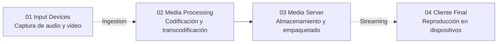
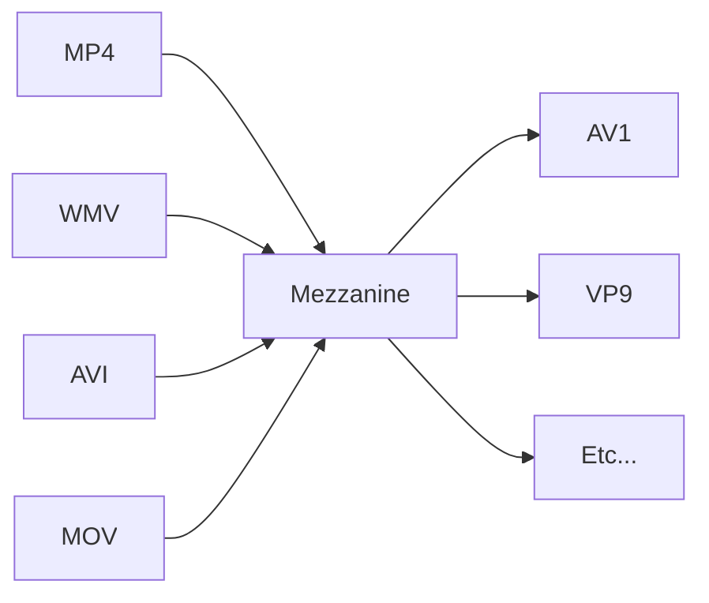

## Introducción

En esta unidad vamos a ver los **servicios multimedia**, empezando por el streaming de video y las redes de distribución de contenido (CDNs), para luego pasar a las redes de broadcasting y, por último, a la telefonía y la voz sobre IP.

Cuando hablamos de **streaming** nos referimos a la distribución de video en forma digital. Tiene tres características principales:
- **One-way**: es una transmisión unidireccional, desde la fuente hacia el receptor, sin requerir una interacción bidireccional constante.
- **Prioridad en calidad**: el objetivo es que el usuario final reciba siempre la mejor calidad de reproducción posible, y para eso se utilizan el almacenamiento en búfer y tasas de bits adaptativas.
- **Ocupación de red**: el contenido de video y audio es el que tiene la mayor ocupación y volumen de tráfico en las redes públicas.

Este último punto es el que justifica estudiarlo. Según distintas fuentes, el streaming de video representa más del $66\%$ de todo el tráfico global de internet (Sandvine 2025) y casi el $76\%$ del tráfico de las redes móviles (Ericsson 2025), con plataformas como Netflix, YouTube, AppleTV y Amazon Prime, entre otras. La razón es doble. Por un lado, el video ocupa mucho ancho de banda, y además ese consumo es variable. Por otro lado, es un servicio masivo, que usa muchísima gente todo el tiempo. Es una forma de comunicación tan masiva que resulta fundamental entender cómo funciona desde el punto de vista de las redes.

---
## Compresión de Video

Como el video necesita mucho ancho de banda, lo primero que hay que hacer es **comprimirlo**. Un video es una secuencia de imágenes que se muestran a una velocidad constante, habitualmente de 24 o 30 imágenes por segundo, que es el mínimo para que percibamos el movimiento como fluido. Con 15 imágenes por segundo, por ejemplo, el video se vería entrecortado. Ya en el cine más antiguo se trabajaba con esta cantidad de cuadros por segundo, y lo mismo ocurre hoy en los videojuegos.

Una imagen codificada digitalmente y sin comprimir consta de una matriz de píxeles, y cada píxel se codifica con un número de bits que representa la luminancia y el color. Si multiplicamos eso por 24 o 30 imágenes por segundo, la cantidad de datos es enorme. Si transmitiéramos el video en formato crudo, tal cual sale de la cámara, internet prácticamente no podría funcionar: ese ancho de banda sería carísimo y ocuparía el lugar de otros servicios más fundamentales.

Por eso, una característica importante del video es que se puede comprimir, lo que permite equilibrar la calidad con la tasa de bits. Los algoritmos de compresión estándar actuales pueden comprimir un video a prácticamente cualquier tasa de bits deseada. La compresión de video es una rama de estudio muy importante y existen muchísimos algoritmos.

---
## Ejemplo del Confeti

Para ver a qué nos referimos con comprimir video, en clase vimos un video en inglés en el que se muestra qué pasa cuando se comprime una escena llena de confeti, como en un recital. Según cuánto esté comprimido, el confeti se distingue mejor o peor, y en los casos extremos se ve todo como una mancha.

El video arranca con la televisión analógica. Era solo de definición estándar, pero prácticamente cada detalle que captaba la cámara aparecía en la pantalla. Eso funcionaba cuando había pocos canales y se transmitían literalmente por aire, pero es un enorme desperdicio. La razón por la que la televisión digital puede tener tantos canales, y por la que el video en la web funciona, es la **compresión**. Si quisiéramos transmitir cada píxel de un video HD en calidad perfecta, necesitaríamos alrededor de 1 gigabit por segundo, lo que al momento de grabar el video saturaría más de 100 conexiones de banda ancha promedio de Estados Unidos al mismo tiempo, o más de 50 de Corea del Sur.

Entonces, para que YouTube funcione, esa cantidad de datos por segundo, es decir, el **bitrate**, tiene que reducirse. Para eso se aplican dos pasos:
1. **Compresión de imagen**: es la compresión común de cualquier imagen. Casi todas las fotos de internet están comprimidas, principalmente descartando pequeños detalles que el ojo probablemente no va a notar. Esta compresión se puede aplicar a cada cuadro del video por separado.
2. **Compresión entre cuadros (interframe)**: hasta que no haya un cambio grande de escena, no tiene sentido guardar cuadros completos si se pueden guardar solo los cambios entre uno y otro. Si alguien habla frente a un fondo liso, no hace falta enviar el fondo una y otra vez; alcanza con decirle al reproductor que repita lo que ya estaba. Si la persona se mueve un poco, se le indica que desplace ese bloque de píxeles un poco hacia un costado y que ajuste algo de color en algunos lugares.

Con mucha matemática, así es como se pasa de gigabits por segundo a algo que se puede cargar en un celular.

Para demostrarlo, el autor limita el bitrate de su propio video a 200 kilobits por segundo, es decir, 200.000 unos y ceros por segundo. Aclara que YouTube vuelve a procesar el video al subirlo, pero no puede recuperar mágicamente el detalle perdido, así que aunque lo veamos en la mejor calidad posible, seguimos viendo la versión limitada. Con codificación moderna no se ve tan mal: se pierde algo de detalle fino en la cara, en el pelo o en los gestos de las manos, pero todavía se entiende claramente lo que pasa.

Después agrega nieve, y de repente esos bits ya no se usan solo para mostrar a la persona, sino también para seguir todo lo que vuela por la pantalla. El movimiento es caótico, cambia de dirección todo el tiempo y es complejo, así que la instrucción de "mover estos píxeles hacia acá" deja de servir. Luego agrega confeti de colores, y la imagen empieza a desarmarse. Cuantas más cosas se mueven en el cuadro, más repartidos tienen que estar esos 200 kilobits. Por más que el codificador intente priorizar las caras y los tonos de piel, simplemente no le sobran bits. Incluso si volviera a subir el bitrate al máximo, en ese momento seguiría viéndose mal.

La clave es que el problema no es el confeti en sí, sino el **movimiento**. Si se congela todo el confeti en el aire y pasa a ser un fondo estático, en un par de segundos la calidad del video vuelve. Por eso la imagen se desarma cuando nuestro equipo gana y cae el confeti.

---
## Compresión de Audio

Así como hay compresión de video, también hay compresión de audio. Por ejemplo, el mismo sonido codificado con tres formatos distintos, todos a 44.100 Hz:
![[Pasted image 20261030163358.png|center|369]]
1. **MP3** (LibMP3Lame): 32 kbps, Joint Stereo.
2. **WAV** (PCM_S16LE): $1.411{,}2$ kbps, Stereo.
3. **OGG** (OGG Vorbis): 50 kbps, Stereo.

El WAV es el mismo sonido con mucha más definición, a costa de una tasa de bits muchísimo mayor. Dependiendo de la potencia de cómputo que tengamos y, sobre todo, del canal que estemos usando, va a ser adecuado un nivel de compresión más alto o más bajo.

---
## Técnicas de Compresión

Formalmente, la **compresión de video** es el proceso algorítmico de reducción de la tasa de bits (bitrate) de una señal de video digital mediante la eliminación de redundancias estadísticas y perceptuales, optimizando el equilibrio entre tasa de datos y distorsión (Rate-Distortion Optimization). Las técnicas principales son las siguientes.

El **submuestreo de crominancia** aprovecha la redundancia psicovisual. Se convierte el espacio de color RGB a **YCbCr**, separando la **luminancia** ($Y$, el brillo) de la **crominancia** ($Cb$ y $Cr$, el color), y se comprimen estas variables por separado. Dado que el sistema visual humano tiene menor agudeza ante las variaciones de color que ante las de brillo, se reduce la resolución de los canales de color (por ejemplo, con los esquemas **4:2:2** o **4:2:0**) sin una pérdida perceptual significativa. En el siguiente ejemplo se ve cómo, en los esquemas 4:2:2 y 4:2:0, la luma se conserva completa mientras que la croma se comparte entre varios píxeles:
![[Pasted image 20261030163417.png|center|475]]

La **compresión intracuadro** aprovecha la redundancia espacial, es decir, la correlación entre píxeles adyacentes dentro de un mismo fotograma. Se toma cada una de las imágenes de la secuencia y se comprime el contenido que se repite. Para eso se utiliza predicción direccional espacial y se aplican transformadas matemáticas al dominio de la frecuencia, como la **Transformada Discreta del Coseno (DCT)** o la Transformada Discreta del Seno (DST), sobre bloques de píxeles. Estos son los conocidos **macrobloques** de H.264, o las Coding Tree Units (CTU) en HEVC y AV1. El objetivo es concentrar la energía de la señal en los coeficientes de baja frecuencia.

El nivel de compresión que se logra depende mucho del contenido. No es lo mismo comprimir un dibujo animado plano, con pocos colores y un fondo de un solo color, que comprimir una carrera de Fórmula 1:
![[Pasted image 20261030163454.png|center|565]]

La **compresión intercuadro** aprovecha la redundancia temporal, minimizando los datos entre fotogramas consecutivos mediante **estimación y compensación de movimiento**. En lugar de codificar cada cuadro completo, el códec calcula **vectores de movimiento** que describen el desplazamiento de los bloques entre cuadros y codifica únicamente el error residual (la diferencia). Se estructura en un **GOP** (Group of Pictures) compuesto por:
- **I-frames (Intra)**: cuadros clave codificados de forma independiente, sin referencia temporal.
- **P-frames (Predicted)**: codificados a partir de referencias a cuadros anteriores (I o P).
- **B-frames (Bi-predictive)**: tienen mayor eficiencia de compresión, ya que interpolan datos de cuadros anteriores y posteriores.

A estas técnicas se suman tres etapas más:
- **Cuantización (con pérdida)**: es el núcleo de la reducción de datos irreversible. Los coeficientes de la transformada (DCT) se dividen por una matriz de cuantización escalada por un parámetro (**QP**, Quantization Parameter) y se redondean a números enteros. Esto anula los coeficientes de alta frecuencia (ruido y detalles finos menos visibles), y controla directamente la relación entre el peso del archivo y la presencia de artefactos visuales.
- **Codificación entrópica (sin pérdida)**: el flujo resultante de coeficientes cuantizados y vectores de movimiento se comprime estadísticamente sin pérdida adicional. Emplea algoritmos como **CABAC** (Context-Adaptive Binary Arithmetic Coding) o **CAVLC**, que asignan palabras de código más cortas a los símbolos más probables según el contexto.
- **Filtros en bucle (In-Loop Filtering)**: es una etapa previa al almacenamiento del cuadro en el búfer de referencia. Aplica filtros adaptativos como **Deblocking** (suaviza los bordes artificiales entre bloques) y **SAO** (Sample Adaptive Offset) para mitigar los artefactos de compresión y evitar que el error visual se propague a los cuadros predichos siguientes.

Todas estas son distintas formas de comprimir el video, útiles porque sí o sí necesitamos bajar la cantidad de datos que transmitimos.

---
## Televisión Digital

En la televisión digital también hay distintos estándares según el país o la región:
![[Pasted image 20261030163538.png|center|520]]

Aunque como consumidores no lo tengamos presente, en todo el mundo se discute continuamente no solo cómo comprimir el video, sino también cómo agregar otros servicios dentro de la televisión digital, llegar a los móviles con la mejor calidad y hacer transmisión adaptativa a los distintos dispositivos. Estos estándares tienen otras funcionalidades distintas a las del streaming de video, que es lo que vamos a ver a continuación.

---
## Arquitectura de Streaming

La arquitectura de streaming de video tiene cuatro etapas:

- **Input Devices**: es el contenido de entrada, por ejemplo, un programa que se está filmando en vivo o archivos de video pregrabados.
- **Media Processing**: el contenido se ingesta en un servidor que lo codifica y transcodifica, para que tenga un formato adecuado para ser transmitido.
- **Media Server**: el contenido procesado se copia en un servidor de medios (media server o video server), que lo almacena y empaqueta.
- **Cliente final**: desde el servidor de medios se hace el streaming que llega al cliente.

Este proceso tan simple se multiplica millones de veces continuamente, con petabytes por segundo, porque todo el mundo genera contenido y todo el mundo lo consume. Antes había pocos canales de televisión que transmitían, y por eso se hablaba de **broadcasting**, ya que la transmisión es de uno a muchos: un satélite con una huella que llegaba al proveedor de cable, con muy pocas entidades que podían transmitir contenido. Hoy la televisión tradicional dio lugar a la interactividad, y cualquiera puede subir contenido desde cualquier dispositivo. Aun cuando hay un único proveedor de contenidos, como Netflix, la cantidad de bocas de salida es enorme.

---
## Transmisión HTTP

En un principio se utilizó la **transmisión por HTTP**. En este esquema, el video simplemente se almacena en un servidor HTTP como un archivo ordinario con una URL específica. Cuando un usuario quiere ver el video, el cliente establece una conexión TCP con el servidor y emite una solicitud HTTP GET para esa URL. Luego el servidor envía el archivo de video, dentro de un mensaje de respuesta HTTP, tan rápido como lo permitan los protocolos de red subyacentes y las condiciones del tráfico.

Del lado del cliente, los bytes se van recogiendo en un búfer de la aplicación. Una vez que la cantidad de bytes del búfer supera un umbral predeterminado, la aplicación comienza la reproducción: toma periódicamente fotogramas del búfer, los descomprime y los muestra en la pantalla. La aplicación puede ser un browser, QuickTime o cualquier aplicación que reproduzca video. De esta manera, el video se muestra a medida que se reciben y almacenan en el búfer los fotogramas de las partes posteriores. Si no llegan suficientes paquetes, el video se ve con tirones.

Aunque este esquema se implementó ampliamente en la práctica (por ejemplo, en YouTube desde sus inicios), tiene una deficiencia principal: todos los clientes reciben la misma codificación del video, a pesar de las grandes variaciones en el ancho de banda disponible, tanto entre distintos clientes como a lo largo del tiempo para un mismo cliente. Pensemos en qué le puede pasar al usuario final si la tasa de bits que le llega no alcanza para reproducir el video. Un usuario puede tener un celular antiguo, una computadora vieja o una muy potente, buena o mala recepción, y cada una de estas variables empeora o mejora el servicio, por lo que los usuarios tienen experiencias muy diferentes.

---
## DASH

Para resolver esto se desarrolló un nuevo tipo de transmisión basada en HTTP, llamado **transmisión adaptativa dinámica sobre HTTP (DASH)**. Este protocolo implica mucho más esfuerzo del lado de quien ofrece los contenidos.

En DASH, el video se codifica en varias versiones diferentes, cada una con una tasa de bits distinta y, en consecuencia, un nivel de calidad distinto. Por ejemplo, en la etapa de media processing se puede transcodificar el video en 4 bitrates diferentes, de modo de ofrecer 4 calidades a los usuarios finales. El cliente solicita dinámicamente fragmentos de segmentos de video de unos pocos segundos de duración. Cuando el ancho de banda disponible es alto, la aplicación del cliente selecciona fragmentos de una versión de alta tasa, y cuando es bajo, selecciona fragmentos de una versión de tasa más baja. Por eso decimos que es un protocolo **adaptativo**, que se ajusta al ancho de banda y al dispositivo del usuario final.

Veamos cómo funciona el envío adaptativo del contenido:
![[Pasted image 20261030163651.png|center|514]]

El **encoder** recibe el video de entrada con un bitrate alto y lo codifica en las distintas versiones de bitrate (en el diagrama, la roja, la verde y la azul). Estas versiones van al servidor web, que crea un **archivo manifiesto**. El manifiesto es necesario porque alguien le tiene que avisar al usuario final qué versiones existen: si se generan cuatro versiones pero el cliente no se entera, nunca las va a ir a buscar. Por eso el manifiesto contiene la URL de cada versión, por ejemplo 1, 2, 3 y 4, siendo la 1 la de menor bitrate y la 4 la de mayor bitrate. Cuando la aplicación del celular detecta que tiene menos ancho de banda, busca en el manifiesto la versión adecuada, que es la que puede reproducir de forma continua con la mejor calidad posible dentro de las posibilidades de su dispositivo y su ancho de banda.

En el gráfico de abajo se ve el ancho de banda disponible a lo largo del tiempo. Cuando el ancho de banda es alto, el cliente usa la versión de mayor bitrate. Cuando baja (y esto lo va midiendo el propio dispositivo), cambia a una versión de menor bitrate para que el búfer del cliente esté más holgado. Si sigue bajando, por ejemplo por una congestión de red, pasa a la peor versión. Luego, a medida que el ancho de banda mejora, vuelve a la versión de bitrate medio y después a la de bitrate alto, porque entiende que el ancho de banda de la red es suficiente. Si vuelve a bajar, cambia otra vez de versión. Es lo que experimentamos sin darnos cuenta cuando notamos que la calidad de una película varía, por ejemplo, cuando alguien más en la casa se pone a ver otro video.

En resumen, el funcionamiento de DASH es el siguiente:
1. Cada versión del video se almacena en el servidor HTTP, cada una con una URL diferente.
2. El servidor HTTP también tiene un archivo manifiesto, que proporciona la URL de cada versión junto con su tasa de bits. El cliente primero solicita el manifiesto y obtiene la información sobre las distintas versiones.
3. Luego, el cliente selecciona un fragmento a la vez, especificando una URL y un rango de bytes en un mensaje HTTP GET para cada fragmento. Mientras descarga los fragmentos, mide el ancho de banda recibido y ejecuta un algoritmo de determinación de tasa para seleccionar el próximo fragmento. Lo va haciendo prácticamente en tiempo real.
4. De manera natural, si el cliente tiene mucho video en el búfer y el ancho de banda medido es alto, elige un fragmento de una versión de alta tasa de bits. Si tiene poco video en el búfer y el ancho de banda medido es bajo, elige un fragmento de una versión de baja tasa de bits.

>[!TIP] Importante
>Es el cliente, y no el servidor, quien elige qué versión descargar, ya que es quien tiene el manifiesto. Por lo tanto, DASH permite al cliente cambiar libremente entre diferentes niveles de calidad.

Mientras miramos una película, todo esto está pasando en el televisor inteligente sin que lo notemos. Lo que se busca en estos sistemas distribuidos gigantescos es que el cliente tenga la mejor calidad de servicio posible, y ese es el precepto principal con el que se diseña el sistema.

---
## Envío Adaptativo

El envío de video adaptativo forma un circuito entre el servidor y el cliente:
![[Pasted image 20261030163941.png|center|422]]

El media server tiene el manifiesto y los clientes eligen la tasa baja, media o alta. El contenido llega al búfer y de ahí al media player, que es la aplicación que reproduce el video. A su vez, el cliente le envía información de recepción al media server, y este loop constante hace que el usuario final vea lo mejor posible. Si el ancho de banda es muy bajo, eventualmente el video se va a cortar, pero este tipo de protocolos hace que falle lo menos posible, porque aprovecha la red de la mejor manera. Ante una baja del ancho de banda no se corta el video, sino que se siguen entregando paquetes hasta donde sea sensato.

En síntesis, el envío adaptativo del contenido:
- Controla los datos enviados por el media server según la información de recepción que envía el cliente.
- Resuelve problemas de latencia, enviando menos paquetes con más contenido, o paquetes más chicos, cuando se está terminando el búfer.
- Resuelve problemas de ancho de banda, determinando la calidad óptima a partir del monitoreo constante del ancho de banda disponible.
- Se recalcula cada pocos segundos (entre 2 y 10).

Cuando hay latencia, baja la calidad, lo cual es malo, pero el contenido se sigue reproduciendo, lo cual es bueno. Es una especie de democratización de la distribución de contenidos: todos pueden recibir lo mismo, con distinta calidad según su dispositivo y su conexión.

---
## Protocolos de Streaming

DASH es uno de muchos protocolos de streaming. Es una rama de estudio muy avanzada, y los protocolos se van mejorando con más resiliencia, distintos tipos de información e interactividad. Algunos de los más comunes son:
- **MPEG-DASH (Dynamic Adaptive Streaming over HTTP)**: tiene muchas librerías para usarlo en HTML5 y lo usan muchos CDN.
- **HLS (HTTP Live Streaming)**: desarrollado por Apple, muy usado para ingesta.
- **RTMP (Real Time Messaging Protocol)**: desarrollado por Adobe, es el protocolo que usaba Flash y todavía se usa en algunos casos.
- **RTSP (Real Time Streaming Protocol)**: es un protocolo de control para manejar un media server, que permite play, pause, etc. Usa RTP como transporte.
- **WebRTC (Web Real Time Communication)**: usa UDP desde un browser, tiene una API de JavaScript y es muy usado para P2P desde browsers.

De acuerdo con las características que necesitemos, vamos a elegir un protocolo específico. Lo que no cambia es el funcionamiento general, que tiene que permitir que todo el mundo reciba los contenidos en distintas calidades sin depender tanto del ancho de banda ni del dispositivo. Si trabajamos en un noticiero, queremos que todo el mundo reciba las noticias, sin importar la calidad. Como dijimos antes, transmitir como se hacía en la televisión en vivo, por aire y en video crudo, sería imposible por el ancho de banda que requeriría.

Los protocolos se pueden clasificar según la latencia tolerable, que es lo que hay que considerar para elegir uno para un servicio:
![[Pasted image 20261030164011.png|center|605]]
- **Latencias HTTP comunes (más de 45 segundos)**: Apple HLS y MPEG-DASH. Se usan para transmisiones unidireccionales de eventos en vivo a grandes audiencias y programación lineal.
- **Latencia reducida (entre 18 y 5 segundos)**: HLS y DASH ajustados, y RTMP. Se usan en proveedores OTT y streaming en vivo de noticias y deportes.
- **Baja latencia (entre 5 y 1 segundo)**: Low-Latency HLS, Low-Latency CMAF para DASH, RTMP ajustado, SRT y RTSP/RTP. Se usan para streams en vivo generados por usuarios, gaming y esports. La latencia típica de la televisión por cable HD es de unos 5 segundos.
- **Casi tiempo real (menos de 1 segundo)**: WebRTC. Se usa para videoconferencias bidireccionales, telepresencia y control de dispositivos en tiempo real, como cámaras PTZ o drones.

Constantemente aparecen nuevas versiones y nuevos protocolos con mayores niveles de compresión, incluso usando inteligencia artificial, pero estos son los más clásicos y los que suelen elegir los proveedores de servicios.

---
## Distribución Centralizada

Volvamos a la arquitectura de streaming: una entrada de contenido, un transcodificador, un servidor y el cliente final. Si tenemos un noticiero o un servicio como Netflix, ¿alcanza con un único servidor que tenga todos los manifiestos y todos los contenidos? No. Cuando aumenta la escala, un centro de datos único y centralizado tiene varias limitaciones:
- **Cuellos de botella y latencia**: si tenemos muchos usuarios, todas las solicitudes llegan al mismo servidor, y las rutas largas a través de múltiples ISP reducen el rendimiento de extremo a extremo y causan interrupciones (rebuffering).
- **Ineficiencia de red y costos**: transmitir repetidamente el mismo contenido popular desperdicia ancho de banda y encarece el tráfico saliente, que además no se puede controlar.
- **Punto único de falla (SPOF)**: hay baja tolerancia a fallos ante caídas del servidor central o de sus enlaces troncales. Si se cae algún componente, se pierde toda la transmisión.

Este esquema puede servir para algo específico, como una intranet o un servicio privado, pero no es lo que se usa para un servicio global.

---
## Content Delivery Networks

La solución es tener una **Content Delivery Network (CDN)**, que ya vimos que es muy útil para transmitir contenidos, no solo videos. Se ubican servidores en el borde (**edge servers**), en los puntos de presencia, y los clientes acceden al que tienen más cerca, mientras que el servidor original mantiene el contenido de origen:
![[Pasted image 20261030164040.png|center|468]]

En una CDN podemos distribuir dos tipos de contenido. El **contenido estático** son archivos que rara vez cambian y que se almacenan en la memoria caché de los edge servers, cerca de los usuarios. Queremos que los clientes accedan a ellos de forma rápida. Incluye:
- **Imágenes**: formatos como JPG, PNG, WebP, SVG, etc.
- **Archivos de diseño y estilo**: hojas de estilo CSS.
- **Scripts**: archivos de código JavaScript.
- **Archivos multimedia pesados**: documentos PDF, paquetes de instalación de software, instaladores o parches de videojuegos.
- **Contenido audiovisual pregrabado**: videos y audios de plataformas de streaming.

Aunque tradicionalmente las CDN se asociaban solo a archivos estáticos, las CDN modernas también procesan y transmiten **contenido dinámico**, es decir, datos que cambian en tiempo real según el usuario, su ubicación o sus acciones. En estos casos hay aplicaciones viviendo en los puntos de borde que ayudan a mejorar la calidad del servicio con respuestas personalizadas. Incluye:
- **Respuestas personalizadas**: datos de perfiles de usuario, carritos de compra de comercio electrónico o feeds de redes sociales.
- **Streaming en vivo**: transmisiones de video o audio en directo.
- **Llamadas a APIs**: consultas y respuestas de bases de datos procesadas en la red perimetral mediante tecnologías de computación edge, de modo que el acceso sea mucho más rápido.

Tanto para el contenido estático como para el dinámico, estos puntos de presencia aumentan la calidad del servicio a escala global.

---
## Arquitecturas de CDN

Como estas redes trabajan a gran escala y con aplicaciones muy distintas, hay varias arquitecturas posibles y conviene buscar la mejor para cada desarrollo.

En cuanto a la **distribución geográfica**, el contenido se replica en múltiples clústeres distribuidos, que pueden ser **privados** (por ejemplo, Google con YouTube, que distribuye el contenido en sus propios data centers) o **de terceros** (por ejemplo, Akamai, Cloudflare o CloudFront, empresas que ofrecen sus data centers gigantescos, distribuidos por todo el mundo, a quien les pague por el servicio).

Dentro de la arquitectura también se define una estrategia de almacenamiento. En la estrategia **pull** (bajo demanda), los clústeres descargan y guardan en caché local el contenido, por ejemplo una película o un PDF, solo cuando un usuario lo solicita por primera vez, de forma que la próxima vez que lo pidan ya esté presente. Cuando la caché se llena, se descartan los archivos poco frecuentes.

Además, hay dos filosofías de despliegue de servidores:
- **Enter Deep (inserción profunda)**: miles de clústeres pequeños dentro de las redes de acceso de los ISP (por ejemplo, Akamai). Se aprovechan las redes de terceros y su enorme cantidad de puntos de presencia, lo que tiene mucha capilaridad hacia los usuarios finales. Minimiza la latencia y los saltos de red, pero complejiza el mantenimiento, ya que necesitamos una aplicación que monitoree constantemente qué contenido hay y qué no en cada ISP.
- **Bring Home (traer a casa)**: menos clústeres, pero de gran capacidad, ubicados en los Puntos de Intercambio de Internet o IXP (por ejemplo, Limelight). Reduce los costos operativos a cambio de una latencia ligeramente mayor, justamente porque no es tan capilar.

No hay un diseño fijo, sino que se diseña según las necesidades. Las empresas más grandes, con las redes más grandes de este tipo, van a tener sus propios protocolos, su propia estrategia de distribución y su propia red, porque así ahorran muchísimo dinero. Los servicios más chicos, en cambio, buscan las alternativas que les convengan económicamente o según la latencia que necesitan.

---
## Enrutamiento y Redirección

Una vez que un usuario pide una película, ¿cómo le llega el contenido? Si la CDN tiene mucha capilaridad, el contenido está por definición en múltiples lugares al mismo tiempo, así que necesitamos un mecanismo de **enrutamiento y redirección** para saber a qué servidor ir a buscar la película. Las tres estrategias más usadas son las siguientes.

La primera es el **enrutamiento a nivel de red (capa 3) con IP Anycast**:
- **Mecanismo**: múltiples servidores en distintas ubicaciones globales anuncian exactamente la misma dirección IP mediante el protocolo BGP (Border Gateway Protocol).
- **Funcionamiento**: los routers de internet enrutan automáticamente las peticiones del cliente hacia el Punto de Presencia (PoP) topológicamente más cercano, según las métricas de los sistemas autónomos (AS). Si estamos en Buenos Aires, nos va a llevar al punto de presencia más cercano del proveedor.
- **Ventaja**: baja latencia en el establecimiento de la conexión y resolución instantánea a nivel de red, sin sobrecargar el DNS ni otros servicios. Es muy dinámico y práctico.

La segunda es la **redirección y resolución a nivel de aplicación (capa 7)**, que se usa cuando queremos un control más granular sobre a dónde distribuimos:
- **DNS geolocalizado (Geo-DNS)**: el servidor DNS autoritativo de la CDN analiza la IP de origen del cliente (o de su servidor DNS recursivo) y devuelve la dirección IP del PoP óptimo, basándose en latencia, proximidad geográfica o políticas de tráfico.
- **Redirección HTTP (códigos 301 y 302)**: el servidor de origen o un proxy perimetral responde a la petición inicial con una cabecera Location que redirige al cliente hacia la URL específica del edge server asignado.
- **Enrutamiento basado en CNAME**: el dominio del cliente apunta mediante un CNAME a la infraestructura de la CDN, delegando dinámicamente el control de la resolución al sistema de gestión de tráfico de la red.

La tercera es el **balanceo de carga y selección del edge server**, que funciona como cualquier load balancer:
- **Monitoreo en tiempo real**: se evalúa continuamente la salud, la carga de CPU, el uso de caché y la congestión de enlace de los servidores en el PoP, para saber cuál tiene menos carga, cuál tiene la película en caché o cuál no está congestionado.
- **Políticas de enrutamiento avanzadas**: failover automático ante caídas de nodos y distribución basada en el tipo de contenido (estático o dinámico).

---
## Redirección por DNS

Veamos un ejemplo concreto de la segunda estrategia, en el que el DNS es quien define qué servidor nos entrega el contenido:
![[Pasted image 20261030164212.png|346]]
1. El usuario visita la página web de NetCinema.
2. Cuando el usuario hace clic en el enlace `http://video.netcinema.com/6Y7B23V` (el nombre del video es una especie de hash), el host del usuario envía una consulta DNS para `video.netcinema.com` a su servidor DNS local.
3. El servidor DNS local (LDNS) retransmite la consulta a un servidor DNS autoritativo para NetCinema, que es el que tiene la información de todos los hosts del dominio. Este observa la cadena "video" en el nombre de host `video.netcinema.com` y, para transferir la consulta a KingCDN, en lugar de devolver una dirección IP devuelve al LDNS un nombre de host en el dominio de KingCDN, por ejemplo `a1105.kingcdn.com`.
4. A partir de este momento, la consulta DNS entra en la infraestructura de DNS privada de KingCDN. El LDNS envía una segunda consulta, ahora para `a1105.kingcdn.com`, y el sistema DNS de KingCDN termina devolviendo al LDNS las direcciones IP de un servidor de contenido de KingCDN. Es aquí, dentro del sistema DNS de KingCDN, donde se especifica el servidor desde el que el cliente va a recibir el contenido.
5. El LDNS reenvía la dirección IP del nodo CDN al host del usuario.
6. Una vez que el cliente recibe la dirección IP de un servidor de contenido de KingCDN, establece una conexión TCP directa con ese servidor y emite una solicitud HTTP GET para el video. Si se utiliza DASH, el servidor envía primero el archivo manifiesto con una URL para cada versión del video, y el cliente selecciona dinámicamente los fragmentos de las diferentes versiones.

>[!INFO] Nota
>El ejemplo está simplificado. Para llegar a `www.NetCinema.com` en el paso 1 también hace falta una consulta DNS previa, que no se dibuja. Además, los servidores autoritativos no son únicos, sino que forman una red DNS normal, con servidores principales y réplicas.

Esto no es una búsqueda DNS normal, en la que a lo sumo se consulta al autoritativo y se obtiene la IP. Acá el DNS tiene una funcionalidad adicional, que es indicar cuál es el servidor más cercano que puede servir el contenido. Esto pasa cada vez que buscamos un contenido en Netflix o en cualquier CDN.

Con esto vemos que hay varias capas de procesos que hacen posible que veamos un video lo más rápido posible y con la mejor experiencia de usuario. Por un lado, el algoritmo de compresión permite que el contenido llegue comprimido al dispositivo. Por otro lado, el mecanismo de enrutamiento y redirección (DNS, BGP o un load balancer) elige el servidor del que viene el contenido. Y una vez que ese servidor empieza a entregar el contenido, el protocolo adaptativo cambia la calidad en forma dinámica según la red. Cada distribuidor de contenidos usa lo que más le conviene según su servicio, y proveedores como Cloudflare o Akamai tienen sus propios protocolos propietarios para eficientizar la entrega de video según sus recursos, su negocio y las regiones donde trabajan.

---
## Gestión de Caché

Los servidores que entregan el contenido lo tienen en una **caché**, que es una memoria distribuida que necesitamos que sea persistente para sacar provecho y tener mejor performance. Hay distintas estrategias para llenar esas cachés.

El **almacenamiento selectivo** parte de que replicar todo el catálogo en miles de nodos (los nodos son los servidores de contenido, como el de KingCDN del paso 6) es inviable por los costos de red y la capacidad de disco. Entonces, cada ubicación opera como una **caché dinámica**: almacena subconjuntos regionales y reemplaza periódicamente los archivos inactivos por contenido en tendencia. Los archivos "hot", que se usan continuamente, se mantienen, y los que se usaron una vez o casi no se usan se borran.

En la estrategia **push (inserción proactiva)**, los servidores centrales predicen la demanda regional y distribuyen el contenido a las cachés antes de que los usuarios lo soliciten. Por ejemplo, Netflix precarga los estrenos y los títulos más populares en horas de bajo tráfico, de modo que el día del estreno todo el mundo pueda ver la película que estaba esperando. Es, en cierto sentido, lo inverso a la estrategia anterior.

En la estrategia **pull (extracción reactiva o bajo demanda)**:
- **Acierto de caché (cache hit)**: la caché local entrega el video directamente al usuario, por ejemplo vía DASH.
- **Fallo de caché (cache miss)**: el nodo solicita el archivo al servidor central, guarda una copia local y transmite en paralelo al usuario tras recibir los primeros fragmentos, minimizando la latencia. Es decir, el usuario no espera a que se copie todo el archivo, sino que recibe la primera parte mientras se termina de copiar el resto.

Es el caso de YouTube, que es óptimo para catálogos masivos e impredecibles generados por usuarios. Como no se pueden copiar todas las bibliotecas en todos lados, los puntos de presencia con menos audiencia esperan a que les pidan algo y recién ahí lo traen.

Por último, el **enfoque híbrido** combina la inserción programada con la extracción bajo demanda según el perfil del cliente o del contenido. Es lo que hace Akamai: como es un proveedor de CDN, le ofrece a cada cliente un servicio u otro. A un cliente le puede ofrecer copiar su contenido en todos lados, a un costo muy alto, o bien copiarlo a medida que se lo piden, más barato porque ocupa menos ancho de banda y menos espacio.

Una de las grandes ventajas de usar una CDN es el ahorro de ancho de banda. Si todos los clientes van a buscar el contenido al origen, atraviesan una porción mucho mayor de la red y el tráfico hacia el servidor de origen es enorme. En cambio, con el contenido distribuido, se accede de forma local, donde las tarifas son más baratas, el cliente se satisface de inmediato sin esperar más latencia y se consume menos ancho de banda de la región.

Para elegir una estrategia hay que pensar en el tipo de contenido. Si vendemos libros y tenemos un catálogo, conviene push, ya que son archivos de poco tamaño y queremos vender rápido. Si en cambio tenemos videos cortos, cuya popularidad cambia muy rápidamente, conviene pull.

---
## Preguntas de Repaso

Repasemos algunos conceptos con preguntas de opción múltiple.

¿Cuál es el fundamento técnico principal del submuestreo de crominancia en la compresión de video? Aprovechar la menor agudeza visual humana ante las variaciones de color, frente a las de luminancia. Las otras opciones (comprimir estadísticamente los flujos con códigos de longitud variable, eliminar los coeficientes de alta frecuencia con una transformada de Fourier, o sincronizar los fotogramas de referencia de un GOP) corresponden a otras etapas o son incorrectas.

>[!WARNING] Corrección
>En clase se explicó el submuestreo de crominancia como reducir la cantidad de colores de la imagen ("en vez de 8 amarillos, tener 3"). En realidad, eso es reducir la paleta de colores. El submuestreo de crominancia no reduce la cantidad de colores, sino la resolución de los canales de color: varios píxeles vecinos comparten la misma información de crominancia ($Cb$, $Cr$), mientras que cada uno conserva su propia luminancia ($Y$), como se ve en los esquemas 4:2:2 y 4:2:0.

¿Qué característica distingue al enrutamiento IP Anycast a nivel de capa 3, en comparación con Geo-DNS a nivel de capa 7? Que permite que múltiples servidores distribuidos anuncien exactamente la misma dirección IP mediante BGP.

¿En qué escenario se recomienda principalmente el uso de WebRTC? En videoconferencias bidireccionales en tiempo real y control de dispositivos, con latencia menor a un segundo.

¿Qué diferencia a Enter Deep de Bring Home? Enter Deep instala muchos clústeres pequeños dentro de las redes de los ISP, mientras que Bring Home ubica menos clústeres en los IXP, más lejos del usuario y con más latencia.

¿Cómo opera principalmente la estrategia pull bajo demanda? El nodo perimetral solicita el contenido al servidor central solo cuando ocurre un cache miss ante la petición de un usuario. En cambio, que los servidores centrales programen la precarga del catálogo en horas de bajo tráfico corresponde a push, que es más rápido porque todo está servido antes de que los clientes lo pidan y no hay probabilidad de cache miss.

---
## Caso Netflix

Además de las CDN generales, existen **CDNs específicas para multimedia**, con muchos más puntos de presencia intermedios, una jerarquía y más capas de caché, porque el contenido multimedia implica mucha complejidad, mucho material y mucho ancho de banda. Como vimos, no hay una única solución de CDN, así que veamos dos casos particulares de las redes más grandes: Netflix y YouTube. Son estrategias extremas, que no representan al proveedor común, pero viendo los extremos se entiende mejor el comportamiento.

Netflix usa la estrategia **push en horas valle**. Su CDN propia, **Open Connect**, se coordina desde AWS, que sincroniza y precarga el contenido en los servidores durante las madrugadas, cuando hay bajo tráfico de red, actualizando diariamente los títulos en tendencia en los nodos con almacenamiento limitado. De esta manera, la mayor parte del contenido ya está precargado, y cuando hay un estreno los usuarios acceden directamente.

>[!WARNING] Corrección
>En clase se dijo que Netflix tiene una red propia contratada con AWS. En realidad, AWS es la nube de terceros donde corre el backend (web, facturación, recomendaciones, ingesta y transcodificación), mientras que la CDN, Open Connect, es una red privada de Netflix, dedicada exclusivamente a video.

En un mercado con tanta competencia como el del streaming, donde incluso Netflix y YouTube compiten entre sí, funcionar siempre y con la mejor calidad es crítico. Por eso Netflix invierte muchísimo en tener varias capas de caché y todo precargado, lo que es una inversión de dinero muy grande que el negocio tiene que poder sostener.

El flujo de reproducción y enrutamiento es directo, **sin redirección DNS**:
- **Selección de nodo**: al dar play, el backend en AWS localiza qué servidores tienen el título y elige el óptimo, priorizando el **bastión** (el servidor con los contenidos ubicado dentro del ISP del usuario) o, en su defecto, un IXP cercano.
- **Asignación directa**: AWS envía directamente al cliente la dirección IP del servidor CDN elegido junto con el archivo manifiesto, con las URLs de las distintas calidades, prescindiendo de la intercepción por DNS tradicional.
- **Transmisión adaptativa (DASH propietario)**: todas las películas se dividen en fragmentos (chunks). El cliente solicita chunks de aproximadamente 4 segundos mediante HTTP GET con encabezados de rango de bytes (byte-range), y mide el ancho de banda en tiempo real para ajustar dinámicamente la calidad del siguiente fragmento. Es decir, cada 4 segundos se verifica si el ancho de banda alcanza y, si no, se elige un bitrate más adecuado.

---
## Caso YouTube

YouTube es un servicio completamente distinto. Si bien también es un servicio de streaming, lo que más lo identifica es que los usuarios suben videos y estos se reproducen. Es la mayor plataforma de video del mundo, con cientos de horas subidas por minuto y miles de millones de vistas diarias.

>[!WARNING] Corrección
>En clase se dijo que YouTube tiene "billones" de usuarios, con b larga. Un billón en español equivale a un millón de millones, más que la población mundial. Lo correcto es miles de millones, tanto de usuarios como de vistas diarias.

Sus características principales son:
- **Escala e infraestructura propia**: usa la **CDN privada de Google**, distribuyendo desde los megacentros de datos propios (los mismos puntos de presencia que vimos para la nube) combinados con cientos de clústeres desplegados en IXP e ISP a nivel global.
- **Ingesta y procesamiento centralizado**: tanto la subida (cliente $\rightarrow$ servidor), que hacen usuarios comunes desde su cuenta, como la transmisión (servidor $\rightarrow$ cliente) se realizan sobre HTTP. La transcodificación se hace en los centros de datos de Google, donde cada video subido se convierte al formato propietario de la plataforma y se codifica en múltiples versiones con distintos bitrates para la transmisión adaptativa.
- **Gestión de caché con estrategia pull**: a diferencia de Netflix, que tiene un catálogo curado y puede usar push, el volumen masivo e impredecible de contenido generado por usuarios hace inviable precargar todo el catálogo. Los videos se replican en las cachés locales únicamente cuando los usuarios los solicitan (cache miss). Esto pasa muy frecuentemente, por lo que puede ser más lento. A su vez, cuanto más se ve un video, más tiempo queda en caché, y más rápido lo reciben los nuevos usuarios.
- **Enrutamiento y selección de clúster vía DNS**: utiliza redirección por DNS para asignar el servidor al cliente, como en el ejemplo de NetCinema. El criterio prioriza el clúster con menor **RTT** (Round-Trip Time, la latencia de ida y vuelta) hacia el usuario, aunque puede redirigir a nodos más distantes para balancear la carga entre servidores.

Todas estas megaempresas tienen algoritmos propietarios para tener mayor control de lo que sucede, así que aunque YouTube use DNS, también aplica sus propias políticas.

---
## Netflix vs YouTube

Comparando ambos casos se entienden mejor las estrategias de cada uno:

| **Dimensión técnica** | **Netflix** | **YouTube** |
|---|---|---|
| **Naturaleza del catálogo** | Curado y predecible: biblioteca acotada de películas y series comerciales (estrenos programados). | Masivo e impredecible (UGC): millones de videos subidos diariamente por usuarios (long-tail). |
| **Infraestructura cloud y procesamiento** | Nube de terceros (AWS): gestiona web, facturación, recomendaciones, ingesta de másters y transcodificación. | Infraestructura propia (centros de datos de Google): gestiona web, subida por HTTP y transcodificación interna. |
| **Red de distribución (CDN)** | CDN privada (Open Connect): dedicada exclusivamente a video, con bastión en más de 200 IXP y dentro de ISP residenciales. | CDN privada de Google: multipropósito, opera desde megacentros de datos propios y cientos de clústeres en IXP e ISP. |
| **Estrategia de caché** | Push (inserción proactiva): precarga el catálogo o el top de popularidad durante horas valle (madrugada). | Pull (extracción bajo demanda): el video se replica al nodo local solo cuando un usuario lo solicita (cache miss). |
| **Mecanismo de enrutamiento** | Asignación directa (sin DNS): el backend en AWS envía al cliente la IP exacta del servidor óptimo y el archivo manifiesto. | Redirección por DNS: enruta al clúster con menor RTT (latencia), desviando a nodos más lejanos para balancear carga. |
| **Protocolo de entrega** | DASH propietario sobre HTTP: solicitudes HTTP GET por rangos de bytes (chunks de unos 4 s) con adaptación de tasa en el cliente. | Streaming adaptativo sobre HTTP: múltiples versiones de tasa de bits servidas dinámicamente desde el clúster o centro de datos. |

Netflix usa un DASH propietario porque, entre otras features, trabaja con chunks de 4 segundos y con ese intervalo adapta la tasa del cliente. Es un tiempo bajo, que asegura la calidad momento a momento. YouTube, por su parte, hace streaming adaptativo sobre HTTP, con un protocolo propietario que además mejora TCP.

---
## Transcodificación en YouTube

Cuando subimos un video a YouTube, la plataforma lo tiene que transcodificar:
![[Pasted image 20261030164255.png|center|449]]

Los videos pueden venir de un software de edición, de un iPhone, de un Android o de una cámara de video de los 80, y tienen que poder verse en un Android, en un sitio web o en una Nintendo Wii, es decir, todos con todos:
![[Pasted image 20261030164319.png|center|481]]

YouTube publica recomendaciones de configuración que, si las seguimos, nos permiten obtener mejor calidad de video en la plataforma:
![[Pasted image 20261030164343.png|center|501]]

Sin embargo, no todo el mundo las sigue. Lo habitual es sacar un video con el teléfono y subirlo directamente, y eso hace que YouTube reciba videos en muchos formatos diferentes (MP4, WMV, AVI, MOV) que tiene que convertir a los formatos de salida (AV1, VP9, etc.):
![[Pasted image 20261030164432.png|center|499]]

**Transcodificar** significa cambiar el formato del video o su compresión. Hay cambios de formato muy simples, como cambiar el encabezado de los paquetes, en los que la compresión sigue siendo la misma. Otros son más profundos, porque hay que cambiar el método de compresión, y para eso hay que descomprimir y volver a comprimir. Es un software muy pesado, y cuanto más profunda es la transformación, más cara y más lenta resulta.

Para simplificar esto, se convierten todos los formatos entrantes en un archivo maestro, llamado **mezzanine**, y a partir de él se generan las copias en los distintos formatos que utilizan los usuarios:

Así solo se necesita un conversor de cualquier formato a mezzanine y otro de mezzanine a cualquier formato, lo que es mucho más práctico y fácil de implementar y controlar. Si cambia la versión de un formato, por ejemplo MP4, solo hay que actualizar la conversión de MP4 a mezzanine. Si hubiera que hacer todos los cruces, tendríamos que mantener muchísimo software y muchísimas versiones de transcodificadores.

Además, YouTube no se limita a mostrar los videos en la resolución en la que fueron subidos, ya que sería demasiado lento en dispositivos móviles o con malas conexiones. Si subimos un video 4K a 60 cuadros por segundo pero quien lo mira tiene una conexión pésima, no lo va a poder ver:
![[Pasted image 20261030164507.png|center|483]]

Por eso, a partir del mezzanine, cada video se transforma en muchos tamaños diferentes, desde resolución completa hasta súper diminuto (1080p, 720p, 480p, 360p, 240p y 144p). Según el formato y el bitrate que se aplique, a veces se pierde resolución y a veces no. Todas estas versiones se almacenan para que cualquier usuario pueda ver el video, y esto se hace con todos los videos que sube toda la gente, lo que da una idea de la enorme cantidad de procesamiento involucrado.
![[Pasted image 20261030164526.png|center|528]]

---
## Red de Broadcasting

Una **red de broadcasting** es la trastienda de la producción de televisión, tanto de los canales de aire como de cable, y por extensión de cualquier canal de transmisión continua u on demand. Es la red de producción de los canales de televisión.

Hay que distinguirla de la red de **back office**, que es la red de IT normal, con todos los servicios que se usan en una oficina: servidores, repositorios de archivos y documentos, la seguridad de los usuarios, los sistemas de gestión como SAP, etc. La red de broadcasting surgió cuando se empezó a digitalizar todo el contenido de televisión y hizo falta una red para mantener los servidores que lo almacenaban.

Para entender cómo funciona un canal de televisión actual hay que ver la historia, porque los componentes son los mismos, pero hoy están todos digitalizados y pueden ser pequeños programas, por lo que es difícil distinguir la funcionalidad de cada uno sin conocer de dónde vienen.

---
## Evolución del Broadcasting

Desde que empezó la televisión, en los años 60, los canales que transmitían en vivo o mostraban películas pregrabadas funcionaban de la siguiente manera. El contenido estaba en cintas (tapes), que se ponían en un robot que las reproducía, y la señal se transcodificaba para mandarla al satélite. Desde el satélite llegaba a las antenas.

En los años 2000, todas las películas que venían en cassettes (de formato Beta) se tuvieron que transcodificar para digitalizarlas, es decir, el video analógico se convertía a digital. Con la digitalización aparecieron los **servidores de aire**, parecidos a los servidores de streaming que vimos, pero cuya salida no era un video consumido por internet. La salida pasaba por otro transcodificador, el **encoder**, que enviaba todo a un equipo que convertía la señal de digital a analógica, y la señal analógica subía al satélite. Desde el satélite, los canales se consumían por cable o por antena.

Tomemos como ejemplo una película como El Hombre Araña:
![[Pasted image 20261030164548.png|center|560]]

Desde la biblioteca de cassettes Beta, la película se transcodifica en un archivo de video. El servidor de video tiene una salida de video (digital, pero video, no bits de un archivo). Por eso, los **eventos secundarios** se agregan dentro de la trama de video: ese cable de video digital se conecta a un aparato que inserta subtítulos, la "mosca" con el nombre del canal o fondos. En ese momento no existían los fondos digitales ni todo lo que hoy se hace automáticamente con inteligencia artificial, y todo se pegaba a mano sobre el video. A partir de ahí, el video se distribuía por cable coaxial dentro de la planta, se encodeaba y se mandaba al satélite. En definitiva, la red de broadcast tenía solo un servidor y un transcodificador, porque a partir de ese punto todo era video que viajaba por cable coaxial.

Luego se logró agregar los eventos secundarios directamente en el archivo de video, sin tener que transformar una señal de video digital:
![[Pasted image 20261030164636.png|center|639]]

Esto agregó otro servidor a la red de broadcast, que empezó a tener más aplicativos. Hoy esto se hace en segundos con software, pero en su momento fue un gran cambio.

Más adelante, una vez que los videos tenían insertados sus eventos secundarios (comerciales, subtítulos, logos, etc.), pasaron a tomar dos caminos:
![[Pasted image 20261030165225.png|center]]
- **Camino tradicional**: el video se distribuye en la planta del canal, se encodea y se manda al satélite, desde donde llega al usuario final.
- **Distribución digital**: el video se persiste en un servidor y se encodea para streaming, con las distintas calidades que vimos antes. Luego pasa a los servidores de distribución, que son los orígenes de la CDN, y desde ahí llega a los distintos dispositivos.

Todo lo que forma parte de la broadcast network está conectado, tiene dirección IP y son servidores, mientras que al principio esta red de producción directamente no existía. Antes era una planta física, y hoy casi todo puede correr en la nube, lo que permite crear miles de canales distintos porque la automatización permite manipular el video de forma súper dinámica. Es lo que hace, por ejemplo, Shorta, una empresa moderna de transmisión de video para formatos móviles: tiene todo en la nube y todo digitalizado, y manda el contenido a la CDN de forma automática sin pasar nunca por video digital. Si quisieran mandar ese contenido a cable, se conectarían a otra nube que a su vez se conecta con un encoder para enviar los datos al satélite. En definitiva, la situación se revirtió: la red de broadcast, que es la red específica de producción de contenido para canales de televisión, hoy es toda digital y corre en la nube.

---
## Telefonía

Así como hubo un cambio de paradigma en la transmisión de video, que pasó de analógica a digital y luego a internet, lo mismo pasó con la **telefonía**. Hoy la telefonía pública de línea casi no se usa y está prácticamente discontinuada, pero los conceptos históricos ayudan a entender cómo se formó la telefonía actual.
![[Pasted image 20261030165620.png|center|491]]
En un principio, la comunicación entre dos personas eran señales eléctricas, y todo el equipamiento dependía de la continuidad de esa señal. Toda la telefonía estaba cableada a las casas: alguien levantaba el tubo, pedía comunicarse con un número, y una operadora hacía la conexión física entre el origen y el destino. No era una conmutación automática, sino física:
![[Pasted image 20261030165719.png|center|481]]

Esto fue cambiando, pero la **conmutación de circuitos** persistió hasta la generación anterior. Tenemos entonces dos tipos de redes de telefonía:
![[Pasted image 20261030165758.png|center]]
- **Red de conmutación de circuitos**: hay centrales de conmutación (que hasta hace pocos años eran automáticas y electrónicas) entre el originador y el receptor, y la continuidad de la llamada depende de la continuidad eléctrica del circuito.
- **Red de conmutación de paquetes (VoIP)**: usa una red IP (internet o una LAN) para transferir la voz desde el originador hasta el receptor, con protocolos como SIP. No necesita continuidad eléctrica ni pasar por centrales de conmutación, sino que envía paquetes por la red.

---
## Redes de Telefonía

Las redes de telefonía se pueden clasificar de dos formas cruzadas, según sean públicas o privadas y según usen conmutación de circuitos o de paquetes:
- **Públicas (PSTN/PLMN)**: son las de las telcos, la telefonía que teníamos en nuestras casas o en los teléfonos públicos de la calle.
	- Circuit switched: es la tecnología legacy (TDM, 2G y 3G), que está en desuso porque se pasó al modelo de voz sobre IP.
	- Packet switched / VoIP: IMS, 4G/VoLTE e IP.
- **Privadas (PBX)**: son las centrales telefónicas internas de las empresas.
	- Circuit switched / analógica: legacy.
	- Packet switched / VoIP.

Cuando trabajamos con conmutación de paquetes, los requisitos dependen del servicio:
- **Voz y videoconferencia**: tiene que ser en tiempo real, con menos de 100 ms de round-trip, y **full duplex** (two way). Es decir, en una conversación cada parte tiene su canal de transmisión y su canal de recepción.
- **Live streaming y on-demand streaming**: es tolerante a la demora (delay tolerant), con baja latencia o casi tiempo real, **simplex** (one way) y con feedback.

Veamos cómo era una central de servicio telefónico con ADSL. La central tenía la parte de voz y un equipo concentrador ADSL, con módems ADSL que transmitían datos desde la central. Por la línea telefónica viajaban voz y datos ADSL juntos, y en la casa se separaban: la voz iba al teléfono y los datos al módem ADSL de la computadora. Es decir, las centrales telefónicas se desdoblaban en voz y datos mediante los mecanismos de transmisión de ADSL:
![[Pasted image 20261030165830.png|center|504]]

---
## Protocolos VoIP

En voz sobre IP tenemos dos planos, y para cada uno hay protocolos que nos ayudan:
- **Plano de señalización (control)**: envía mensajes para comunicar eventos y controlar los aspectos de cada llamada. Maneja la señalización de comienzo y fin de llamada, quién llama a quién, las negociaciones y los parámetros específicos de la llamada.
- **Plano de media (datos)**: es el audio o video que se intercambia en cada llamada, una vez que esta se estableció.

Hay una separación lógica entre la señalización y la media, en línea con el desacoplamiento entre control y datos que venimos viendo. Ambos pueden tomar caminos separados, y normalmente lo hacen. En VoIP, la media suele ser peer to peer.

---
## PBX IP

Una **PBX (Private Branch Exchange)** es la central telefónica privada de una empresa, de uso corporativo, que se usa para armar los internos. Una PBX IP es una central telefónica digital que utiliza los protocolos de voz sobre IP:
- Se implementa con software como **Asterisk**, entre otros, sobre hardware estándar: un servidor o una PC.
- Su capacidad depende del hardware y no de puertos físicos.
- Converge con la red de datos de la empresa.
- Permite una interconexión simple entre múltiples PBXs, incluso entre sucursales remotas.
- Soporta acceso analógico, TDM o SIP Trunk a la PSTN.

Como es todo software, se puede instalar en cualquier servidor, con software pago o software libre. Incluso se podría correr en un clúster de Kubernetes. Lo importante es la conectividad, porque si todas las comunicaciones de la empresa dependen de la red y la red falla, falla la comunicación interna.

Los servicios que ofrecen los protocolos de control y que se realizan dentro de la PBX son:
- Llamada entre internos
- Transferencia de llamadas
- Desvío de llamadas
- Colas de espera y distribución de llamadas
- Bloqueo de llamadas
- Música en espera
- Conferencia
- Call pickup
- IVRs

Los **internos** son equipos especiales con interfaz IP, que se conectan a los switches de la red de la empresa. También puede haber un **softphone**, que es un software instalado en la computadora que permite tener un interno de la empresa sin necesidad de un dispositivo físico:
![[Pasted image 20261030170037.png|center|500]]
Los **contact centers** también hacen uso de estos servicios. Utilizar servicios IP permite procesar las llamadas, grabarlas y tener un tratamiento de los datos mucho más dinámico que con una central analógica. Así se pueden crear call centers corporativos inteligentes, con ayuda a los agentes humanos e incluso con agentes virtuales.

Veamos cómo se arma la red de telefonía de una empresa con una PBX IP:
![[Pasted image 20261030170121.png|center|581]]
- **IP-PBX**: es la central telefónica interna, conectada a un switch de la empresa.
- **Internos**: al switch se conectan los internos IP físicos y los softphones. Para usar un interno analógico, como el de la telefonía fija, hace falta un gateway en el medio.
- **Gateway (GW) hacia la PSTN**: es el concepto más importante, porque es el punto de unión entre la red pública de telefonía y la central de voz sobre IP interna. Es un equipo que traduce las comunicaciones de la red pública (conmutación de circuitos) a voz sobre IP (conmutación de paquetes), y por el que entran y salen las llamadas de la PBX hacia la red pública.
- **Conexión IP**: la PBX también puede conectarse directamente por IP a un proveedor de telefonía IP (IPTSP).

Si dos internos se quieren comunicar entre sí, por ejemplo un interno IP con un softphone, la llamada pasa por el switch y llega a la PBX, que es quien la controla:
![[Pasted image 20261030170158.png|center|518]]

Si en cambio un interno quiere llamar hacia afuera, pasa por el switch, por la PBX y por el gateway, y sale a la red pública:
![[Pasted image 20261030170225.png|center|550]]

---
## Hosted PBX

En lugar de tener la PBX en un servidor propio, se puede usar una **PBX virtual o hosted**, es decir, una PBX como servicio alojada en internet:
- El cliente solo tiene los teléfonos, sin hardware on premise.
- Depende mucho de la conectividad a internet.
- Centraliza todo el control en el proveedor.
- El acceso a la PSTN está a cargo del proveedor.

En este esquema, la empresa tiene un router, un switch, los internos IP físicos, los softphones y el interno analógico con su gateway, y del otro lado de internet está la PBX hosteada por la telco, conectada a la PSTN:
![[Pasted image 20261030170315.png|center|519]]

>[!WARNING] Cuidado
>La hosted PBX tiene que tener muy buena conexión a internet. Si internet falla, se cae también la comunicación interna de la empresa, por lo que tener la central hosteada afuera es un riesgo.

Esto era muy común en las oficinas, donde antes de la pandemia había un interno en cada escritorio. Hoy los internos fueron desapareciendo y la comunicación pasa por otras herramientas. Lo interesante es ver cómo históricamente se usaron switches y routers para el acceso a la telefonía, y cómo en determinado momento se pasó de la conmutación de circuitos a la conmutación de paquetes.