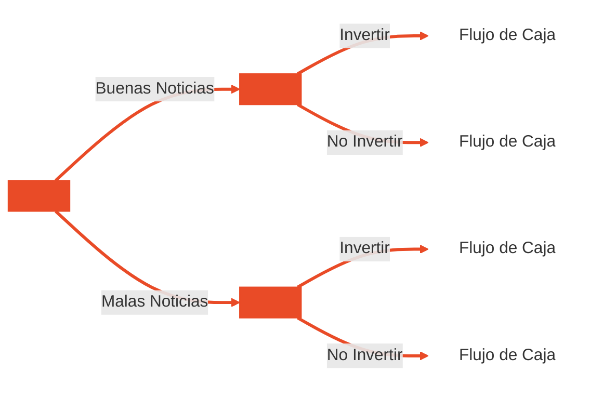

## Valor Financiero

Podemos definir el **flujo** mediante la siguiente ecuación:
$$\text{Flujo}= +GON-\Delta BU-\Delta KT$$
Donde:
- $GON$: Ganancias Operativas Netas - Utilidades antes de restarles intereses pero después de descontarles los Impuestos a las Ganancias.
- $\Delta BU$: Cambios en el Nivel de los Bienes de Uso.
- $\Delta KT$: Cambios en el Nivel de Capital de Trabajo. Se refiere al dinero efectivo + cuentas por cobrar - cuentas por cobrar + inventarios. 

Las utilidades no son flujo porque contienen las amortizaciones.

El valor de un activo, empresa o inversión a partir de flujos de caja se calcula mediante el **Descuento de Flujos de Caja (DCF, Discounted Cash Flow)**. Este método estima el valor presente de los ingresos futuros esperados, ajustados por el valor del dinero en el tiempo. La fórmula es:
$$\text{Valor} = \sum_{t}^{\infty} \frac{\text{Flujos}_t}{(1+r)^t}$$
Si le llamamos $E$ al equity y $D$ a debt, el valor de mercado de la deuda, hacemos un promedio ponderado para calcular el **costo del dinero (Weighted Average Cost of Capital)**:
$$WACC=\frac{E}{E+D}\times Ke+\frac{D}{E+D}\times Kd\times(1-T)$$
Generalmente, el costo de la deuda ($Kd$) es menor que el costo del capital propio ($Ke$), dado que los acreedores asumen un riesgo menor que los accionistas. Además, la deuda genera un **escudo fiscal**, ya que los intereses son deducibles del Impuesto a las Ganancias ($1 - T$).

Si la empresa incluye además **acciones preferentes** ($P$), la fórmula general del WACC con sus tres componentes es:
$$WACC = W_d \cdot Kd(1 - T) + W_p \cdot Kp + W_e \cdot Ke$$
Donde:
- **$W_d, W_p, W_e$**: ponderaciones o pesos de cada fuente.
- $Kd(1 - T)$ (Deuda after-tax)
- $Kp$ (Acciones preferentes)
- $Ke$ (Acciones ordinarias / Equity)

Con esto, ahora podríamos pensar cuánto valor se gana en un período de tiempo. La métrica se conoce como **Economic Value Added (EVA)**. Se usa al principio del período para presupuestar o al final para controlar y comparar las espectativas. 
$$EVA= +UON-WACC\times TOC$$
Donde:
- $UON$: Utilidad Operativa Neta y se refiere a las utilidades antes de restarles intereses pero después de descontarles los impuestos a las ganancias. El costo de intereses se incluye en el WACC.
- $TOC$: Se refiere al capital operativo total, o sea al capital de trabajo operativo más los bienes de uso. En otras palabras, al (dinero en efectivo + cuentas por cobrar - cuentas por pagar + inventarios) + los bienes de uso.

El **ROE (Return on Equity o Rentabilidad del Patrimonio Neto)** mide la eficiencia con la que una empresa genera ganancias a partir del capital aportado por los accionistas.
$$ROE=\frac{\text{Utilidad Neta}}{\text{Patrimonio Neto}}$$
Se la puede descomponer en la ecuación de DuPont:
$$\begin{gathered} \left( \frac{\text{Utilidad neta}}{\text{Ventas}} \right) \times \left( \frac{\text{Ventas}}{\text{Activo}} \right) \times \left( \frac{\text{Activo}}{\text{Patrimonio Neto}} \right) \\[2ex]
\text{Margen} \times \text{Rotación} \times \text{Multiplicador} \end{gathered}$$
Donde:
- **Margen de Ganancia**: refleja la eficiencia operativa y la capacidad de la empresa para transformar ventas en ganancias finales. 
- **Rotación de Activos**: mide la eficiencia con la que la firma utiliza sus activos para generar ventas. 
- **Multiplicador del Capital**: representa el nivel de apalancamiento financiero; muestra cuánto del activo total está financiado por deuda vs. patrimonio propio.

---
## Análisis Financiero

Definiciones importantes dentro del balance:
- **Lease payments**: cuotas periódicas fijas que la empresa está obligada a pagar por el arrendamiento o alquiler operativo y financiero de activos.
- **Required sinking fund payments**: pagos o aportes obligatorios comprometidos contractualmente para amortizar o cancelar gradualmente una deuda financiera a su vencimiento.
- **Cash and equivalents**: Representa el dinero disponible en caja y bancos.
- **Accounts receivable**: Crédito por ventas.
- **Inventories**: Bienes de Cambio
- **Total current assets**: todos los activos líquidos o que se espera convertir en efectivo, vender o consumir en un plazo.
- **Accounts payable**: Son las deudas u obligaciones a corto plazo contraídas con proveedores.
- **Notes payable**: Son compromisos de deuda a corto plazo.
- **Accruals**: Son gastos ya devengados o incurridos por la operación que aún no han sido efectivamente pagados al cierre del período (como sueldos, cargas sociales o impuestos a pagar).
- **Total common equity**: Es el valor contable del patrimonio neto correspondiente a los accionistas ordinarios.

Definiciones importantes dentro del cuadro de resultados:
- **Less interest**: Es el monto total pagado en concepto de intereses y cargos financieros por la deuda contraída con acreedores.
- **Net Income before preferred dividends**: Es la ganancia neta total generada por la empresa después de pagar todos los costos, intereses e impuestos.
- **Common dividends**: Es la porción de la ganancia neta que se distribuye efectivamente en efectivo a los tenedores de acciones ordinarias.

Tenemos las siguientes métricas de desempeño operativo:
- **Net Operating Working Capital (NOWC / Capital de Trabajo Operativo Neto)**: Fondos netos inmovilizados en la operación a corto plazo, descontando el crédito espontáneo sin costo financiero que otorgan los proveedores.
$$\begin{gathered} \text{NOWC} = \text{Activos Corrientes Operativos} - \text{Pasivos Corrientes sin Interés} \\[2ex] \text{NOWC} = (\text{Caja} + \text{Créditos por Ventas} + \text{Bienes de Cambio}) - (\text{Proveedores} + \text{Deudas Comerciales}) \end{gathered}$$
- **Total Operating Capital (TOC / Capital Operativo Total)**: Total de fondos propios y de deuda inmovilizados en la operación completa del negocio.
$$\begin{gathered} \text{TOC} = \text{NOWC} + \text{Bienes de Uso (Activo Fijo Neto)} \\[2ex] \text{TOC} = \text{Deuda Bancaria (D)} + \text{Patrimonio Neto (E)} \end{gathered}$$
- **Net Operating Profit After Taxes (NOPAT / GON / UON - Utilidad Operativa Neta)**: Ganancia operativa generada exclusivamente por la actividad del negocio.
$$\text{NOPAT} = \text{EBIT} \times (1 - \text{Tasa Impositiva})$$
- **Net Cash Flow (NCF / Flujo de Caja Neto de las Utilidades)**: Flujo de fondos contable básico generado por las operaciones del ejercicio.
 $$\text{NCF} = \text{Utilidad Neta (Net Income)} + \text{Amortizaciones / Depreciación}$$
- **Operating Cash Flow (OCF / Flujo de Caja Operativo)**: Efectivo generado por la actividad operativa pura antes de financiar nuevas inversiones de capital.
$$\text{OCF} = \text{NOPAT} + \text{Amortizaciones / Depreciación}$$
- **Free Cash Flow (FCF / Flujo de Fondos Libre)**: Flujo de caja verdaderamente libre que queda disponible para remunerar a acreedores (bancos) y accionistas.
$$\text{FCF} = \text{NOPAT} - \Delta\text{TOC} = \text{GON} - \Delta\text{BU} - \Delta\text{KT}$$

Luego, podemos enumerar distintos ratios financieros.

**Liquidity Ratios (Ratios de Liquidez)**: Advierten sobre el estado de la caja y la solvencia inmediata de la empresa para saber si puede afrontar sus vencimientos a corto plazo:
- **Current Ratio (Liquidez Corriente o Razón Corriente)**: Mide la capacidad global de la empresa para cubrir sus deudas a corto plazo con la totalidad de sus activos corrientes.
 $$\begin{gathered} \text{Current Ratio} = \frac{\text{Activo Corriente}}{\text{Pasivo Corriente}} \\[2ex] \text{Current Ratio} = \frac{\text{Caja} + \text{Créditos por Ventas} + \text{Bienes de Cambio}}{\text{Deuda Bancaria Corto Plazo} + \text{Proveedores} + \text{Deudas Comerciales}} \end{gathered}$$
- **Quick Ratio (Prueba Ácida o Liquidez Ácida)**: Mide la solvencia más inmediata al excluir los inventarios (Bienes de Cambio) por ser el activo corriente menos líquido y más difícil de convertir rápidamente en efectivo.
 $$\begin{gathered} \text{Quick Ratio} = \frac{\text{Activo Corriente} - \text{Bienes de Cambio (Inventarios)}}{\text{Pasivo Corriente}} \\[2ex] \text{Quick Ratio} = \frac{\text{Caja} + \text{Créditos por Ventas}}{\text{Pasivo Corriente}} \end{gathered}$$

**Asset Management Ratios (Ratios de Operación / Gestión de Activos)**: Miden la eficiencia con la que la empresa gestiona sus recursos y activos en el día a día.
- **Inventory Turnover (Rotación de Inventario)**: Mide cuántas veces al año rota o se comercializa el inventario total.
$$\text{Inventory Turnover} = \frac{\text{Ventas}}{\text{Bienes de Cambio (Inventarios)}}$$
- **Days Sales of Inventory (DSI / Días de Inventario o Permanencia de Stock)**: Mide cuántos días promedio pasa la mercadería almacenada antes de venderse.
$$\text{DSI} = \frac{\text{Bienes de Cambio (Inventarios)}}{\text{Ventas}} \times 365 = \frac{365}{\text{Inventory Turnover}}$$
- **Days Sales Outstanding (DSO / Plazo Medio de Cobranza o Días de Cobro)**: Refleja el plazo promedio en días que demora la empresa en cobrar sus facturas vendidas a crédito.
$$\text{DSO} = \frac{\text{Créditos por Ventas (Cuentas por Cobrar)}}{\text{Ventas Anuales}} \times 365$$
- **Fixed Asset Turnover (Rotación de Bienes de Uso / Activo Fijo)**: Mide la eficiencia en la utilización de la infraestructura, maquinarias y bienes de uso para generar ventas.
$$\text{Fixed Asset Turnover} = \frac{\text{Ventas}}{\text{Bienes de Uso Netos (Activo Fijo)}}$$
- **Total Asset Turnover (TATO / Rotación del Activo Total)**: Indica el volumen de ventas generado por cada peso invertido en activos totales (componente central del modelo DuPont).
$$\text{Total Asset Turnover} = \frac{\text{Ventas}}{\text{Activo Total}}$$

**Debt Management Ratios (Ratios de Endeudamiento / Apalancamiento)**: Evalúan en qué medida la empresa utiliza el apalancamiento financiero para financiar sus operaciones, así como su solvencia y capacidad para cumplir con sus obligaciones a largo plazo:
- **Debt Ratio (Razón de Endeudamiento o Nivel de Deuda)**: Porcentaje del total de activos financiado a través de deuda con terceros.
$$\text{Debt Ratio} = \frac{\text{Pasivo Total (o Deuda Financiera Total)}}{\text{Activo Total}}$$
- **Times Interest Earned (TIE / Cobertura de Intereses)**: Capacidad de la ganancia operativa para hacer frente al pago periódico de intereses devengados por deudas bancarias y financieras.
$$\text{Times Interest Earned (TIE)} = \frac{\text{EBIT (Resultado Operativo)}}{\text{Intereses Pagados (Cargos Financieros)}}$$
- **EBITDA Coverage Ratio (Índice de Cobertura de Cargos Fijos / EBITDA)**: Cobertura integral del flujo operativo bruto antes de alquileres sobre la totalidad de los compromisos fijos obligatorios anuales.
$$\text{EBITDA Coverage Ratio} = \frac{\text{EBITDA} + \text{Alquileres}}{\text{Intereses} + \text{Alquileres} + \dfrac{\text{Devolución de Préstamos (Cuotas)} + \text{Dividendos Preferidos}}{1 - T}}$$

**Profitability Ratios (Ratios de Rentabilidad)**: Miden la capacidad global del negocio para generar utilidades y rendimientos netos a partir de sus ventas, de los activos invertidos y del capital aportado por los accionistas:
- **Profit Margin (Margen Neto o Margen de Utilidad)**: Porcentaje final de las ventas que se convierte en ganancia neta para los accionistas ordinarios tras cubrir costos, gastos, intereses e impuestos.
$$\text{Profit Margin} = \frac{\text{Utilidad Neta (Net Income)}}{\text{Ventas}}$$
- **Basic Earning Power (BEP / Capacidad Básica de Ganancia o Rentabilidad Operativa del Activo)**: Eficiencia operativa pura de los activos totales para generar ganancias antes del efecto de las deudas y los impuestos.
$$\text{Basic Earning Power (BEP)} = \frac{\text{EBIT (Resultado Operativo)}}{\text{Activo Total}}$$
- **Return on Assets (ROA / Rentabilidad sobre Activos Totales)**: Rendimiento neto generado sobre la totalidad de los recursos o activos de la firma.
$$\text{ROA} = \frac{\text{Utilidad Neta (Net Income)}}{\text{Activo Total}}$$
- **Return on Equity (ROE / Rentabilidad sobre el Patrimonio Neto)**: Rentabilidad neta generada sobre los fondos propios aportados por los accionistas comunes (capital social más utilidades acumuladas).
$$\text{ROE} = \frac{\text{Utilidad Neta (Net Income)}}{\text{Patrimonio Neto Total (Capital Social} + \text{Utilidades Acumuladas)}}$$
- **Return on Invested Capital (ROIC / Rentabilidad sobre el Capital Invertido)**: Rentabilidad operativa neta generada sobre la totalidad del capital operativo fondeado, independientemente de su estructura de financiamiento. Es la tasa que se compara contra el WACC para evaluar la creación de valor en el EVA ($ROIC > WACC$).
$$\text{ROIC} = \frac{\text{NOPAT (Utilidad Operativa Neta)}}{\text{Capital Operativo Total (TOC)}}$$

**Market Value Ratios (Ratios de Valor de Mercado)**: Relacionan el precio de las acciones de la empresa con sus métricas contables y financieras para evaluar cómo el mercado de capitales percibe el valor y las perspectivas futuras de la firma:
- **Price-to-Earnings Ratio (P/E o PER / Razón Precio-Ganancia)**: Múltiplo que indica cuántos pesos pagan los inversores por cada peso de beneficio neto generado.
$$\text{P/E Ratio} = \frac{\text{Precio de Mercado por Acción}}{\text{Beneficio por Acción (BPA / EPS)}} \quad \text{donde } \text{BPA} = \frac{\text{Utilidad Neta}}{\text{Cantidad de Acciones}}$$
- **Price-to-Cash Flow Ratio (P/CF / Razón Precio-Flujo de Caja)**: Relación entre la cotización de mercado de la acción y el flujo de fondos contable que genera por título.
$$\text{Price-to-Cash Flow} = \frac{\text{Precio de Mercado por Acción}}{\text{Flujo de Caja por Acción (NCF / Cantidad de Acciones)}}$$
- **Market-to-Book Ratio (M/B / Razón Mercado a Libros)**: Compara la valuación de mercado de la acción frente a su valor contable en libros. Muestra si el mercado confía en que la empresa generará valor sobre su capital contable.
$$\text{Market-to-Book Ratio (M/B)} = \frac{\text{Precio de Mercado por Acción}}{\text{Valor Libros por Acción (VPA / BVPS)}} \quad \text{donde } \text{VPA} = \frac{\text{Patrimonio Neto}}{\text{Cantidad de Acciones}}$$

---
## Acciones y Bonos

El **valor presente (VP)** es la suma de los flujos futuros descontados a una tasa que refleja el riesgo y el costo de oportunidad.
$$VP=\sum_{t=1}^n\frac{\text{Flujo}_t}{(1+r)^t}$$
El **valor** es el precio que un inversor perfectamente informado tendría que pagar en un mercado competitivo.

Las **acciones (comunes)** son instrumentos de renta variable, los emiten las empresas para financiar proyectos y los compran inversores para multiplicar sus ahorros. Su precio puede calcularse como el valor presente de los dividendos que se pronostica que se distribuirán. Los dividendos asumimos que se reciben por tiempo infinito, ya que la acción no tiene un plazo de vencimiento. Para calcular el valor de perpetuidades y acciones:
$$\sum_{t=1}^{\infty} \frac{D}{(1+r)^t} = \frac{D}{(1+r)^1} + \frac{D}{(1+r)^2} + \frac{D}{(1+r)^3} + \dots = \frac{D}{r}$$
En los casos donde los flujos futuros crecen de manera constante a una tasa $g$ (growth) en cada período:
$$\sum_{t=1}^{\infty} \frac{D_0 (1+g)^t}{(1+r)^t} = \frac{D_1}{(1+r)^1} + \frac{D_2}{(1+r)^2} + \frac{D_3}{(1+r)^3} + \dots = \frac{D_1}{r - g}$$

El **rendimiento total** de una acción se define como la rentabilidad obtenida durante un período determinado en relación con el precio pagado al inicio.
$$\text{Rentabilidad Acción} = \frac{(P_1 - P_0) + D_1}{P_0}$$
Podemos hacer la siguiente reestructuración de estas fórmulas:
$$r_s = \frac{D_1}{P_0} + g = \frac{(P_1 - P_0) + D_1}{P_0} = \frac{D_1}{P_0} + \frac{P_1 - P_0}{P_0}$$
- **Rendimiento por Dividendos (Dividend Yield)**: Es el primer término, $\frac{D_1}{P_0}$, y mide el ingreso en efectivo generado directamente por la distribución de ganancias en relación con el precio inicial de la acción.
- **Ganancias de Capital (Capital Gains)**: Es el segundo término, $\frac{P_1 - P_0}{P_0}$, y mide el cambio porcentual en el valor de cotización de la acción entre el precio final $P_1$ y el precio inicial $P_0$.

El **modelo de valuación de empresas** consiste en:
1. Determinar el valor de la firma:
$$\text{Valor de la Firma} = \sum_{t=1}^{n} \frac{\text{Flujo Operativo}_t}{(1 + \text{WACC})^t}$$
2. Calcular el valor del equity:
$$\text{Valor del Equity} = \text{Valor de la Firma} - \text{Valor de la Deuda}$$
3. Divvidir el valor total del equity entre la cantidad total de acciones comunes:
$$\text{Precio por Acción} = \frac{\text{Valor del Equity}}{\text{Número de Acciones Comunes}}$$

Los **bonos** son títulos de deuda emitidos por Estados o empresas para financiarse, con el compromiso de abonar intereses y devolver el capital en plazos fijados. La **amortización de capital** define el esquema mediante el cual un bono devuelve el monto principal invertido a lo largo de su vida útil.
$$P = \sum_{t=1}^{n} \frac{C_t}{(1 + r)^t}$$
Donde:
- $P$: precio o valor presente del bono en el momento actual.
- $C_t$: flujo de caja total generado en el período $t$, incluyendo pagos de cupones y amortizaciones de capital.
- $r$: tasa de descuento o rendimiento requerido por el mercado en función del riesgo del emisor.
- $n$: cantidad total de períodos comprendidos desde la fecha actual hasta el vencimiento final.

El **rendimiento de un bono** se mide mediante la **Tasa Interna de Retorno (TIR)**, conocida en el ámbito financiero internacional como Yield to Maturity (YTM). A diferencia de la valuación donde se busca determinar el valor del activo a partir de una tasa dada, en este caso el precio de mercado es un dato conocido y la TIR representa la verdadera incógnita a despejar. La fórmula matemática para calcular el rendimiento del bono es: $$P = \sum_{t=1}^{n} \frac{C_t}{(1 + \text{TIR})^t}$$
Los bonos pueden emitirse:
- **A la par** (Tasa Cupón = YTM → Precio = Valor Nominal): El bono paga exactamente el interés que el mercado exige.
- **Sobre la par** (Tasa Cupón > YTM → Precio > Valor Nominal): El cupón del bono es más tentador que el mercado, por lo que cotiza más caro.
- **Bajo la par** (Tasa Cupón < YTM → Precio < Valor Nominal): El cupón del bono se quedó corto frente al mercado, por lo que debe venderse más barato para ser atractivo.

La **duration** de un bono representa el promedio ponderado del tiempo que tarda un inversor en recuperar el dinero invertido, funcionando como un punto de equilibrio en el eje temporal donde se conceptualiza la concentración de todos los flujos de fondos futuros.

---
## Teoría de Cartera

La **esperanza matemática** ($\mu$ o $E[R]$) es el rendimiento esperado de una inversión (promedio ponderado por probabilidad):
$$\mu = \sum_{i=1}^n p_i \cdot R_i$$

El **riesgo de un activo individual** está representado por la dispersión o volatilidad de sus retornos alrededor de la media. Se mide cuantitativamente con la **varianza ($\sigma^2$)** y, fundamentalmente, con el **desvío estándar ($\sigma$)**, que expresa el riesgo en las mismas unidades porcentuales que el retorno:
$$\sigma^2 = \sum_{i=1}^n p_i \cdot (R_i - \mu)^2 \quad \Longrightarrow \quad \sigma = \sqrt{\sigma^2}$$

Si lo que se quiere es medir la relación entre los retornos de dos activos, es necesario trabajar con la **covarianza** y el coeficiente de correlación. 
- **Covarianza positiva**: si los dos activos están positivamente relacionados entre sí (tienden a moverse en la misma dirección).
- **Covarianza negativa**: si se encuentran negativamente relacionados entre sí (tienden a moverse en direcciones opuestas).

El **coeficiente de correlación** normaliza la covarianza dividiéndola por el producto de los desvíos estándar de ambos activos. Su fórmula es:
$$ \rho_{xy} = \frac{\operatorname{Cov}(R_x, R_y)}{\sigma_x \cdot \sigma_y} $$
* $\rho_{xy}$: coeficiente de correlación entre los retornos de los activos $x$ e $y$.
* $\operatorname{Cov}(R_x, R_y)$: covarianza entre los retornos del activo $x$ y el activo $y$.
* $\sigma_x, \sigma_y$: desviación estándar (volatilidad) de los retornos de los activos $x$ e $y$.

El **rendimiento esperado** del portfolio (forma general) es:
$$
\mu_p = W_1 \cdot \mu_1 + W_2 \cdot \mu_2
$$
La **fórmula general de la volatilidad** de un portfolio de 2 activos se simplifica mucho cuando uno de ellos es libre de riesgo ($σ_2 = 0$):
$$
\sigma_p = \sqrt{(W_1 \cdot \sigma_1)^2 + 2 \cdot W_1 \cdot \sigma_1 \cdot W_2 \cdot \sigma_2 \cdot \rho + (W_2 \cdot \sigma_2)^2}
$$

La pendiente $(\mu_1 - r_f) / \sigma_1$ es el "precio del riesgo", es decir, cuánto rendimiento adicional exige el mercado por cada unidad extra de desvío estándar. A esta recta se la llama **Línea del Mercado de Capitales (LMC)**, y describe el mejor rendimiento esperado alcanzable para cada nivel de riesgo, combinando el activo libre de riesgo con el portfolio riesgoso.

La **diversificación** consiste en tener muchos activos riesgosos en vez de concentrar toda la inversión en uno solamente. Debemos diferenciar:
- **Riesgo Diversificable**:
	- A medida que la correlación varía de uno a cero el porcentaje de riesgo no diversificable cae, y el número de activos necesario para diversificar se incrementa.
	- Sinónimos: riesgo individual, riesgo específico, riesgo irrelevante.
- **Riesgo No Diversificable**:
	- Existe un valor asintótico para el menor riesgo que el portfolio puede contener, y no se puede diversificar por debajo de ese valor.
	- Sinónimos: riesgo de mercado, riesgo relevante, riesgo sistemático.
	- Costo de reducirlo: se puede reducir el riesgo del portfolio diversificando las inversiones a muy bajo costo (de transacción), pero no eliminarlo del todo.

Un **portfolio eficiente** se define como aquel que ofrece al inversor la mayor tasa esperada de rendimiento a un nivel de riesgo específico. Los **portfolios subóptimos** son aquellos donde existe otra combinación con el mismo riesgo pero mayor rendimiento esperado. Ningún inversor racional los elegiría.

El **Capital Asset Pricing Model (CAPM)** es una teoría sobre los precios de equilibrio en los mercados para activos riesgosos. La medida de riesgo relevante ahora de un activo será su **Beta ($\beta$)** e indica cuánto tiene que cambiar el rendimiento esperado del activo ($R_i$) cuando cambia el rendimiento del mercado ($R_m$).
- $β = 1$: el activo se eleva y desciende a la misma velocidad que el mercado.
- $β ≥ 1$ - activo agresivo: el activo se eleva y desciende a mayor velocidad que el mercado.
- $β ≤ 1$ - activo defensivo: el activo se eleva y desciende a menor velocidad que el mercado.

En equilibrio, el premio por riesgo esperado de un activo $i$ es proporcional a su $\beta$:
$$ R_i - r_f = (R_m - r_f) \cdot \beta_i $$
Esta es la forma de "premio por riesgo". A esta ecuación se la conoce como **Línea del Mercado de Valores**. Podemos despejar y obtener el rendimiento esperado que exige el mercado a este activo:
$$ R_i = r_f + (R_m - r_f) \cdot \beta_i $$
Donde:
- $R_i$ (Rendimiento del Activo): Rendimiento esperado o exigido para el activo $i$ en función del riesgo sistemático asumido.
- $r_f$ (Tasa Libre de Riesgo): Rentabilidad de un activo libre de riesgo de impago (típicamente bonos del Tesoro de EE.UU.), que compensa el valor del dinero en el tiempo.
- $R_m$ (Riesgo de Mercado): Rendimiento esperado de la cartera de mercado en su conjunto. Representa el retorno global del mercado y determina, junto a $r_f$, la prima por riesgo ($R_m - r_f$).

---
## Planificación Financiera

El primer paso para armar un pronóstico de ventas consiste en estimar la **tasa de crecimiento histórico**. Existen métodos que van desde lo simple hasta lo complejo:
- Tasa de Crecimiento Anual Promedio (Average annual growth rate): Promedio aritmético de las tasas de variación anual (10,3%).
- Tasa de Crecimiento Anual Compuesto: Tasa geométrica de crecimiento acumulado (9,9%). En Excel se calcula con la función `=TASA()` (`RATE`).
- Regresión Lineal: para proyectar ventas futuras a partir de los datos históricos

El **método del porcentaje de ventas** asume que varias partidas de los estados financieros son directamente proporcionales a las ventas. También asume que la **depreciación** es proporcional a la planta y equipo neto. 
- **Costs / Sales:** Eficiencia operativa; indica qué porcentaje de cada peso vendido se consume en costos operativos antes de amortizaciones.
- **Depreciation / Net plant & equip.:** Tasa de desgaste contable del activo fijo; mide la velocidad con la que se amortiza la maquinaria e infraestructura instalada.
- **Cash / Sales:** Eficiencia de liquidez operativa; refleja la cantidad mínima de caja inmediata retenida por cada peso generado en ventas.
- **Accounts Rec. / Sales:** Política de crédito comercial; expone la porción de ventas que aún queda inmovilizada pendiente de cobro a clientes.
- **Inventory / Sales:** Eficiencia en gestión de inventario; señala el volumen de stock inmovilizado necesario para respaldar el nivel de actividad comercial.
- **Net plant & equip. / Sales:** Intensidad de capital; determina la cantidad de inversión en activos fijos requerida para sostener un peso de ventas.
- **Accounts Pay. / Sales:** Financiamiento espontáneo comercial; mide el apalancamiento operativo obtenido a través de los plazos otorgados por proveedores.
- **Accruals / Sales:** Financiamiento operativo devengado; representa pasivos espontáneos no facturados (como cargas laborales o impuestos) generados por la operatoria diaria.
- **Long-term bonds / Operating assets:** Estructura de financiamiento a largo plazo; define qué porcentaje de los activos productivos se cubre con deuda financiera estructurada.

El **Additional Funds Needed (AFN)** es el monto de financiamiento externo (vía nueva deuda o emisión de acciones) que la empresa debe salir a conseguir para financiar el aumento proyectado de sus activos, luego de descontar los pasivos operativos espontáneos y las ganancias retenidas que generará el propio negocio. Hay una forma no exacta de realizar el cálculo:
$$\text{AFN} = \Delta\text{Activos Requeridos} - \Delta\text{Pasivos Espontáneos} - \Delta\text{Utilidades Retenidas}$$
Desagregando cada componente según los ratios respecto a las ventas:
$$\text{AFN} = \left(\frac{A^*}{S_0}\right)\Delta S - \left(\frac{L^*}{S_0}\right)\Delta S - (M \cdot S_1 \cdot RR)$$
Donde:
- $A^*$: activos operativos que varían con ventas.
- $S_0$: ventas del año base.
- $\Delta S$: incremento en ventas ($S_1 - S_0$).
- $L^*$: pasivos corrientes espontáneos (proveedores y gastos devengados).
- $M$: margen neto ($\frac{\text{Utilidad Neta}}{\text{Ventas}}$).
- $RR$: tasa de retención ($1 - \text{Payout}$).

Con esto, podemos obtener también la **Tasa de Crecimiento Autosostenible** ($g$ para $\text{AFN} = 0$). Reordenando la ecuación:
$$g = \frac{M \cdot RR}{\left(\frac{A^*}{S_0} - \frac{L^*}{S_0}\right) - (M \cdot RR)}$$

---
## Gestión del Riesgo

Los pasos de la gestión de riesgos incluyen:
1. Identificación del riesgo
2. Cuantificación de los riesgo
3. Gerenciamiento del riesgo

El **riesgo financiero** es la posibilidad de que los resultados reales difieran de los esperados, afectando negativamente el valor de la empresa. Existen distintos tipos de riesgos:
- Riesgo de mercado.
- Riesgo de crédito.
- Riesgo operativo.
- Riesgo de liquidez.

La **cobertura (hedging)** es una estrategia para reducir o eliminar el impacto negativo de ciertos riesgos financieros mediante el uso de instrumentos financieros. El objetivo es proteger el valor económico de la empresa, no necesariamente obtener ganancias. Es crucial distinguir entre el uso de derivados como instrumentos de cobertura y como vehículos de especulación.

Los **forwards (futuros)** son contratos privados entre dos partes para comprar o vender un activo en una fecha futura a un precio acordado. Son usados para cubrir riesgo de tipo de cambio, tasas de interés o commodities. No se negocian en un mercado organizado, lo que les confiere flexibilidad en cuanto a montos, vencimientos y condiciones específicas. Desde el punto de vista contable y financiero, no implican un desembolso inicial, pero sí generan compromisos futuros que deben ser gestionados con cuidado. Se usan para cubrir riesgos en diversas áreas:
- Tipo de cambio
- Commodities
- Tasas de interés

Tenemos la siguiente fórmula: $$G=\text{Spot}-F_0$$ Donde:
- $G$: Ganancia
- $\text{Spot}$: Precio al momento de la transacción
- $F_0$: Precio acordado

Notemos que no nos importa "ganar" con el negocio, sino tener certidumbre del futuro para cubrir un riesgo y que el proyecto resulte como se esperaba.

La empresa adopta la **posición larga (long)** en un contrato forward, comprometiéndose a **comprar** el activo subyacente en la fecha futura acordada al precio fijado ($F_0$). Decimos que es como "una apuesta a que las cosas salgan mal": el contrato forward genera una ganancia ($G = \text{Spot} - F_0 > 0$) precisamente cuando el precio de mercado sube por encima de $F_0$, compensando el encarecimiento de la materia prima física. 

El proveedor adoptó la **posición corta (short)** en un contrato forward, comprometiéndose a vender el activo subyacente en la fecha futura al precio pactado ($F_0$). Su temor es que los precios en el mercado spot caigan, lo que reduciría los ingresos percibidos por la venta de su mercadería.

Los **futuros** son similares a los forwards, pero estandarizados y negociados en mercados organizados. Tienen una mayor liquidez y un menor riesgo de contraparte. Formalmente, un **contrato de futuros** es un acuerdo estandarizado para comprar o vender un activo en una fecha futura a un precio determinado, negociado en mercados organizados como el CME (Chicago Mercantile Exchange). 

El precio de un **contrato de futuros** se establece en los mercados organizados mediante un proceso de interacción entre oferta y demanda, influenciado por varios factores económicos y financieros. La fórmula básica es: $$F=S\cdot e^{(r+c-y)\cdot T}$$ Donde:
- $F$: precio futuro
- $S$: precio spot
- $r$: tasa de interés libre de riesgo
- $c$: costos de acarreo
- $y$: rendimiento del activo (si aplica)
- $T$: tiempo hasta vencimiento

Cuando uno se obliga en uno de los mercados regulados, se le solicita un margen, que funciona especie de garantía. Si se pierde todo es fondo se lo llama a uno para lo que se conoce como un **margin call**, donde uno debe reponer los fondos necesarios (ese margen) para seguir operando. Si la participación de una persona es en ambos mercados (el físico y el de futuros), entonces se trata de una gestión del riesgo. Si en cambio una persona se dedica únicamente al mercado de futuros, entonces es lo que se conoce como un **especulador**. 

En el contexto de contratos de futuros, **cerrar una posición** significa realizar una operación contraria a la que se hizo originalmente, con el fin de salir del contrato antes de su vencimiento.
- **Si teníamos una posición larga (comprador):** cerramos la posición vendiendo la misma cantidad de contratos del mismo activo y vencimiento.
- **Si teníamos una posición corta (vendedor):** cerramos la posición comprando la misma cantidad de contratos del mismo activo y vencimiento.

Un **swap financiero** es un contrato entre dos partes que acuerdan intercambiar flujos de efectivo en fechas futuras, generalmente basados en diferentes condiciones como tasas de interés o monedas. A diferencia de otros derivados como los futuros o las opciones, los swaps no se negocian en mercados organizados, sino que se pactan de forma extrabursátil (OTC), lo que permite una mayor personalización.

Existen dos tipos comunes de swaps:
- **Swap de Tasas de Interés**: Este tipo de swap permite a las partes intercambiar pagos de intereses sobre un monto nocional. El caso más típico es el intercambio entre una tasa fija y una tasa variable. Por ejemplo, una empresa con deuda a tasa variable puede preferir estabilidad en sus pagos y usar un swap para convertir esa exposición en una tasa fija.
- **Swap de Divisas**: En este caso, las partes intercambian pagos en diferentes monedas. Es útil para empresas multinacionales que tienen ingresos y gastos en distintas divisas, ya que les permite cubrir el riesgo cambiario. Además, puede incluir el intercambio de capital principal al inicio y al final del contrato.

Los swaps ofrecen ventajas como:
- Cobertura de riesgos financieros (tasa, tipo de cambio).
- Acceso a condiciones más favorables que las disponibles directamente en el mercado.
- Flexibilidad contractual.

La cobertura cambiaria es una herramienta clave para transformar incertidumbre en certeza, algo fundamental en la evaluación de inversiones.
- **Reducción de incertidumbre en los flujos futuros**
- **Impacto en el Valor Actual Neto (VAN)**: El VAN depende de los flujos descontados. Sin cobertura, los flujos pueden variar mucho según el tipo de cambio.
- **Mejor estimación del riesgo**
- **Acceso a financiamiento**: Proyectos con cobertura cambiaria suelen ser más atractivos para inversores y bancos, porque presentan menor riesgo. Ejemplo práctico: Supongamos un proyecto agroexportador argentino que genera ingresos en USD pero tiene costos en ARS:
	- Sin cobertura: si el tipo de cambio baja, los ingresos en ARS disminuyen → el proyecto puede ser inviable.
	- Con cobertura: se asegura un tipo de cambio mínimo → se protege el margen y mejora la viabilidad.

---
## Derivados

Tomemos la siguiente diferenciación clave:
- **Cobertura**: Contrato "para comprar 100.000 envases, dentro de seis meses a $\text{USD } 0.25$/envase, pagando al recibirlos" es un contrato forward (obligación a comprar).
- **Aseguramiento**: Contrato "para comprar hasta 100.000 envases, dentro de seis meses a $\text{USD } 0.25$/envase, pagando al recibirlos", no es un contrato forward (derecho, pero no obligación, a comprar).

Una **opción** es un contrato derivado financiero mediante el cual el comprador adquiere el derecho (pero no la obligación), a cambio del pago de una prima, de comprar o vender un activo subyacente a un precio determinado en o hasta una fecha fijada.
- **Call**: otorga el derecho (no la obligación) de comprar el activo subyacente a un precio de ejercicio (X) prefijado, en o hasta una fecha de vencimiento.
- **Put**: otorga el derecho (no la obligación) de vender el activo subyacente al precio de ejercicio X.

Las opciones tienen dos características fundamentales:
- **Apalancamiento**: un incremento en el precio de la acción se traduce en incrementos más que proporcionales en el rendimiento de la opción, porque la prima pagada es mucho menor que el precio de la acción.
- **Seguro**: comprar un put junto con la acción ("protective put") limita la pérdida máxima posible del portafolio, a cambio de pagar una prima. Funciona como una póliza de seguro sobre el valor de la posición. Es la que más nos importa para esta materia.

La cobertura es simétrica, ya que se sacrifica el riesgo upside (ganancia) para protegerse del riesgo downside (pérdida), mientras que el aseguramiento es asimétrico, pues se mantiene el riesgo upside (ganancia), pero conservando parte del riesgo downside (pérdida).
```tikz
\begin {document}
\begin{tikzpicture}
  % Líneas de cuadrícula horizontal
  \foreach \y in {0, 0.6, 1.2, 1.8, 2.4, 3.0, 3.6, 4.2, 4.8, 5.4} {
    \draw[gray!30] (1, \y) -- (9, \y);
  }

  % Ejes principales
  \draw[black, thick] (1,0) -- (9.5,0);
  \draw[black, thick] (1,0) -- (1,5.6);

  % Valores Eje X
  \foreach \x in {1,...,9} {
    \draw[black] (\x, 0) -- (\x, -0.1);
    \node[below, black] at (\x, -0.1) {\small \x};
  }
  \node[black, font=\bfseries] at (5, -0.8) {Precio soja};

  % Valores Eje Y
  \foreach \val/\y in {0/0, 50000/0.6, 100000/1.2, 150000/1.8, 200000/2.4, 250000/3.0, 300000/3.6, 350000/4.2, 400000/4.8, 450000/5.4} {
    \draw[black] (0.9, \y) -- (1, \y);
    \node[left, black] at (0.9, \y) {\small \val};
  }
  \node[black, font=\bfseries, rotate=90] at (-0.8, 2.7) {Ingreso};

  % 1. Pos.Original (Negro con círculos blancos)[cite: 1]
  \draw[black, ultra thick] (1,0) -- (9,4.8);
  \foreach \x/\y in {1/0, 2/0.6, 3/1.2, 4/1.8, 5/2.4, 6/3.0, 7/3.6, 8/4.2, 9/4.8} {
    \draw[black, fill=white, thick] (\x,\y) circle (2.2pt);
  }

  % 2. Cubierto (Rojo constante en 200.000)[cite: 1]
  \draw[red!75!black, ultra thick] (1,2.4) -- (9,2.4);
  \foreach \x in {1,...,9} {
    \fill[red!75!black] (\x-0.08, 2.4-0.08) rectangle (\x+0.08, 2.4+0.08);
  }

  % 3. Asegurado (Verde/Teal)[cite: 1]
  \draw[teal, ultra thick] (1,2.1) -- (5,2.1) -- (9,4.5);
  \foreach \x/\y in {1/2.1, 2/2.1, 3/2.1, 4/2.1, 5/2.1, 6/2.7, 7/3.3, 8/3.9, 9/4.5} {
    \fill[teal] (\x,\y) circle (2.2pt);
  }

  % Leyenda a la derecha[cite: 1]
  \begin{scope}[shift={(10.2, 2.4)}]
    % Pos.Original
    \draw[black, thick] (0, 0.6) -- (0.5, 0.6);
    \draw[black, fill=white, thick] (0.25, 0.6) circle (2pt);
    \node[right, black, font=\small\bfseries] at (0.6, 0.6) {Pos.Original};

    % Cubierto
    \draw[red!75!black, thick] (0, 0) -- (0.5, 0);
    \fill[red!75!black] (0.25-0.07, -0.07) rectangle (0.25+0.07, 0.07);
    \node[right, black, font=\small\bfseries] at (0.6, 0) {Cubierto};

    % Asegurado
    \draw[teal, thick] (0, -0.6) -- (0.5, -0.6);
    \fill[teal] (0.25, -0.6) circle (2pt);
    \node[right, black, font=\small\bfseries] at (0.6, -0.6) {Asegurado};
  \end{scope}
\end{tikzpicture}
\end{document}
```

El concepto de **moneyness** describe la posición relativa entre el precio de mercado actual del activo ($S_t$) y el precio de ejercicio ($X$), determinando si una opción de compra posee valor intrínseco inmediato o no.
- **At the money (a la par):** $S_t = X$
- **In the money (bajo la par):** $S_t > X$
- **Out of the money (sobre la par):** $S_t < X$

```tikz
\begin{document}
\begin{tikzpicture}[x=1cm, y=1cm]

  % -------------------------
  % 1. Comprador de call
  % -------------------------
  \begin{scope}[shift={(0, 0)}]
    \node[font=\bfseries] at (2.9, 3.5) {Comprador de call};
    \node[font=\small, text=gray!70!black] at (2.9, 3.0) {Derecho a comprar a $X$};
    \draw[gray!70!black, thick, ->] (0, -2.6) -- (0, 2.6) node[above] {$\$$};
    \draw[gray!70!black, thick, ->] (-0.2, 0) -- (5.6, 0) node[right] {$S_T$};
    \draw[gray!60, dotted, thick] (2.8, 0) -- (2.8, -0.8);
    \draw[green!50!black, ultra thick] (0, -0.8) -- (2.8, -0.8) -- (5.2, 1.6);
    \node[left, font=\small] at (0, -0.8) {$-P_c$};
    \node[above, font=\small] at (2.8, 0) {$X$};
    \node[below right, font=\small] at (3.6, 0) {$X + P_c$};
    \node[font=\small, align=center] at (2.9, -3.2) {Ganancia m{\'a}x.: ilimitada\\P{\'e}rdida m{\'a}x.: $P_c$};
  \end{scope}

  % -------------------------
  % 2. Vendedor de call
  % -------------------------
  \begin{scope}[shift={(8.5, 0)}]
    \node[font=\bfseries] at (2.9, 3.5) {Vendedor de call};
    \node[font=\small, text=gray!70!black] at (2.9, 3.0) {Obligado a vender a $X$ si ejercen};
    \draw[gray!70!black, thick, ->] (0, -2.6) -- (0, 2.6) node[above] {$\$$};
    \draw[gray!70!black, thick, ->] (-0.2, 0) -- (5.6, 0) node[right] {$S_T$};
    \draw[gray!60, dotted, thick] (2.8, 0) -- (2.8, 0.8);
    \draw[red!75!black, ultra thick] (0, 0.8) -- (2.8, 0.8) -- (5.2, -1.6);
    \node[left, font=\small] at (0, 0.8) {$P_c$};
    \node[below, font=\small] at (2.8, 0) {$X$};
    \node[above right, font=\small] at (3.6, 0) {$X + P_c$};
    \node[font=\small, align=center] at (2.9, -3.2) {Ganancia m{\'a}x.: $P_c$\\P{\'e}rdida m{\'a}x.: ilimitada};
  \end{scope}

  % -------------------------
  % 3. Comprador de put
  % -------------------------
  \begin{scope}[shift={(0, -8.5)}]
    \node[font=\bfseries] at (2.9, 3.5) {Comprador de put};
    \node[font=\small, text=gray!70!black] at (2.9, 3.0) {Derecho a vender a $X$};
    \draw[gray!70!black, thick, ->] (0, -2.6) -- (0, 2.6) node[above] {$\$$};
    \draw[gray!70!black, thick, ->] (-0.2, 0) -- (5.6, 0) node[right] {$S_T$};
    \draw[gray!60, dotted, thick] (2.8, 0) -- (2.8, -0.8);
    \draw[green!50!black, ultra thick] (0, 2) -- (2.8, -0.8) -- (5.2, -0.8);
    \node[left, font=\small] at (0, 2) {$X - P_p$};
    \node[left, font=\small] at (0, -0.8) {$-P_p$};
    \draw[gray!60, dotted, thick] (0, -0.8) -- (2.8, -0.8);
    \node[above, font=\small] at (2.8, 0) {$X$};
    \node[below left, font=\small] at (2, 0) {$X - P_p$};
    \node[font=\small, align=center] at (2.9, -3.2) {Ganancia m{\'a}x.: $X - P_p$\\P{\'e}rdida m{\'a}x.: $P_p$};
  \end{scope}

  % -------------------------
  % 4. Vendedor de put
  % -------------------------
  \begin{scope}[shift={(8.5, -8.5)}]
    \node[font=\bfseries] at (2.9, 3.5) {Vendedor de put};
    \node[font=\small, text=gray!70!black] at (2.9, 3.0) {Obligado a comprar a $X$ si ejercen};
    \draw[gray!70!black, thick, ->] (0, -2.6) -- (0, 2.6) node[above] {$\$$};
    \draw[gray!70!black, thick, ->] (-0.2, 0) -- (5.6, 0) node[right] {$S_T$};
    \draw[gray!60, dotted, thick] (2.8, 0) -- (2.8, 0.8);
    \draw[gray!60, dotted, thick] (0, 0.8) -- (2.8, 0.8);
    \draw[red!75!black, ultra thick] (0, -2) -- (2.8, 0.8) -- (5.2, 0.8);
    \node[left, font=\small] at (0, -2) {$-(X - P_p)$};
    \node[left, font=\small] at (0, 0.8) {$P_p$};
    \node[below, font=\small] at (2.8, 0) {$X$};
    \node[above left, font=\small] at (2, 0) {$X - P_p$};
    \node[font=\small, align=center] at (2.9, -3.2) {Ganancia m{\'a}x.: $P_p$\\P{\'e}rdida m{\'a}x.: $X - P_p$};
  \end{scope}

\end{tikzpicture}
\end{document}
```


La **prima** no es arbitrario ni depende únicamente del precio actual del activo subyacente, sino que se compone de dos partes: $$\text{Prima} = \text{Valor Intrínseco} + \text{Valor de Tiempo}$$
El **valor intrínseco** representa el beneficio económico bruto que se obtendría si la opción se ejerciera de forma inmediata al precio actual de mercado ($S_t$). 
- **Call largo (comprador):** $\max(S_t - X, 0)$
- **Call corto (lanzador/vendedor):** $\min(X - S_t, 0)$
- **Put largo (comprador):** $\max(X - S_t, 0)$
- **Put corto (lanzador/vendedor):** $\min(S_t - X, 0)$

El **valor de tiempo** es la prima adicional que el mercado está dispuesto a pagar por encima del valor intrínseco de la opción. Matemáticamente surge por despeje de la fórmula que vimos antes.

Antes de la fecha de expiración, el precio de mercado de un Call no fluctúa de forma arbitraria; se encuentra acotado por límites teóricos: $$0 \leq \text{Precio del Call} \leq S_t$$
Existen seis variables que determinan el valor de una opción.
- **Volatilidad**: Mide la dispersión o variabilidad esperada en el precio del activo subyacente a lo largo del tiempo. A mayor volatilidad del activo subyacente, mayor es el valor tanto de los Calls como de los Puts por igual. Existen dos formas de abordarla operativamente:
	- **Volatilidad Asumida/Histórica**
	- **Volatilidad Implícita (IV)**
- **Tiempo de Vida**: A menor tiempo de vida, menor es la probabilidad de que el precio de mercado supere al precio de ejercicio antes del vencimiento (para un call). Por eso, el valor de tiempo se reduce a medida que se acerca el vencimiento.
- **Tasa de Interés Libre de Riesgo**: Afecta el valor de las opciones a través del valor tiempo del dinero y el costo de oportunidad del capital necesario para adquirir o vender el activo subyacente ($C = S_t - \frac{X}{1+r_f}$). 
- **Dividendos**: Cuando una empresa reparte dividendos en efectivo, el precio de la acción cae. Si se espera que $S_t$ caiga por el pago de dividendos, el valor del call disminuye y el valor del put aumenta.
- **Precio del Activo Subyacente ($S_t$)**: A medida que $S_t$ aumenta, el valor del call sube porque se amplía la brecha positiva entre la cotización de mercado y el precio fijo de compra, o aumenta la probabilidad de terminar dentro del dinero. 
- **Precio de Ejercicio ($X$)**: Determina el umbral contractual que condiciona los flujos futuros esperados. Cuanto más alto sea $X$, menos valdrá un call, dado que el comprador deberá pagar un precio más elevado para adquirir la acción, recortando su beneficio intrínseco potencial.

El **modelo de Black-Scholes** permite calcular el precio teórico de una opción europea a partir de una cartera de réplica libre de riesgo y bajo un marco neutral al riesgo. Se resta el valor esperado de recibir el activo ponderado por $N(d_1)$ menos el valor presente del precio de ejercicio que se pagará al vencimiento descontado continuamente a la tasa libre de riesgo y ponderado por $N(d_2)$. 
$$C = S_t \cdot N(d_1) - X \cdot e^{-rT} \cdot N(d_2)$$
Con:
$$\begin{gathered} d_1 = \frac{\ln(S_t / X) + \left(r + \frac{\sigma^2}{2}\right) T}{\sigma \sqrt{T}} \\[2ex] d_2 = d_1 - \sigma \sqrt{T} \end{gathered}$$
Donde:
- $S_t$: Precio actual de la acción subyacente.
- $X$: Precio de ejercicio (_strike_).
- $r$: Tasa de interés libre de riesgo anualizada continua.
- $T$: Tiempo restante hasta el vencimiento expresado en años.
- $\sigma$: Volatilidad anualizada del subyacente.
- $N(\cdot)$: Función de distribución acumulada de la normal estándar $\mathcal{N}(0, 1)$.

Un **Protective Put** consiste simplemente en comprar una acción y, al mismo tiempo, comprar una opción de venta (put) sobre esa misma acción.
```tikz
\begin{document}
\begin{tikzpicture}[x=1cm, y=1cm]

% Colores
\definecolor{colorCall}{RGB}{43, 98, 168}        % Azul
\definecolor{colorAccion}{RGB}{108, 122, 137}    % Gris pizarra
\definecolor{colorBorde}{RGB}{218, 225, 233}     % Marco tenue

% Marco rectangular del gráfico[cite: 13]
\draw[colorBorde, thin] (0, -1.5) rectangle (10, 4);

% Eje vertical (Y)[cite: 13]
\draw[black, thick] (0, -1.5) -- (0, 4) node[above=3pt, anchor=south west, black] {\textit{Beneficio (USD)}};

% Eje horizontal (X) en el nivel 0[cite: 13]
\draw[black, thick] (0, 0) -- (10, 0);

% Línea vertical discontinua en 50 (precio de ejercicio X=50)[cite: 13]
\draw[colorCall, thick, dashed] (5, -1.5) -- (5, 4);

% 1. Línea gris (Acción / Subyacente): pendiente recta que cruza el eje 0[cite: 13]
\draw[colorAccion, line width=1.8pt] (2.87, -1.5) -- (9.88, 4);

% 2. Línea azul (Opción Call comprada): horizontal negativa (-prima) hasta 50, luego sube[cite: 13]
\draw[colorCall, line width=2pt] (0, -0.37) -- (5, -0.37) -- (10, 3.63);

% Etiquetas de los ejes[cite: 13]
\node[below=4pt, colorAccion, font=\small] at (1.7, 0) {40};
\node[below=4pt, colorAccion, font=\small] at (5, 0) {50};
\node[below=4pt, colorAccion, font=\small] at (8.3, 0) {60};

% Título del eje horizontal[cite: 13]
\node[below=6pt, black] at (5, -1.5) {\textit{$S_T$ (precio de la acción al vencimiento, USD)}};

\end{tikzpicture}
\end{document}
```

Un **Bull Spread** consiste en comprar un call con un strike más bajo (más caro) y, al mismo tiempo, vender un call con un strike más alto (más barato). La idea es abaratar el costo de apostar a la subida.

```tikz
\begin{document}
\begin{tikzpicture}[x=1cm, y=1cm]

% Colores
\definecolor{colorAzul}{RGB}{43, 98, 168}        % Azul de la estrategia (Bull Call Spread)[cite: 16]
\definecolor{colorGris}{RGB}{108, 122, 137}      % Gris para líneas de referencia y texto[cite: 16]
\definecolor{colorBorde}{RGB}{218, 225, 233}     % Marco tenue[cite: 16]

% Marco rectangular del gráfico[cite: 16]
\draw[colorBorde, thin] (0, -1.8) rectangle (10, 2.8);

% Eje vertical (Y)[cite: 16]
\draw[black, thick] (0, -1.8) -- (0, 2.8) node[above=3pt, anchor=south west, black] {\textit{Beneficio (USD)}};

% Eje horizontal (X) en el nivel 0[cite: 16]
\draw[black, thick] (0, 0) -- (10, 0);

% Líneas verticales discontinuas en 50 y 55[cite: 16]
\draw[colorGris, thick, dashed] (5.0, -1.8) -- (5.0, 2.8);
\draw[colorGris, thick, dashed] (6.67, -1.8) -- (6.67, 2.8);

% Función Bull Call Spread (Línea azul)[cite: 16]:
% 1. Horizontal en pérdida máxima (-prima neta) desde 0 hasta 50[cite: 16]
% 2. Sube en diagonal entre 50 y 55 cruzando el eje horizontal[cite: 16]
% 3. Horizontal en beneficio máximo a partir de 55[cite: 16]
\draw[colorAzul, line width=2pt] (0, -0.75) -- (5.0, -0.75) -- (6.67, 2.05) -- (10, 2.05);

% Etiquetas de los ejes[cite: 16]
\node[below=4pt, colorGris, font=\small] at (5.0, 0) {50};
\node[below=4pt, colorGris, font=\small] at (6.67, 0) {55};

% Título del eje horizontal[cite: 16]
\node[below=6pt, black] at (5, -1.8) {\textit{$S_T$ (precio de la acción al vencimiento, USD)}};

\end{tikzpicture}
\end{document}
```

Un **Bear Spread** consiste en vender un call con strike más bajo (más caro) y comprar un call con strike más alto (más barato) para ponerle un tope a las pérdidas si el mercado sube en contra. Es una estrategia direccional y bajista que representa la contracara exacta del bull spread anterior.
```tikz
\begin{document}
\begin{tikzpicture}[x=1cm, y=1cm]

% Colores
\definecolor{colorRojo}{RGB}{165, 30, 30}        % Rojo de la estrategia (Bear Spread / Contraparte)[cite: 17]
\definecolor{colorGris}{RGB}{108, 122, 137}      % Gris para líneas de referencia y texto[cite: 17]
\definecolor{colorBorde}{RGB}{218, 225, 233}     % Marco tenue[cite: 17]

% Marco rectangular del gráfico[cite: 17]
\draw[colorBorde, thin] (0, -2.4) rectangle (10, 2.0);

% Eje vertical (Y)[cite: 17]
\draw[black, thick] (0, -2.4) -- (0, 2.0) node[above=3pt, anchor=south west, black] {\textit{Beneficio (USD)}};

% Eje horizontal (X) en el nivel 0[cite: 17]
\draw[black, thick] (0, 0) -- (10, 0);

% Líneas verticales discontinuas en 50 y 55[cite: 17]
\draw[colorGris, thick, dashed] (5.0, -2.4) -- (5.0, 2.0);
\draw[colorGris, thick, dashed] (6.67, -2.4) -- (6.67, 2.0);

% Función de la estrategia (Línea roja)[cite: 17]:
% 1. Horizontal en ganancia constante hasta 50[cite: 17]
% 2. Baja en diagonal entre 50 y 55 cruzando el eje horizontal[cite: 17]
% 3. Horizontal en pérdida constante a partir de 55[cite: 17]
\draw[colorRojo, line width=2pt] (0, 0.7) -- (5.0, 0.7) -- (6.67, -1.8) -- (10, -1.8);

% Etiquetas de los ejes[cite: 17]
\node[below=4pt, colorGris, font=\small] at (5.0, 0) {50};
\node[below=4pt, colorGris, font=\small] at (6.67, 0) {55};

% Título del eje horizontal[cite: 17]
\node[below=6pt, black] at (5, -2.4) {\textit{$S_T$ (precio de la acción al vencimiento, USD)}};

\end{tikzpicture}
\end{document}
```

Un **Butterfly Spread** busca ganar dinero si el precio del activo se queda quieto o fluctúa muy poco alrededor de un valor central. Se construye combinando tres precios de ejercicio (strikes) equidistantes mediante cuatro opciones en total: se compran los extremos (las "alas") y se vende el doble en el centro (el "cuerpo").
```tikz
\begin{document}
\begin{tikzpicture}[x=1cm, y=1cm]

% Colores
\definecolor{colorAzul}{RGB}{43, 98, 168}        % Azul de la estrategia (Butterfly Spread)
\definecolor{colorGris}{RGB}{108, 122, 137}      % Gris para líneas de referencia y texto
\definecolor{colorBorde}{RGB}{218, 225, 233}     % Marco tenue

% Marco rectangular del gráfico[cite: 18]
\draw[colorBorde, thin] (0, -2.1) rectangle (10, 2.5);

% Eje vertical (Y)[cite: 18]
\draw[black, thick] (0, -2.1) -- (0, 2.5) node[above=3pt, anchor=south west, black] {\textit{Beneficio (USD)}};

% Eje horizontal (X) en el nivel 0[cite: 18]
\draw[black, thick] (0, 0) -- (10, 0);

% Líneas verticales discontinuas en 45, 50 y 55[cite: 18]
\draw[colorGris, thick, dashed] (3.33, -2.1) -- (3.33, 2.5);
\draw[colorGris, thick, dashed] (5.0, -2.1) -- (5.0, 2.5);
\draw[colorGris, thick, dashed] (6.67, -2.1) -- (6.67, 2.5);

% Función Butterfly Spread (Línea azul)[cite: 18]:
% 1. Horizontal en pérdida constante hasta 45[cite: 18]
% 2. Sube en diagonal hasta el vértice superior en 50[cite: 18]
% 3. Baja en diagonal simétricamente hasta 55[cite: 18]
% 4. Horizontal en pérdida constante a partir de 55[cite: 18]
\draw[colorAzul, line width=2pt] (0, -1.6) -- (3.33, -1.6) -- (5.0, 1.95) -- (6.67, -1.6) -- (10, -1.6);

% Etiquetas de los ejes[cite: 18]
\node[below=4pt, colorGris, font=\small] at (3.33, 0) {45};
\node[below=4pt, colorGris, font=\small] at (5.0, 0) {50};
\node[below=4pt, colorGris, font=\small] at (6.67, 0) {55};

% Título del eje horizontal[cite: 18]
\node[below=6pt, black] at (5, -2.1) {\textit{$S_T$ (precio de la acción al vencimiento, USD)}};

\end{tikzpicture}
\end{document}
```

Un **Straddle** es una estrategia pura de apuesta sobre la volatilidad en la que no importa hacia qué dirección se mueve el precio del activo, sino cuánto se mueve. Se construye combinando un call y un put con el mismo precio de ejercicio ($X$) y el mismo vencimiento.

```tikz
\begin{document}
\begin{tikzpicture}[x=1cm, y=1cm]

% Colores
\definecolor{colorVerde}{RGB}{28, 114, 53}       % Long Straddle[cite: 22]
\definecolor{colorRojo}{RGB}{165, 30, 30}        % Short Straddle[cite: 22]
\definecolor{colorGris}{RGB}{108, 122, 137}      % Ejes y líneas de referencia[cite: 22]
\definecolor{colorBorde}{RGB}{218, 225, 233}     % Marco tenue[cite: 22]
\definecolor{colorTitulo}{RGB}{11, 33, 70}       % Azul oscuro para los textos inferiores[cite: 22]

% =========================================================
% GRÁFICO 1: IZQUIERDA (Long Straddle)[cite: 22]
% =========================================================
\begin{scope}[shift={(0, 0)}]
  % Marco rectangular[cite: 22]
  \draw[colorBorde, thin] (0, -2.2) rectangle (8.5, 3.8);

  % Eje vertical (Y)[cite: 22]
  \draw[black, thick] (0, -2.2) -- (0, 3.8) node[above=3pt, anchor=south west, black] {\textit{Beneficio (USD)}};

  % Eje horizontal (X)[cite: 22]
  \draw[black, thick] (0, 0) -- (8.5, 0);

  % Línea vertical discontinua en 50[cite: 22]
  \draw[colorGris, thick, dashed] (4.25, -2.2) -- (4.25, 3.8);

  % Línea verde (V)[cite: 22]
  \draw[colorVerde, line width=2pt] (0, 3.3) -- (4.25, -1.4) -- (8.5, 3.3);

  % Etiqueta 50[cite: 22]
  \node[below=4pt, colorGris, font=\small] at (4.25, 0) {50};

  % Texto descriptivo inferior[cite: 22]
  \node[below=8pt, colorTitulo, font=\bfseries] at (4.25, -2.2) {Largo: comprar call50 + put50 (costo 3,28)};
\end{scope}

% =========================================================
% GRÁFICO 2: DERECHA (Short Straddle)[cite: 22]
% =========================================================
\begin{scope}[shift={(9.3, 0)}]
  % Marco rectangular[cite: 22]
  \draw[colorBorde, thin] (0, -2.2) rectangle (8.5, 3.8);

  % Eje vertical (Y)[cite: 22]
  \draw[black, thick] (0, -2.2) -- (0, 3.8) node[above=3pt, anchor=south west, black] {\textit{Beneficio (USD)}};

  % Eje horizontal (X)[cite: 22]
  \draw[black, thick] (0, 1.8) -- (8.5, 1.8);

  % Línea vertical discontinua en 50[cite: 22]
  \draw[colorGris, thick, dashed] (4.25, -2.2) -- (4.25, 3.8);

  % Línea roja (V invertida)[cite: 22]
  \draw[colorRojo, line width=2pt] (0, -1.6) -- (4.25, 3.2) -- (8.5, -1.6);

  % Etiqueta 50[cite: 22]
  \node[below=4pt, colorGris, font=\small] at (4.25, 1.8) {50};

  % Texto descriptivo inferior[cite: 22]
  \node[below=8pt, colorTitulo, font=\bfseries] at (4.25, -2.2) {Corto: vender call50 + put50 (crédito 3,28)};
\end{scope}

\end{tikzpicture}
\end{document}
```


El **Strangle** sigue exactamente la misma lógica, pero en vez de usar el mismo precio de ejercicio, se compra dos opciones Out of the Money: un put con strike más bajo y un call con strike más alto.

```tikz
\begin{document}
\begin{tikzpicture}[x=1cm, y=1cm]

% Colores
\definecolor{colorAzul}{RGB}{43, 98, 168}        % Azul de la estrategia (Strangle comprado / Long Strangle)[cite: 23]
\definecolor{colorGris}{RGB}{108, 122, 137}      % Gris para líneas de referencia y texto[cite: 23]
\definecolor{colorBorde}{RGB}{218, 225, 233}     % Marco tenue[cite: 23]

% Marco rectangular del gráfico[cite: 23]
\draw[colorBorde, thin] (0, -1.8) rectangle (10, 4.0);

% Eje vertical (Y)[cite: 23]
\draw[black, thick] (0, -1.8) -- (0, 4.0) node[above=3pt, anchor=south west, black] {\textit{Beneficio (USD)}};

% Eje horizontal (X) en el nivel 0[cite: 23]
\draw[black, thick] (0, 0) -- (10, 0);

% Líneas verticales discontinuas en 45 y 55[cite: 23]
\draw[colorGris, thick, dashed] (3.33, -1.8) -- (3.33, 4.0);
\draw[colorGris, thick, dashed] (6.67, -1.8) -- (6.67, 4.0);

% Función Long Strangle (Línea azul en forma de trapecio/U)[cite: 23]:
% 1. Baja desde la izquierda hasta x = 3.33 (45)[cite: 23]
% 2. Tramo horizontal plano en pérdida constante entre 45 y 55[cite: 23]
% 3. Sube simétricamente a partir de x = 6.67 (55)[cite: 23]
\draw[colorAzul, line width=2pt] (0, 3.35) -- (3.33, -0.22) -- (6.67, -0.22) -- (10, 3.35);

% Etiquetas de los ejes[cite: 23]
\node[below=4pt, colorGris, font=\small] at (3.33, 0) {45};
\node[below=4pt, colorGris, font=\small] at (6.67, 0) {55};

% Título del eje horizontal[cite: 23]
\node[below=6pt, black] at (5, -1.8) {\textit{$S_T$ (precio de la acción al vencimiento, USD)}};

\end{tikzpicture}
\end{document}
```

Tanto el **Strip** como el **Strap** son variantes del Straddle pensadas como una apuesta direccional sobre la volatilidad. En un straddle común se compra la misma cantidad de calls y puts (posición simétrica), pero acá se rompe esa simetría.

```tikz
\begin{document}
\begin{tikzpicture}[x=1cm, y=1cm]

% Colores
\definecolor{colorAzul}{RGB}{43, 98, 168}        % Azul (Strip: 1 call + 2 puts)
\definecolor{colorNaranja}{RGB}{214, 114, 28}     % Naranja (Strap: 2 calls + 1 put)
\definecolor{colorGris}{RGB}{108, 122, 137}      % Ejes y líneas de referencia
\definecolor{colorBorde}{RGB}{218, 225, 233}     % Marco tenue
\definecolor{colorTitulo}{RGB}{11, 33, 70}       % Azul oscuro para los textos inferiores

% =========================================================
% GRÁFICO 1: IZQUIERDA (Strip: 1 call50 + 2 put50)
% Mayor pendiente a la baja (2 puts), menor al alza (1 call)
% =========================================================
\begin{scope}[shift={(0, 0)}]
  % Marco rectangular
  \draw[colorBorde, thin] (0, -1.8) rectangle (8.5, 3.8);

  % Eje vertical (Y)
  \draw[black, thick] (0, -1.8) -- (0, 3.8) node[above=3pt, anchor=south west, black] {\textit{Beneficio (USD)}};

  % Eje horizontal (X)
  \draw[black, thick] (0, 0) -- (8.5, 0);

  % Línea vertical discontinua en 50
  \draw[colorGris, thick, dashed] (4.25, -1.8) -- (4.25, 3.8);

  % Función Strip (Línea azul asimétrica: baja pronunciada, subida moderada)
  \draw[colorAzul, line width=2pt] (0, 3.4) -- (4.25, -1.45) -- (8.5, 1.45);

  % Etiqueta 50
  \node[below=4pt, colorGris, font=\small] at (4.25, 0) {50};

  % Texto descriptivo inferior
  \node[below=8pt, colorTitulo, font=\bfseries] at (4.25, -1.8) {Strip: 1 call50 + 2 put50 (costo 5,10)};
\end{scope}

% =========================================================
% GRÁFICO 2: DERECHA (Strap: 2 call50 + 1 put50)
% Menor pendiente a la baja (1 put), mayor al alza (2 calls)
% =========================================================
\begin{scope}[shift={(9.3, 0)}]
  % Marco rectangular
  \draw[colorBorde, thin] (0, -1.8) rectangle (8.5, 3.8);

  % Eje vertical (Y)
  \draw[black, thick] (0, -1.8) -- (0, 3.8) node[above=3pt, anchor=south west, black] {\textit{Beneficio (USD)}};

  % Eje horizontal (X)
  \draw[black, thick] (0, 0) -- (8.5, 0);

  % Línea vertical discontinua en 50
  \draw[colorGris, thick, dashed] (4.25, -1.8) -- (4.25, 3.8);

  % Función Strap (Línea naranja asimétrica: baja moderada, subida pronunciada)
  \draw[colorNaranja, line width=2pt] (0, 1.55) -- (4.25, -1.35) -- (8.5, 3.5);

  % Etiqueta 50
  \node[below=4pt, colorGris, font=\small] at (4.25, 0) {50};

  % Texto descriptivo inferior
  \node[below=8pt, colorTitulo, font=\bfseries] at (4.25, -1.8) {Strap: 2 call50 + 1 put50 (costo 4,74)};
\end{scope}

\end{tikzpicture}
\end{document}
```[cite: 24]
```


El **sistema de márgenes** existe para eliminar el riesgo de contraparte (que alguien no pague lo que debe). Como las opciones otorgan derechos a una parte y obligaciones a la otra, las exigencias patrimoniales son totalmente asimétricas según el rol que se tome en la operación. El margen se recalcula todos los días: si el valor de la cuenta queda por encima de lo exigido, el lanzador puede retirar la diferencia; si queda por debajo, recibe un margin call y debe reponer fondos. 

La **paridad put-call** surge de comparar dos alternativas de inversión que, aunque se arman con instrumentos distintos, generan exactamente los mismos flujos al vencimiento. 
- Protective Put
- Compra de un call sobre el mismo activo

---
## Opciones Reales

Los métodos tradicionales de evaluación de proyectos, como el VAN basado en flujos de fondos descontados, tienen dos fortalezas centrales. 
- **Incorporan el riesgo** a través de la tasa de descuento (TREMA).
- **Consideran el timing de los flujos**.

El riesgo y el **tiempo** están estrechamente vinculados. El tiempo transforma al riesgo, y la naturaleza de ese riesgo depende del horizonte que se esté considerando. En la práctica, los flujos de fondos de un proyecto van a diferir de lo previsto.

Los desarrollos recientes en **opciones reales** permiten ponerle un valor concreto a aquello que antes la gerencia mencionaba como intangible. Estas técnicas son capaces de cuantificar elementos complejos como la flexibilidad operativa y las interacciones estratégicas. La primera se refiere a la posibilidad de modificar el curso del proyecto a medida que se resuelve la incertidumbre, mientras que la segunda tiene que ver con las oportunidades futuras y la ventaja competitiva que un proyecto puede generar. 

El enfoque de opciones reales se representa con un **árbol de decisión**. Hay eventos de azar, y después de que se revela la información aparecen nuevos nodos de decisión en los que la gerencia elige qué hacer, por ejemplo invertir o no invertir. Cada alternativa conduce a un flujo de caja diferente, y en cada escenario se puede optar por la que resulte más conveniente.


La **opción de esperar** se valúa como un call, ponderando el pago de cada escenario por su probabilidad neutral al riesgo y descontando el resultado a la tasa libre de riesgo.
$$
\text{Call} = \frac{q \cdot \text{Pago}_{\text{sube}} + (1 - q) \cdot \text{Pago}_{\text{baja}}}{1 + r}
$$
La **opción de abandono** funciona como un put con precio de ejercicio $X$.

Las aplicaciones de las opciones reales pueden agruparse según el tipo de situación ante la cual le permiten reaccionar a la gerencia.
- Responden a buenas noticias:
	- Opciones de Crecimiento
	- Opciones de Expansión de Escala
- Reaccionan ante cambios en el mercado:
	- Opciones de Esperar
	- Opciones de Cambiar
- Responden a malas noticias:
	- Opciones de Contraer la Escala
	- Opciones de Abandonar

La **valoración de un proyecto con opciones reales** parte del VAN básico calculado de forma tradicional, al que se le suma el valor de la opción y se le restan los costos asociados a obtenerla. $$VAN_{\text{con opción}} = VAN_{\text{básico}} + \text{Valor de la opción} - \text{Costos asociados}$$
Valuar un proyecto con opciones reales sigue una secuencia de cinco pasos:
1. **Reconocer** la opción en los flujos y la descripción del proyecto.
2. **Mapear** $S$, $K$, $T$, $r$ y $σ$ del proyecto.
3. **Separar** los flujos de cada fase.
4. **Valuar** con Black-Scholes o binomial.
5. **Decidir** comparar con el VAN tradicional.

---
## Estructura Financiera

Veamos de dónde sale el riesgo riesgo de mercado, descomponiéndolo en dos dimensiones nuevas, y cómo medir e interpretar cada una:
- **Riesgo de negocio**: es el riesgo inherente a lo que hace la empresa. Es el riesgo del lado de los activos, y existiría aunque la firma no usara nada de deuda.
- **Riesgo financiero**: es el riesgo adicional que soportan los accionistas como consecuencia del uso de deuda.

El **apalancamiento operativo** refleja la cantidad de costos fijos que tiene incorporada la operación de una firma. Si un alto porcentaje de los costos es fijo, y por lo tanto se siguen pagando aunque caigan las ventas, se dice que la firma tiene un alto apalancamiento operativo, y en esa situación un pequeño cambio en las ventas puede generar un gran cambio en el resultado operativo.

Comparamos dos estructuras de costos frente a un mismo mercado: el Plan A, con costos fijos de $\$20.000$, y el Plan B, con $\$60.000$. Los costos fijos amplifican los resultados (apalancamiento operativo): B gana más cuando las ventas son altas y pierde más cuando son bajas. Así, B tiene un $ROIC$ esperado de $12\%$ con un desvío de $14{,}8\%$, contra $9\$ y $7{,}4\%$ de A. Ninguno es mejor en términos absolutos, sino que reflejan el compromiso entre riesgo y retorno: más rendimiento exige más riesgo.

El **punto de equilibrio** (break-even), es decir, la cantidad en la que el $EBIT$ es cero. Se obtiene igualando ingresos y costos:
$$Q_{BE} = \frac{F}{p - cv}$$
Donde:
- $F$: costos fijos
- $p$: precio
- $cv$: costo variable unitario

El riesgo financiero funciona de manera muy parecida al operativo, pero del lado del financiamiento. Se trata de elegir alternativas de financiamiento que implican costos fijos, que son sobre todo la **deuda** y las acciones preferidas. Esto nos permite distinguir dos betas:
- **Beta no apalancado** ($\beta_U$): refleja el riesgo de negocio, es decir, el riesgo que tendría la firma suponiendo que no tiene nada de deuda.
- **Beta apalancado** ($\beta_L$): apalancado significa endeudado. Este beta suma al riesgo operativo el riesgo financiero. Es más alto.

El **apalancamiento financiero** consiste en financiar parte de los activos con deuda. Para analizar su efecto, retomamos el ejemplo anterior suponiendo que la empresa eligió el Plan B, con activos por $\$200.000$ y una tasa de impuestos del $40\%$, y comparamos qué pasa con el retorno del accionista ($ROE$) si la financiamos toda con capital propio o si tomamos la mitad como deuda al $10\%$. Con deuda, los intereses reducen la utilidad neta, pero como esta se logra con la mitad del capital propio, en los escenarios favorables el $ROE$ aumenta: el apalancamiento financiero busca obtener más rentabilidad. Sin embargo, funciona como un amplificador, y en los escenarios desfavorables las pérdidas también crecen: en el terrible pasan de $-18\%$ a $-42\%$. 

Tanto el apalancamiento operativo (costos fijos operativos) como el financiero (costos fijos de financiamiento) funcionan igual: mejoran la rentabilidad cuando las cosas van bien y la empeoran cuando van mal, es decir, aumentan el rendimiento esperado a cambio de un mayor riesgo.

Entendido el riesgo que estamos corriendo, la pregunta es si hay algún punto que podamos definir como **óptimo**. En finanzas lo óptimo se define por el objetivo número uno, que es maximizar el valor.
$$\text{Valor} = \sum_{t=1}^{n} \frac{FCF_t}{(1 + WACC)^t}$$ Con: $$WACC=\frac{E}{E+D}\times K_e+\frac{D}{E+D}\times K_d\times(1-T)$$
Como los flujos de la firma ($EBIT(1-T) - \Delta BU - \Delta K_{top}$) no dependen del nivel de deuda, maximizar el valor equivale a **minimizar el $WACC$**. Dado que la deuda es más barata que el equity, podríamos pensar que conviene endeudarse al máximo, pero el mercado no presta a la misma tasa a una empresa muy endeudada que a una poco endeudada: el costo de la deuda sube con el endeudamiento, pasando de $8\%$ sin deuda a $14\%$ con un $60\%$ de deuda. Para encontrar la estructura óptima, entonces, falta ver cómo se comporta el costo del equity.

Miller y Modigliani estudiaron cómo afecta el endeudamiento al valor de la empresa en dos escenarios. 
- Sin impuestos, el valor no cambia ($V_L = V_U$), la empresa vale por lo que generan sus activos, y el mayor costo que exige el accionista por el riesgo adicional compensa exactamente la deuda más barata, por lo que el $WACC$ se mantiene constante. 
- Con impuestos, en cambio, el $WACC$ decrece y el valor aumenta con la deuda. Como la única diferencia entre ambos escenarios son los impuestos, el valor no proviene de que la deuda sea más barata, sino del escudo impositivo, ya que los intereses reducen la base imponible y, considerando una perpetuidad, $V_L = V_U + T \cdot D$. 

En la práctica, sin embargo, el costo de la deuda crece con el endeudamiento y aparecen otros costos asociados al mayor riesgo (pérdida de clientes, proveedores y empleados clave, conflictos y pleitos), por lo que el $WACC$ alcanza un mínimo y luego crece, lo que determina la relación $D/E$ óptima.

Para resolver esto de manera numérica tenemos que pasar por la **ecuación de Hamada**. El $CAPM$ nos dice cómo se relaciona la rentabilidad con el riesgo, y Miller y Modigliani cómo se relaciona el valor con el endeudamiento. Hamada tomó un poco de cada uno y llegó a cómo se relaciona el riesgo, entendido como beta, con el endeudamiento:
$$\beta_L = \beta_U \times \left[1 + (1-T) \times \frac{D}{E}\right]$$
Donde:
- $\beta_L$: beta apalancado
- $\beta_U$: beta que tendría la empresa si no usara deuda
- $T$: tasa de impuestos marginal
- $D$ y $E$: valores de mercado de la deuda y del equity

Con esta ecuación se calculan los distintos $\beta_L$ para cada nivel de deuda, y con cada $\beta_L$ aplicamos el $CAPM$ para obtener el costo del equity:
$$K_e = r_f + \beta_L \times (R_m - r_f)$$

Con eso ya tenemos las dos funciones que necesitamos:
- $K_d = f(D/E)$: sale del mercado, de la encuesta a los banqueros.
- $K_e = f(D/E)$: sale de Hamada combinado con el $CAPM$.

Si conocemos el $\beta_L$ para un $D/E_1$ y queremos saber cuál sería para un $D/E_2$, con la ecuación de Hamada calculamos el $\beta_U$ (le sacamos toda la deuda, es decir, $D/E = 0$) y después lo volvemos a endeudar con la misma ecuación:
$$\beta_U = \frac{\beta_L}{1 + (1-T)\frac{D}{E}}$$

Para lograr el efecto de apalancamiento hay que endeudarse a una tasa menor que la rentabilidad operativa. La relación entre rentabilidad y endeudamiento suele escribirse como:

$$ROE = R_{op}^{\text{desp. imp.}} + \left(R_{op}^{\text{antes imp.}} - i\right) \times \frac{D}{E} \times (1-T)$$
Donde:
- $R_{op}^{\text{antes imp.}} = \frac{EBIT}{\text{Activos}} = \frac{EBIT}{D+E}$
- $R_{op}^{\text{desp. imp.}} = R_{op}^{\text{antes imp.}} \times (1-T)$
- $ROE = \frac{\text{Utilidad Neta}}{E}$
- $i$: tasa a la que se endeuda la empresa

El **grado de apalancamiento operativo ($DOL$)** mide cómo varía porcentualmente el $EBIT$ ante una variación porcentual de las ventas:
$$DOL=\frac{\Delta \% EBIT}{\Delta \% \text{Ventas}}$$

El **grado de apalancamiento financiero ($DFL$)** mide cómo varía porcentualmente la utilidad por acción ($EPS$ o $UPA$) ante una variación porcentual del $EBIT$:
$$DFL=\frac{\Delta \% EPS}{\Delta \% EBIT} = \frac{EBIT}{EBIT - I}$$

El **efecto combinado** mide cómo varía porcentualmente la utilidad por acción ante una variación porcentual de las ventas:
$$DTL=\frac{\Delta \% EPS}{\Delta \% \text{Ventas}} = DOL \times DFL$$

---
## Valuación de Empresas

La valuación es necesaria en muchas otras situaciones:
- Decisiones de inversión y desinversión
- Fusiones y adquisiciones
- Evaluación del desempeño gerencial
- Salidas a bolsa (IPO, Initial Public Offering)
- Ingreso de socios o de capital privado
- Fijación de precios en negociaciones

La **Valuación por Flujos de Fondos Descontados** parte de la idea de que las cosas valen lo que pueden dar. Por lo tanto, el valor de una empresa debería ser todo lo que esta puede entregar. En su primera aplicación calculamos el valor de la empresa a partir del **$FCFF$ (Free Cash Flow to the Firm)**, es decir, el flujo de fondos libre de la firma:
$$V=\sum_{t=1}^{n}\frac{FCFF_t}{(1+WACC)^t}+\frac{VR}{(1+WACC)^n}$$
Donde:
- $FCFF_t$: flujo de fondos libre de la firma del período $t$
- $WACC$: costo promedio ponderado del capital
- $n$: horizonte de proyección
- $VR$: valor residual, donde se contempla un crecimiento $g$, que puede ser $0\%$, $5\%$ o $10\%$ según cómo se vea el futuro: $$VR=\frac{FCFF_{n+1}}{WACC-g}$$

Al construir el $FCFF$ estamos armando, conceptualmente, un flujo hacia un colectivo formado por los accionistas y los acreedores en conjunto. Si en cambio trazamos la frontera alrededor de los accionistas solamente, el flujo pasa a llamarse **$FCFE$ (Free Cash Flow to the Equity)**. En este caso sí debemos considerar esos movimientos, porque cruzan la frontera:
- Los **intereses** con signo menos, ya que se pagan a los acreedores a través de la gestión de la empresa.
- Las **tomas de préstamos** con signo más, porque ingresa dinero.
- Las **cancelaciones de préstamos** con signo menos, porque sale dinero hacia los acreedores.

Con el $WACC$ y un flujo de fondos podemos valorizar la empresa. El valor obtenido corresponde a los dos **claim holders**, es decir, todos los que tienen reclamos sobre el valor de la empresa. Estos son los stockholders (los accionistas) y los bondholders o debtholders (los acreedores, ya sean bancos o bonistas). El valor de la empresa es la suma de los intereses de ambos grupos. Si solo interesa el valor del equity, se resta la deuda al valor de la empresa:
$$E=V-D$$
Y para obtener el precio de la acción se divide el equity por la cantidad de acciones:
$$\text{Precio por acción}=\frac{E}{N^{\circ}\text{ de acciones}}$$

El $WACC$ no se usa siempre. Se deben cumplir cuatro condiciones:
1. **La estructura de capital es estable**, es decir, la composición entre deuda y equity no cambia significativamente a lo largo del tiempo.
2. **Se valúa una empresa en marcha** (going concern). No se trata de una empresa que se está cerrando y cuyos activos se van a rematar.
3. **El valor se estima desde la perspectiva de todos los inversores**. El $FCFF$ representa el valor de la firma completa, deuda más equity, y no solo el del accionista.
4. **Se dispone de buena información sobre el costo de la deuda y del capital**. Sin ella no es posible calcular el $WACC$ y, por lo tanto, tampoco aplicar el método.

Un **Leveraged Buyout (LBO)** es la compra de una empresa con mucha deuda (apalancada), donde la garantía del préstamo son los activos de la propia empresa que se adquiere. Quien compra puede carecer de activos propios y aun así endeudarse, porque ofrece como respaldo la empresa que va a comprar. Luego se compromete a pagar la deuda con los flujos de esa empresa, que pasa a gestionar. Es equivalente a comprar un departamento con una hipoteca, donde el departamento es la garantía.

Existen métodos de valuación que no usan flujos descontados. El método consiste en buscar en el mercado empresas parecidas a la que queremos evaluar. Una vez identificadas, se busca información sobre ellas. De cada una se obtiene su valor, el $EV$ (Enterprise Value), y se lo divide por una métrica propia de esa empresa, por ejemplo su $EBITDA$. El resultado es el **múltiplo**, llamado así porque luego se lo multiplica por otra cantidad:
$$\text{Múltiplo}=\frac{EV}{EBITDA}$$

Si ese múltiplo es comparable con nuestra empresa, refleja cómo el mercado valora empresas como la nuestra. Lo que buscamos, el valor de nuestra empresa, es la incógnita, pero su $EBITDA$ sí podemos pronosticarlo razonablemente bien. Entonces:
$$EV=\text{Múltiplo}\times EBITDA_{\text{previsto}}$$
Este es el método de **múltiplos comparables**, que, como vemos, no utiliza flujos descontados.

Existen otros métodos, de uso más acotado. Uno es calcular el valor como activos menos pasivos, es decir, el **valor contable**. En general no es una buena forma de valuar, porque la contabilidad no refleja lo que se puede hacer con el dinero. Como criterio general, el método sugerido según el contexto es el siguiente:

|           Criterio           |       Método sugerido       |
| :--------------------------: | :-------------------------: |
|  Empresa en marcha estable   |            $DCF$            |
| Existen empresas comparables |          Múltiplos          |
| Startup sin flujos actuales  | Múltiplos, opciones reales  |
| Empresa con activos valiosos | Valor contable, liquidación |

El método **APV (Adjusted Present Value)** se basa en Miller y Modigliani. Vimos que ellos concluyeron que el valor de la empresa endeudada es igual al de la empresa no endeudada más el valor del escudo impositivo:
$$V_L=V_U+\text{tax shield}$$
De esta forma, accionistas y acreedores cuentan con un flujo a su favor, formado por todos los **escudos impositivos** a lo largo de la vida de la empresa. Si la deuda es constante, los intereses y el producto $T\cdot I$ también lo son, y tenemos una perpetuidad cuyo valor presente se calcula trayendo cada flujo a hoy:
$$VP=\frac{T\cdot I}{i}=\frac{T\cdot(i\cdot D)}{i}=T\cdot D$$
De allí surge el $\text{tax shield}$ de Miller y Modigliani. Si en cambio la vida de la empresa es finita, por ejemplo de cinco años, el valor presente se calcula con la sumatoria de los flujos:
$$VP=\sum_{t=1}^{n}\frac{T\cdot I_t}{(1+i)^t}$$
Volviendo al $FCFF$, ahora lo consideramos para una empresa no endeudada. Con este método ya no se trabaja con el $WACC$, sino con dos términos: el valor de la empresa no endeudada y lo que el endeudamiento le agrega, que es el valor presente de los escudos impositivos:
$$V_{APV}=V_U+TS=\sum_{t=1}^{\infty}\frac{FCFF_t}{(1+K_U)^t}+\sum_{t=1}^{\infty}\frac{T\cdot I_t}{(1+i)^t}$$

En teoría, si el endeudamiento es constante, los resultados de ambos métodos convergen, y esto fue demostrado.

El tercer método de descuento de flujos es el **FTE (Flow to Equity)**, donde se calcula el equity directamente, a partir de la sumatoria del free cash flow to the equity, que considera únicamente a los accionistas. Se parte del $FCFF$ y se restan los intereses y las cancelaciones de préstamos, y se suman las nuevas tomas de préstamos:
$$FTE_t=FCFF_t-\text{Intereses}_t\cdot(1-T)-\text{Amortización de deuda}_t+\text{Nueva deuda}_t$$
Los intereses entran netos de impuestos, porque el $FCFF$ se construye con $EBIT(1-T)$ y no incluye el ahorro impositivo que generan. La tasa de descuento es $K_L$, el costo del equity de la empresa endeudada, que representa a los accionistas cualquiera sea la situación de la empresa. Al mirar todo desde el punto de vista del accionista, la tasa debe reflejar esa situación, y es cada vez mayor cuanto más endeudada está la empresa, porque cualquier inversor exige más rendimiento en una empresa más volátil:
$$E=\sum_{t=1}^{\infty}\frac{FTE_t}{(1+K_L)^t}$$
Es un método incómodo de aplicar, porque exige todo lo que exigen los otros dos:
- Como el $WACC$, requiere que $K_L$ sea constante. 
- Como el APV, requiere conocer con precisión el calendario de deuda, para determinar los intereses de cada período, ya que para pasar del $FCFF$ al $FTE$ hay que restarlos.
