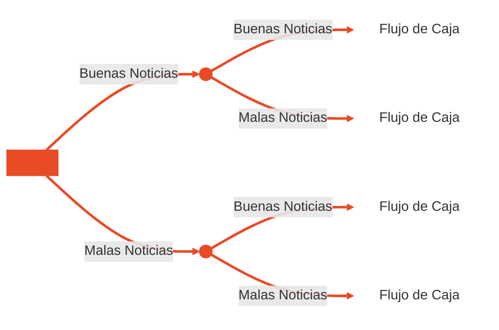
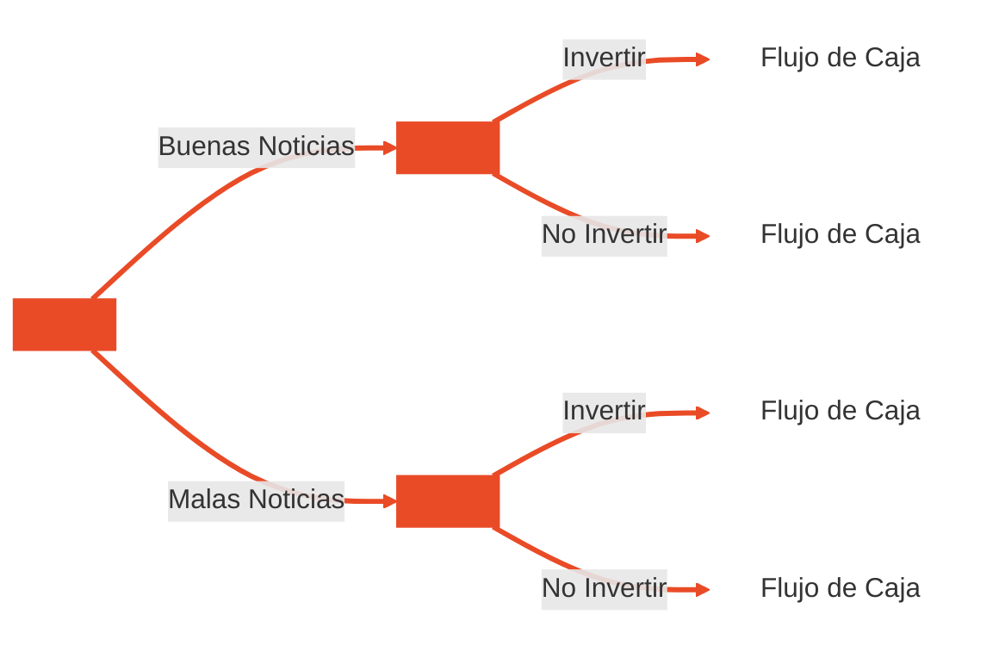

## Introducción

En esta unidad vamos a aplicar la teoría de valuación de opciones que vimos previamente a la **valuación de proyectos**. Para motivar el tema, partimos de un caso concreto que vamos a retomar a lo largo de toda la unidad.

Puna Litio S.A. evalúa construir una planta de carbonato de litio en el NOA. En 2026 el precio del litio subió con fuerza en el primer semestre y se espera una moderación en el segundo, por lo que su evolución futura es incierta. La empresa tiene derechos exclusivos sobre el salar y puede decidir hoy o dentro de un año sin perderlos. Los números del proyecto, en US$ millones, son los siguientes:
- Inversión requerida: $\$105$
- VP de los flujos esperados hoy: $\$100$
- VAN hoy: $\$100 - \$105 = -\$5$
- VP de los flujos en un año: $\$140$ si el precio se consolida o $\$70$ si se modera
- Tasa libre de riesgo: $5\%$ anual

Con el criterio tradicional no deberíamos aprobar la planta, pues el VAN de invertir hoy es negativo. Sin embargo, la empresa no está obligada a decidir hoy. Si espera un año, puede invertir solo en el escenario favorable, obteniendo $\$140 - \$105 = \$35$, y no invertir en el desfavorable, donde el resultado es $\$0$ en lugar de una pérdida de $\$70 - \$105 = -\$35$. Esperar elimina el escenario negativo y conserva el positivo, por lo que el derecho a decidir más adelante tiene un **valor propio**.

Para saber cuánto estaríamos dispuestos a pagar por ese derecho hay que valuar la **opción de esperar**. Como su pago máximo es de $\$35$, nunca podría valer más que eso, y su valor hoy surge de ponderar ambos escenarios y descontarlos, como veremos más adelante. Si ese valor supera al VAN de invertir hoy, de $-\$5$, conviene esperar. Ahora bien, si un competidor puede invertir primero, la opción de esperar ya no vale lo mismo, porque nos quitará parte del mercado. Lo que se pierde por no invertir de inmediato es el **costo de esperar**, y reduce el valor de la opción.

---
## Métodos Tradicionales de Evaluación de Proyectos

Los métodos tradicionales de evaluación de proyectos, como el VAN basado en flujos de fondos descontados, tienen dos fortalezas centrales. Primero, incorporan el **riesgo** a través de la tasa de descuento (TREMA). Cuanto más riesgoso es el proyecto, mayor es la tasa que se exige y, por lo tanto, menor el valor presente de los flujos futuros. Segundo, consideran el **timing de los flujos**, es decir, reconocen que no es lo mismo recibir un peso hoy que dentro de varios años, ya que cada flujo se descuenta según el momento en que ocurre.

Sin embargo, estos métodos tienen limitaciones. Se apoyan implícitamente en un único escenario esperado, proyectando flujos promedio y asumiendo que la empresa se compromete desde el inicio con una estrategia operacional fija, sin margen para cambiar el rumbo a medida que se revela nueva información. Esto deja afuera la flexibilidad que tiene la gerencia para reaccionar ante distintos escenarios.

Además, el proyecto se evalúa como una oportunidad de inversión independiente, aislada del resto de las decisiones de la empresa. No se tiene en cuenta que un proyecto puede abrir o condicionar oportunidades futuras, por lo que su valor estratégico puede quedar subestimado en el análisis.

El riesgo y el **tiempo** están estrechamente vinculados. El tiempo transforma al riesgo, y la naturaleza de ese riesgo depende del horizonte que se esté considerando. Un mismo proyecto no presenta la misma incertidumbre si se lo mira a corto o a largo plazo, y esta relación cobra mayor importancia cuando las decisiones son irreversibles, ya que una vez comprometida la inversión no hay forma de volver atrás sin costo.

En la práctica, los flujos de fondos de un proyecto van a diferir de lo previsto. A medida que pasa el tiempo llega nueva información y la incertidumbre sobre los flujos futuros se va resolviendo gradualmente. Esto le permite a la gerencia descubrir que tiene flexibilidad para apartarse de la estrategia operacional planteada al inicio o revisarla, adaptando sus decisiones a cómo evolucionan las condiciones reales del proyecto. Justamente esta flexibilidad es la que los métodos tradicionales no capturan, porque asumen un compromiso fijo con una única estrategia.

Al analizar inversiones, es común que la gerencia haga referencia a elementos como los “intangibles”, las “decisiones estratégicas” o la “flexibilidad”. Son aspectos que no aparecen reflejados de forma directa en los flujos de fondos proyectados, pero que en muchos casos terminan siendo la clave a la hora de decidir si se avanza o no con un proyecto.

El valor de estos intangibles está en que le permiten a la gerencia agregar valor a un proyecto por dos vías, aumentando las ganancias cuando las condiciones resultan favorables, o mitigando las pérdidas cuando resultan adversas. Es decir, la capacidad de reaccionar ante la nueva información que va surgiendo tiene un valor en sí misma, y ese valor es el que los métodos tradicionales dejan fuera del análisis.

Los métodos tradicionales de evaluación presentan tres problemas principales:
- Uso estático: La evaluación tradicional asume que, una vez realizada la inversión, el directivo cumple un rol pasivo: decide invertir o no invertir y luego mira los resultados.
- No tienen en cuenta la ventaja competitiva ni las oportunidades futuras: Desestima las oportunidades estratégicas que abre un proyecto, subvalorando la corriente de ingresos futuros que genera.
- No tienen en cuenta la flexibilidad de la gerencia: El directivo puede agregar valor tomando decisiones a medida que se va develando la incertidumbre, eligiendo la mejor alternativa en cada escenario posible.

---
## Opciones Reales

Los desarrollos recientes en **opciones reales** revolucionaron el campo de la evaluación de proyectos, porque ofrecen una respuesta a las limitaciones de los métodos tradicionales. Su aporte central es que permiten ponerle un valor concreto a aquello que antes la gerencia mencionaba como intangible.

Las técnicas que provienen de la valoración de opciones son capaces de cuantificar elementos complejos como la flexibilidad operativa y las interacciones estratégicas. La primera se refiere a la posibilidad de modificar el curso del proyecto a medida que se resuelve la incertidumbre, mientras que la segunda tiene que ver con las oportunidades futuras y la ventaja competitiva que un proyecto puede generar. De esta manera, aspectos que el enfoque tradicional dejaba fuera del análisis pasan a formar parte del valor del proyecto.

El enfoque de opciones reales parte de la idea de que toda decisión de inversión lleva implícita una serie de opciones que la gerencia puede ejercer a lo largo de la vida del proyecto. Estas opciones no aparecen en un análisis tradicional, pero forman parte del valor real de la inversión porque le dan a la empresa margen para reaccionar ante la nueva información.
- Diferir el proyecto
- Ampliar la capacidad
- Abandonar
- Ejecutarlo en etapas
- Modificar precios y costos

---
## Árboles

La metodología tradicional puede representarse mediante un **árbol de probabilidades**. En este tipo de árbol, después de la decisión inicial de invertir, todos los nodos siguientes son eventos de azar, en los que pueden ocurrir buenas o malas noticias con cierta probabilidad. Cada camino posible termina en un flujo de caja distinto, pero la gerencia no tiene ninguna intervención en el recorrido, por lo que su rol es pasivo y se limita a observar qué escenario termina ocurriendo.


El enfoque de opciones reales, en cambio, se representa con un **árbol de decisión**. Acá también hay eventos de azar, pero después de que se revela la información aparecen nuevos nodos de decisión en los que la gerencia elige qué hacer, por ejemplo invertir o no invertir. Cada alternativa conduce a un flujo de caja diferente, y en cada escenario se puede optar por la que resulte más conveniente.


La diferencia entre ambos árboles refleja la diferencia entre los dos enfoques. Mientras el árbol de probabilidades asume un compromiso fijo desde el inicio, el árbol de decisión incorpora la flexibilidad de la gerencia para aprovechar los escenarios favorables y evitar comprometer recursos en los desfavorables, y ese margen de decisión es lo que le agrega valor al proyecto.

La flexibilidad de la gerencia para adaptar sus acciones dependiendo del contexto futuro introduce una **asimetría** en la distribución de probabilidades de VAN que aumenta el verdadero valor de la oportunidad de inversión al mejorar su potencial de suba y limitar el potencial de baja en relación a las expectativas iniciales.

El valor de las opciones provistas por flexibilidad operacional y estratégica no puede ser capturado mediante técnicas tradicionales dada la naturaleza discrecional de estas opciones y su dependencia de eventos futuros que son inciertos al momento de la decisión inicial. Se pueden analizar estos aspectos si se ve a las oportunidades de inversión como colecciones de opciones sobre activos reales.

---
## Proyectos Como Opciones

Las opciones reales toman su nombre de las opciones financieras, porque las decisiones que puede tomar la gerencia sobre un proyecto se comportan de forma similar. Tener la posibilidad de invertir en un proyecto en el futuro es comparable a tener una opción para comprar una acción de una empresa, es decir, un call. Quien tiene un call tiene el derecho, pero no la obligación, de comprar, y del mismo modo la empresa puede decidir invertir solo si las condiciones resultan favorables. Bajo esta lógica, tanto la opción de expandirse como la de esperar pueden verse como un call.

En sentido inverso, la posibilidad de retirarse de una inversión es análoga a tener una opción para vender una acción, es decir, un put. El put da el derecho, pero no la obligación, de vender, lo que permite protegerse frente a escenarios desfavorables. Por eso la opción de abandonar un proyecto puede entenderse como un put, ya que le permite a la empresa salir de la inversión y limitar sus pérdidas si los resultados no acompañan.

Como dijimos, así como el poseedor de un Call sobre un activo financiero tiene el derecho de comprar el activo subyacente a un determinado precio de ejercicio en cualquier momento previo a la fecha de expiración y ejercerá la opción sólo si es en su interés hacerlo, también hará lo mismo el poseedor de una opción sobre activos reales.

Quien dispone de una oportunidad de inversión tiene el derecho de adquirir el valor actualizado de los flujos de caja esperados al invertir antes del momento en que deje de existir la oportunidad.

---
## Opción: Esperar

Retomemos el ejemplo que vimos al principio. Allí se evalúa un proyecto cuyo valor presente de flujos hoy es de $\$100$ y que requiere una inversión de $\$105$. Con el criterio tradicional el VAN es $\$100$ menos $\$105$, es decir, $-\$5$, por lo que el proyecto se rechazaría. Sin embargo, si la empresa tiene la posibilidad de postergar la decisión un año, el análisis cambia, porque puede esperar a ver cómo evoluciona el valor del proyecto antes de comprometer la inversión.

Se supone que en un año el valor del proyecto puede subir a $\$140$ o bajar a $\$70$. Para valuar la opción se utiliza la probabilidad neutral al riesgo, que se calcula como el valor actual capitalizado a la tasa libre de riesgo ($\$100 \cdot 1.05 = \$105$) menos el valor en el escenario malo, dividido por la diferencia entre ambos escenarios. Esto da $(\$105 - \$70) / (\$140 - \$70) = 50\%$. Conviene notar que el $\$105$ de esta fórmula proviene de capitalizar $V_0$ y no de la inversión requerida, aunque en este caso los números coincidan.

Si el valor sube a $\$140$, conviene invertir y se obtiene $\$140 - \$105 = \$35$. Si baja a $\$70$, no se invierte y la opción vale $\$0$, evitando así una pérdida. El valor esperado de la opción en un año es $50\%$ por $\$35$ más $50\%$ por $\$0$, es decir, $\$17.5$, que descontado a la tasa libre de riesgo da $\$17.5 / 1.05 \approx \$16.67$ hoy. Esto significa que un proyecto que con el VAN tradicional se rechazaba pasa a tener un valor positivo cuando se considera la opción de esperar, porque la empresa solo invierte en el escenario favorable.
![[Pasted image 20261014135425.png|center|367]]

La opción de esperar se valúa como un call, ponderando el pago de cada escenario por su probabilidad neutral al riesgo y descontando el resultado a la tasa libre de riesgo.
$$
\text{Call} = \frac{q \cdot \text{Pago}_{\text{sube}} + (1 - q) \cdot \text{Pago}_{\text{baja}}}{1 + r}
$$
Reemplazando con los datos del ejemplo se obtiene el valor de la opción. Como se trabaja con probabilidades neutrales al riesgo, el descuento se hace a la tasa libre de riesgo y no a una tasa ajustada por riesgo.
$$
Call = \frac{0.5 \cdot \$35 + 0.5 \cdot \$0}{1.05} = \$16.67
$$

La comparación entre ambos enfoques es clara. Invertir hoy implica un VAN tradicional de $-\$5$, mientras que conservar la posibilidad de esperar un año vale $\$16.67$. Por lo tanto, la decisión óptima es diferir el proyecto y solo invertir si el valor sube a $\$140$, ya que la flexibilidad de decidir con más información convierte un proyecto que se rechazaba en una oportunidad con valor positivo.

---
## Opción: Abandonar

Tomemos el mismo caso, pero con una diferencia en el tipo de flexibilidad. Ahora, la empresa invierte hoy pero en $t = 1$ puede abandonar el proyecto y vender sus activos por un valor de rescate de $\$90$. Esta opción de abandono funciona como un put con precio de ejercicio $\$90$.

Si el valor sube a $\$140$, conviene continuar con el proyecto. Si baja a $\$70$, conviene abandonar y vender los activos por $\$90$, ya que $\$90 > \$70$. El valor del proyecto con la opción se obtiene ponderando el mejor resultado de cada escenario y descontando a la tasa libre de riesgo.
$$
V_{\text{con\ opción}} = \frac{0.5 \cdot \$140 + 0.5 \cdot \$90}{1.05} = \$109.52
$$

El valor del put surge de la diferencia con el proyecto sin flexibilidad, o bien de valuar directamente su pago, que es $\$0$ si el valor sube y $\$90 - \$70 = \$20$ si baja.
$$
\text{Put} = \frac{0.5 \cdot \$0 + 0.5 \cdot \$20}{1.05} = \$9.52
$$

|                       | Sin opción | Con opción | Opción (put) |
| --------------------- | ---------- | ---------- | ------------ |
| Valor del proyecto    | $\$100.00$ | $\$109.52$ | $\$9.52$     |
| VAN (valor - $\$105$) | $-\$5.00$  | $+\$4.52$  | —            |

Sin flexibilidad el VAN es de $-\$5$ y el proyecto se rechaza, pero al incorporar la posibilidad de abandonar el VAN pasa a ser $\$109.52 - \$105 = \$4.52$. La opción de abandono limita la pérdida en el escenario desfavorable y, con eso, convierte un VAN negativo en positivo.

---
## Valuación de Opciones Reales

Para **valuar una opción real** se parte de la misma lógica que en las opciones sobre activos financieros, identificando en el proyecto el equivalente de cada una de las variables que determinan el valor de una opción.

|    Opción sobre activos financieros    |         Opción sobre activos reales         |
| :------------------------------------: | :-----------------------------------------: |
|         Precio spot del activo         |           VA de flujos esperados            |
|          Precio de ejercicio           |             Monto de inversión              |
|          Fecha de expiración           | Tiempo hasta que desaparezca la oportunidad |
| Incertidumbre acerca del precio futuro |         Incertidumbre acerca del VA         |
|      Tasa de descuento sin riesgo      |        Tasa de descuento sin riesgo         |

El activo subyacente en una opción real es el proyecto, y su valor es el **valor actual de los flujos de fondos esperados**. Cuanto mayor sea ese valor, mayor será el valor de una opción sobre los flujos del proyecto. Existe además una diferencia importante respecto de las opciones financieras, ya que el poseedor de una opción financiera no puede afectar el precio de la acción, mientras que el valor de un proyecto sí puede modificarse por acciones deliberadas de la gerencia.

El precio de ejercicio es el **monto que se invierte** para ejercer la opción cuando se trata de un call, o el monto que se recibe cuando se trata de un put. Cuanto mayor es el precio de ejercicio, menor es el valor de un call y mayor es el valor de un put, porque en el primer caso hay que desembolsar más para ejercer y en el segundo se recibe más al hacerlo.

El **tiempo a expiración** también incide positivamente, ya que a mayor tiempo hasta que la opción expire, mayor es su valor. Un plazo más largo permite resolver algunas o varias de las incertidumbres antes de tener que tomar una decisión.

La volatilidad del activo subyacente es otro determinante clave, y el valor de una opción es mayor cuanto mayor es el riesgo del proyecto. Un call genera pagos positivos en la medida en que el valor del activo supere el precio de ejercicio, y la probabilidad de que esto ocurra aumenta con la volatilidad, medida como desvío estándar. Cuando existe flexibilidad en la toma de decisiones, una mayor incertidumbre da la posibilidad de aprovechar las circunstancias favorables y, al mismo tiempo, acotar los perjuicios de los eventos desfavorables.

La tasa libre de riesgo afecta al valor de un call de forma positiva. Cuanto mayor es la tasa, menor es el valor presente de la inversión a realizar, y diferirla evita inmovilizar el capital.

Por último, los dividendos representan el costo de esperar. En una opción real son los flujos que se pierden por no invertir de inmediato, por ejemplo si un competidor invierte primero, y cuanto mayores sean, menor va a ser el valor de la opción de esperar.

|           Variable            |          En el Proyecto          | Call (esperar / expandir) | Put (abandonar) |
| :---------------------------: | :------------------------------: | :-----------------------: | :-------------: |
|    $S$ (valor del activo)     |    VP de los flujos esperados    |          ↑ sube           |     ↓ baja      |
|   $K$ (precio de ejercicio)   | Inversión (call) o rescate (put) |          ↓ baja           |     ↑ sube      |
|         $T$ (tiempo)          |    Plazo que se puede esperar    |          ↑ sube           |     ↑ sube      |
|    $\sigma$ (volatilidad)     |   Incertidumbre de los flujos    |          ↑ sube           |     ↑ sube      |
|  $r$ (tasa libre de riesgo)   |  Valor del dinero en el tiempo   |          ↑ sube           |     ↓ baja      |
| Dividendos / costo de esperar | Flujos que se pierden al diferir |          ↓ baja           |     ↑ sube      |

Cada variable afecta de manera distinta a un call y a un put. Un mayor valor del proyecto o una mayor tasa libre de riesgo favorecen al call y perjudican al put, mientras que un mayor precio de ejercicio o mayores flujos perdidos por esperar tienen el efecto contrario. El tiempo y la volatilidad, en cambio, aumentan el valor de ambos tipos de opción, porque dan más margen para que la incertidumbre se resuelva a favor de quien tiene la flexibilidad. Estos sentidos son generales, ya que el efecto del tiempo sobre un put puede depender del tipo de opción.

El efecto de la volatilidad se puede comprobar con el mismo árbol de los ejemplos anteriores. Si los escenarios se amplían de $\$140$ / $\$70$ a $\$150$ / $\$60$, la probabilidad neutral al riesgo sigue siendo $(\$105 - \$60) / (\$150 - \$60) = 50\%$, pero los pagos de las opciones cambian.
$$
Call = \frac{0.5 \cdot (\$150 - \$105) + 0.5 \cdot \$0}{1.05} = \$21.43
$$
$$
Put = \frac{0.5 \cdot \$0 + 0.5 \cdot (\$90 - \$60)}{1.05} = \$14.29
$$

Así, el valor de la opción de esperar sube de $\$16.67$ a $\$21.43$ y el de la opción de abandono de $\$9.52$ a $\$14.29$. La mayor dispersión mejora el escenario favorable que aprovecha el call y empeora el desfavorable del que protege el put, por lo que ambas opciones ganan valor.

---
## Aplicaciones de Opciones Reales

Las aplicaciones de las opciones reales pueden agruparse según el tipo de situación ante la cual le permiten reaccionar a la gerencia. Un primer grupo lo forman las **opciones de crecimiento** y las de **expansión de escala**, que responden a buenas noticias. Le dan a la empresa la posibilidad de aumentar su inversión o ampliar el proyecto cuando las condiciones resultan más favorables de lo esperado, y por eso se comportan como un call.

Un segundo grupo incluye las **opciones de esperar** y las **de cambiar**, que reaccionan ante cambios en el mercado. La opción de esperar permite postergar la decisión de inversión hasta que se resuelva parte de la incertidumbre, mientras que la de cambiar le da a la empresa margen para modificar la forma en que opera el proyecto a medida que evolucionan las condiciones.

El último grupo lo componen las **opciones de contraer la escala** y las de **abandonar**, que responden a malas noticias. Permiten reducir el tamaño del proyecto o salir directamente de la inversión cuando los resultados no acompañan, limitando así las pérdidas, y por eso se asocian a la lógica de un put.

Cada tipo de opción real puede asociarse a una pregunta concreta que se hace la gerencia al evaluar un proyecto. Entre los siguientes ejemplos, los de Los Toldos II Este de Tecpetrol y Fénix 1B de Rio Tinto son casos reales, mientras que el resto son ejemplos genéricos del sector.

| Opción             | Pregunta de la gerencia                                | Ejemplo en Argentina                                              | Tipo        |
| ------------------ | ------------------------------------------------------ | ----------------------------------------------------------------- | ----------- |
| Esperar (call)     | ¿Conviene diferir la inversión hasta tener más información? | Desarrollo de un área hidrocarburífera o minera cuando mejoran precios o reglas | Ilustrativo |
| Ejecutar en etapas | ¿Se puede frenar o ajustar tras la primera etapa?      | Los Toldos II Este (Tecpetrol), de 35 mil a 70 mil bpd             | Real        |
| Expandir (call)    | ¿Se puede ampliar si el mercado responde?              | Fénix 1B (Rio Tinto, litio), +9.5 mil t/año                        | Real        |
| Cambiar            | ¿Se puede alternar insumo, producto o proceso?         | Planta industrial que puede operar con distintos combustibles o productos | Ilustrativo |
| Contraer           | ¿Se puede reducir la escala si cae la demanda?         | Reducir equipos de perforación si cae el precio del crudo          | Ilustrativo |
| Abandonar (put)    | ¿Se puede salir y recuperar parte de la inversión?     | Venta o devolución de áreas de un yacimiento maduro                | Ilustrativo |

Los Toldos II Este es un proyecto de Tecpetrol en Vaca Muerta, aprobado bajo el RIGI en agosto de 2026, con una inversión proyectada de $\text{US\$ 6400 M}$. Se desarrolla en dos etapas, la primera con una producción de 35 mil barriles por día y la segunda, hacia mediados de 2027, llegando a 70 mil barriles por día, cerca del $10\%$ de la producción del país. Desde las opciones reales, el desarrollo en etapas funciona como una serie de calls, donde la Etapa 2 se ejerce solo si la Etapa 1 confirma la productividad de los pozos y el precio del crudo la justifica. En este caso $S$ es el VP de los ingresos de la Etapa 2, $K$ su inversión y $\sigma$ surge del precio del petróleo y el desempeño de los pozos. El RIGI aporta estabilidad regulatoria, lo que reduce una fuente de incertidumbre pero no la de mercado, y si el crudo fuera más volátil el valor de la opción aumentaría.

Rio Tinto comprometió más de $\text{US\$ 3630 M}$ en tres proyectos de litio en Argentina, que son Rincón en Salta ($\text{US\$ 2744 M}$, 60 mil t/año, primer proyecto minero bajo RIGI), Fénix 1B en Catamarca ($\text{US\$ 251.3 M}$) y Sal de Vida en Salta ($\text{US\$ 638 M}$, con primera producción en el 2T-2026). Fénix 1B es una opción de expansión, ya que suma 9.5 mil t/año sobre una operación existente hasta alcanzar 38 mil t/año totales, con un costo mucho menor al de un proyecto nuevo. Se ejerce cuando el valor presente de la ampliación supera la inversión ($S > K$), lo que depende del precio del litio, que es muy volátil. Con una $\sigma$ alta conviene tener la opción de ampliar en lugar de comprometer todo el capital desde el inicio.

---
## Valoración de Proyectos con Opciones Reales

La **valoración de un proyecto con opciones reales** parte del VAN básico calculado de forma tradicional, al que se le suma el valor de la opción y se le restan los costos asociados a obtenerla. $$
VAN_{\text{con\ opción}} = VAN_{\text{básico}} + \text{Valor de la opción} - \text{Costos asociados}
$$
Para ilustrarlo se toma el caso de la construcción de una planta industrial en la que ya se prevén, para dentro de tres años, inversiones que ampliarían su capacidad y le permitirían participar en nuevos mercados. Tomando todos los flujos en conjunto, el VAN del proyecto es de $-\$30$, por lo que con el criterio tradicional se rechazaría. Sin embargo, el proyecto contiene una opción cuyo valor debería tenerse en cuenta.

|             |    Año 0    |  Año 1   |   Año 2   |    Año 3    |   Año 4   |   Año 5   |   Año 6    |
| :---------: | :---------: | :------: | :-------: | :---------: | :-------: | :-------: | :--------: |
| Inversiones | $-\$155.00$ |          |           | $-\$382.00$ |           |           |            |
|  FF Total   | $-\$155.00$ | $\$9.00$ | $\$10.00$ | $-\$371.00$ | $\$34.60$ | $\$37.50$ | $\$651.00$ |

El primer paso es reconocer la opción, lo que se logra mirando los números y la descripción del proyecto, y examinando el patrón de los flujos de fondos proyectados. En este caso aparecen dos momentos de inversión bien diferenciados, uno en el año 0 y otro mucho mayor en el año 3, lo que indica que el proyecto puede separarse en dos fases. La segunda fase no tiene por qué ser obligatoria, sino que la empresa puede decidir en el año 3 si la ejecuta, por lo que se comporta como un call.
```tikz
\begin{document}
\begin{tikzpicture}[y=0.005cm, x=1cm]
  \definecolor{barra}{RGB}{153,153,255}

  % Título
  \node[font=\bfseries] at (4,950) {Flujo de Fondos};

  % Fondo gris
  \fill[gray!45] (0.5,-600) rectangle (7.5,800);

  % Líneas de grilla y etiquetas del eje Y
  \foreach \v in {-600,-400,...,800} {
    \draw[black] (0.5,\v) -- (7.5,\v);
    \node[left, font=\small] at (0.5,\v) {\v,00};
  }

  % Barras (período/valor)
  \foreach \x/\v in {1/-150, 2/5, 3/10, 4/-370, 5/35, 6/35, 7/650} {
    \draw[fill=barra] (\x-0.3,0) rectangle (\x+0.3,\v);
  }

  % Eje en cero
  \draw[thick] (0.5,0) -- (7.5,0);

  % Etiquetas de períodos
  \foreach \x in {1,...,7} {
    \node[below, font=\small] at (\x,0) {\x};
  }

  % Eje vertical
  \draw (0.5,-600) -- (0.5,800);
\end{tikzpicture}
\end{document}
```

```tikz
\begin{document}
\begin{tikzpicture}[y=0.01cm, x=1cm]
  \definecolor{barra}{RGB}{153,153,255}

  % Título
  \node[font=\bfseries] at (4,70) {Inversiones};

  % Fondo gris
  \fill[gray!45] (0.5,-450) rectangle (7.5,0);

  % Líneas de grilla y etiquetas negativas en rojo
  \foreach \v in {-450,-400,...,-50} {
    \draw[black] (0.5,\v) -- (7.5,\v);
    \node[left, font=\small, red] at (0.5,\v) {\v,00};
  }
  \node[left, font=\small] at (0.5,0) {0,00};

  % Barras (período/valor)
  \foreach \x/\v in {1/-155, 4/-380} {
    \draw[fill=barra] (\x-0.3,0) rectangle (\x+0.3,\v);
  }

  % Eje superior en cero con marcas entre categorías
  \draw[thick] (0.5,0) -- (7.5,0);
  \foreach \x in {0.5,1.5,...,7.5} {
    \draw (\x,0) -- (\x,-8);
  }

  % Etiquetas de períodos
  \foreach \x in {1,...,7} {
    \node[font=\small] at (\x,-40) {\x};
  }

  % Eje vertical
  \draw (0.5,-450) -- (0.5,0);
\end{tikzpicture}
\end{document}
```

$$
VAN_{\text{proyecto}} = VAN_{\text{Fase}\ 1} + Call_{\text{Fase}\ 2}
$$

El segundo paso consiste en identificar los componentes del call dentro del proyecto. El valor del activo subyacente es el valor de los flujos que se obtienen ejerciendo la opción, el precio de ejercicio es la inversión en los activos de la Fase 2, el tiempo para el ejercicio es de 3 años, la tasa libre de riesgo es del $5\%$ y el desvío estándar es del $40\%$ anual.

El tercer paso es preparar el flujo de caja separando ambas fases y asociando cada ingreso con la fase que lo genera.

|         | Año 0       | Año 1    | Año 2     | Año 3       | Año 4     | Año 5     | Año 6      | VAN        |
| ------- | ----------- | -------- | --------- | ----------- | --------- | --------- | ---------- | ---------- |
| Fase I  | $-\$155.00$ | $\$9.00$ | $\$10.00$ | $\$11.00$   | $\$11.50$ | $\$12.10$ | $\$203.70$ | $-\$13.80$ |
| Fase II | $\$0.00$    | $\$0.00$ | $\$0.00$  | $-\$382.00$ | $\$23.10$ | $\$25.40$ | $\$447.30$ | $-\$16.20$ |

Ninguna de las dos fases es rentable por separado bajo el criterio tradicional, y la suma de ambos VAN reproduce el $-\$30$ del proyecto completo.

El cuarto paso es obtener los valores del call a partir del flujo de la Fase II. El valor presente de sus flujos sin considerar la inversión es de $\$255.70$, y ese es el valor del activo subyacente $S$. La inversión del año 3, de $\$382.00$, es el precio de ejercicio $K$.

El quinto paso es encontrar el valor de la opción con todos los parámetros ya identificados.

|             Parámetro             |    Valor     |
| :-------------------------------: | :----------: |
| Valor del activo subyacente ($S$) |  $\$255.70$  |
|     Precio de ejercicio ($K$)     |  $\$382.00$  |
|  Tiempo para el ejercicio ($t$)   |    3 años    |
|    Tasa libre de riesgo ($r$)     |    $5\%$     |
|    Desvío estándar ($\sigma$)     | $40\%$ anual |

Con estos datos el valor de la opción es de $\$47.56$. Las diapositivas solo informan el resultado, que coincide con el que se obtiene aplicando el modelo de Black-Scholes con tasa continua.
$$
C = S \cdot N(d_1) - K e^{-rt} \cdot N(d_2)
$$
$$
d_1 = \frac{\ln(S/K) + (r + \sigma^2/2)\,t}{\sigma \sqrt{t}} \qquad d_2 = d_1 - \sigma \sqrt{t}
$$

Finalmente se comparan ambos enfoques. El VAN estándar trata la Fase 2 como obligatoria y suma los dos VAN, mientras que el VAN con opción reemplaza el VAN de la Fase 2 por el valor del call.
$$
VAN_{\text{estándar}} = VAN_{\text{Fase}\ 1} + VAN_{\text{Fase}\ 2} = -\$13.8 - \$16.2 = -\$30
$$
$$
VAN_{\text{con opción}} = VAN_{\text{Fase}\ 1} + Call_{\text{Fase}\ 2} = -\$13.8 + \$47.56 = \$33.8
$$

```tikz
\begin{document}
\begin{tikzpicture}[y=0.1cm, x=1cm]
  \definecolor{verde}{RGB}{70,125,60}

  % Barra VAN estándar (negativa, sin relleno)
  \draw[fill=white] (0.6,0) rectangle (2.4,-30);
  \node[below, font=\bfseries\large] at (1.5,-30) {-30,0};

  % Barra VAN con opción (positiva, verde)
  \fill[verde] (3.6,0) rectangle (5.4,33.8);
  \node[above, font=\bfseries\large] at (4.5,33.8) {33,8};

  % Eje horizontal con marcas
  \draw (0,0) -- (6,0);
  \foreach \x in {0,3,6} {
    \draw (\x,0) -- (\x,-1.5);
  }

  % Etiquetas de categorías
  \node at (1.5,-50) {VAN est\'andar};
  \node at (4.5,-50) {VAN con opci\'on};
\end{tikzpicture}
\end{document}
```

La diferencia entre ambos resultados es de $\$63.8$, que surge de $\$47.56 - (-\$16.2)$, es decir, del valor del call menos el VAN estándar de la Fase 2. La decisión correcta es aprobar la Fase 1 y, en el año 3, ejecutar la Fase 2 solo si $S$ supera a $K$, conservando así el derecho a decidir en lugar de comprometerse desde el inicio.

En síntesis, valuar un proyecto con opciones reales sigue una secuencia de cinco pasos:
1. **Reconocer** la opción en los flujos y la descripción del proyecto.
2. **Mapear** $S$, $K$, $T$, $r$ y $σ$ del proyecto.
3. **Separar** los flujos de cada fase.
4. **Valuar** con Black-Scholes o binomial.
5. **Decidir** comparar con el VAN tradicional.

Esto toma como idea central lo que ya estudiamos de que la flexibilidad es asimétrica, pues permite aprovechar lo favorable y limitar lo desfavorable. Cuanto mayor la incertidumbre y más tiempo para decidir, más vale esa flexibilidad.

---
## Limitaciones y Buenas Prácticas

El enfoque de opciones reales tiene limitaciones que conviene tener presentes al aplicarlo, ya que el valor que se obtiene depende en gran medida de los supuestos utilizados.

Cuidado con
- La volatilidad de un proyecto, que es difícil de estimar, por lo que conviene hacer análisis de sensibilidad sobre $\sigma$.
- Los supuestos de Black-Scholes, que considera un ejercicio único al vencimiento y la ausencia de pagos intermedios.
- La interacción entre opciones, porque el valor de varias opciones juntas no es la suma del valor de cada una por separado.
- Los competidores, ya que si comparten la misma opción la espera puede perder valor.
- La capacidad de ejercicio, dado que una opción solo vale si la gerencia puede y quiere ejercerla.

Buenas prácticas:
- Reconocer primero la opción y determinar su tipo (call o put).
- Mapear $S$, $K$, $T$, $r$ y $\sigma$ con datos concretos del proyecto.
- Usar un árbol binomial cuando hay ejercicio anticipado o decisiones por etapas.
- Comparar siempre el resultado con el VAN tradicional.
- Documentar los supuestos, porque el resultado es tan bueno como ellos.